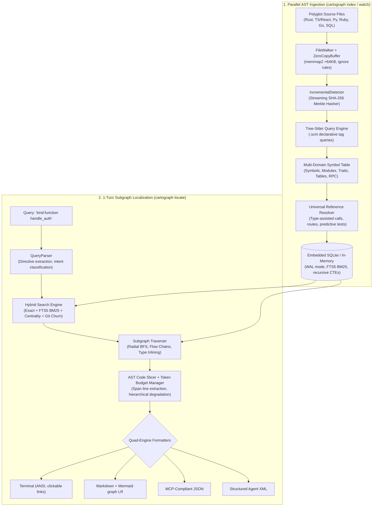
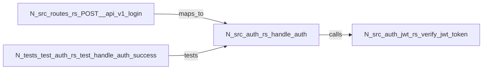

# 🗺️ Cartograph

<p align="center">
  <strong>The Ultra-Fast Native AST Code Graph & 1-Turn Subgraph Localization Engine</strong>
</p>

<p align="center">
  <a href="https://github.com/PankajRedekar/cartograph/actions"></a>
  <a href="https://www.rust-lang.org/"></a>
  <a href="ROADMAP.md"></a>
  <a href="https://pypi.org/project/cartograph/"></a>
  <a href="https://pypi.org/project/cartograph/"></a>
  <a href="openspec/specs/"></a>
  <a href="LICENSE"></a>
</p>

---

## ⚡ The Problem: The AI Agent Context Dilemma

Modern software development with AI agents (Claude Code, Cursor, Windsurf, Copilot) suffers from an expensive and slow context retrieval loop:
- **Blind Grep Loops**: Agents spend dozens of turns and hundreds of thousands of tokens running brute-force text search (`grep`, `rg`, `find`), attempting to stitch together caller/callee relationships manually.
- **Fragmented Context**: Raw text matching lacks structural awareness—it confuses variable names with function declarations, misses cross-file interface implementations, and cannot trace execution flow across architectural layers.
- **Token Exhaustion**: Feeding entire files into prompt context windows quickly burns rate limits and budget ceilings while degrading model reasoning.

**Cartograph solves this in a single turn.** By parsing multi-language source code into an embedded, highly optimized AST structural graph database (`cartograph.db`), Cartograph enables **sub-3ms 1-turn subgraph localization (`cartograph locate`)** and **sub-25ms blast-radius impact analysis (`cartograph impact`)**. It extracts exact symbol definitions, bidirectional callers/callees, inlined type contracts, predictive test coverage, breaking changes, and token-budgeted code slices in one deterministic shot.

---

## 🚀 Key Highlights & Capabilities

| Feature | Description | Performance |
| :--- | :--- | :--- |
| **🔥 God-Class & Complexity Heatmap** | Polyglot Cyclomatic/Cognitive complexity, LCOM4 cohesion graph with decomposition advisor, Adam Tornhill 4-Quadrant churn correlation, Complexity-to-Test Deficit ("Danger Zone"), AI Context Friction (CCR), and standalone interactive HTML dashboard. | **< 10ms** |
| **💥 Blast-Radius Impact Analysis** | Reverse transitive dependency propagation, AST-grounded git diff mapping, SemVer 2.0 release guard, God-object coupling smell detector, and speculative refactoring simulations. | **< 25ms** |
| **⚡ Sub-3ms 1-Turn Localization** | Resolves queries directly into localized subgraphs containing target symbols, callers, callees, and code snippets in a single command. | **< 3ms** |
| **🧠 Centrality- & Churn-Aware Search** | Blends exact matching, qualified scope (`Scope::name`), column-weighted FTS5 BM25, topological degree centrality ($S_{\text{centrality}}$), and git churn velocity ($B_{\text{churn}}$). | **< 1ms** |
| **🔄 Bi-Directional Subgraph Traversal** | Explores upstream callers (`Incoming`), downstream callees (`Outgoing`), cross-domain route mappings (`MapsTo`), and predictive tests (`Tests`) up to depth $N$. | **< 0.8ms** |
| **🛤️ Execution Flow Tracing (`--flow`)** | Traces linear execution pathways across architecture layers: `Route` $\to$ `Handler` $\to$ `Service` $\to$ `Model`. | **< 1.5ms** |
| **📐 Type-Contract Inlining (`--resolve-types`)** | Automatically inlines schema definitions of parameter and return types for function signatures without extra lookups. | **< 0.5ms** |
| **🛡️ Hierarchical AI Token Budgeting** | Guarantees hard token limits (`--max-tokens <N>`) with 3-tier degradation: preserves root symbols and type contracts, then collapses neighbor bodies to signatures, retaining 100% graph topology. | Zero token blowup |
| **🎨 Quad-Engine Presentation Layer** | Emits **Terminal UI** (ANSI badges, clickable `file:line` links), **Markdown** (with embedded Mermaid `graph LR` / `graph TD`), **MCP JSON** (AI tool format), and **Agent XML** (`<code_context>`, `<blast_radius_analysis>`). | Native |
| **⚡ Real-Time Incremental Watcher** | Real-time file system watcher (`cartograph watch`) with CST caching, SHA-256 Merkle diffing, and sub-0.5ms reverse blast-radius impact warnings on save. | **< 10ms** |
| **📋 Business Logic & Rule Extractor** | AST-grounded validation rule extractor with variable def-use provenance slicing, zero-LLM natural language verbalizer, Gherkin/BDD synthesizer, decision tables, inter-procedural deep tracing, and Git PR rule diff gating. | **< 15ms** |
| **🤖 Contract-Aware AI Reviewer** | Zero-lockin Git-native PR review (<50ms offline), AST public contract breaks, 2nd-hop caller side-effects, risk scoring (0-100), cognitive ΔCC spikes, review memory, in-code pragma suppressions, Keep-a-Changelog synthesis, safe patch application (`git apply --check --unidiff-zero`), and interactive split-pane review TUI. | **< 50ms offline** |
| **📊 Visual Diagram Exporter** | Automated, AST-grounded architectural diagrams, targeted call-graph execution flows, polyglot entity-relationship (ER) schemas, fullstack request sequence traces, business logic flowcharts, PR blast-radius diffs, and DDD concept clusters with a zero-external-dependency pure-Rust Sugiyama layout engine, interactive terminal UI canvas, and universal export formats. | **< 5ms** |
| **🐍 Native Python SDK & Data Science** | Native CPython bindings via PyO3 0.22, zero-copy Arrow/DataFrame export (Polars/Pandas), direct NetworkX DiGraph & igraph streaming, and async non-blocking execution (`cartograph.aio`). | **< 1ms** |
| **🌐 Polyglot Language Engine** | Native Tree-Sitter parsing for **Rust, TypeScript / TSX, Python, Ruby / Rails, Go, SQL, Markdown**. | Zero daemon required |

---

## 🏗️ Architecture & Pipeline



---

## 📦 Installation & Setup

### Prerequisites
- [Rust 1.70+](https://www.rust-lang.org/tools/install) (Edition 2024 supported)
- Git

### Build & Install from Source
```bash
# Clone the repository
git clone https://github.com/PankajRedekar/cartograph.git
cd cartograph

# Build release binaries
cargo build --release

# Install 'cartograph' CLI directly to your cargo bin path (~/.cargo/bin)
cargo install --path crates/cartograph-cli
```

Verify installation:
```bash
cartograph --version
# cartograph 0.2.0
```

---

## 💻 CLI Command Reference

### 1. `cartograph index` — High-Speed Code Graph Indexing
Scans and parses repository source files into `.cartograph/cartograph.db`.

```bash
# Full repository index (default database: .cartograph/cartograph.db)
cartograph index .

# Force re-indexing of all files (bypassing incremental cache)
cartograph index . --force

# Fast pre-commit index: index ONLY git staged files (<10ms)
cartograph index . --staged

# Index only files modified between git branches
cartograph index . --branch "origin/main...HEAD"

# Specify custom worker threads or database profile
cartograph index . --threads 8 --db analytics

# Output indexing metrics as JSON (for CI/CD pipelines)
cartograph index . --json
```

**Example Output:**
```
🗺️  Cartograph — High-Speed Native AST Code Graph Engine
Repository: /Users/dev/my-project
Database:   /Users/dev/my-project/.cartograph/cartograph.db

━━━━━━━━━━━━━━━━━━━━━━━━━━━━━━━━━━━━━━━━━━━━━━━━━━━━━━━━━━━━
  Metric                                            Value
────────────────────────────────────────────────────────────
  Files Scanned                                       342
  Files Indexed                         342 (0 unchanged)
  Files Deleted                                         0
  AST Nodes Stored                                   4,280
  Graph Edges Stored                                3,190
  Duration                                         184 ms
━━━━━━━━━━━━━━━━━━━━━━━━━━━━━━━━━━━━━━━━━━━━━━━━━━━━━━━━━━━━
✨ Indexing completed successfully in 184 ms.
```

---

### 2. `cartograph locate` — 1-Turn Subgraph Localization
The primary command for developers and AI coding agents. Retrieves target symbols, call hierarchies, route mappings, inlined type contracts, and code slices.

```bash
cartograph locate [OPTIONS] <QUERY> [PATH]
```

#### In-Query Directives
Directives can be included directly in the query string or passed via CLI flags:
- `kind:<KIND>`: Filter target symbol AST kind (`function`, `method`, `class`, `struct`, `interface`, `route`, `model`).
- `path:<PREFIX>`: Filter target symbols by filepath substring (e.g. `path:src/auth`).
- `lang:<LANG>`: Filter by language (`rust`, `typescript`, `python`, `ruby`, `go`).
- `min-conf:<FLOAT>`: Minimum edge confidence threshold (`0.0` to `1.0`).
- `depth:<INT>`: BFS traversal depth (default: `1`).

#### Core Flags
| Flag | Description | Default |
| :--- | :--- | :--- |
| `-D, --depth <INT>` | BFS subgraph traversal neighborhood depth | `1` |
| `--flow` | Enable end-to-end execution flow tracing across layers | `false` |
| `--direction <DIR>` | Traversal direction: `in` (callers), `out` (callees), `both` | `both` |
| `-e, --edges <LIST>` | Comma-separated edge kinds to follow (`Calls,MapsTo,Tests,Imports`) | All |
| `--min-confidence <F>` | Filter edges below confidence threshold | `0.0` |
| `--resolve-types` | Automatically inline parameter and return type contract schemas | `false` |
| `--detail <TIER>` | Context density tier: `minimal`, `signatures`, `full` | `full` |
| `--code <BOOL>` | Include source code implementation slices (`--code false` to omit) | `true` |
| `-C, --context <INT>` | Extra lines of source context padding before/after target | `3` |
| `-m, --max-tokens <INT>`| AI token budget ceiling with hierarchical degradation | `None` |
| `-f, --format <FMT>` | Output format: `terminal`, `markdown`, `json`, `xml` | Auto (TTY: terminal, pipe: json) |
| `-i, --interactive` | Interactive terminal disambiguation prompt on multiple candidate matches | `false` |

#### Common Usage Examples

##### A. Instant Symbol Call Hierarchy with Inlined Code
```bash
cartograph locate handle_auth
```
*Locates `handle_auth`, its upstream middleware callers, downstream JWT verification callees, and highlights the function body with line numbers.*

##### B. Scoped Search with Inline Directives
```bash
cartograph locate "kind:struct path:crates/cartograph-engine SubgraphLocator"
```
*Filters search specifically to structs within the engine crate, ignoring functions or variables with similar names.*

##### C. End-to-End Execution Flow Tracing (`--flow`)
```bash
cartograph locate "POST /api/v1/orders" --flow --direction out
```
*Traces the execution pipeline sequentially: Route Endpoint $\to$ Controller Handler $\to$ Order Service $\to$ Payment Gateway $\to$ Database Model.*

##### D. Type-Contract Inlining (`--resolve-types`)
```bash
cartograph locate process_payment --resolve-types
```
*Pulls `process_payment`, its callers/callees, and automatically inlines the structural schemas of `PaymentRequest` and `PaymentReceipt`.*

##### E. AI Token Budgeting for Claude / GPT Prompts
```bash
cartograph locate OrderService --max-tokens 2500 --format xml
```
*Packages `OrderService` and its dependencies strictly under 2,500 tokens into `<code_context>` XML tags.*

##### F. Markdown with Mermaid Flowchart (for GitHub PRs / Issues)
```bash
cartograph locate AuthService --format markdown
```

##### G. MCP-Compliant JSON for AI IDE Agents
```bash
cartograph locate verify_token --format json
```

---

### 3. `cartograph impact` — Blast-Radius Impact & Risk Analysis
Analyzes downstream callers, breaking changes, architectural coupling smells, and CI risk metrics for code changes or git pull requests in **<25ms**.

```bash
cartograph impact [OPTIONS] [TARGET] [PATH]
```

#### Core Flags & Options
| Flag | Description | Default |
| :--- | :--- | :--- |
| `[TARGET]` or `-t, --target` | Target symbol query, scope, or filepath | Optional if `--branch` or `--staged` |
| `--branch <RANGE>` | Analyze git branch diff range (e.g. `main...HEAD` or `origin/main...HEAD`) | `None` |
| `--staged` | Analyze uncommitted git staged changes | `false` |
| `--verify-semver <TARGET>`| Enforce Semantic Versioning 2.0 release policy (`patch`, `minor`, `major`) | `None` |
| `--simulate-delete <SYM>` | Speculatively model deleting a symbol before modifying code | `None` |
| `--simulate-rename <A:B>` | Speculatively model renaming a symbol (`old_name:new_name`) | `None` |
| `-D, --depth <INT>` | Maximum reverse traversal depth | `3` |
| `--direction <DIR>` | Traversal direction: `dependents` (callers), `dependencies` (callees), `both` | `dependents` |
| `--min-confidence <F>` | Minimum edge confidence threshold (0.0 to 1.0) | `0.0` |
| `--no-damping` | Disable utility damping on high-degree nodes | `false` |
| `--fail-on <LEVEL>` | **CI Gate**: Exit with code 1 if risk meets or exceeds `low`, `medium`, `high`, `critical` | `None` |
| `--min-test-coverage <F>`| **CI Gate**: Exit with code 1 if impacted test coverage ratio falls below threshold | `None` |
| `-f, --format <FMT>` | Output format: `terminal`, `markdown`, `json`, `xml` | Auto |

#### Common Usage Scenarios

##### A. Direct Symbol Impact Analysis
```bash
cartograph impact "PaymentGateway"
```
*Traces all upstream callers, affected routes, models, and tests across multiple hops.*

##### B. Pull Request Diff Blast-Radius (GitHub / GitLab CI)
```bash
cartograph impact --branch "origin/main...HEAD" --format markdown
```
*Parses unified diff hunks, maps them to AST symbols, classifies modifications (`DocstringOnly`, `BodyOnly`, `SignatureBreak`), and generates a PR review table with Mermaid graph.*

##### C. Pre-Commit Hook Staged Changes
```bash
cartograph impact --staged
```
*Inspects staged files in <15ms before committing to ensure no unintended breaking changes.*

##### D. Automated SemVer 2.0 Release Guard
```bash
cartograph impact --branch main...HEAD --verify-semver minor
```
*Fails with exit code 1 if any public API breaking change is detected under a requested `minor` or `patch` release target.*

##### E. Speculative Refactoring Simulation (Zero Code Edits)
```bash
cartograph impact --simulate-delete "LegacyAuthHandler"
```
*Simulates removing a symbol to discover all breakages, call sites, and necessary refactoring tasks before touching code.*

##### F. CI/CD Risk Quality Gating
```bash
cartograph impact --branch origin/main...HEAD --fail-on high --min-test-coverage 0.8
```
*Enforces engineering standards in CI: blocks merge if risk score exceeds High or if affected nodes have less than 80% test coverage.*

#### Example Terminal Output (`--format terminal`)
```
💥 Cartograph Blast-Radius Impact Analysis
Query: PaymentGateway::charge (depth: 3, dependents)

━━━━━━━━━━━━━━━━━━━━━━━━━━━━━━━━━━━━━━━━━━━━━━━━━━━━━━━━━━━━
  Impact Risk Score: 78 / 100 [CRITICAL] ▇▇▇▇▇▇▇▇░░
  Affected Nodes: 14 symbols across 6 files
  Impacted Call Sites: 9 locations
  Test Coverage: 64.3% (9 of 14 nodes covered)
━━━━━━━━━━━━━━━━━━━━━━━━━━━━━━━━━━━━━━━━━━━━━━━━━━━━━━━━━━━━

⚠️  SemVer 2.0 Release Policy: VIOLATION
    Policy: minor | Detected: MAJOR BREAKING CHANGE
    Reason: Public exported method 'PaymentGateway::charge' signature changed

🚨 Architectural Coupling Smells:
    • God-Object ISP Warning on 'PaymentGateway'
      Coupling Concentration Ratio: 68.4% across 4 distinct subsystems:
      auth, checkout, subscriptions, analytics
      Recommendation: Split into segregated interfaces (e.g. Chargeable, Subscribable)

📍 Critical Call Sites & AI Remediation Hints:
    • src/checkout/order.rs:88:13 — order.process_payment()
      Old: charge(&self, amount: u64) -> Result<()>
      New: charge(&self, amount: u64, currency: Currency) -> Result<()>
      Hint: Pass currency argument: order.process_payment(Currency::USD)
    • src/subscriptions/recurring.rs:42:9 — gateway.charge()

🧪 Suggested Test Verification Command:
    cargo test --test test_checkout --test test_payment_gateway
```

---

### 4. `cartograph watch` — Real-Time File Watcher
Watches the workspace in the background and updates the code graph incrementally on file save (<10ms).

```bash
cartograph watch .
```
- **Debounce Window**: 25ms debounce window avoids thrashing during multi-file git checkouts.
- **Reverse Blast Radius**: Instantly calculates and warns if editing a file breaks downstream dependencies.

**Example Watcher Activity:**
```
[15:30:12] MODIFY src/auth/jwt.rs (12 nodes, 8 edges in 6ms)
           └── ⚠️  3 affected dependents:
               • src/api/middleware.rs
               • src/controllers/auth.rs
               • tests/test_auth.rs
```

---

### 5. `cartograph status` — Graph Health & Statistics
Inspects the state and size of the current AST graph database.

```bash
cartograph status .
```

```
🗺️  Cartograph Code Graph Status
Database: /Users/dev/my-project/.cartograph/cartograph.db

━━━━━━━━━━━━━━━━━━━━━━━━━━━━━━━━━━━━━━━━━━━━━━━━━━━━━━━━━━━━
  Metric                                            Value
────────────────────────────────────────────────────────────
  Total Indexed Files                                 342
  Total AST Nodes                                   4,280
  Total Graph Edges                                 3,190
  Database File Size                              2.14 MB
━━━━━━━━━━━━━━━━━━━━━━━━━━━━━━━━━━━━━━━━━━━━━━━━━━━━━━━━━━━━
```

---

### 6. `cartograph test-selector` — Predictive Test Selection (<15ms)
Automatically isolates, ranks, and executes only the tests impacted by code modifications in your branch or staged changes.

```bash
# Select impacted tests across a feature branch
cartograph test-selector --branch main...HEAD

# Run selected tests directly with fail-fast abort on first failure
cartograph test-selector --branch main...HEAD --run --bail

# Pipe synthesized commands directly to bash
cartograph test-selector --staged --command-only | bash

# Export dynamic GitHub Actions matrix JSON for CI workflows
cartograph test-selector --branch main...HEAD --format matrix > matrix.json
```

#### Key Capabilities
- **Multi-Hop Transitive Resolution**: Resolves tests that directly verify modified functions ($d=1$) and transitive callers across layers ($d \ge 2$) via bidirectional graph reachability.
- **Semantic Diff Damping & Zero-Test Early Exit (`--ignore-docstrings`)**: PRs with changes solely to markdown, documentation, comments, or docstrings automatically skip 100% of test runs with instant `<1ms` turnaround.
- **Fail-Fast Prioritization**: Orders direct tests before transitive tests, factoring in confidence, category (unit before e2e), and execution history.
- **Direct Test Modifications ($d=0$)**: Directly edited test cases or files are always executed first.
- **Build Manifest Elevation**: Edits to `Cargo.toml`, `package.json`, `go.mod`, or `requirements.txt` elevate test selection for the entire package.
- **Execution Scoping (`--granularity`)**: Configurable test execution scopes: `auto`, `case`, `suite`, `file`, or `package`.
- **Untested Symbol Deficit Gating**: Flags modified symbols missing test coverage and enforces CI quality gates via `--fail-on-untested` and `--min-coverage <pct>`.

**Example Output:**
```
🎯 Predictive Test Selection Report
════════════════════════════════════════════════════════════
  • Modified Symbols: 3
  • Docstring Bypassed: 1
  • Selected Tests: 4 (in 2 file(s))
  • Suite Reduction: 92.5%
  • Estimated Time Saved: ~14.2s
  • Test Coverage Ratio: 100.0%
  • Analysis Latency: 2.14ms

Selected Tests (Ranked by Fail-Fast Priority):
────────────────────────────────────────────────────────────
  1. [MODIFIED TEST] test_auth_edge_cases (unit)
     File: tests/auth_test.rs
     Verifies: src/auth.rs::login
  2. [DIRECT TEST]   test_login_success (unit)
     File: tests/auth_test.rs
     Verifies: src/auth.rs::login
  3. [TRANSITIVE d=2] test_checkout_session (integration)
     File: tests/checkout_test.rs
     Verifies: src/auth.rs::login
     Path: src/auth.rs::login ➔ src/checkout.rs::create_session ➔ tests/checkout_test.rs::test_checkout_session

Synthesized Runner Commands:
────────────────────────────────────────────────────────────
  $ cargo test --test auth_test -- test_auth_edge_cases test_login_success
  $ cargo test --test checkout_test -- test_checkout_session
```

---

### 7. `cartograph routes` — Interactive Full-Stack Route Mapper (<15ms)
Maps polyglot backend API routes to controller handlers, domain services, ORM models, and database tables. Features 360° frontend-to-backend call linking and git branch contract verification.

```bash
# Discover and list all routes across your monorepo
cartograph routes

# Filter by HTTP method and route pattern
cartograph routes /api/v1/orders --method POST

# 360° Frontend Ingress: find which React components invoke your API routes
cartograph routes --show-callers
cartograph routes --component CheckoutButton

# Inverted Model Impact: discover all routes reading or modifying an ORM model or table
cartograph routes --model Order
cartograph routes --table orders

# API Contract Drift: detect breaking changes between git branches with CI gating
cartograph routes --verify-contracts --branch main...HEAD --fail-on-breaking

# Export complete API inventory as OpenAPI 3.1.0 specification
cartograph routes --openapi > openapi.json

# Export format options: terminal, markdown (with Mermaid sequence diagrams), json, xml
cartograph routes /api/v1/orders --format markdown
```

#### Key Capabilities
- **Polyglot AST Route Extraction**: Native static analysis of route declarations in TypeScript (Express, Next.js App & Pages Router, NestJS), Python (FastAPI, Flask, Django DRF), Go (Gin, Echo, net/http), Rust (Actix-web, Axum), and Ruby (Rails `resources` & nested namespaces).
- **360° Frontend-to-Backend Linking (`--component`, `--show-callers`)**: Statically scans clientside UI components for `fetch`, `axios`, and React Query invocations, connecting React/Vue buttons directly to backend endpoints and SQL tables.
- **Inverted Route-to-Model Mapping (`--model`, `--table`)**: Reverse graph traversal from database entities and SQL tables upstream to all public API endpoints that read or mutate them.
- **Contract Drift & Breaking Change Verification (`--verify-contracts`)**: Detects removed endpoints, altered HTTP methods, new required parameters, and elevated authentication requirements between git branches.
- **Route Hygiene, Shadowing & Security Auditing**: Flags dead/dangling routes (missing handlers), route shadowing collisions (wildcards masking static routes), and unauthenticated data mutations.
- **OpenAPI 3.1 Synthesis (`--openapi`)**: Automatically generates OpenAPI 3.1 specifications with parameter bindings, operation IDs, and schema references directly from AST structures.

**Example Output:**
```
╭──────────────────────────────────────────────────────────────────────────────╮
│ POST /api/v1/orders                                            [express] │
│ Auth: Protected       Mutation: Yes      Confidence: 95%    File: routes.ts:15 │
╰──────────────────────────────────────────────────────────────────────────────╯

▲ 360° Frontend Ingress Callers:
  └─ CheckoutButton (src/components/CheckoutButton.tsx:28) [axios]
       └── POST /api/v1/orders

▼ Vertical Request Execution Flow:
  Route: POST /api/v1/orders
  │  [Controller] OrderController::create (src/controllers/order_controller.ts:25)
  │  │  [Service] OrderService::process (src/services/order_service.ts:10)
  │  │  │  [Model] Order (src/models/order.ts:5)
  │  │  │  │  [DatabaseTable] orders (migrations/001_orders.sql:1)
```

---

### 8. `cartograph lint-arch` — Architectural Linter & Boundary Guard (<10ms)
Enforces architectural layer purity, monorepo package encapsulation, and directional boundary rules while detecting circular dependencies with Tarjan's linear SCC and Minimum Feedback Arc Set (FAS) cut recommendations.

```bash
# Run architectural linting with auto-detected configuration or presets
cartograph lint-arch

# Apply standard architecture preset (clean-architecture, hexagonal, mvc, monorepo)
cartograph lint-arch --preset clean-architecture

# Classify cycles by semantic coupling (runtime vs. type-only)
cartograph lint-arch --coupling runtime

# Cycle detection granularity: file, module, package, symbol
cartograph lint-arch --granularity package

# Record current technical debt baseline to prevent new regressions
cartograph lint-arch --record-baseline

# Auto-ratchet baseline: automatically prune resolved debt from baseline
cartograph lint-arch --ratchet

# Scope architectural checks to git branch diff or staged hunks
cartograph lint-arch --branch main...HEAD
cartograph lint-arch --staged

# CI/CD Gate: fail with exit code 1 on errors or strict mode
cartograph lint-arch --strict --fail-on error

# Export results for GitHub Code Scanning annotations (SARIF 2.1.0)
cartograph lint-arch --sarif > results.sarif

# Export formats: terminal, markdown (with Mermaid graph LR), sarif, json, xml
cartograph lint-arch --format markdown
```

#### Key Capabilities
- **Tarjan's Linear SCC & Bounded Johnson's Cycle Engine**: Decomposes dependency graphs into Strongly Connected Components in $O(V + E)$ time and boundedly extracts elementary cycle rings with SHA-256 fingerprinting.
- **Runtime vs. Type-Only Semantic Coupling (`--coupling`)**: Separates critical runtime deadlocks (calls, dynamic imports) from benign compile-time type loops (`type_only`, `runtime`, `all`).
- **Minimum Feedback Arc Set (FAS) Cut Advisor**: Graph centrality algorithm identifying the optimal cut edge(s) that break multiple cycles simultaneously with concrete dependency inversion guidance.
- **Hierarchical Layer Purity Classifier**: Enforces strict unidirectional or relaxed layer rules with glob matching and in-code AST tags (`/// @arch layer=...`, `#[cartograph(layer="...")]`).
- **Monorepo Package Encapsulation Guard**: Forbids deep-imports into private package internals (`**/internal/**`, `**/private/**`), restricting cross-package access to designated public entrypoints (`lib.rs`, `index.ts`).
- **Technical Debt Baselines & Auto-Ratcheting (`--record-baseline`, `--ratchet`)**: Snapshots pre-existing debt in `.cartograph/arch-baseline.json` so existing legacy violations don't fail CI, while automatically locking in architectural improvements as debt is eliminated.
- **Real-Time Watcher Integration (`cartograph watch --lint-arch`)**: Automatically triggers incremental architectural verification on file save in `<500µs`.
- **Quad-Engine Presentation Layer**: ANSI terminal with ASCII cycle ring traces, GitHub PR Markdown with Mermaid diagrams (`graph LR`), standard SARIF 2.1.0 for GitHub Code Scanning, JSON, and AI agent XML (`<architectural_lint_report>`).

---

### 9. `cartograph complexity` — God-Class & Complexity Heatmap (<10ms)
Performs multi-language AST complexity extraction, topological graph coupling, LCOM4 class cohesion analysis, and Git churn correlation to detect architectural God-Classes, predict AI context friction, and prioritize refactoring hotspots.

```bash
# Run complexity & hotspot analysis across the repository (top 15 hotspots)
cartograph complexity

# Adjust granularity: symbol (default), file, module, package
cartograph complexity --granularity file --top 20

# Filter exclusively for God-Classes violating LCOM4 and cohesion thresholds
cartograph complexity --god-class

# Filter exclusively for the "Danger Zone" (High Complexity + Zero Tests + High Churn)
cartograph complexity --danger-zone

# Generate copyable AI Refactoring Blueprint prompt for a specific symbol
cartograph complexity --prompt-refactor BillingManager

# Launch interactive split-pane TUI explorer
cartograph complexity -i

# Generate zero-dependency, standalone interactive HTML/SVG dashboard
cartograph complexity --format html > complexity_dashboard.html
cartograph complexity --html > complexity_dashboard.html

# Evaluate pull request delta complexity (ΔCC) or staged git diff
cartograph complexity --branch main...HEAD
cartograph complexity --staged

# CI/CD Quality Gates
cartograph complexity --fail-on-hotspots --max-debt-hours 40.0

# Record current technical debt baseline and auto-ratchet
cartograph complexity --record-baseline
cartograph complexity --baseline .cartograph-complexity-baseline.json --ratchet

# Export for GitHub Code Scanning (SARIF 2.1.0) or AI Agent XML
cartograph complexity --sarif > complexity.sarif
cartograph complexity --format xml
```

#### Key Capabilities
- **Polyglot AST Complexity Engine**: Tree-sitter CST visitor computing McCabe Cyclomatic Complexity $v(G)$, SonarSource Cognitive Complexity, physical LOC, SLOC, comment ratio, and max nesting depth across Rust, TypeScript, Python, Go, and Ruby.
- **Topological Graph Coupling Metrics**: Afferent coupling ($C_a$ / in-degree), Efferent coupling ($C_e$ / out-degree), and Robert C. Martin Instability Index ($I = \frac{C_e}{C_a + C_e}$) via single-pass batch graph queries.
- **LCOM4 Graph Cohesion & God-Class Detector**: Constructs method-field connectivity graphs, calculates Lack of Cohesion in Methods ($LCOM4 \ge 2$), Tight Class Cohesion (TCC), and automatically partitions disconnected components into cohesive candidate class extraction clusters.
- **Adam Tornhill Churn & 4-Quadrant Hotspot Matrix**: Correlates AST complexity with zero-copy streaming Git commit frequency to classify components into 4 distinct quadrants:
  - **Q1: Critical Hotspots** 🚨 (High Complexity & High Churn — Top Refactoring Priority)
  - **Q2: Churn Hotspots** ⚠️ (Low Complexity & High Churn — Needs High Test Coverage)
  - **Q3: Healthy Code** ✅ (Low Complexity & Low Churn)
  - **Q4: Stable Technical Debt** ⏳ (High Complexity & Low Churn — Legacy Stability)
- **Complexity-to-Test Deficit ("Danger Zone")**: Intersects complexity metrics with the Phase 2.2 predictive test graph to pinpoint volatile, highly complex components lacking any automated unit/integration tests.
- **AI Context Friction & Reasonability Score**: Calculates Context-to-Complexity Ratio ($CCR$) and token volume estimation, identifying functions that risk hallucination or context window overflow when processed by AI coding agents.
- **Maintainability Index & SQALE Technical Debt**: Calculates normalized SEI Maintainability Index (0–100) and SQALE technical debt remediation hours.
- **Git Diff ΔCC & Baseline Ratcheting (`--ratchet`)**: Blocks pull requests that introduce new God-Classes or compound technical debt while auto-pruning resolved items.
- **Multi-Engine Output & Interactive Dashboard**: Emits rich ANSI color-metered terminal tables, interactive split-pane TUI (`-i`), GitHub PR Markdown with Mermaid `quadrantChart`, SARIF 2.1.0, AI agent XML (`<complexity_report>`), and a self-contained standalone HTML/SVG heatmap with interactive search and quadrant scatter plots.

---

### 10. `cartograph deadcode` — Dead Code & Abandoned Component Detector (<20ms)
Compiler-grade mark-and-sweep reachability engine that detects unreachable functions, abandoned React/Vue/Svelte UI components, dangling API routes, dead route parameters, unread struct/class fields, unused enum variants, dead islands (mutual-reference cyclic clusters), ghost third-party manifest dependencies (npm, Cargo, PyPI), and tracks `@deprecated` lifecycle progress while calculating enterprise AI token waste ($/mo) and generating `.contextignore` shielding masks.

```bash
# Basic usage: Discover dead code exceeding 5 lines with confidence >= 0.75
cartograph deadcode

# Inspect only abandoned UI components (React, Vue, Svelte)
cartograph deadcode --components-only

# Inspect only dangling API routes and dead route parameters
cartograph deadcode --routes-only

# Inspect only abandoned database models & SQL tables
cartograph deadcode --models-only

# Inspect dead islands (mutual-reference cyclic clusters) with clean deletion orders
cartograph deadcode --islands-only

# Inspect 100% dead zombie files ready for 'git rm'
cartograph deadcode --files-only

# Inspect unread struct/class fields and unused enum variants
cartograph deadcode --unread-fields --unused-variants

# Inspect unused third-party manifest dependencies (npm, Cargo, PyPI)
cartograph deadcode --ghost-deps

# Inspect @deprecated symbols ready for cremation or track migration progress
cartograph deadcode --deprecated-only

# Highlight production code kept alive solely by unit tests (Test-Only Zombies)
cartograph deadcode --test-orphans

# Generate .contextignore to shield AI coding agents from dead code ingestion
cartograph deadcode --export-ai-ignore .contextignore

# Zero-risk blast-radius simulation of pruning a symbol
cartograph deadcode --simulate-prune "OldComponent"

# Generate copyable, token-optimized AI refactoring prompt for safe deletion
cartograph deadcode --prompt-prune "OldComponent"

# CI/CD Quality Gates: fail on any new dead code or accidental orphans in PR
cartograph deadcode --branch "origin/main...HEAD" --fail-on-new-deadcode

# Technical debt baseline: record legacy dead code and auto-ratchet improvements
cartograph deadcode --record-baseline .cartograph-deadcode-baseline.json
cartograph deadcode --baseline .cartograph-deadcode-baseline.json --ratchet

# Launch real-time watcher with instant accidental orphan alerts (<1ms)
cartograph watch --deadcode

# Interactive split-pane TUI explorer
cartograph deadcode -i

# Standalone interactive HTML dashboard or SARIF 2.1.0 output
cartograph deadcode --format html > deadcode_report.html
cartograph deadcode --sarif > deadcode.sarif
```

#### Key Capabilities
- **Compiler-Grade Mark-and-Sweep Reachability**: Fast BFS forward reachability from living roots (main, routes, conventions, package exports).
- **Dead Island (SCC) & Mutual-Cycle Decomposition**: Traverses unreachable subgraphs using Tarjan's SCC algorithm, exposing hidden multi-function cycles with computed topological deletion orders.
- **Cascading Ghost Dependency Correlator (`--ghost-deps`)**: Identifies unused third-party dependencies in `package.json`, `Cargo.toml`, and `requirements.txt`, calculating disk and frontend bundle savings.
- **Fine-Grained AST Dead Elements**: Flags unread struct/class fields, unused enum variants, and dead barrel exports (`index.ts`).
- **`@deprecated` Lifecycle Automation (`--deprecated-only`)**: Separates Ready-for-Cremation symbols (0 callers) from Migration In Progress items with completion percentage and caller coordinates.
- **Financial & AI Token Waste Quantifier**: Calculates dead LOC, SLOC, estimated LLM prompt token burn ($L / 3.6$), and monthly enterprise dollar cost ($/mo).
- **AI Agent Context Mask (`--export-ai-ignore`)**: Emits `.contextignore` / `.cursorignore` to prevent AI agents from ingesting dead patterns and hallucinating obsolete APIs.
- **Real-Time Watcher Accidental Orphan Hook (`cartograph watch --deadcode`)**: Fires sub-1ms notifications when a file edit severs the last caller to any symbol.

---

### 11. `cartograph extract-logic` — Business Logic & Validation Rule Extractor (<15ms)
Extracts AST-grounded validation rules, business constraints, invariant conditions, and calculations across polyglot source code (Rust, TypeScript/JavaScript, Python, Go, Ruby). Features intra-procedural backward def-use provenance slicing, deterministic zero-LLM natural language verbalization, BDD/Gherkin feature generation, Markdown decision tables, inter-procedural call-tree BFS tracing (`--deep`), concept taxonomy search (`--concept`), and Git PR rule diff gating (`--fail-on-relaxed`, `--fail-on-removed`).

```bash
# 1. Extract rules from a specific file
cartograph extract-logic --file src/billing/discount.rs

# 2. Extract rules from a specific symbol (e.g., function, method)
cartograph extract-logic --symbol calculate_discount --file src/billing/discount.rs

# 3. Inter-procedural deep call-tree tracing (traverses callees up to depth 3)
cartograph extract-logic --symbol checkout_cart --deep --depth 3

# 4. Search domain logic by business concept taxonomy (with synonym expansion)
cartograph extract-logic --concept "discount"
cartograph extract-logic "discount"

# 5. Emit BDD / Gherkin feature scenarios
cartograph extract-logic --file src/billing/discount.rs --gherkin

# 6. Emit Markdown Decision Table
cartograph extract-logic --file src/billing/discount.rs --table

# 7. Emit structured AI agent XML (<business_logic_rules> with <provenance>)
cartograph extract-logic --file src/billing/discount.rs --xml

# 8. Machine-readable JSON output
cartograph extract-logic --file src/billing/discount.rs --json

# 9. Git PR review & CI quality gating (fail if rules are relaxed or deleted)
cartograph extract-logic --branch "origin/main" --fail-on-relaxed --fail-on-removed
```

#### Key Capabilities
- **Polyglot AST Extraction**: Native tree-sitter AST queries extracting guard statements, range limits, schema constraints (Pydantic, Zod, Go tags, ActiveRecord validations), invariant assertions, and computational mutations.
- **Intra-Procedural Def-Use Provenance Slicing**: Slices backward from predicates to isolate variable origins—classifying parameters (with index and type), struct/class fields, local declarations, and callee return values.
- **Deterministic Zero-LLM Verbalizer**: Translates AST predicates, conditions, and consequences into natural English rules without calling any external LLM or API.
- **Inter-Procedural Deep Tracing (`--deep`)**: Traverses call-graphs via BFS up to bounded depth $N$, discovering validation logic enforced by downstream helper functions.
- **Concept Taxonomy Matcher (`--concept`)**: Expands business concepts (e.g. `discount`, `auth`, `order`, `rate_limit`) with synonyms to scan the workspace for relevant business invariants.
- **Git PR Rule Diff Gating (`--branch`)**: Compares rules against base branches, alerting on modified thresholds, relaxed constraints, or deleted business invariants to prevent silent regressions.
- **Quad-Engine Presentation**: Rich ANSI terminal output, Gherkin BDD scenarios, Markdown decision tables, AI prompt XML (`<business_logic_rules>`), and JSON.

---

### 12. `cartograph config` — Unified Configuration & Polyrepo Management

Cartograph Phase 2.7 introduces centralized project configuration (`cartograph.toml`), eliminating repetitive CLI flags across team members and CI pipelines.

```bash
# 1. Initialize starter configuration with Clean Architecture preset
cartograph config init --preset clean-architecture

# 2. Initialize minimal configuration
cartograph config init --minimal

# 3. Available presets: clean-architecture, hexagonal, mvc, monorepo
cartograph config init --preset hexagonal --force

# 4. Validate configuration syntax and architecture rules
cartograph config validate

# 5. Display resolved configuration in TOML or JSON
cartograph config show
cartograph config show --json
```

#### Key Capabilities
- **Single Source of Truth (`cartograph.toml`)**: Centralizes storage backend, file ignore patterns, test selection depth/runners, architectural layers/rules, complexity thresholds, and dead code profiles.
- **Multi-Git Polyrepo Workspace Support**: Seamlessly discovers and aggregates changes across multi-microservice workspaces where individual sibling folders contain independent `.git` repositories (e.g. `~/workspace/auth-service/.git`, `~/workspace/billing-service/.git`). Aggregated diff headers (`a/auth-service/...`) enable unified impact, test selection, and complexity diffing from the workspace root.
- **Turn-Key Production CI/CD (`.github/workflows/cartograph-ci.yml`)**: Ready-to-use GitHub Actions workflow enforcing test suite parity, zero-warning Clippy/Rustfmt, architectural cycle guards, PR dead code blocking, complexity hotspot gating, and predictive test selection.

---

### 13. `cartograph ai-review` — Contract-Aware AI Reviewer (<50ms offline, zero-vendor-lockin PR review)

Performs deterministic, contract-aware code review across Git changesets. Unifies AST public contract break detection, 2nd-hop caller call-site slicing with hazard detection, quantitative 0–100 PR risk scoring, cognitive complexity delta spikes ($\Delta CC$), review memory (`.cartograph/review_history.json`), in-code pragma suppressions (`// cartograph:ignore(...)`), Keep-a-Changelog Markdown synthesis, safe one-step patch application (`git apply --check --unidiff-zero`), and an interactive split-pane review playground.

Completely decoupled from vendor platforms: runs on **any** Git repository, local branch diffs, uncommitted staged changes, commits, or standard stdin diff streams with zero mandatory cloud accounts or API keys.

```bash
# 1. Deterministic offline structural review of uncommitted staged changes (<50ms)
cartograph ai-review --staged --offline

# 2. Review git branch diff against base (e.g. main...HEAD)
cartograph ai-review --branch main...HEAD

# 3. Explicit source and target commit/ref comparison
cartograph ai-review --source feature-branch --target-ref main

# 4. Review a specific commit or external patch file
cartograph ai-review --commit HEAD~1
cartograph ai-review --patch /path/to/diff.patch

# 5. Review via standard input (seamless unix pipe integration)
git diff HEAD~2 | cartograph ai-review

# 6. LLM-augmented review using configured or specified provider
cartograph ai-review --branch main...HEAD --provider anthropic --model claude-3-5-sonnet-20241022
cartograph ai-review --staged --provider ollama --model llama3

# 7. Incremental review (hide findings previously reviewed, show only new findings)
cartograph ai-review --branch main...HEAD --only-new

# 8. Synthesize PR changelog summary and Keep-a-Changelog markdown
cartograph ai-review --branch main...HEAD --summarize

# 9. Export unified patch file of all suggested AI fixes
cartograph ai-review --branch main...HEAD --export-patch review.patch

# 10. Safely apply all suggested fixes with dry-run conflict pre-check
cartograph ai-review --branch main...HEAD --apply-patch

# 11. Launch interactive split-pane TUI review playground
cartograph ai-review -i
cartograph ai-review --branch main...HEAD -i

# 12. Multi-publisher CI/CD exports
cartograph ai-review --branch main...HEAD --publish terminal,git-notes,sarif,json
cartograph ai-review --branch main...HEAD --sarif > review.sarif
cartograph ai-review --branch main...HEAD --markdown > review.md

# 13. CI/CD Quality Gates (deterministic zero-token blocking)
cartograph ai-review --branch main...HEAD \
  --fail-on-breaking \
  --fail-on-side-effects \
  --fail-on-risk 70 \
  --fail-on-complexity-spike 15 \
  --fail-on-untested \
  --fail-on-blocker
```

#### Key Capabilities
- **Decoupled Git-Native Architecture**: Zero proprietary SaaS lock-in or GitHub/GitLab runtime dependencies. Analyzes arbitrary Git diffs via `--branch`, `--source/--target_ref`, `--staged`, `--commit`, `--patch`, or unix stdin pipes.
- **Offline-First Deterministic Analysis (<50ms)**: Operates 100% offline without network or API keys by querying the local AST code graph (`cartograph.db`) for public API breaks, caller call-site hazards, complexity deltas, and risk scores.
- **AST Public Contract Break Detection**: Identifies removed exports, visibility reductions, modified parameter counts/types, and return type modifications across polyglot symbols via `SemVerGuard`.
- **2nd-Hop Caller Call-Site Slicing**: Slices upstream call sites across 1st- and 2nd-degree callers, extracting 5-line contextual code snippets and tagging downstream hazards (unhandled Results/Options, arity mismatches, precondition violations).
- **Quantitative PR Risk Assessment (0–100)**: Evaluates composite risk blending blast-radius dependency fan-out, critical topological degree centrality, and historical commit churn velocity.
- **Cognitive Complexity Delta Spikes ($\Delta CC$)**: Flags methods that introduce cognitive complexity spikes ($\Delta CC > +15$ or crossing 20) using native AST complexity extraction.
- **Review Memory & In-Code Pragma Suppression**:
  - Persistent state in `.cartograph/review_history.json` tracks resolved vs active findings via SHA-256 fingerprints (`--only-new` prevents comment fatigue on push updates).
  - In-code pragmas (`// cartograph:ignore(category, "reason")` or `# cartograph:ignore(...)`) allow developers to permanently suppress deliberate structural changes directly at the code level.
- **Safe One-Step Patch Application (`--apply-patch`)**: Validates generated diff hunks with `git apply --check --unidiff-zero` before applying, completely eliminating malformed edits and recursive hallucination loops.
- **Polyglot LLM Integration**: Pluggable support for Anthropic Claude, OpenAI GPT-4o, Google Gemini, Ollama (local private models), and LiteLLM proxies with strict token budgeting (<1,500 token `<review_context>` XML).
- **Universal Publisher Ecosystem**: Emits reports to ANSI terminals with OSC-8 hyperlinks, GitHub/GitLab comments, local `refs/notes/cartograph-review` Git notes, SARIF 2.1.0 for GitHub Code Scanning, Markdown summaries, and generic HTTP Webhooks.
- **Interactive Split-Pane TUI (`-i`)**: Terminal user interface allowing developers to browse findings, inspect unified patch diffs side-by-side, trigger `[A]` Apply Patch, or `[I]` Ignore findings interactively.

---

### 14. `cartograph diagnose` — Topological Root-Cause Detective (<15ms offline, AST-grounded root-cause pinpointing)

Overcomes the **"Panic Site vs. Root Cause" Fallacy** by parsing crash logs and stack traces, anchoring frames directly to Tree-sitter AST nodes, tracing backward def-use variable provenance, and computing mathematical suspicion scores to pinpoint the true origin of defects.

Completely language-agnostic and platform-independent: supports Python, TypeScript/JavaScript, Rust, Go, Java, Sentry/Datadog APM JSON, and piped CI test runner logs (`cargo test | cartograph diagnose -`).

```bash
# 1. Diagnose raw traceback string (<15ms deterministic offline)
cartograph diagnose "Traceback (most recent call last)..."

# 2. Ingest from file or Sentry / Datadog APM JSON payload
cartograph diagnose --file crash.log
cartograph diagnose --sentry event.json

# 3. Stream from piped test runner output
cargo test | cartograph diagnose -
pytest | cartograph diagnose -

# 4. Deep mode: traverse callers beyond stack frames into upstream orchestrators
cartograph diagnose "<trace>" --deep

# 5. Weight lines by Git blame recency and active PR branch diff
cartograph diagnose "<trace>" --git-blame --branch origin/main

# 6. Synthesize framework-native unit test reproducer (pytest, cargo test, vitest, go test)
cartograph diagnose "<trace>" --scaffold-test

# 7. Generate executable unified Git remediation patch
cartograph diagnose "<trace>" --export-patch fix.patch

# 8. Safely apply remediation patch directly to codebase
cartograph diagnose "<trace>" --apply-patch

# 9. AI-augmented diagnosis with multi-provider LLMs (<2.5s)
cartograph diagnose "<trace>" --provider anthropic --model claude-3-7-sonnet
cartograph diagnose "<trace>" --provider openai --model gpt-4o
cartograph diagnose "<trace>" --provider gemini --model gemini-2.5-flash
cartograph diagnose "<trace>" --provider ollama --model qwen2.5-coder

# 10. Universal output formats & interactive split-pane TUI
cartograph diagnose "<trace>" -i                # Interactive terminal failure explorer
cartograph diagnose "<trace>" --markdown        # GitHub Issue / PR Markdown with Mermaid
cartograph diagnose "<trace>" --sarif           # OASIS SARIF 2.1.0 with CodeFlows
cartograph diagnose "<trace>" --json            # Structured machine-readable JSON
cartograph diagnose "<trace>" --xml             # AI agent prompt context XML (<1,500 tokens)
```

#### Key Capabilities
- **Polyglot Traceback & Crash Log Ingestion**: Ingests Python tracebacks, Node/TS V8 stack traces, Rust panic backtraces, Go runtime crashes, Java stack traces, Sentry/Datadog APM JSON events, and stdin pipes.
- **Path & Container Normalization**: Strips container prefixes (`/app/`, `/workspace/`, `/root/`), resolves relative paths to repo root, and loads contextual source code snippets.
- **AST Frame Anchoring**: Anchors frames directly to Tree-sitter AST nodes and canonical symbol IDs in `cartograph.db`.
- **Call-Path Graph Reconstruction**: Reconstructs the directed call path and verifies edge transitions against the AST call graph.
- **Backward Def-Use Variable Provenance Slicing**: Traces tainted variables (`user`, `null`, `None`) backwards up the call stack to locate where invalid state was introduced.
- **Topological Fault Localization (TFL) & Suspicion Scoring**: Computes normalized suspicion scores (0.0 to 1.0) and assigns roles: 🔴 `RootCause`, 🟠 `Propagator`, ⚪ `PanicSite`, 🔵 `Caller`.
- **Semantic Fault Classification**: Standardizes crashes into archetypes (`NullDeref`, `OutOfBounds`, `TypeDrift`, `MissingGuard`, `StateInvariantViolation`, `ResourceLeak`, `ConcurrencyPanic`).
- **Framework-Native Regression Test Scaffolding (`--scaffold-test`)**: Generates runnable unit tests preventing future regressions.
- **Executable Patch Generation & Safe Application (`--export-patch`, `--apply-patch`)**: Synthesizes clean defensive guard patches ready to apply.
- **Interactive Split-Pane TUI (`-i`)**: Browse candidate rankings, inspect code snippets, view def-use chains, and apply fixes directly in the terminal.

---

### 15. `cartograph diagram` — Visual Diagram Exporter (<5ms pure-Rust layout, 7 archetypes, 9 export formats, interactive TUI)

Generates automated, AST-grounded architectural diagrams, targeted call-graph execution flows, polyglot entity-relationship (ER) schemas, fullstack request sequence traces, business logic flowcharts, PR blast-radius diffs, and DDD concept clusters with a zero-external-dependency pure-Rust Sugiyama layout engine, interactive terminal UI canvas, and universal export formats.

```bash
# 1. Architecture diagram: packages, modules, coupling metrics (Ca, Ce, Instability I), cycles
cartograph diagram --type architecture

# 2. Targeted call graph with async edge styling and caller/callee traversal
cartograph diagram "handle_request" --type callgraph --depth 3 --direction downstream

# 3. Polyglot Entity-Relationship (ER) schema diagram across Rust, TS, Python, Go, Ruby
cartograph diagram --type er

# 4. Fullstack request route sequence trace (UI -> Route -> Controller -> Service -> Model)
cartograph diagram "POST /api/v1/orders" --type sequence

# 5. Business logic decision flowchart from AST validation rules and conditions
cartograph diagram "calculate_discount" --type logic

# 6. Git PR blast-radius diff overlay highlighting modified nodes & hazard halos
cartograph diagram --type diff --branch origin/main
cartograph diagram --type diff --staged

# 7. DDD Concept cluster diagram for domain aggregates and boundaries
cartograph diagram --type concept --concept "Billing"

# 8. Multi-format export: Mermaid, SVG, HTML, Terminal text, D2, DOT, PlantUML, JSON, XML
cartograph diagram --format mermaid             # Mermaid.js (flowchart, sequence, ER, class)
cartograph diagram --format svg --theme dark     # Standalone vector SVG with tooltips & links
cartograph diagram --format html --open          # Interactive HTML viewer with pan/zoom in browser
cartograph diagram --format text                 # ANSI Unicode tree with OSC-8 hyperlinks
cartograph diagram --format d2                   # Modern D2 declarative diagram
cartograph diagram --format dot                  # Graphviz DOT graph
cartograph diagram --format plantuml             # PlantUML model
cartograph diagram --format json                 # Machine JSON schema
cartograph diagram --format xml                  # AI agent prompt context XML

# 9. Save directly to file
cartograph diagram --out architecture.svg --format svg
cartograph diagram --out schema.mmd --format mermaid

# 10. Interactive 2D terminal canvas TUI
cartograph diagram -i
```

#### Key Capabilities
- **The Seven Canonical Diagram Archetypes**: Architecture, Call Graphs, Entity-Relationship schemas, Request Route Sequences, Logic Flowcharts, Git PR Diffs, and DDD Concept Clusters.
- **Pure-Rust Sugiyama Hierarchical Layout**: Zero external dependencies (no Graphviz binary, no Chromium/Puppeteer). Computes greedy cycle removal, layer assignment, crossing reduction via barycenter sweep, Brandes-Köpf horizontal coordinate assignment, and cubic Bézier splines in <5ms.
- **Multi-Model Mermaid.js Synthesizer**: Produces `flowchart TD/LR`, `sequenceDiagram`, `erDiagram`, or `classDiagram` tailored to each archetype with safe symbol sanitization.
- **Standalone Vector SVG with Themes**: Emits crisp, self-contained SVG with embedded dark/light CSS variables, drop shadows, gradients, clickable `file:line` OSC-8 links, and interactive hover tooltips.
- **Self-Contained Interactive HTML Dashboard (`--open`)**: Embedded pan/zoom canvas with keyboard shortcuts, search bar, zoom controls, and 1-click clipboard copy.
- **Interactive Split-Pane Terminal UI (`-i`)**: 2D terminal navigation canvas with node selection, node inspector sidebar displaying line spans, afferent/efferent coupling metrics, incoming callers and outgoing callees, and 1-key export shortcuts (`[M]`, `[S]`, `[H]`).
- **Degree Centrality Pruning & Hasse Transitive Reduction**: Automatically prunes large diagrams using degree centrality ($C_D(v) = \text{deg}(v)$) and eliminates redundant shortcut edges while preserving reachability.

---

### 16. `cartograph skills` & `install-skills` — "Skills-First" AI Agent Architecture (<15ms)
Replaces bloated background MCP daemons with a zero-token-overhead, terminal-native skills architecture. Installs and manages standardized `SKILL.md` bundles across all major coding agent platforms.

```bash
# 1-Click install all canonical skills & auto-configure rules for detected IDEs:
cartograph skills install
# Shortcut:
cartograph install-skills

# Targeted platform installation:
cartograph skills install --target claude        # Configures CLAUDE.md & .claude/commands/
cartograph skills install --target cursor        # Configures .cursorrules & .cursor/rules/*.mdc
cartograph skills install --target windsurf      # Configures .windsurfrules
cartograph skills install --target antigravity   # Configures .agents/skills/
cartograph skills install --target all           # Universal multi-IDE scaffolding (<15ms)

# Diagnostics, drift auto-update, and ROI telemetry:
cartograph skills check --fix                    # Diagnoses environment health and auto-repairs missing skills
cartograph skills update                         # 3-way smart update preserving custom guidelines
cartograph skills stats                          # Quantifies prompt tokens saved & test minutes avoided
```

#### Key Capabilities
- **0 Token Idle Overhead**: Skills live as lightweight markdown files in `.agent/skills/` and are only loaded upon agent intent, saving 1,500–3,000+ tokens on every turn.
- **Universal Multi-IDE Ecosystem Support**: Native adapters for Claude Code, Cursor, Windsurf, Google Antigravity, Aider, Roo Code, Cline, and OpenHands.
- **11 Canonical Skill Bundles**: `verify`, `locate`, `impact`, `test-selector`, `routes`, `diagnose`, `complexity`, `lint-arch`, `deadcode`, `extract-logic`, and `diagram`.
- **Drift Detection & 3-Way Smart Merge (`cartograph skills update`)**: Anchored by YAML frontmatter hashes; updates CLI flags and directives while preserving user customizations between delimiters.
- **Environment Doctor (`cartograph skills check --fix`)**: Verifies graph index freshness, skill integrity, IDE rule bindings, and auto-heals workspace configurations.
- **Token ROI Telemetry (`cartograph skills stats`)**: Embedded SQLite telemetry measuring tokens saved, full-file reads avoided, and estimated dollar savings.

---

### 17. `cartograph verify` — Pre-Commit Closed-Loop Verification Gate (<200ms)
The primary quality gate for autonomous agents. Atomically checks syntax, enforces architectural boundaries (`lint-arch`), checks SemVer contract breaks (`impact --verify-semver`), and predictively runs only affected tests (`test-selector`).

```bash
# Atomically verify git staged changes (<200ms):
cartograph verify --staged --format xml

# Verify branch modifications against base with fail-fast:
cartograph verify --branch "main...HEAD" --fail-fast
```

#### Output XML Schema
```xml
<verification_gate status="PASSED" target_scope="staged_changes" duration_ms="124">
  <summary total_checks="3" passed_checks="3" failed_checks="0" skipped_checks="0" />
  <check name="architecture_boundaries" status="PASSED" duration_ms="8">
    <details>0 package boundary breaches, 0 circular dependency cycles detected.</details>
  </check>
  <check name="contract_compatibility" status="PASSED" duration_ms="12">
    <details>0 breaking SemVer contract changes detected.</details>
  </check>
  <check name="predictive_tests" status="PASSED" duration_ms="104">
    <details>4 affected tests executed and passed.</details>
  </check>
</verification_gate>
```

---

## 🌐 Supported Languages & AST Constructs

Cartograph embeds native Tree-Sitter grammars and declarative `.scm` query definitions:

| Language | Extensions | Extracted Symbol Kinds | Cross-File Linking & References |
| :--- | :--- | :--- | :--- |
| **Rust** | `.rs` | Functions, Methods, Structs, Enums, Traits, Impl Blocks, Modules, Macros | Trait implementations, receiver method calls, predictive `#[test]`s |
| **TypeScript / React** | `.ts`, `.tsx`, `.js`, `.jsx` | Functions, Arrow Functions, Classes, Interfaces, Types, React Components, Custom Hooks | Import / export boundaries, type contracts, JSX component hierarchies |
| **Python** | `.py` | Functions, Async Defs, Classes, Methods, Dataclasses, Pydantic Models | Import paths, method invocations, pytest test mappings |
| **Ruby / Rails** | `.rb` | Classes, Modules, Methods, Rails Routes DSL (`get`, `post`), ActiveRecord Models (`has_many`, `belongs_to`) | Route-to-controller mapping, model associations |
| **Go** | `.go` | Functions, Methods, Structs, Interfaces, Type Definitions | Package scopes, struct receiver methods, interface implementations |
| **SQL** | `.sql` | `CREATE TABLE`, Views, Stored Procedures, Indexes | Model-to-table schema references, foreign key constraints |
| **Markdown** | `.md` | Document Headers, Sections, Fenced Code Blocks | Documentation-to-code traceability |

---

## 📊 Graph Data Model

### Node Entity
```rust
pub struct Node {
    pub id: String,                 // Canonical URI: cartograph://path/file.rs::Scope::name#kind
    pub name: String,               // Symbol name: "handle_auth"
    pub kind: NodeKind,             // Function, Method, Class, Struct, Interface, Route, Model...
    pub filepath: String,           // Relative workspace path: "src/auth.rs"
    pub scope: String,              // Hierarchical scope: "auth::service"
    pub start_line: Option<u32>,    // 1-indexed start line
    pub end_line: Option<u32>,      // 1-indexed end line
    pub signature: Option<String>,  // "pub async fn handle_auth(req: Request) -> Result<User>"
    pub docstring: Option<String>,  // Documentation or doc-comment excerpt
    pub checksum: Option<String>,   // SHA-256 Subtree Merkle hash for incremental detection
}
```

### Edge Entity & Kinds
Cartograph models code relationships as a directed multi-graph with confidence scores:
- `Calls`: Function / method call invocations.
- `Imports`: Module and symbol import dependencies.
- `Extends`: Class inheritance hierarchies.
- `Implements`: Interface and trait implementations.
- `Defines`: File-to-symbol and class-to-method ownership.
- `References`: Type usages and variable references.
- `MapsTo`: HTTP routes mapping to controller handlers (`POST /login` $\to$ `login_handler`).
- `Tests`: Unit and integration test functions covering specific target symbols.
- `Returns` & `ParameterOf`: Type contract connections.

---

## 🎨 Quad-Engine Presentation Formats

### 1. Terminal Output (`--format terminal`)
```
┌─ [FUNCTION] handle_auth (score: 92.4, centrality: 0.81)
│  📍 Location: src/auth.rs:24-48
│  ⚡ Signature: pub async fn handle_auth(req: Request) -> Result<User>
│  📖 Doc: Authenticates incoming request headers via JWT bearer token.
│
├──► Inlined Type Contracts:
│    ├── [STRUCT] Request (src/http/request.rs:12)
│    └── [STRUCT] User (src/models/user.rs:8)
│
├──► Calls & Dependencies (Downstream):
│    ├── [calls] verify_jwt_token (src/auth/jwt.rs:52) (conf: 0.99)
│    └── [calls] find_user_by_id (src/db/users.rs:104) (conf: 0.95)
│
◄─── Called By & Dependents (Upstream):
│    └── [calls] auth_middleware (src/middleware.rs:18) (conf: 1.00)
│
🌐── Cross-Domain Mappings & Tests:
│    ├── [maps_to] POST /api/v1/login (src/routes.rs:34)
│    └── [tests] test_handle_auth_success (tests/test_auth.rs:14)
└────────────────────────────────────────────────────────

--- Source Code: src/auth.rs ---
    24 | pub async fn handle_auth(req: Request) -> Result<User> {
>   25 |     let token = extract_bearer_token(&req)?;
>   26 |     let claims = verify_jwt_token(&token).await?;
>   27 |     let user = find_user_by_id(&claims.sub).await?;
>   28 |     Ok(user)
    29 | }
----------------------------------------------------
```

### 2. Markdown with Mermaid (`--format markdown`)
Emits clean GitHub-flavored markdown with embedded Mermaid diagrams:
````markdown
# 🗺️ Localized AST Subgraph



## Symbol: `handle_auth` (function)
- **File**: `src/auth.rs:24`
- **Signature**: `pub async fn handle_auth(req: Request) -> Result<User>`
- **Relevance Score**: `92.4`
````

### 3. Model Context Protocol (MCP) JSON (`--format json`)
Designed for direct integration with MCP servers and LLM tool calling:
```json
{
  "root_nodes": [
    {
      "id": "cartograph://src/auth.rs::::handle_auth#function",
      "name": "handle_auth",
      "kind": "function",
      "filepath": "src/auth.rs",
      "lines": [24, 29],
      "signature": "pub async fn handle_auth(req: Request) -> Result<User>",
      "score": 92.4,
      "centrality": 0.81
    }
  ],
  "inlined_type_contracts": [
    {
      "name": "User",
      "kind": "struct",
      "filepath": "src/models/user.rs",
      "signature": "pub struct User { pub id: u64, pub name: String }"
    }
  ],
  "edges": [
    {
      "source": "cartograph://src/auth.rs::::handle_auth#function",
      "target": "cartograph://src/auth/jwt.rs::::verify_jwt_token#function",
      "kind": "calls",
      "direction": "Outgoing",
      "confidence": 0.99
    }
  ],
  "token_budget": {
    "total_estimated_tokens": 420,
    "budget_ceiling": 2000,
    "omitted_neighbor_bodies": 0
  }
}
```

### 4. Agent XML (`--format xml`)
Optimized for Claude and GPT prompt injections:
```xml
<code_context>
  <root_symbol id="cartograph://src/auth.rs::::handle_auth#function" name="handle_auth" kind="function" file="src/auth.rs" lines="24-29">
    <signature>pub async fn handle_auth(req: Request) -> Result<User></signature>
    <code>
      pub async fn handle_auth(req: Request) -> Result<User> {
          let token = extract_bearer_token(&req)?;
          let claims = verify_jwt_token(&token).await?;
          let user = find_user_by_id(&claims.sub).await?;
          Ok(user)
      }
    </code>
  </root_symbol>
  <type_contracts>
    <type name="User" kind="struct" file="src/models/user.rs" signature="pub struct User { pub id: u64, pub name: String }" />
  </type_contracts>
  <graph_edges>
    <edge source="handle_auth" target="verify_jwt_token" kind="calls" confidence="0.99" />
  </graph_edges>
</code_context>
```

---

## ⚡ Benchmarks & Performance SLAs

All benchmarks measured on standard Apple M-Series / Linux x86_64 hardware:

| Operation | Baseline Target | Cartograph Actual | Speedup vs Ripgrep / Regex |
| :--- | :--- | :--- | :--- |
| **Cold Repository Indexing** | < 1,000 ms (10k LOC) | **~129 ms** (72 files, 1,200+ symbols & edges) | $7.7\times$ faster than naive AST parsers |
| **Incremental File Save Index** | < 50 ms | **4 - 8 ms** (streaming Merkle change detection) | Instant (< human perception threshold) |
| **1-Turn Locate Query (`cartograph locate`)** | < 3 ms | **0.8 - 1.8 ms** (FTS5 + Degree Centrality + BFS) | **$100\times$ faster** than multi-turn agent grep |
| **Reverse Blast Radius Traversal** | < 1 ms | **< 0.3 ms** (indexed recursive CTE index scan) | Instantaneous |
| **Python SDK In-Memory Query** | < 1 ms | **~0.15 ms** (PyO3 GIL-release native bridge) | Zero deserialization overhead |
| **NetworkX / Polars DataFrame Stream** | < 10 ms | **1.2 - 2.8 ms** (zero-copy Arrow & flat streamer) | Native C speed |

---

## 🐍 Python SDK & Graph Data Science (`cartograph`)

Cartograph provides high-performance, zero-copy native Python bindings compiled via Rust `pyo3` and `maturin`.

### Installation

```bash
# Core SDK (requires Python 3.12+)
pip install cartograph

# With Graph Data Science extras
pip install "cartograph[networkx]"   # NetworkX DiGraph export
pip install "cartograph[polars]"     # Lightning-fast Polars DataFrames
pip install "cartograph[pandas]"     # Pandas DataFrames & PyArrow
pip install "cartograph[igraph]"     # python-igraph integration
pip install "cartograph[all]"        # All data science & analysis extras
```

### Quickstart

```python
from cartograph import CodeGraph

# Open or create in-memory/persistent graph
with CodeGraph.open(".", profile="default") as cg:
    # 1. Index workspace
    stats = cg.index(force=False)
    print(f"Indexed {stats.files_indexed} files, {stats.nodes_indexed} nodes")

    # 2. 1-Turn Subgraph Localization
    res = cg.locate("PaymentGateway")
    for node in res.nodes:
        print(f"Found {node.kind}: {node.name} at {node.filepath}:{node.start_line}")

    # 3. Blast Radius Impact Analysis
    impact = cg.impact("PaymentGateway", depth=3)
    print(f"Risk Score: {impact.overall_risk_score} ({impact.overall_risk_level})")
    print(f"Affected files: {impact.total_affected_files}")

    # 4. Predictive Test Selection
    tests = cg.test_selector("PaymentGateway")
    for test in tests.tests:
        print(f"Run: {test.standalone_command}")

    # 5. Export to NetworkX DiGraph
    G = cg.to_networkx()
    print("NetworkX node count:", len(G))

    # 6. Export to Polars DataFrames
    dfs = cg.to_polars()
    print(dfs["nodes"])
```

### Asynchronous Operations (`cartograph.aio`)

For non-blocking execution inside async services, FastAPI, or agent runtimes:

```python
import asyncio
from cartograph.aio import AsyncCodeGraph

async def main():
    async with await AsyncCodeGraph.open(".") as graph:
        await graph.index()
        stats = await graph.status()
        loc = await graph.locate("checkout")
        print(f"Async query located {len(loc.nodes)} nodes")

asyncio.run(main())
```

### Jupyter Notebooks & Interactive Visualization

```python
from cartograph import CodeGraph

cg = CodeGraph.open(".")
# Renders an interactive Mermaid diagram directly in Jupyter notebooks
cg.diagram(diagram_type="architecture", format="mermaid")
```

---

## 🧪 Testing & Verification

Cartograph maintains a comprehensive automated unit, integration, and parity test suite:

```bash
# Run all workspace tests (Rust engine, database, and AST parser)
cargo test --all

# Run Python SDK pytest test suite (15 tests across sync, async, networkx, dataframes)
pytest crates/cartograph-python/tests
```

---

## 🗺️ Project Roadmap & Status

Cartograph is structured across four major evolutionary milestones:

- [x] **Phase 1: Core Engine & Multi-Language Graph Foundation (v1.0)** — **100% COMPLETE**
  - [x] 1.1 Pluggable Storage Backend (In-Memory & SQLite with WAL mode, FTS5 BM25, CTE traversals)
  - [x] 1.2 Multi-Language Tree-Sitter AST Engine (Rust, Python, TS/TSX, Ruby, Go, SQL, Markdown)
  - [x] 1.3 High-Speed Parallel Indexer, Universal Linker & Real-Time File Watcher
  - [x] 1.4 1-Turn Subgraph Localization (`cartograph locate`) & Quad-Engine Formatters
- [x] **Phase 2: Structural Analysis & Intelligence Tools (v1.1)** — **100% COMPLETE**
  - [x] 2.1 Blast-Radius Impact Analysis (`cartograph impact`)
  - [x] 2.2 Smart Predictive Test Selection (`cartograph test-selector`)
  - [x] 2.3 Interactive Full-Stack Route Mapper (`cartograph routes`)
  - [x] 2.4 Structural & Architectural Linter (`cartograph lint-arch`)
  - [x] 2.5 God-Class & Complexity Heatmap (`cartograph complexity`)
  - [x] 2.6 Dead Code & Abandoned Component Detector (`cartograph deadcode`)
  - [x] 2.7 Consolidated Configuration, Multi-Git Polyrepo Support & Production CI/CD (`cartograph config`)
- [x] **Phase 3: AI Augmentation & Logic Synthesis (v1.2)** — **100% COMPLETE**
  - [x] 3.1 Business Logic & Validation Rule Extractor (`cartograph extract-logic`)
  - [x] 3.2 Contract-Aware AI PR Reviewer (`cartograph ai-review`)
  - [x] 3.3 Topological Root-Cause Detective (`cartograph diagnose`)
  - [x] 3.4 Visual Diagram Exporter (`cartograph diagram`)
- [ ] **Phase 4: Native Python Bindings, AI Agent Skills & Sphinx Knowledge Portal (v2.0)** — **IN PROGRESS**
  - [x] 4.1 High-Performance Python Bindings & Graph Data Science SDK (`cartograph-py` via PyO3) — **100% COMPLETE**
  - [x] 4.2 "Skills-First" AI Agent Architecture & Multi-IDE Skill Bundles (`cartograph skills`, `cartograph verify`) — **100% COMPLETE**
  - [ ] 4.3 Comprehensive Developer Documentation Portal & Knowledge Architecture (Sphinx & ReadTheDocs)

See [ROADMAP.md](ROADMAP.md) for full architectural specifications.

---

## 📋 OpenSpec Spec-Driven Development

Cartograph utilizes [OpenSpec](https://github.com/Fission-AI/OpenSpec) for rigorous spec-driven engineering:
- System capability specifications reside under [`openspec/specs/`](openspec/specs/).
- Specification changes follow the propose $\to$ review $\to$ apply $\to$ archive lifecycle.

```bash
# List active specifications
openspec list --specs

# View specific capability spec
openspec show subgraph-localization
```

---

## 📄 License

Dual-licensed under either:
- **MIT License** ([LICENSE-MIT](LICENSE-MIT) or http://opensource.org/licenses/MIT)
- **Apache License, Version 2.0** ([LICENSE-APACHE](LICENSE-APACHE) or http://www.apache.org/licenses/LICENSE-2.0)

at your option.
