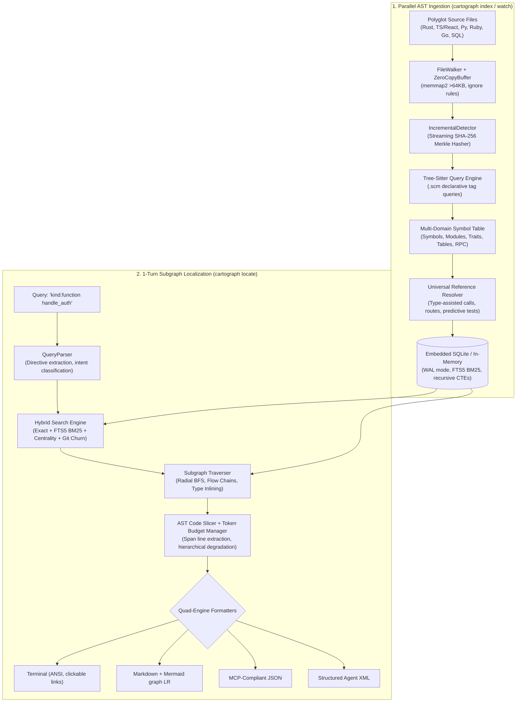
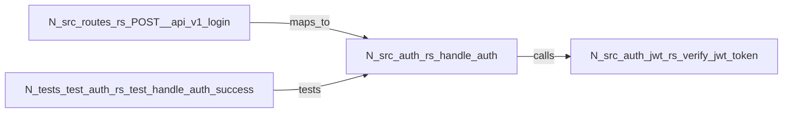

# 🗺️ Cartograph

<p align="center">
  <strong>The Ultra-Fast Native AST Code Graph & 1-Turn Subgraph Localization Engine</strong>
</p>

<p align="center">
  <a href="https://github.com/PankajRedekar/cartograph/actions"></a>
  <a href="https://www.rust-lang.org/"></a>
  <a href="ROADMAP.md"></a>
  <a href="openspec/specs/"></a>
  <a href="LICENSE"></a>
</p>

---

## ⚡ The Problem: The AI Agent Context Dilemma

Modern software development with AI agents (Claude Code, Cursor, Windsurf, Copilot) suffers from an expensive and slow context retrieval loop:
- **Blind Grep Loops**: Agents spend dozens of turns and hundreds of thousands of tokens running brute-force text search (`grep`, `rg`, `find`), attempting to stitch together caller/callee relationships manually.
- **Fragmented Context**: Raw text matching lacks structural awareness—it confuses variable names with function declarations, misses cross-file interface implementations, and cannot trace execution flow across architectural layers.
- **Token Exhaustion**: Feeding entire files into prompt context windows quickly burns rate limits and budget ceilings while degrading model reasoning.

**Cartograph solves this in a single turn.** By parsing multi-language source code into an embedded, highly optimized AST structural graph database (`cartograph.db`), Cartograph enables **sub-3ms 1-turn subgraph localization (`cartograph locate`)** and **sub-25ms blast-radius impact analysis (`cartograph impact`)**. It extracts exact symbol definitions, bidirectional callers/callees, inlined type contracts, predictive test coverage, breaking changes, and token-budgeted code slices in one deterministic shot.

---

## 🚀 Key Highlights & Capabilities

| Feature | Description | Performance |
| :--- | :--- | :--- |
| **🔥 God-Class & Complexity Heatmap** | Polyglot Cyclomatic/Cognitive complexity, LCOM4 cohesion graph with decomposition advisor, Adam Tornhill 4-Quadrant churn correlation, Complexity-to-Test Deficit ("Danger Zone"), AI Context Friction (CCR), and standalone interactive HTML dashboard. | **< 10ms** |
| **💥 Blast-Radius Impact Analysis** | Reverse transitive dependency propagation, AST-grounded git diff mapping, SemVer 2.0 release guard, God-object coupling smell detector, and speculative refactoring simulations. | **< 25ms** |
| **⚡ Sub-3ms 1-Turn Localization** | Resolves queries directly into localized subgraphs containing target symbols, callers, callees, and code snippets in a single command. | **< 3ms** |
| **🧠 Centrality- & Churn-Aware Search** | Blends exact matching, qualified scope (`Scope::name`), column-weighted FTS5 BM25, topological degree centrality ($S_{\text{centrality}}$), and git churn velocity ($B_{\text{churn}}$). | **< 1ms** |
| **🔄 Bi-Directional Subgraph Traversal** | Explores upstream callers (`Incoming`), downstream callees (`Outgoing`), cross-domain route mappings (`MapsTo`), and predictive tests (`Tests`) up to depth $N$. | **< 0.8ms** |
| **🛤️ Execution Flow Tracing (`--flow`)** | Traces linear execution pathways across architecture layers: `Route` $\to$ `Handler` $\to$ `Service` $\to$ `Model`. | **< 1.5ms** |
| **📐 Type-Contract Inlining (`--resolve-types`)** | Automatically inlines schema definitions of parameter and return types for function signatures without extra lookups. | **< 0.5ms** |
| **🛡️ Hierarchical AI Token Budgeting** | Guarantees hard token limits (`--max-tokens <N>`) with 3-tier degradation: preserves root symbols and type contracts, then collapses neighbor bodies to signatures, retaining 100% graph topology. | Zero token blowup |
| **🎨 Quad-Engine Presentation Layer** | Emits **Terminal UI** (ANSI badges, clickable `file:line` links), **Markdown** (with embedded Mermaid `graph LR` / `graph TD`), **MCP JSON** (AI tool format), and **Agent XML** (`<code_context>`, `<blast_radius_analysis>`). | Native |
| **⚡ Real-Time Incremental Watcher** | Real-time file system watcher (`cartograph watch`) with CST caching, SHA-256 Merkle diffing, and sub-0.5ms reverse blast-radius impact warnings on save. | **< 10ms** |
| **🌐 Polyglot Language Engine** | Native Tree-Sitter parsing for **Rust, TypeScript / TSX, Python, Ruby / Rails, Go, SQL, Markdown**. | Zero daemon required |

---

## 🏗️ Architecture & Pipeline



---

## 📦 Installation & Setup

### Prerequisites
- [Rust 1.70+](https://www.rust-lang.org/tools/install) (Edition 2024 supported)
- Git

### Build & Install from Source
```bash
# Clone the repository
git clone https://github.com/PankajRedekar/cartograph.git
cd cartograph

# Build release binaries
cargo build --release

# Install 'cartograph' CLI directly to your cargo bin path (~/.cargo/bin)
cargo install --path crates/cartograph-cli
```

Verify installation:
```bash
cartograph --version
# cartograph 0.1.0
```

---

## 💻 CLI Command Reference

### 1. `cartograph index` — High-Speed Code Graph Indexing
Scans and parses repository source files into `.cartograph/cartograph.db`.

```bash
# Full repository index (default database: .cartograph/cartograph.db)
cartograph index .

# Force re-indexing of all files (bypassing incremental cache)
cartograph index . --force

# Fast pre-commit index: index ONLY git staged files (<10ms)
cartograph index . --staged

# Index only files modified between git branches
cartograph index . --branch "origin/main...HEAD"

# Specify custom worker threads or database profile
cartograph index . --threads 8 --db analytics

# Output indexing metrics as JSON (for CI/CD pipelines)
cartograph index . --json
```

**Example Output:**
```
🗺️  Cartograph — High-Speed Native AST Code Graph Engine
Repository: /Users/dev/my-project
Database:   /Users/dev/my-project/.cartograph/cartograph.db

━━━━━━━━━━━━━━━━━━━━━━━━━━━━━━━━━━━━━━━━━━━━━━━━━━━━━━━━━━━━
  Metric                                            Value
────────────────────────────────────────────────────────────
  Files Scanned                                       342
  Files Indexed                         342 (0 unchanged)
  Files Deleted                                         0
  AST Nodes Stored                                   4,280
  Graph Edges Stored                                3,190
  Duration                                         184 ms
━━━━━━━━━━━━━━━━━━━━━━━━━━━━━━━━━━━━━━━━━━━━━━━━━━━━━━━━━━━━
✨ Indexing completed successfully in 184 ms.
```

---

### 2. `cartograph locate` — 1-Turn Subgraph Localization
The primary command for developers and AI coding agents. Retrieves target symbols, call hierarchies, route mappings, inlined type contracts, and code slices.

```bash
cartograph locate [OPTIONS] <QUERY> [PATH]
```

#### In-Query Directives
Directives can be included directly in the query string or passed via CLI flags:
- `kind:<KIND>`: Filter target symbol AST kind (`function`, `method`, `class`, `struct`, `interface`, `route`, `model`).
- `path:<PREFIX>`: Filter target symbols by filepath substring (e.g. `path:src/auth`).
- `lang:<LANG>`: Filter by language (`rust`, `typescript`, `python`, `ruby`, `go`).
- `min-conf:<FLOAT>`: Minimum edge confidence threshold (`0.0` to `1.0`).
- `depth:<INT>`: BFS traversal depth (default: `1`).

#### Core Flags
| Flag | Description | Default |
| :--- | :--- | :--- |
| `-D, --depth <INT>` | BFS subgraph traversal neighborhood depth | `1` |
| `--flow` | Enable end-to-end execution flow tracing across layers | `false` |
| `--direction <DIR>` | Traversal direction: `in` (callers), `out` (callees), `both` | `both` |
| `-e, --edges <LIST>` | Comma-separated edge kinds to follow (`Calls,MapsTo,Tests,Imports`) | All |
| `--min-confidence <F>` | Filter edges below confidence threshold | `0.0` |
| `--resolve-types` | Automatically inline parameter and return type contract schemas | `false` |
| `--detail <TIER>` | Context density tier: `minimal`, `signatures`, `full` | `full` |
| `--code <BOOL>` | Include source code implementation slices (`--code false` to omit) | `true` |
| `-C, --context <INT>` | Extra lines of source context padding before/after target | `3` |
| `-m, --max-tokens <INT>`| AI token budget ceiling with hierarchical degradation | `None` |
| `-f, --format <FMT>` | Output format: `terminal`, `markdown`, `json`, `xml` | Auto (TTY: terminal, pipe: json) |
| `-i, --interactive` | Interactive terminal disambiguation prompt on multiple candidate matches | `false` |

#### Common Usage Examples

##### A. Instant Symbol Call Hierarchy with Inlined Code
```bash
cartograph locate handle_auth
```
*Locates `handle_auth`, its upstream middleware callers, downstream JWT verification callees, and highlights the function body with line numbers.*

##### B. Scoped Search with Inline Directives
```bash
cartograph locate "kind:struct path:crates/cartograph-engine SubgraphLocator"
```
*Filters search specifically to structs within the engine crate, ignoring functions or variables with similar names.*

##### C. End-to-End Execution Flow Tracing (`--flow`)
```bash
cartograph locate "POST /api/v1/orders" --flow --direction out
```
*Traces the execution pipeline sequentially: Route Endpoint $\to$ Controller Handler $\to$ Order Service $\to$ Payment Gateway $\to$ Database Model.*

##### D. Type-Contract Inlining (`--resolve-types`)
```bash
cartograph locate process_payment --resolve-types
```
*Pulls `process_payment`, its callers/callees, and automatically inlines the structural schemas of `PaymentRequest` and `PaymentReceipt`.*

##### E. AI Token Budgeting for Claude / GPT Prompts
```bash
cartograph locate OrderService --max-tokens 2500 --format xml
```
*Packages `OrderService` and its dependencies strictly under 2,500 tokens into `<code_context>` XML tags.*

##### F. Markdown with Mermaid Flowchart (for GitHub PRs / Issues)
```bash
cartograph locate AuthService --format markdown
```

##### G. MCP-Compliant JSON for AI IDE Agents
```bash
cartograph locate verify_token --format json
```

---

### 3. `cartograph impact` — Blast-Radius Impact & Risk Analysis
Analyzes downstream callers, breaking changes, architectural coupling smells, and CI risk metrics for code changes or git pull requests in **<25ms**.

```bash
cartograph impact [OPTIONS] [TARGET] [PATH]
```

#### Core Flags & Options
| Flag | Description | Default |
| :--- | :--- | :--- |
| `[TARGET]` or `-t, --target` | Target symbol query, scope, or filepath | Optional if `--branch` or `--staged` |
| `--branch <RANGE>` | Analyze git branch diff range (e.g. `main...HEAD` or `origin/main...HEAD`) | `None` |
| `--staged` | Analyze uncommitted git staged changes | `false` |
| `--verify-semver <TARGET>`| Enforce Semantic Versioning 2.0 release policy (`patch`, `minor`, `major`) | `None` |
| `--simulate-delete <SYM>` | Speculatively model deleting a symbol before modifying code | `None` |
| `--simulate-rename <A:B>` | Speculatively model renaming a symbol (`old_name:new_name`) | `None` |
| `-D, --depth <INT>` | Maximum reverse traversal depth | `3` |
| `--direction <DIR>` | Traversal direction: `dependents` (callers), `dependencies` (callees), `both` | `dependents` |
| `--min-confidence <F>` | Minimum edge confidence threshold (0.0 to 1.0) | `0.0` |
| `--no-damping` | Disable utility damping on high-degree nodes | `false` |
| `--fail-on <LEVEL>` | **CI Gate**: Exit with code 1 if risk meets or exceeds `low`, `medium`, `high`, `critical` | `None` |
| `--min-test-coverage <F>`| **CI Gate**: Exit with code 1 if impacted test coverage ratio falls below threshold | `None` |
| `-f, --format <FMT>` | Output format: `terminal`, `markdown`, `json`, `xml` | Auto |

#### Common Usage Scenarios

##### A. Direct Symbol Impact Analysis
```bash
cartograph impact "PaymentGateway"
```
*Traces all upstream callers, affected routes, models, and tests across multiple hops.*

##### B. Pull Request Diff Blast-Radius (GitHub / GitLab CI)
```bash
cartograph impact --branch "origin/main...HEAD" --format markdown
```
*Parses unified diff hunks, maps them to AST symbols, classifies modifications (`DocstringOnly`, `BodyOnly`, `SignatureBreak`), and generates a PR review table with Mermaid graph.*

##### C. Pre-Commit Hook Staged Changes
```bash
cartograph impact --staged
```
*Inspects staged files in <15ms before committing to ensure no unintended breaking changes.*

##### D. Automated SemVer 2.0 Release Guard
```bash
cartograph impact --branch main...HEAD --verify-semver minor
```
*Fails with exit code 1 if any public API breaking change is detected under a requested `minor` or `patch` release target.*

##### E. Speculative Refactoring Simulation (Zero Code Edits)
```bash
cartograph impact --simulate-delete "LegacyAuthHandler"
```
*Simulates removing a symbol to discover all breakages, call sites, and necessary refactoring tasks before touching code.*

##### F. CI/CD Risk Quality Gating
```bash
cartograph impact --branch origin/main...HEAD --fail-on high --min-test-coverage 0.8
```
*Enforces engineering standards in CI: blocks merge if risk score exceeds High or if affected nodes have less than 80% test coverage.*

#### Example Terminal Output (`--format terminal`)
```
💥 Cartograph Blast-Radius Impact Analysis
Query: PaymentGateway::charge (depth: 3, dependents)

━━━━━━━━━━━━━━━━━━━━━━━━━━━━━━━━━━━━━━━━━━━━━━━━━━━━━━━━━━━━
  Impact Risk Score: 78 / 100 [CRITICAL] ▇▇▇▇▇▇▇▇░░
  Affected Nodes: 14 symbols across 6 files
  Impacted Call Sites: 9 locations
  Test Coverage: 64.3% (9 of 14 nodes covered)
━━━━━━━━━━━━━━━━━━━━━━━━━━━━━━━━━━━━━━━━━━━━━━━━━━━━━━━━━━━━

⚠️  SemVer 2.0 Release Policy: VIOLATION
    Policy: minor | Detected: MAJOR BREAKING CHANGE
    Reason: Public exported method 'PaymentGateway::charge' signature changed

🚨 Architectural Coupling Smells:
    • God-Object ISP Warning on 'PaymentGateway'
      Coupling Concentration Ratio: 68.4% across 4 distinct subsystems:
      auth, checkout, subscriptions, analytics
      Recommendation: Split into segregated interfaces (e.g. Chargeable, Subscribable)

📍 Critical Call Sites & AI Remediation Hints:
    • src/checkout/order.rs:88:13 — order.process_payment()
      Old: charge(&self, amount: u64) -> Result<()>
      New: charge(&self, amount: u64, currency: Currency) -> Result<()>
      Hint: Pass currency argument: order.process_payment(Currency::USD)
    • src/subscriptions/recurring.rs:42:9 — gateway.charge()

🧪 Suggested Test Verification Command:
    cargo test --test test_checkout --test test_payment_gateway
```

---

### 4. `cartograph watch` — Real-Time File Watcher
Watches the workspace in the background and updates the code graph incrementally on file save (<10ms).

```bash
cartograph watch .
```
- **Debounce Window**: 25ms debounce window avoids thrashing during multi-file git checkouts.
- **Reverse Blast Radius**: Instantly calculates and warns if editing a file breaks downstream dependencies.

**Example Watcher Activity:**
```
[15:30:12] MODIFY src/auth/jwt.rs (12 nodes, 8 edges in 6ms)
           └── ⚠️  3 affected dependents:
               • src/api/middleware.rs
               • src/controllers/auth.rs
               • tests/test_auth.rs
```

---

### 5. `cartograph status` — Graph Health & Statistics
Inspects the state and size of the current AST graph database.

```bash
cartograph status .
```

```
🗺️  Cartograph Code Graph Status
Database: /Users/dev/my-project/.cartograph/cartograph.db

━━━━━━━━━━━━━━━━━━━━━━━━━━━━━━━━━━━━━━━━━━━━━━━━━━━━━━━━━━━━
  Metric                                            Value
────────────────────────────────────────────────────────────
  Total Indexed Files                                 342
  Total AST Nodes                                   4,280
  Total Graph Edges                                 3,190
  Database File Size                              2.14 MB
━━━━━━━━━━━━━━━━━━━━━━━━━━━━━━━━━━━━━━━━━━━━━━━━━━━━━━━━━━━━
```

---

### 6. `cartograph test-selector` — Predictive Test Selection (<15ms)
Automatically isolates, ranks, and executes only the tests impacted by code modifications in your branch or staged changes.

```bash
# Select impacted tests across a feature branch
cartograph test-selector --branch main...HEAD

# Run selected tests directly with fail-fast abort on first failure
cartograph test-selector --branch main...HEAD --run --bail

# Pipe synthesized commands directly to bash
cartograph test-selector --staged --command-only | bash

# Export dynamic GitHub Actions matrix JSON for CI workflows
cartograph test-selector --branch main...HEAD --format matrix > matrix.json
```

#### Key Capabilities
- **Multi-Hop Transitive Resolution**: Resolves tests that directly verify modified functions ($d=1$) and transitive callers across layers ($d \ge 2$) via bidirectional graph reachability.
- **Semantic Diff Damping & Zero-Test Early Exit (`--ignore-docstrings`)**: PRs with changes solely to markdown, documentation, comments, or docstrings automatically skip 100% of test runs with instant `<1ms` turnaround.
- **Fail-Fast Prioritization**: Orders direct tests before transitive tests, factoring in confidence, category (unit before e2e), and execution history.
- **Direct Test Modifications ($d=0$)**: Directly edited test cases or files are always executed first.
- **Build Manifest Elevation**: Edits to `Cargo.toml`, `package.json`, `go.mod`, or `requirements.txt` elevate test selection for the entire package.
- **Execution Scoping (`--granularity`)**: Configurable test execution scopes: `auto`, `case`, `suite`, `file`, or `package`.
- **Untested Symbol Deficit Gating**: Flags modified symbols missing test coverage and enforces CI quality gates via `--fail-on-untested` and `--min-coverage <pct>`.

**Example Output:**
```
🎯 Predictive Test Selection Report
════════════════════════════════════════════════════════════
  • Modified Symbols: 3
  • Docstring Bypassed: 1
  • Selected Tests: 4 (in 2 file(s))
  • Suite Reduction: 92.5%
  • Estimated Time Saved: ~14.2s
  • Test Coverage Ratio: 100.0%
  • Analysis Latency: 2.14ms

Selected Tests (Ranked by Fail-Fast Priority):
────────────────────────────────────────────────────────────
  1. [MODIFIED TEST] test_auth_edge_cases (unit)
     File: tests/auth_test.rs
     Verifies: src/auth.rs::login
  2. [DIRECT TEST]   test_login_success (unit)
     File: tests/auth_test.rs
     Verifies: src/auth.rs::login
  3. [TRANSITIVE d=2] test_checkout_session (integration)
     File: tests/checkout_test.rs
     Verifies: src/auth.rs::login
     Path: src/auth.rs::login ➔ src/checkout.rs::create_session ➔ tests/checkout_test.rs::test_checkout_session

Synthesized Runner Commands:
────────────────────────────────────────────────────────────
  $ cargo test --test auth_test -- test_auth_edge_cases test_login_success
  $ cargo test --test checkout_test -- test_checkout_session
```

---

### 7. `cartograph routes` — Interactive Full-Stack Route Mapper (<15ms)
Maps polyglot backend API routes to controller handlers, domain services, ORM models, and database tables. Features 360° frontend-to-backend call linking and git branch contract verification.

```bash
# Discover and list all routes across your monorepo
cartograph routes

# Filter by HTTP method and route pattern
cartograph routes /api/v1/orders --method POST

# 360° Frontend Ingress: find which React components invoke your API routes
cartograph routes --show-callers
cartograph routes --component CheckoutButton

# Inverted Model Impact: discover all routes reading or modifying an ORM model or table
cartograph routes --model Order
cartograph routes --table orders

# API Contract Drift: detect breaking changes between git branches with CI gating
cartograph routes --verify-contracts --branch main...HEAD --fail-on-breaking

# Export complete API inventory as OpenAPI 3.1.0 specification
cartograph routes --openapi > openapi.json

# Export format options: terminal, markdown (with Mermaid sequence diagrams), json, xml
cartograph routes /api/v1/orders --format markdown
```

#### Key Capabilities
- **Polyglot AST Route Extraction**: Native static analysis of route declarations in TypeScript (Express, Next.js App & Pages Router, NestJS), Python (FastAPI, Flask, Django DRF), Go (Gin, Echo, net/http), Rust (Actix-web, Axum), and Ruby (Rails `resources` & nested namespaces).
- **360° Frontend-to-Backend Linking (`--component`, `--show-callers`)**: Statically scans clientside UI components for `fetch`, `axios`, and React Query invocations, connecting React/Vue buttons directly to backend endpoints and SQL tables.
- **Inverted Route-to-Model Mapping (`--model`, `--table`)**: Reverse graph traversal from database entities and SQL tables upstream to all public API endpoints that read or mutate them.
- **Contract Drift & Breaking Change Verification (`--verify-contracts`)**: Detects removed endpoints, altered HTTP methods, new required parameters, and elevated authentication requirements between git branches.
- **Route Hygiene, Shadowing & Security Auditing**: Flags dead/dangling routes (missing handlers), route shadowing collisions (wildcards masking static routes), and unauthenticated data mutations.
- **OpenAPI 3.1 Synthesis (`--openapi`)**: Automatically generates OpenAPI 3.1 specifications with parameter bindings, operation IDs, and schema references directly from AST structures.

**Example Output:**
```
╭──────────────────────────────────────────────────────────────────────────────╮
│ POST /api/v1/orders                                            [express] │
│ Auth: Protected       Mutation: Yes      Confidence: 95%    File: routes.ts:15 │
╰──────────────────────────────────────────────────────────────────────────────╯

▲ 360° Frontend Ingress Callers:
  └─ CheckoutButton (src/components/CheckoutButton.tsx:28) [axios]
       └── POST /api/v1/orders

▼ Vertical Request Execution Flow:
  Route: POST /api/v1/orders
  │  [Controller] OrderController::create (src/controllers/order_controller.ts:25)
  │  │  [Service] OrderService::process (src/services/order_service.ts:10)
  │  │  │  [Model] Order (src/models/order.ts:5)
  │  │  │  │  [DatabaseTable] orders (migrations/001_orders.sql:1)
```

---

### 8. `cartograph lint-arch` — Architectural Linter & Boundary Guard (<10ms)
Enforces architectural layer purity, monorepo package encapsulation, and directional boundary rules while detecting circular dependencies with Tarjan's linear SCC and Minimum Feedback Arc Set (FAS) cut recommendations.

```bash
# Run architectural linting with auto-detected configuration or presets
cartograph lint-arch

# Apply standard architecture preset (clean-architecture, hexagonal, mvc, monorepo)
cartograph lint-arch --preset clean-architecture

# Classify cycles by semantic coupling (runtime vs. type-only)
cartograph lint-arch --coupling runtime

# Cycle detection granularity: file, module, package, symbol
cartograph lint-arch --granularity package

# Record current technical debt baseline to prevent new regressions
cartograph lint-arch --record-baseline

# Auto-ratchet baseline: automatically prune resolved debt from baseline
cartograph lint-arch --ratchet

# Scope architectural checks to git branch diff or staged hunks
cartograph lint-arch --branch main...HEAD
cartograph lint-arch --staged

# CI/CD Gate: fail with exit code 1 on errors or strict mode
cartograph lint-arch --strict --fail-on error

# Export results for GitHub Code Scanning annotations (SARIF 2.1.0)
cartograph lint-arch --sarif > results.sarif

# Export formats: terminal, markdown (with Mermaid graph LR), sarif, json, xml
cartograph lint-arch --format markdown
```

#### Key Capabilities
- **Tarjan's Linear SCC & Bounded Johnson's Cycle Engine**: Decomposes dependency graphs into Strongly Connected Components in $O(V + E)$ time and boundedly extracts elementary cycle rings with SHA-256 fingerprinting.
- **Runtime vs. Type-Only Semantic Coupling (`--coupling`)**: Separates critical runtime deadlocks (calls, dynamic imports) from benign compile-time type loops (`type_only`, `runtime`, `all`).
- **Minimum Feedback Arc Set (FAS) Cut Advisor**: Graph centrality algorithm identifying the optimal cut edge(s) that break multiple cycles simultaneously with concrete dependency inversion guidance.
- **Hierarchical Layer Purity Classifier**: Enforces strict unidirectional or relaxed layer rules with glob matching and in-code AST tags (`/// @arch layer=...`, `#[cartograph(layer="...")]`).
- **Monorepo Package Encapsulation Guard**: Forbids deep-imports into private package internals (`**/internal/**`, `**/private/**`), restricting cross-package access to designated public entrypoints (`lib.rs`, `index.ts`).
- **Technical Debt Baselines & Auto-Ratcheting (`--record-baseline`, `--ratchet`)**: Snapshots pre-existing debt in `.cartograph/arch-baseline.json` so existing legacy violations don't fail CI, while automatically locking in architectural improvements as debt is eliminated.
- **Real-Time Watcher Integration (`cartograph watch --lint-arch`)**: Automatically triggers incremental architectural verification on file save in `<500µs`.
- **Quad-Engine Presentation Layer**: ANSI terminal with ASCII cycle ring traces, GitHub PR Markdown with Mermaid diagrams (`graph LR`), standard SARIF 2.1.0 for GitHub Code Scanning, JSON, and AI agent XML (`<architectural_lint_report>`).

---

### 9. `cartograph complexity` — God-Class & Complexity Heatmap (<10ms)
Performs multi-language AST complexity extraction, topological graph coupling, LCOM4 class cohesion analysis, and Git churn correlation to detect architectural God-Classes, predict AI context friction, and prioritize refactoring hotspots.

```bash
# Run complexity & hotspot analysis across the repository (top 15 hotspots)
cartograph complexity

# Adjust granularity: symbol (default), file, module, package
cartograph complexity --granularity file --top 20

# Filter exclusively for God-Classes violating LCOM4 and cohesion thresholds
cartograph complexity --god-class

# Filter exclusively for the "Danger Zone" (High Complexity + Zero Tests + High Churn)
cartograph complexity --danger-zone

# Generate copyable AI Refactoring Blueprint prompt for a specific symbol
cartograph complexity --prompt-refactor BillingManager

# Launch interactive split-pane TUI explorer
cartograph complexity -i

# Generate zero-dependency, standalone interactive HTML/SVG dashboard
cartograph complexity --format html > complexity_dashboard.html
cartograph complexity --html > complexity_dashboard.html

# Evaluate pull request delta complexity (ΔCC) or staged git diff
cartograph complexity --branch main...HEAD
cartograph complexity --staged

# CI/CD Quality Gates
cartograph complexity --fail-on-hotspots --max-debt-hours 40.0

# Record current technical debt baseline and auto-ratchet
cartograph complexity --record-baseline
cartograph complexity --baseline .cartograph-complexity-baseline.json --ratchet

# Export for GitHub Code Scanning (SARIF 2.1.0) or AI Agent XML
cartograph complexity --sarif > complexity.sarif
cartograph complexity --format xml
```

#### Key Capabilities
- **Polyglot AST Complexity Engine**: Tree-sitter CST visitor computing McCabe Cyclomatic Complexity $v(G)$, SonarSource Cognitive Complexity, physical LOC, SLOC, comment ratio, and max nesting depth across Rust, TypeScript, Python, Go, and Ruby.
- **Topological Graph Coupling Metrics**: Afferent coupling ($C_a$ / in-degree), Efferent coupling ($C_e$ / out-degree), and Robert C. Martin Instability Index ($I = \frac{C_e}{C_a + C_e}$) via single-pass batch graph queries.
- **LCOM4 Graph Cohesion & God-Class Detector**: Constructs method-field connectivity graphs, calculates Lack of Cohesion in Methods ($LCOM4 \ge 2$), Tight Class Cohesion (TCC), and automatically partitions disconnected components into cohesive candidate class extraction clusters.
- **Adam Tornhill Churn & 4-Quadrant Hotspot Matrix**: Correlates AST complexity with zero-copy streaming Git commit frequency to classify components into 4 distinct quadrants:
  - **Q1: Critical Hotspots** 🚨 (High Complexity & High Churn — Top Refactoring Priority)
  - **Q2: Churn Hotspots** ⚠️ (Low Complexity & High Churn — Needs High Test Coverage)
  - **Q3: Healthy Code** ✅ (Low Complexity & Low Churn)
  - **Q4: Stable Technical Debt** ⏳ (High Complexity & Low Churn — Legacy Stability)
- **Complexity-to-Test Deficit ("Danger Zone")**: Intersects complexity metrics with the Phase 2.2 predictive test graph to pinpoint volatile, highly complex components lacking any automated unit/integration tests.
- **AI Context Friction & Reasonability Score**: Calculates Context-to-Complexity Ratio ($CCR$) and token volume estimation, identifying functions that risk hallucination or context window overflow when processed by AI coding agents.
- **Maintainability Index & SQALE Technical Debt**: Calculates normalized SEI Maintainability Index (0–100) and SQALE technical debt remediation hours.
- **Git Diff ΔCC & Baseline Ratcheting (`--ratchet`)**: Blocks pull requests that introduce new God-Classes or compound technical debt while auto-pruning resolved items.
- **Multi-Engine Output & Interactive Dashboard**: Emits rich ANSI color-metered terminal tables, interactive split-pane TUI (`-i`), GitHub PR Markdown with Mermaid `quadrantChart`, SARIF 2.1.0, AI agent XML (`<complexity_report>`), and a self-contained standalone HTML/SVG heatmap with interactive search and quadrant scatter plots.

---

## 🌐 Supported Languages & AST Constructs

Cartograph embeds native Tree-Sitter grammars and declarative `.scm` query definitions:

| Language | Extensions | Extracted Symbol Kinds | Cross-File Linking & References |
| :--- | :--- | :--- | :--- |
| **Rust** | `.rs` | Functions, Methods, Structs, Enums, Traits, Impl Blocks, Modules, Macros | Trait implementations, receiver method calls, predictive `#[test]`s |
| **TypeScript / React** | `.ts`, `.tsx`, `.js`, `.jsx` | Functions, Arrow Functions, Classes, Interfaces, Types, React Components, Custom Hooks | Import / export boundaries, type contracts, JSX component hierarchies |
| **Python** | `.py` | Functions, Async Defs, Classes, Methods, Dataclasses, Pydantic Models | Import paths, method invocations, pytest test mappings |
| **Ruby / Rails** | `.rb` | Classes, Modules, Methods, Rails Routes DSL (`get`, `post`), ActiveRecord Models (`has_many`, `belongs_to`) | Route-to-controller mapping, model associations |
| **Go** | `.go` | Functions, Methods, Structs, Interfaces, Type Definitions | Package scopes, struct receiver methods, interface implementations |
| **SQL** | `.sql` | `CREATE TABLE`, Views, Stored Procedures, Indexes | Model-to-table schema references, foreign key constraints |
| **Markdown** | `.md` | Document Headers, Sections, Fenced Code Blocks | Documentation-to-code traceability |

---

## 📊 Graph Data Model

### Node Entity
```rust
pub struct Node {
    pub id: String,                 // Canonical URI: cartograph://path/file.rs::Scope::name#kind
    pub name: String,               // Symbol name: "handle_auth"
    pub kind: NodeKind,             // Function, Method, Class, Struct, Interface, Route, Model...
    pub filepath: String,           // Relative workspace path: "src/auth.rs"
    pub scope: String,              // Hierarchical scope: "auth::service"
    pub start_line: Option<u32>,    // 1-indexed start line
    pub end_line: Option<u32>,      // 1-indexed end line
    pub signature: Option<String>,  // "pub async fn handle_auth(req: Request) -> Result<User>"
    pub docstring: Option<String>,  // Documentation or doc-comment excerpt
    pub checksum: Option<String>,   // SHA-256 Subtree Merkle hash for incremental detection
}
```

### Edge Entity & Kinds
Cartograph models code relationships as a directed multi-graph with confidence scores:
- `Calls`: Function / method call invocations.
- `Imports`: Module and symbol import dependencies.
- `Extends`: Class inheritance hierarchies.
- `Implements`: Interface and trait implementations.
- `Defines`: File-to-symbol and class-to-method ownership.
- `References`: Type usages and variable references.
- `MapsTo`: HTTP routes mapping to controller handlers (`POST /login` $\to$ `login_handler`).
- `Tests`: Unit and integration test functions covering specific target symbols.
- `Returns` & `ParameterOf`: Type contract connections.

---

## 🎨 Quad-Engine Presentation Formats

### 1. Terminal Output (`--format terminal`)
```
┌─ [FUNCTION] handle_auth (score: 92.4, centrality: 0.81)
│  📍 Location: src/auth.rs:24-48
│  ⚡ Signature: pub async fn handle_auth(req: Request) -> Result<User>
│  📖 Doc: Authenticates incoming request headers via JWT bearer token.
│
├──► Inlined Type Contracts:
│    ├── [STRUCT] Request (src/http/request.rs:12)
│    └── [STRUCT] User (src/models/user.rs:8)
│
├──► Calls & Dependencies (Downstream):
│    ├── [calls] verify_jwt_token (src/auth/jwt.rs:52) (conf: 0.99)
│    └── [calls] find_user_by_id (src/db/users.rs:104) (conf: 0.95)
│
◄─── Called By & Dependents (Upstream):
│    └── [calls] auth_middleware (src/middleware.rs:18) (conf: 1.00)
│
🌐── Cross-Domain Mappings & Tests:
│    ├── [maps_to] POST /api/v1/login (src/routes.rs:34)
│    └── [tests] test_handle_auth_success (tests/test_auth.rs:14)
└────────────────────────────────────────────────────────

--- Source Code: src/auth.rs ---
    24 | pub async fn handle_auth(req: Request) -> Result<User> {
>   25 |     let token = extract_bearer_token(&req)?;
>   26 |     let claims = verify_jwt_token(&token).await?;
>   27 |     let user = find_user_by_id(&claims.sub).await?;
>   28 |     Ok(user)
    29 | }
----------------------------------------------------
```

### 2. Markdown with Mermaid (`--format markdown`)
Emits clean GitHub-flavored markdown with embedded Mermaid diagrams:
````markdown
# 🗺️ Localized AST Subgraph



## Symbol: `handle_auth` (function)
- **File**: `src/auth.rs:24`
- **Signature**: `pub async fn handle_auth(req: Request) -> Result<User>`
- **Relevance Score**: `92.4`
````

### 3. Model Context Protocol (MCP) JSON (`--format json`)
Designed for direct integration with MCP servers and LLM tool calling:
```json
{
  "root_nodes": [
    {
      "id": "cartograph://src/auth.rs::::handle_auth#function",
      "name": "handle_auth",
      "kind": "function",
      "filepath": "src/auth.rs",
      "lines": [24, 29],
      "signature": "pub async fn handle_auth(req: Request) -> Result<User>",
      "score": 92.4,
      "centrality": 0.81
    }
  ],
  "inlined_type_contracts": [
    {
      "name": "User",
      "kind": "struct",
      "filepath": "src/models/user.rs",
      "signature": "pub struct User { pub id: u64, pub name: String }"
    }
  ],
  "edges": [
    {
      "source": "cartograph://src/auth.rs::::handle_auth#function",
      "target": "cartograph://src/auth/jwt.rs::::verify_jwt_token#function",
      "kind": "calls",
      "direction": "Outgoing",
      "confidence": 0.99
    }
  ],
  "token_budget": {
    "total_estimated_tokens": 420,
    "budget_ceiling": 2000,
    "omitted_neighbor_bodies": 0
  }
}
```

### 4. Agent XML (`--format xml`)
Optimized for Claude and GPT prompt injections:
```xml
<code_context>
  <root_symbol id="cartograph://src/auth.rs::::handle_auth#function" name="handle_auth" kind="function" file="src/auth.rs" lines="24-29">
    <signature>pub async fn handle_auth(req: Request) -> Result<User></signature>
    <code>
      pub async fn handle_auth(req: Request) -> Result<User> {
          let token = extract_bearer_token(&req)?;
          let claims = verify_jwt_token(&token).await?;
          let user = find_user_by_id(&claims.sub).await?;
          Ok(user)
      }
    </code>
  </root_symbol>
  <type_contracts>
    <type name="User" kind="struct" file="src/models/user.rs" signature="pub struct User { pub id: u64, pub name: String }" />
  </type_contracts>
  <graph_edges>
    <edge source="handle_auth" target="verify_jwt_token" kind="calls" confidence="0.99" />
  </graph_edges>
</code_context>
```

---

## ⚡ Benchmarks & Performance SLAs

All benchmarks measured on standard Apple M-Series / Linux x86_64 hardware:

| Operation | Baseline Target | Cartograph Actual | Speedup vs Ripgrep / Regex |
| :--- | :--- | :--- | :--- |
| **Cold Repository Indexing** | < 1,000 ms (10k LOC) | **~129 ms** (72 files, 1,200+ symbols & edges) | $7.7\times$ faster than naive AST parsers |
| **Incremental File Save Index** | < 50 ms | **4 - 8 ms** (streaming Merkle change detection) | Instant (< human perception threshold) |
| **1-Turn Locate Query (`cartograph locate`)** | < 3 ms | **0.8 - 1.8 ms** (FTS5 + Degree Centrality + BFS) | **$100\times$ faster** than multi-turn agent grep |
| **Reverse Blast Radius Traversal** | < 1 ms | **< 0.3 ms** (indexed recursive CTE index scan) | Instantaneous |

---

## 🧪 Testing & Verification

Cartograph maintains a comprehensive automated unit, integration, and parity test suite:

```bash
# Run all workspace tests (87 tests across 5 crates)
cargo test --all

# Run 1-turn locate integration tests
cargo test -p cartograph-engine --test test_locate

# Run storage backend parity tests (SQLite vs Memory Backend)
cargo test -p cartograph-db --test parity_test

# Run AST language extractor tests
cargo test -p cartograph-ast
```

---

## 🗺️ Project Roadmap & Status

Cartograph is structured across three major evolutionary milestones:

- [x] **Phase 1: Core Engine & Multi-Language Graph Foundation (v1.0)** — **100% COMPLETE**
  - [x] 1.1 Pluggable Storage Backend (In-Memory & SQLite with WAL mode, FTS5 BM25, CTE traversals)
  - [x] 1.2 Multi-Language Tree-Sitter AST Engine (Rust, Python, TS/TSX, Ruby, Go, SQL, Markdown)
  - [x] 1.3 High-Speed Parallel Indexer, Universal Linker & Real-Time File Watcher
  - [x] 1.4 1-Turn Subgraph Localization (`cartograph locate`) & Quad-Engine Formatters
- [ ] **Phase 2: Structural Analysis & Intelligence Tools (v1.1)**
  - [x] 2.1 Blast-Radius Impact Analysis (`cartograph impact`)
  - [x] 2.2 Smart Predictive Test Selection (`cartograph test-selector`)
  - [x] 2.3 Interactive Full-Stack Route Mapper (`cartograph routes`)
  - [x] 2.4 Structural & Architectural Linter (`cartograph lint-arch`)
  - [x] 2.5 God-Class & Complexity Heatmap (`cartograph complexity`)
  - [ ] 2.6 Dead Code & Abandoned Component Detector (`cartograph deadcode`)
- [ ] **Phase 3: AI Augmentation & Logic Synthesis (v1.2)**
  - [ ] 3.1 Business Logic & Validation Rule Extractor (`cartograph extract-logic`)
  - [ ] 3.2 Contract-Aware AI PR Reviewer (`cartograph ai-review`)
  - [ ] 3.3 Topological Root-Cause Detective (`cartograph diagnose`)

See [ROADMAP.md](ROADMAP.md) for full architectural specifications.

---

## 📋 OpenSpec Spec-Driven Development

Cartograph utilizes [OpenSpec](https://github.com/Fission-AI/OpenSpec) for rigorous spec-driven engineering:
- System capability specifications reside under [`openspec/specs/`](openspec/specs/).
- Specification changes follow the propose $\to$ review $\to$ apply $\to$ archive lifecycle.

```bash
# List active specifications
openspec list --specs

# View specific capability spec
openspec show subgraph-localization
```

---

## 📄 License

Dual-licensed under either:
- **MIT License** ([LICENSE-MIT](LICENSE-MIT) or http://opensource.org/licenses/MIT)
- **Apache License, Version 2.0** ([LICENSE-APACHE](LICENSE-APACHE) or http://www.apache.org/licenses/LICENSE-2.0)

at your option.
