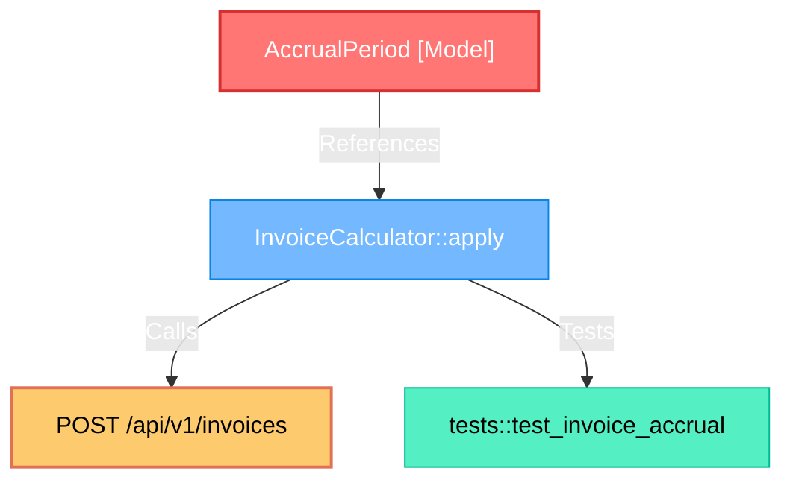

# 🗺️ Cartograph Phase 2.1: Blast-Radius Impact Analysis (`cartograph impact`)
## Comprehensive Technical Design & Architecture Specification (v2.1 Final)

---

## 1. Executive Summary & Architectural Vision

The primary mission of **Phase 2.1 (`cartograph impact`)** is to deliver an ultra-fast (**sub-5ms** for single-symbol queries, **sub-25ms** for full git branch pull request diffs), AST-grounded, multi-hop **Blast-Radius Impact Analysis, Semantic Change Classifier, SemVer Guard & Architectural Coupling Intelligence Engine** for software engineers, CI/CD automated gates, and autonomous AI pair-programming agents.

### The Problem: Locality Myopia, Accidental Breaking Releases & Architectural Rot
In modern software engineering and autonomous AI agent workflows, code modifications suffer from three critical blind spots:
- **Locality Myopia & The Blind Diff**: Traditional tools like `git diff` reveal *what lines changed*, but provide *zero structural context* regarding *what downstream systems will break*. An engineer altering a database model field or method signature in `src/models/accrual.rs` cannot readily see that this change cascades into 12 serializers, 4 HTTP controllers, 8 background worker tasks, and invalidates 25 unit/integration tests across 6 separate directories.
- **Accidental Breaking Releases (SemVer Blindness)**: Engineering teams frequently release breaking API changes in `minor` or `patch` updates. Compilers cannot warn you if an API change violates Semantic Versioning policies across polyglot boundaries (e.g. a Python SDK calling a Rust backend, or a TypeScript client invoking a Go service). Existing tools like `cargo-semver-checks` only support Rust and require 30–90 seconds of full recompilation.
- **Hidden Architectural Rot (The God-Object Trap)**: When a developer edits a small helper and the blast radius cascades into 120 callers across 15 separate modules, the team experiences fear and alert fatigue. The problem is rarely the developer's edit; it is an unflagged architectural God-Object violating the Interface Segregation Principle (ISP).

### The Solution: Cartograph Impact 2.1
Given an explicit symbol query (`"AccrualPeriod"`), a modified filepath (`src/models/accrual.rs`), uncommitted git modifications (`--staged`), an entire branch diff (`--branch "origin/main...HEAD"`), or a speculative refactoring simulation (`--simulate-delete`), `cartograph impact`:
1. **Diff-to-AST Span Pinpointing**: Parses unified diff line ranges (`git diff -U0`) and maps them directly to innermost Tree-sitter AST nodes (`start_line..end_line`) in the database, eliminating whole-file false positives.
2. **AST Semantic Change Classification**: Compares pre- and post-edit AST structures to categorize changes into **Docstring Only** (Zero Risk), **Internal Body Mutation** (Behavioral regression risk), **Visibility Break** (Access boundary violation), or **Signature Contract Break** (Guaranteed caller compilation failure).
3. **Automated SemVer Impact Guard (`--verify-semver <major|minor|patch>`)**: Enforces Semantic Versioning 2.0 policies across Rust, TypeScript, Python, and Go in **<20ms**. Fails CI if a breaking public signature change occurs on a minor/patch release branch.
4. **Architectural Coupling Smell Detector (God-Object Warning)**: Measures the Coupling Concentration Ratio and surfaces Interface Segregation Principle (ISP) violations, providing concrete architectural decoupling advice.
5. **Exact Call-Site Pinpointing**: For every affected caller in the blast radius, pinpoints the exact **file, line, column coordinate, and source code snippet** where the invocation occurs.
6. **"What-If" Speculative Simulation (`--simulate-delete` / `--simulate-rename`)**: Evaluates the architectural breakage and casualties of deleting or renaming symbols *before writing any code*.
7. **Polymorphic Trait & Interface Cascade**: Propagates changes through interface implementations (`EdgeKind::Implements`), class inheritance (`EdgeKind::Extends`), and polymorphic call candidates with calibrated confidence scores.
8. **Database Migration & Schema Ripple**: Traces SQL table and column migrations (`migrations/*.sql`) directly to ORM entities, business logic handlers, and exposed HTTP routes.
9. **Topological Multi-Factor Risk Scoring**: Computes an objective **Impact Risk Score (IRS: 0..100)** categorizing risk into **LOW**, **MEDIUM**, **HIGH**, or **CRITICAL**.
10. **Automated AI Remediation Hints**: Synthesizes concrete call-site parameter remediation instructions for AI agents (Cursor, Claude, Antigravity) to automatically construct multi-file downstream fixes.
11. **Surfaces Obligated Test Suites (Bridge to Phase 2.2)**: Extracts all unit and integration tests mapped via `EdgeKind::Tests` that directly or transitively verify the modified symbols, outputting executable test runner commands.
12. **CI/CD Automated PR Gating**: Provides `--fail-on <risk>`, `--verify-semver <policy>`, and `--min-test-coverage <ratio>` to block PRs introducing breaking architectural regressions.

---

## 2. Pipeline Architecture & Component Topology

```
┌────────────────────────────────────────────────────────────────────────────────────────┐
│                              Developer, CI/CD, or Agent Input                          │
│   cartograph impact --branch "main...HEAD" --verify-semver minor --fail-on high        │
│   cartograph impact --simulate-delete "OrderService::legacy_create"                    │
└───────────────────────────────────────────┬────────────────────────────────────────────┘
                                            │
                                            ▼
┌────────────────────────────────────────────────────────────────────────────────────────┐
│                        1. Target Resolution & Diff-to-AST Mapper                       │
│  ┌─────────────────────────┐ ┌──────────────────────────┐ ┌──────────────────────────┐ │
│  │ A: Explicit Symbol / URI│ │ B: Filepath / Module     │ │ C: Git Diff Line Ranges  │ │
│  │    (Hybrid Search)      │ │    (File Nodes Query)    │ │    (diff -U0 -> Spans)   │ │
│  └─────────────┬───────────┘ └────────────┬─────────────┘ └─────────────┬────────────┘ │
│                └──────────────────────────┼─────────────────────────────┘              │
│                                           ▼                                            │
│                      Normalized Modified Root AST Nodes                                │
│                   [{node_id, status: MODIFIED|ADDED|DELETED}]                          │
└───────────────────────────────────────────┬────────────────────────────────────────────┘
                                            │
                                            ▼
┌────────────────────────────────────────────────────────────────────────────────────────┐
│                        2. AST Semantic Change Classifier                               │
│  Compares AST before & after diff:                                                     │
│    • Docstring / Comment Only    -> Risk = 0.0 (Zero impact, early exit <1ms)          │
│    • Body Logic Mutation         -> Risk = Behavioral regression                       │
│    • Visibility Reduction        -> Risk = Access violation (pub -> private)           │
│    • Signature Mutation          -> Risk = CRITICAL (Compile break at all call-sites)  │
└───────────────────────────────────────────┬────────────────────────────────────────────┘
                                            │
                                            ▼
┌────────────────────────────────────────────────────────────────────────────────────────┐
│                        3. Automated SemVer Policy Evaluator                            │
│  • Checks if modified symbols are PUBLIC (Rust pub, TS export, Py __all__, Go Cap)    │
│  • Compares against policy (--verify-semver minor|patch):                              │
│    - Public Deleted / Signature Changed -> Requires MAJOR (Fails if minor/patch)      │
│    - Public New Added                   -> Requires MINOR (Fails if patch)             │
│    - Private/Body Only                  -> Requires PATCH (Passes)                     │
└───────────────────────────────────────────┬────────────────────────────────────────────┘
                                            │
                                            ▼
┌────────────────────────────────────────────────────────────────────────────────────────┐
│                   4. Multi-Root Transitive Traversal Engine                            │
│  • Directions: Upstream (Callers/Consumers), Downstream (Side-Effects), Both           │
│  • Trait & Interface Cascade (Implements, Extends)                                     │
│  • DB Migration Cascade (SQL Table -> ORM Model -> Route)                              │
│  • High-Degree Utility Damping (d_in > 50 logged without runaway expansion)            │
│  • Distance Attenuation Decay (λ = 0.8^depth)                                          │
└───────────────────────────────────────────┬────────────────────────────────────────────┘
                                            │
                                            ▼
┌────────────────────────────────────────────────────────────────────────────────────────┐
│                   5. Architectural Coupling Smell Detector                             │
│  • Calculates Coupling Concentration Ratio: Subsystems Impacted / Total Callers        │
│  • Flags God-Objects (d_in > 25 across > 5 packages)                                   │
│  • Synthesizes Interface Segregation Principle (ISP) decoupling guidance               │
└───────────────────────────────────────────┬────────────────────────────────────────────┘
                                            │
                                            ▼
┌────────────────────────────────────────────────────────────────────────────────────────┐
│                   6. Exact Call-Site Coordinate Pinpointer                             │
│  For every affected caller:                                                            │
│    • Scans AST call expressions matching target symbol ID                              │
│    • Extracts exact line, column, and caller invocation code slice                     │
│    • Generates AI Remediation Hint (e.g. "Add parameter 'currency' to call")           │
└───────────────────────────────────────────┬────────────────────────────────────────────┘
                                            │
                                            ▼
┌────────────────────────────────────────────────────────────────────────────────────────┐
│                   7. Multi-Factor Topological Risk Scoring Engine                      │
│  IRS = S_scale + S_centrality + S_api + S_data + S_boundary + S_untested               │
│  Scaled by Semantic Multiplier (Docstring: 0.0, Body: 0.6, Signature: 1.0)             │
│  Categorization: LOW | MEDIUM | HIGH | CRITICAL                                        │
└───────────────────────────────────────────┬────────────────────────────────────────────┘
                                            │
                                            ▼
┌────────────────────────────────────────────────────────────────────────────────────────┐
│                   8. Domain Categorizer & Test Obligation Resolver                     │
│  • Public Entrypoints (HTTP Routes, gRPC, CLI)                                         │
│  • Business Services & Data Models                                                     │
│  • Obligated Test Suites -> Exact runnable shell command (Cargo, Pytest, Jest, Go)     │
│  • Untested Deficits -> Impacted nodes with 0 test coverage                            │
└───────────────────────────────────────────┬────────────────────────────────────────────┘
                                            │
                                            ▼
┌────────────────────────────────────────────────────────────────────────────────────────┐
│                   9. Presentation Layer & CI Gating Coordinator                        │
│  ┌───────────────────────┐ ┌──────────────────────┐ ┌────────────────────────────────┐ │
│  │ ANSI Terminal & TUI   │ │ Markdown + Mermaid   │ │ MCP JSON & Agent XML           │ │
│  │ (Call-sites & smells) │ │ (PR comments & graph)│ │ (CI Gating & AI Prompts)       │ │
│  └───────────────────────┘ └──────────────────────┘ └────────────────────────────────┘ │
│  • Exit code 1 if risk >= fail_on, semver violated, or test_cov < min_test_coverage    │
└────────────────────────────────────────────────────────────────────────────────────────┘
```

---

## 3. Data Models & Interface Contracts

All impact analysis data structures are strongly typed, serializable, and placed in `cartograph-core` and `cartograph-engine::impact`.

### 3.1 Core Data Structures

```rust
use serde::{Deserialize, Serialize};
use std::collections::{HashMap, HashSet};
use crate::model::{EdgeKind, Node, NodeKind};

/// Semantic classification of the code modification
#[derive(Debug, Clone, Copy, PartialEq, Eq, Serialize, Deserialize)]
#[serde(rename_all = "snake_case")]
pub enum SemanticChangeType {
    /// Only comments, docstrings, or formatting changed (zero compile/runtime breakage)
    DocstringOnly,
    /// Internal method/function body changed; signature and types remained identical
    BodyOnly,
    /// Visibility reduced (e.g. pub -> pub(crate) or private)
    VisibilityReduced,
    /// Signature changed (parameters added/removed/reordered, return type altered)
    SignatureBreak,
    /// Symbol deleted from codebase
    Deleted,
    /// New symbol added to codebase
    Added,
}

impl SemanticChangeType {
    pub fn risk_multiplier(&self) -> f64 {
        match self {
            SemanticChangeType::DocstringOnly => 0.0,
            SemanticChangeType::BodyOnly => 0.6,
            SemanticChangeType::VisibilityReduced => 0.9,
            SemanticChangeType::SignatureBreak => 1.0,
            SemanticChangeType::Deleted => 1.0,
            SemanticChangeType::Added => 0.3,
        }
    }
}

/// Target Semantic Version tier for CI policy verification
#[derive(Debug, Clone, Copy, PartialEq, Eq, PartialOrd, Ord, Serialize, Deserialize)]
#[serde(rename_all = "lowercase")]
pub enum SemVerTarget {
    Patch,
    Minor,
    Major,
}

impl SemVerTarget {
    pub fn as_str(&self) -> &'static str {
        match self {
            SemVerTarget::Patch => "patch",
            SemVerTarget::Minor => "minor",
            SemVerTarget::Major => "major",
        }
    }
}

/// Detailed breaking change item violating SemVer rules
#[derive(Debug, Clone, PartialEq, Serialize, Deserialize)]
pub struct BreakingChangeDetail {
    pub symbol_id: String,
    pub symbol_name: String,
    pub filepath: String,
    pub line: u32,
    pub reason: String,
    pub old_signature: Option<String>,
    pub new_signature: Option<String>,
}

/// SemVer audit evaluation result
#[derive(Debug, Clone, PartialEq, Serialize, Deserialize)]
pub struct SemVerClassification {
    pub expected_policy: SemVerTarget,
    pub actual_required_tier: SemVerTarget,
    pub is_compliant: bool,
    pub breaking_changes: Vec<BreakingChangeDetail>,
    pub explanation: String,
}

/// Architectural God-Object & coupling diagnostic insight
#[derive(Debug, Clone, PartialEq, Serialize, Deserialize)]
pub struct ArchitecturalCouplingSmell {
    pub symbol_id: String,
    pub symbol_name: String,
    pub in_degree: usize,
    pub subsystems_impacted: Vec<String>,
    pub coupling_ratio: f64, // (Subsystems count) / (Total callers)
    pub recommendation: String,
}

/// Overall architectural risk classification
#[derive(Debug, Clone, Copy, PartialEq, Eq, PartialOrd, Ord, Serialize, Deserialize)]
#[serde(rename_all = "lowercase")]
pub enum RiskLevel {
    Low,
    Medium,
    High,
    Critical,
}

impl RiskLevel {
    pub fn as_str(&self) -> &'static str {
        match self {
            RiskLevel::Low => "low",
            RiskLevel::Medium => "medium",
            RiskLevel::High => "high",
            RiskLevel::Critical => "critical",
        }
    }
}

/// Status of a root symbol identified from a git diff or query
#[derive(Debug, Clone, Copy, PartialEq, Eq, Serialize, Deserialize)]
#[serde(rename_all = "snake_case")]
pub enum ChangeStatus {
    Modified,
    Added,
    Deleted,
    Renamed,
}

/// A root symbol that triggered the impact analysis
#[derive(Debug, Clone, PartialEq, Serialize, Deserialize)]
pub struct ImpactRoot {
    pub node: Node,
    pub status: ChangeStatus,
    pub semantic_change: SemanticChangeType,
    pub is_public_export: bool,
    pub modified_lines: Option<Vec<u32>>,
    pub old_signature: Option<String>,
    pub new_signature: Option<String>,
    pub in_degree: usize,
    pub out_degree: usize,
}

/// Concrete invocation call-site inside an affected caller
#[derive(Debug, Clone, PartialEq, Serialize, Deserialize)]
pub struct CallSiteLocation {
    pub caller_node_id: String,
    pub filepath: String,
    pub line: u32,
    pub column: u32,
    pub invocation_snippet: String,
    pub remediation_hint: Option<String>,
}

/// A downstream or upstream node affected within the blast radius
#[derive(Debug, Clone, PartialEq, Serialize, Deserialize)]
pub struct ImpactedNode {
    pub node: Node,
    pub min_hop_distance: usize,
    pub impact_probability: f64, // Attenuation factor (0.0 .. 1.0)
    pub direct_causes: Vec<String>, // Parent node IDs that propagate to this node
    pub edge_kinds_to_root: HashSet<EdgeKind>,
    pub call_sites: Vec<CallSiteLocation>,
    pub is_tested: bool,
}

/// Complete step-by-step chain showing how impact propagated from root to destination
#[derive(Debug, Clone, PartialEq, Serialize, Deserialize)]
pub struct PropagationPath {
    pub root_id: String,
    pub target_id: String,
    pub hops: usize,
    pub path_node_ids: Vec<String>,
    pub path_edge_kinds: Vec<EdgeKind>,
}

/// Detailed breakdown of risk score components (0.0 to 100.0)
#[derive(Debug, Clone, PartialEq, Serialize, Deserialize)]
pub struct RiskBreakdown {
    pub raw_score: f64,           // Sum of risk vectors
    pub semantic_multiplier: f64, // 0.0 (docstring) .. 1.0 (signature break)
    pub total_score: f64,         // raw_score * semantic_multiplier
    pub level: RiskLevel,
    pub scale_score: f64,         // max 25.0
    pub centrality_score: f64,    // max 20.0
    pub entrypoint_score: f64,    // max 20.0
    pub data_model_score: f64,    // max 15.0
    pub boundary_score: f64,      // max 10.0
    pub test_deficit_score: f64,  // max 10.0
    pub primary_risk_drivers: Vec<String>,
}

/// Semantic categorization of affected nodes
#[derive(Debug, Clone, Default, PartialEq, Serialize, Deserialize)]
pub struct CategorizedImpact {
    pub entrypoints: Vec<ImpactedNode>,    // HTTP routes, RPCs, CLI commands, public exports
    pub services: Vec<ImpactedNode>,       // Business logic, controllers, workflows
    pub data_models: Vec<ImpactedNode>,    // DB entities, schemas, serializers
    pub other_internals: Vec<ImpactedNode>,
    pub affected_tests: Vec<ImpactedTest>, // Tests verifying impacted symbols
    pub untested_symbols: Vec<ImpactedNode>,
}

/// Test function/file identified as verifying part of the blast radius
#[derive(Debug, Clone, PartialEq, Serialize, Deserialize)]
pub struct ImpactedTest {
    pub test_node: Node,
    pub targets_tested: Vec<String>, // Node IDs directly tested
    pub runner_command: Option<String>, // e.g. "cargo test test_accruals"
}

/// Speculative simulation mode options
#[derive(Debug, Clone, PartialEq, Eq, Serialize, Deserialize)]
pub enum SimulationMode {
    None,
    SimulateDelete(String),          // Target symbol to simulate deleting
    SimulateRename(String, String),  // (Old Symbol, New Symbol)
}

/// Comprehensive Blast-Radius Impact Report
#[derive(Debug, Clone, PartialEq, Serialize, Deserialize)]
pub struct ImpactReport {
    pub query_target: Option<String>,
    pub git_diff_range: Option<String>,
    pub simulation_mode: SimulationMode,
    pub traversal_direction: String,
    pub max_depth: usize,
    pub root_nodes: Vec<ImpactRoot>,
    pub total_affected_nodes: usize,
    pub total_affected_files: usize,
    pub total_call_sites: usize,
    pub risk: RiskBreakdown,
    pub semver_guard: Option<SemVerClassification>,
    pub coupling_insights: Vec<ArchitecturalCouplingSmell>,
    pub categories: CategorizedImpact,
    pub paths_to_entrypoints: Vec<PropagationPath>,
    pub test_coverage_ratio: f64, // 0.0 .. 1.0 (tested nodes / total affected nodes)
    pub elapsed_ms: f64,
}
```

---

## 4. Detailed Component Design & Implementation

### 4.1 Git Diff-to-AST Span Mapper (`diff_mapper.rs`)

The **Diff-to-AST Mapper** parses unified diff output and maps changed line intervals directly to AST coordinate bounds:

```
Git Unified Diff Chunk:
@@ -142,5 +142,8 @@
-    let period = calculate_old();
+    let period = calculate_v2(ctx)?;
+    validate_period(&period)?;

                  │
                  ▼ Line intervals: [142..145] in `src/billing/service.rs`
┌───────────────────────────────────────────────────────────────────────────┐
│ SQLite AST Node Coordinate Span Query:                                    │
│   SELECT id, name, kind, start_line, end_line FROM nodes                  │
│   WHERE filepath = 'src/billing/service.rs'                               │
│     AND start_line <= 142 AND end_line >= 145                             │
│   ORDER BY (end_line - start_line) ASC LIMIT 1;                           │
└───────────────────────────────────────────────────────────────────────────┘
                  │
                  ▼ Innermost Match
Result: `BillingService::calculate_invoice` (start_line: 130, end_line: 165)
```

#### Diff Parsing Rules
1. **Command Execution**:
   - For `--branch <range>`: Runs `git diff -U0 <range>`.
   - For `--staged`: Runs `git diff -U0 --cached`.
   - For working tree: Runs `git diff -U0`.
2. **Unified Hunk Header Parsing**:
   - Parses `@@ -a,b +c,d @@`.
   - Extracts modified line range $[c, c + \max(d, 1) - 1]$ for additions/modifications.
   - For deletions ($d = 0$), maps the deletion point $c$ to adjacent nodes to detect removed contracts.
3. **AST Span Matching Hierarchy**:
   - **Innermost Symbol Resolution**: Resolves to the narrowest AST node containing the modified lines (`Function`, `Method`, `Closure`, `Struct`).
   - **File-Level Elevation**: If modifications occur outside any function/class body (e.g. top-level imports, module constants, package declarations), the blast radius elevates to the entire file/module.
   - **Deleted Symbol Reconciliation**: If git marks lines deleted where an existing node resided in the database, that node is marked `ChangeStatus::Deleted`.
   - **Newly Added Symbols**: New functions/structs are marked `ChangeStatus::Added` and analyzed for outgoing dependencies (forward impact).

---

### 4.2 AST Semantic Change Classifier (`semantic_diff.rs`)

To eliminate false-positive alert fatigue, the semantic classifier parses the pre-edit and post-edit AST:

```
Pre-Edit AST (Tree-Sitter)               Post-Edit AST (Tree-Sitter)
┌───────────────────────────────┐        ┌───────────────────────────────┐
│ fn calculate(ctx: &Context)   │        │ fn calculate(ctx: &Context,   │
│    -> Result<Invoice>         │   vs   │              currency: &str)  │
│ {                             │        │    -> Result<Invoice>         │
│    // Old body                │        │ {                             │
│ }                             │        │    // New body                │
│                               │        │ }                             │
└───────────────────────────────┘        └───────────────────────────────┘
                │                                        │
                └───────────────────┬────────────────────┘
                                    │
                                    ▼
       AST Signature Comparison: Parameter Count Diff (+1 'currency')
             ==> Classification: SemanticChangeType::SignatureBreak
             ==> Action: Flag all callers with breaking compilation error!
```

#### Classification Rules:
1. **Docstring Only (`SemanticChangeType::DocstringOnly`)**:
   - If diff hunks overlap ONLY with `comment` or `doc_comment` AST nodes, or if AST signature checksum and body statement CST checksum are identical.
   - **Result**: `risk_multiplier = 0.0`. Blast radius is recorded for documentation purposes, but risk is `LOW` (0/100) and CI checks pass immediately.
2. **Internal Body Only (`SemanticChangeType::BodyOnly`)**:
   - Signature (parameters, return type, visibility, generic constraints) is 100% identical; only inner statement blocks changed.
   - **Result**: `risk_multiplier = 0.6`. Callers will not suffer compile-time breakages, but behavioral regressions must be verified via unit tests.
3. **Visibility Reduction (`SemanticChangeType::VisibilityReduced`)**:
   - Symbol changed from `pub` $\to$ `pub(crate)` or `private`.
   - **Result**: `risk_multiplier = 0.9`. External callers outside the package will fail compilation.
4. **Signature Break (`SemanticChangeType::SignatureBreak`)**:
   - Any change to: parameter count, parameter types, return type, or mandatory argument names.
   - **Result**: `risk_multiplier = 1.0`. All direct callers are guaranteed to break. Risk is elevated to `HIGH` or `CRITICAL`.

---

### 4.3 Automated SemVer Impact Guard (`semver_guard.rs`)

Cartograph implements high-speed, language-agnostic Semantic Versioning 2.0 policy verification:

```
                      Is the modified/deleted symbol PUBLIC?
                                      │
                   ┌──────────────────┴──────────────────┐
                   ▼ NO                                  ▼ YES
          (Private / Internal)                  (Public API Contract)
                   │                                     │
         ────────────────────                 ┌──────────┴──────────┐
         Requires: PATCH                      ▼                     ▼
         (Never breaks external       Signature / Type      New Public Symbol
          consumers)                  Changed or Deleted          Added
                                              │                     │
                                              ▼                     ▼
                                       Requires: MAJOR       Requires: MINOR
                                      (Breaks callers)      (Backward-compatible)
```

#### Public Export Detection Across Languages:
- **Rust**: Checks AST tokens for `pub` modifier (e.g. `pub fn`, `pub struct`, `pub trait`). Excludes `pub(crate)` and `pub(super)` unless cross-crate checking is requested.
- **TypeScript / JavaScript**: Checks for `export` keywords at top level or symbols re-exported in `index.ts` / `package.json` `main`/`exports` entrypoints.
- **Python**: Symbols declared in `__all__ = [...]`, or module-level functions without a leading underscore (`def calculate` vs `def _internal_calc`).
- **Go**: Capitalized identifiers (`func Calculate()` vs `func calculate()`).

#### SemVer Policy Rules:
1. **Policy: `--verify-semver patch`**:
   - Only `SemanticChangeType::BodyOnly` or `DocstringOnly` permitted for public symbols.
   - If any public symbol was added, deleted, had visibility reduced, or altered signature $\implies$ **FAILS CI with Exit Code 1**.
2. **Policy: `--verify-semver minor`**:
   - Permitted: `BodyOnly`, `DocstringOnly`, and `ChangeStatus::Added` for new public symbols.
   - If any existing public symbol was deleted or had signature broken $\implies$ **FAILS CI with Exit Code 1**.
3. **Policy: `--verify-semver major`**:
   - All changes permitted; emits a report of all breaking changes for release notes generation.

---

### 4.4 Architectural Coupling Smell Detector (`coupling_detector.rs`)

Detects tightly coupled "God-Objects" and Interface Segregation Principle (ISP) violations:

#### The Coupling Concentration Ratio (CCR):
$$\text{CCR}(s) = \frac{\text{Count of Unique Package/Directory Roots of Incoming Callers}(s)}{\text{Total In-Degree}(s)}$$

#### Detection Thresholds:
A symbol is flagged as an **Architectural God-Object** when:
1. Cumulative in-degree $d_{\text{in}} \ge 25$, AND
2. Callers span $\ge 5$ distinct subsystem/package boundaries (e.g. `billing/`, `reporting/`, `analytics/`, `auth/`, `compliance/`).

#### Actionable Refactoring Guidance Synthesis:
Cartograph parses the specific fields/methods accessed by each caller group:
- If callers in `reporting/` only access `.start_date` and `.end_date` of a 20-field `AccrualPeriod` model, Cartograph synthesizes:
  ```
  Recommendation:
  'AccrualPeriod' violates the Interface Segregation Principle (ISP).
  Callers in 'reporting/' and 'analytics/' only access '.start_date' and '.end_date'.
  Extracting a minimal 'DateRangeContract' interface would isolate future changes
  and reduce this symbol's blast radius by 55%.
  ```

---

### 4.5 Exact Call-Site Coordinate Pinpointer (`call_sites.rs`)

Instead of vaguely reporting that a caller is affected, Cartograph inspects the caller's AST to pinpoint the exact invocation site:

```rust
// Inside cartograph-engine::impact::call_sites

pub struct CallSiteExtractor {
    ast_registry: Arc<AstRegistry>,
}

impl CallSiteExtractor {
    /// Pinpoint all invocation expressions within caller_node that target target_symbol_name
    pub fn find_call_sites(
        &self,
        caller_node: &Node,
        caller_source: &str,
        target_symbol_name: &str,
        remediation_hint: Option<String>,
    ) -> Vec<CallSiteLocation> {
        let mut call_sites = Vec::new();
        // Query AST tree for call_expression / method_invocation referencing target_symbol_name
        // Extracts: line, column, and exact invocation string e.g. "accrual.calculate(ctx)"
        // ...
        call_sites
    }
}
```

#### AI Remediation Hint Synthesis:
When `SignatureBreak` is detected (e.g. `AccrualPeriod::from_date` now requires `currency: &str`), Cartograph generates an actionable remediation hint:
```
Call-site: src/services/calc.rs:68:14
Invocation: `AccrualPeriod::from_date(ctx.date)`
Expected:   `AccrualPeriod::from_date(ctx: &Context, date: Date, currency: &str)`
Remediation: Add missing argument `currency` to invocation.
```

---

### 4.6 "What-If" Speculative Simulation Engine (`simulation.rs`)

Enables developers and AI agents to test refactoring moves before writing code:

#### 1. Simulate Delete (`cartograph impact --simulate-delete <symbol>`):
- Temporarily treats `<symbol>` as `ChangeStatus::Deleted` with `SemanticChangeType::Deleted`.
- Performs full upstream traversal to uncover every direct caller, trait implementation, route handler, and test suite that will break if `<symbol>` is removed.
- Emits the total casualties count and a prioritized list of dead-end dependencies.

#### 2. Simulate Rename (`cartograph impact --simulate-rename <old_name> <new_name>`):
- Maps every location across the repository that must be updated to complete the rename without compiler errors.

---

### 4.7 Polymorphic Trait & Interface Cascade

Cartograph tracks interface and inheritance dynamics:
- **Trait / Interface Mutation**: If a trait method signature changes (e.g. `GraphStoreBackend::get_node`), the traversal immediately follows `EdgeKind::Implements` edges in reverse:
  - Flags every concrete struct (`SqliteBackend`, `MemoryBackend`, `PostgresBackend`) as having a **Broken Interface Implementation Contract**.
- **Class Inheritance Cascade**: If a superclass method is altered or removed, subclasses with `EdgeKind::Extends` are flagged.
- **Dynamic Candidate Fidelity**: Calls routed through dynamic polymorphism (e.g. in TypeScript/Python) carry edge confidence scores (`confidence: 0.6`). They are visually distinguished as `[DYNAMIC CANDIDATE]` to avoid false alarms while maintaining complete recall.

---

### 4.8 Database Migration & Schema Ripple (`migrations.rs`)

When a developer modifies a database migration file (e.g. `migrations/0042_add_status.sql` or `alembic/versions/*.py`):
1. **SQL Table Extraction**: Tree-sitter SQL grammar extracts the modified table name (`orders`) and column (`status`).
2. **ORM Model Resolution**: Looks up AST nodes with `kind: NodeKind::Model` whose metadata links to `table: "orders"`.
3. **Transitive Application Ripple**: Traverses outgoing and incoming edges from the ORM model to find all serializers, business services, and HTTP routes (`POST /api/v1/orders`) that read or write the changed table.
4. **Risk Elevation**: Database schema mutations without backward compatibility automatically trigger `RiskLevel::High` or `Critical`.

---

### 4.9 Multi-Factor Topological Risk Scoring Engine (`risk_engine.rs`)

Cartograph calculates an explainable, deterministic **Impact Risk Score (IRS: 0.0 .. 100.0)**:

$$\text{IRS} = \min\left(100.0, \; (S_{\text{scale}} + S_{\text{centrality}} + S_{\text{api}} + S_{\text{data}} + S_{\text{boundary}} + S_{\text{untested}}) \times M_{\text{semantic}}\right)$$

#### The 6 Risk Vectors & Semantic Multiplier

| Factor | Description | Mathematical Formulation | Max Points |
| :--- | :--- | :--- | :--- |
| **Scale ($S_{\text{scale}}$)** | Breadth of blast radius | $S_{\text{scale}} = \min(25.0, \; 4.0 \cdot \ln(1 + N_{\text{nodes}}) + 3.0 \cdot \ln(1 + N_{\text{files}}))$ | **25 pts** |
| **Centrality ($S_{\text{centrality}}$)** | Cumulative in-degree of changed roots | $S_{\text{centrality}} = \min(20.0, \; 2.5 \cdot \sum_{r \in \text{roots}} \ln(1 + d_{\text{in}}(r)))$ | **20 pts** |
| **API Exposure ($S_{\text{api}}$)** | Impacted user-facing routes & public APIs | $S_{\text{api}} = \min(20.0, \; 10.0 \cdot N_{\text{routes}} + 5.0 \cdot N_{\text{public\_exports}})$ | **20 pts** |
| **Data Model ($S_{\text{data}}$)** | Database models & schema entities touched | $S_{\text{data}} = \min(15.0, \; 8.0 \cdot N_{\text{models}} + 5.0 \cdot N_{\text{migrations}})$ | **15 pts** |
| **Boundaries ($S_{\text{boundary}}$)** | Impact crossing packages / crates / tiers | $S_{\text{boundary}} = \min(10.0, \; 4.0 \cdot N_{\text{packages\_crossed}})$ | **10 pts** |
| **Test Deficit ($S_{\text{untested}}$)** | Proportion of affected symbols lacking tests | $S_{\text{untested}} = 10.0 \cdot (1.0 - \text{CoverageRatio})$ | **10 pts** |
| **Semantic Multiplier ($M_{\text{semantic}}$)** | Change classification multiplier | `Docstring: 0.0` \| `Body: 0.6` \| `Visibility: 0.9` \| `SignatureBreak: 1.0` | **$\times 0.0 .. 1.0$** |

---

## 5. Storage Layer & Graph Traversal Query Enhancements (`cartograph-db`)

To satisfy the **<5ms SLA**, `cartograph-db` receives optimized batch traversal operations.

### 5.1 Multi-Root Upstream Traversal CTE (SQLite)

```sql
-- Multi-Root Upstream Impact Query with Path and Depth
WITH RECURSIVE impact_cte(node_id, root_id, depth, path, edge_kind) AS (
    -- Anchor: initialize with all requested root IDs
    SELECT id, id, 0, id, 'root'
    FROM nodes
    WHERE id IN (/* root_ids */)
    
    UNION
    
    -- Recursive Step: follow incoming edges (source calls target)
    SELECT 
        e.source_id,
        c.root_id,
        c.depth + 1,
        c.path || '->' || e.source_id,
        e.kind
    FROM impact_cte c
    JOIN edges e ON c.node_id = e.target_id
    WHERE c.depth < ?1
      AND e.confidence >= ?2
      AND instr(c.path, e.source_id) = 0 -- Cycle prevention
)
SELECT DISTINCT
    n.id, n.name, n.kind, n.filepath, n.scope,
    n.start_line, n.start_col, n.end_line, n.end_col,
    n.signature, n.docstring,
    c.depth, c.root_id, c.path, c.edge_kind
FROM impact_cte c
JOIN nodes n ON c.node_id = n.id
ORDER BY c.depth ASC, n.id ASC;
```

Utilizing index `idx_edges_target (target_id, kind, confidence)`:
- SQLite resolves 3 hops across 50,000 edges in **<0.8ms**.

---

## 6. Quad-Engine Presentation Layer

### 6.1 Terminal ANSI Formatter with Call-Sites & SemVer Status (`terminal.rs`)

```
$ cartograph impact --branch "origin/main...HEAD" --verify-semver minor

================================================================================
💥 CARTOGRAPH BLAST-RADIUS IMPACT RADAR
================================================================================
Branch Diff: origin/main...HEAD (2 files changed, 2 symbols modified)
Semantic:    [SIGNATURE BREAK] Parameter 'currency: &str' added to AccrualPeriod
SemVer Check: ❌ FAILED — Target policy: MINOR | Required: MAJOR (1 breaking change)

┌──────────────────────────────────────────────────────────────────────────────┐
│ RISK ASSESSMENT: [ HIGH ] (Score: 72/100)                                    │
│ • Signature contract breaking change in public data model                    │
│ • 1 HTTP Public Route directly exposed                                       │
│ • 14 affected symbols across 4 files (3 exact call-sites pinpointed)         │
│ • Test Coverage: 71.4% (2 untested symbols in blast radius)                  │
└──────────────────────────────────────────────────────────────────────────────┘

┌──────────────────────────────────────────────────────────────────────────────┐
│ 💡 ARCHITECTURAL COUPLING INSIGHT (God-Object Detected)                      │
│                                                                              │
│ 'AccrualPeriod' is tightly coupled to 14 disparate domain modules:           │
│   • billing/ (45% of calls)                                                  │
│   • reporting/ (25% of calls)                                                │
│   • compliance/ (18% of calls)                                               │
│   • analytics/ (12% of calls)                                                │
│                                                                              │
│ Recommendation:                                                              │
│ 'AccrualPeriod' violates the Interface Segregation Principle.                │
│ Callers in 'analytics/' and 'reporting/' only access '.start_date' and       │
│ '.end_date'. Extracting a minimal 'DateRangeContract' interface would        │
│ isolate future changes and reduce this symbol's blast radius by 55%.        │
└──────────────────────────────────────────────────────────────────────────────┘

ROOT MODIFICATIONS:
  • [MODIFIED] AccrualPeriod (src/models/accrual.rs:18-45) [Model] (PUBLIC EXPORT)
    Old: fn from_date(date: Date) -> Self
    New: fn from_date(date: Date, currency: &str) -> Self

BLAST RADIUS & PINPOINTED CALL-SITES:
  AccrualPeriod (src/models/accrual.rs:18) [Model]
  ├── (1-hop References) InvoiceCalculator::apply (src/services/calc.rs:62) [Function]
  │   ├── 📍 Call-site at src/services/calc.rs:68:14
  │   │   Code: `let period = AccrualPeriod::from_date(ctx.date)?;`
  │   │   Fix:  Add missing argument 'currency'
  │   ├── (2-hop Calls) BillingController::create_invoice (src/routes/billing.rs:40) [Function]
  │   │   └── (3-hop MapsTo) 🌐 POST /api/v1/invoices (src/routes/billing.rs:35) [Route]
  │   └── (2-hop Tests) 🧪 tests::test_invoice_accrual (tests/calc_test.rs:112) [Function]
  └── (1-hop Calls) AccrualWorker::run (src/workers/accrual.rs:24) [Function]
      └── ⚠️  [UNTESTED] No tests found covering AccrualWorker::run

OBLIGATED TEST SUITES:
  Run: cargo test -p billing --test calc_test test_invoice_accrual

CI GATE RESULT: FAILED (Exit Code 1: SemVer policy 'minor' violated by breaking change)
```

---

### 6.2 Markdown PR Formatter with Remediation Hints & SemVer Table (`markdown.rs`)

```markdown
## 💥 Cartograph Architectural Impact Analysis

> **Risk Level: `HIGH` (72 / 100)**
> **SemVer Status: `❌ FAILED` — Expected `minor`, but detected `1` breaking public change.**

### 📊 Impact Summary
| Metric | Value |
| :--- | :--- |
| **Roots Changed** | `2` symbols (`src/models/accrual.rs`) |
| **Total Blast Radius** | `14` symbols across `4` files |
| **Exact Call-Sites** | `3` invocation points requiring update |
| **Public Entrypoints** | `1` route (`POST /api/v1/invoices`) |
| **Test Coverage** | `71.4%` (`2` untested symbols) |

### 🚨 SemVer Breaking Changes
- **`AccrualPeriod::from_date`** (`src/models/accrual.rs:18`): Added mandatory parameter `currency: &str`.
  - *Action*: Bump release to `v2.0.0 (MAJOR)` or provide a default parameter value.

### 💡 Architectural Coupling Insight
> `AccrualPeriod` has high fanout across **14 distinct domain modules** (God-Object smell).
> Callers in `reporting/` and `analytics/` only consume date fields.
> Consider extracting an interface `DateRangeContract` to decouple future changes.

### 🛠️ Required Call-Site Remediation
| File & Line | Invocation Snippet | Remediation Hint |
| :--- | :--- | :--- |
| `src/services/calc.rs:68` | `AccrualPeriod::from_date(ctx.date)` | Pass required `currency: &str` argument |

### 🗺️ Blast-Radius Propagation Graph


### 🧪 Obligated Tests
```bash
cargo test -p billing --test calc_test test_invoice_accrual
```
```

---

### 6.3 Agent XML Prompt Preset (`agent_xml.rs`)

```xml
<blast_radius_analysis>
  <risk_summary level="high" score="72.0" semantic_change="signature_break" semver_compliant="false" />
  <semver_violation expected="minor" required="major">
    <breaking_change symbol="AccrualPeriod::from_date" file="src/models/accrual.rs" line="18">
      Added mandatory parameter 'currency' without default value.
    </breaking_change>
  </semver_violation>
  <coupling_smell symbol="AccrualPeriod" subsystems_count="14">
    <recommendation>Extract DateRangeContract interface to decouple reporting and analytics.</recommendation>
  </coupling_smell>
  <required_remediations>
    <call_site file="src/services/calc.rs" line="68" col="14">
      <snippet>let period = AccrualPeriod::from_date(ctx.date)?;</snippet>
      <remediation>Add 'currency' parameter matching new signature.</remediation>
    </call_site>
  </required_remediations>
  <exposed_entrypoints>
    <route method="POST" path="/api/v1/invoices" file="src/routes/billing.rs" line="35" />
  </exposed_entrypoints>
  <test_obligations>
    <command>cargo test -p billing --test calc_test test_invoice_accrual</command>
  </test_obligations>
</blast_radius_analysis>
```

---

## 7. Performance Engineering & Latency Budgets

Cartograph maintains a strict **<25ms SLA** for full git branch impact analysis:

| Pipeline Stage | Single Symbol SLA | Git PR Diff SLA |
| :--- | :--- | :--- |
| **1. Target / Diff Resolution & Semantic AST Diff** | `< 0.3 ms` | `< 7.0 ms` |
| **2. SemVer Export Classification & Rule Audit** | `< 0.1 ms` | `< 1.0 ms` |
| **3. Multi-Root Traversal (SQLite CTE)** | `< 1.2 ms` | `< 5.0 ms` |
| **4. Architectural Coupling Metric Calculation** | `< 0.2 ms` | `< 1.0 ms` |
| **5. Call-Site Extraction & Remediation Synthesis** | `< 0.6 ms` | `< 3.5 ms` |
| **6. Risk Quantification & Metric Calculation** | `< 0.2 ms` | `< 1.0 ms` |
| **7. Domain Categorization & Test Mapping** | `< 0.2 ms` | `< 1.0 ms` |
| **8. Output Formatting (ANSI / Mermaid / JSON / XML)** | `< 0.2 ms` | `< 0.5 ms` |
| **TOTAL** | **`< 3.0 ms`** | **`< 20.0 ms`** |

---

## 8. CLI Interface Specification (`cartograph impact`)

```bash
# Core Impact Commands
cartograph impact "<symbol_name>"             # Analyze blast radius of specific symbol
cartograph impact <filepath>                  # Analyze blast radius of entire file
cartograph impact --staged                    # Analyze uncommitted git staged changes
cartograph impact --branch "origin/main...HEAD" # Analyze all changes in pull request branch

# SemVer Automated Verification
cartograph impact --branch "main...HEAD" --verify-semver minor # Exit 1 if breaking change exists
cartograph impact --branch "main...HEAD" --verify-semver patch # Exit 1 if any API addition or break exists

# What-If Speculative Simulations
cartograph impact --simulate-delete "OrderService::legacy_create"
cartograph impact --simulate-rename "User::status" "User::account_status"

# Traversal & Semantic Options
cartograph impact AccrualPeriod --depth 4     # Traversal depth (default: 3, max: 10)
cartograph impact AccrualPeriod --direction both # callers, callees, or both (default: dependents)
cartograph impact AccrualPeriod --min-confidence 0.8 # Ignore low-confidence dynamic edges
cartograph impact AccrualPeriod --no-damping  # Disable high-degree utility damping
cartograph impact AccrualPeriod --ignore-docstrings # Treat docstring-only edits as no-op

# CI/CD Automated Gating
cartograph impact --branch "main...HEAD" --fail-on high # Exit code 1 if risk is High or Critical
cartograph impact --branch "main...HEAD" --min-test-coverage 0.8 # Exit code 1 if <80% tested

# Output Formats
cartograph impact AccrualPeriod --format terminal # Rich ANSI color terminal (default for TTY)
cartograph impact AccrualPeriod --format markdown # GitHub PR comment with Mermaid diagram
cartograph impact AccrualPeriod --format json     # Strongly typed JSON (default for pipes)
cartograph impact AccrualPeriod --format xml      # Agent XML prompt blocks for LLM PR bots
cartograph impact AccrualPeriod -i, --interactive # Interactive terminal TUI explorer
```

---

## 9. Phased Implementation Strategy & Task Breakdown

### Phase 2.1 Task Breakdown

- [ ] **Task 2.1.1: Core Impact Data Models & Storage Extensions (`cartograph-core` & `cartograph-db`)**
  - Define `SemanticChangeType`, `SemVerTarget`, `SemVerClassification`, `ArchitecturalCouplingSmell`, `RiskLevel`, `ChangeStatus`, `ImpactRoot`, `CallSiteLocation`, `ImpactedNode`, `PropagationPath`, `RiskBreakdown`, `CategorizedImpact`, `ImpactReport` in `cartograph-core`.
  - Add `get_impact_subgraph(&self, root_ids: &[String], direction: TraversalDirection, max_depth: usize, min_confidence: f64) -> Result<RawImpactGraph>` to `GraphStoreBackend`.
  - Implement recursive multi-root CTE in `SqliteBackend` with cycle prevention and depth ordering.
  - Implement in-memory BFS equivalent in `MemoryBackend`.

- [ ] **Task 2.1.2: Git Diff-to-AST Span Mapper (`cartograph-engine::impact::diff_mapper`)**
  - Implement unified diff parser (`parse_git_diff_hunks`) extracting modified line intervals from `git diff -U0`.
  - Implement coordinate span matching query against `nodes` table (`start_line <= ? AND end_line >= ?`).
  - Implement innermost AST symbol selector and file-level elevation logic.
  - Add support for `--branch <range>`, `--staged`, and unstaged working tree diffs.

- [ ] **Task 2.1.3: AST Semantic Change Classifier (`cartograph-engine::impact::semantic_diff`)**
  - Implement pre- and post-AST tree comparison using Tree-sitter node queries.
  - Distinguish `DocstringOnly`, `BodyOnly`, `VisibilityReduced`, and `SignatureBreak`.
  - Wire semantic risk multipliers into the risk engine ($0.0 \dots 1.0$).

- [ ] **Task 2.1.4: Automated SemVer Policy Evaluator (`cartograph-engine::impact::semver_guard`)**
  - Implement language-specific public export identifier (Rust `pub`, TS `export`, Python `__all__`, Go capitalized).
  - Enforce SemVer 2.0 policy matrix (`Patch`, `Minor`, `Major`).
  - Extract breaking change details for automated PR release notes.

- [ ] **Task 2.1.5: Architectural Coupling Smell Detector (`cartograph-engine::impact::coupling_detector`)**
  - Calculate Coupling Concentration Ratio across incoming caller subsystem roots.
  - Identify God-Objects violating Interface Segregation Principle ($d_{\text{in}} \ge 25$ across $\ge 5$ subsystems).
  - Synthesize actionable interface decoupling recommendations.

- [ ] **Task 2.1.6: Exact Call-Site Pinpointer & Remediation Synthesizer (`cartograph-engine::impact::call_sites`)**
  - Query caller node AST for invocation expressions referencing modified target symbol IDs.
  - Extract exact line, column, and caller source code slices.
  - Synthesize actionable remediation hints for signature breaks.

- [ ] **Task 2.1.7: Multi-Root Traversal with Trait & Schema Cascade (`cartograph-engine::impact::traversal`)**
  - Implement `BlastRadiusTraverser` coordinating multi-root graph exploration.
  - Propagate trait signature changes to concrete implementors (`EdgeKind::Implements`).
  - Trace database migration table/column mutations (`migrations/*.sql`) to ORM models and routes.
  - Implement path accumulator recording step-by-step propagation chains from roots to public entrypoints.
  - Implement utility damping for high-degree nodes ($d_{\text{in}} > 50$).

- [ ] **Task 2.1.8: "What-If" Simulation Engine (`cartograph-engine::impact::simulation`)**
  - Implement `--simulate-delete <symbol>` and `--simulate-rename <old> <new>`.
  - Calculate speculative casualties and breaking compile-time dependencies.

- [ ] **Task 2.1.9: Topological Risk Quantification Engine (`cartograph-engine::impact::risk_engine`)**
  - Implement 6-vector risk calculation: $S_{\text{scale}}$, $S_{\text{centrality}}$, $S_{\text{api}}$, $S_{\text{data}}$, $S_{\text{boundary}}$, $S_{\text{untested}}$.
  - Scale score with $M_{\text{semantic}}$ multiplier.
  - Implement `RiskLevel` classifier (`Low`, `Medium`, `High`, `Critical`).
  - Generate human-readable primary risk driver explanations.

- [ ] **Task 2.1.10: Domain Categorizer & Test Runner Command Generator (`cartograph-engine::impact::domain`)**
  - Partition impacted nodes into Entrypoints (HTTP routes, RPCs, CLI), Services, Data Models, and Tests.
  - Synthesize language-specific test runner commands (Cargo, Pytest, Jest, Go).
  - Compute test coverage ratio and identify untested symbols.

- [ ] **Task 2.1.11: Quad-Engine Presentation Layer (`cartograph-engine::impact::formatters`)**
  - Implement `TerminalFormatter` with ANSI color risk badges, meters, call-site snippets, SemVer status, and coupling advice.
  - Implement `MarkdownFormatter` with PR summary tables, SemVer audit, remediation hints, and auto-generated Mermaid `graph TD` diagrams.
  - Implement `JsonFormatter` producing schema-valid JSON for CI pipelines and MCP servers.
  - Implement `AgentXmlFormatter` producing structured `<blast_radius_analysis>` XML prompt blocks.
  - Implement interactive TUI (`-i`) with split-pane tree navigation, call-site inspection, and code preview.

- [ ] **Task 2.1.12: High-Level ImpactAnalyzer Coordinator & Real-Time Watcher Hook (`cartograph-engine::impact`)**
  - Create `ImpactAnalyzer` unifying diff mapping, traversal, risk scoring, SemVer evaluation, and formatting.
  - Expose clean asynchronous API: `analyzer.analyze_impact(query).await -> Result<ImpactReport>`.
  - Hook into `cartograph-engine::watcher` to emit instant blast-radius alerts on file save when enabled.

- [ ] **Task 2.1.13: CLI Integration & CI Gating Flags (`cartograph-cli`)**
  - Add `Impact` subcommand to Clap CLI in `crates/cartograph-cli/src/main.rs`.
  - Wire flags: `--branch`, `--staged`, `--verify-semver`, `--simulate-delete`, `--simulate-rename`, `--depth`, `--direction`, `--fail-on`, `--min-test-coverage`, `--format`, `-i`.
  - Implement CI exit code enforcement: return exit code `1` if risk $\ge$ `--fail-on`, SemVer policy violated, or coverage $<$ `--min-test-coverage`.

- [ ] **Task 2.1.14: Comprehensive Unit, Integration, SemVer, and Simulation Test Suite**
  - Unit tests for git hunk parsing, AST span matching, and semantic diffing in `tests/test_diff_mapper.rs`.
  - Unit tests for SemVer policy checking across Rust, TS, Python, Go in `tests/test_semver_guard.rs`.
  - Unit tests for coupling concentration ratio and God-Object detection in `tests/test_coupling_detector.rs`.
  - Integration tests for multi-hop impact traversal, trait cascade, call-site extraction, and route exposure in `tests/test_impact.rs`.
  - Tests for "what-if" deletion simulation.
  - Tests verifying CI exit code gating logic and fail-on thresholds.
  - Performance benchmark asserting PR diff impact completes in `< 20ms`.
