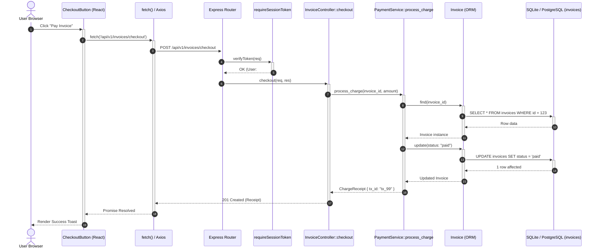

# 🛣️ Cartograph Phase 2.3: Interactive Full-Stack Route Mapper (`cartograph routes`)
## Comprehensive Technical Design & Architecture Specification (v2.3 Final)

---

## 1. Executive Summary & Architectural Vision

The primary mission of **Phase 2.3 (`cartograph routes`)** is to deliver an ultra-fast (**sub-3ms** for single-route full-stack traces, **sub-15ms** for full monorepo API inventory discovery), AST-grounded, polyglot **Interactive Full-Stack Request Flow Tracer, Frontend-to-Backend 360° Call Linker, API Contract Drift Verifier, Inverted Model-to-Route Impact Mapper, Route Hygiene & Security Auditor, and Synthetic OpenAPI 3.1 Schema Engine** for software engineers, frontend/full-stack developers, API architects, security auditors, and autonomous AI pair-programming agents.

```
┌────────────────────────────────────────────────────────────────────────────────────────────────────────┐
│                               Developer / AI Agent / CI CLI Invocation                                 │
│        cartograph routes "checkout" --method POST --format terminal                                    │
│        cartograph routes --component CheckoutButton                                                    │
│        cartograph routes --verify-contracts --branch "origin/main...HEAD" --fail-on-breaking          │
│        cartograph routes --model Invoice --format markdown                                             │
└───────────────────────────────────────────────────┬────────────────────────────────────────────────────┘
                                                    │
                                                    ▼
┌────────────────────────────────────────────────────────────────────────────────────────────────────────┐
│                        Cartograph Full-Stack Route Mapping Engine (<15ms)                              │
│                                                                                                        │
│   1. Frontend API Call Extractor   ──► Scans fetch, axios, TanStack Query in React/Vue/TSX components  │
│   2. Polyglot AST Route Extractors ──► Scans Express, Next.js, FastAPI, Flask, Django, Axum, Gin, Rails │
│   3. Universal URL Normalizer      ──► Unifies :id, {id}, <id>, [id] into RFC 6570 canonical paths     │
│   4. Hierarchical Prefix Resolver  ──► Concatenates nested routers, blueprints, and namespace scopes   │
│   5. Middleware Chain Extractor    ──► Orders Global, Router-level, and Route-level interceptors/guards│
│   6. 360° Full-Stack Request Tracer──► Maps: UI Component ──► Client Fetch ──► Route ──► Handler     │
│                                        ──► Domain Services ──► Repositories ──► ORM Models ──► SQL    │
│   7. Inverted Model-to-Route Tracer──► Discovers all ingress endpoints mutating or reading a DB Model  │
│   8. API Contract Drift Verifier   ──► Flags removed endpoints, altered methods, & breaking DTO diffs  │
│   9. Route Hygiene & Security Lint ──► Flags Dead Handlers, Shadowed Paths, and Unauthenticated Routes │
│  10. OpenAPI 3.1 Schema Synthesizer──► Auto-generates valid OpenAPI 3.1 JSON/YAML directly from AST    │
└───────────────────────────────────────────────────┬────────────────────────────────────────────────────┘
                                                    │
                                                    ▼
┌────────────────────────────────────────────────────────────────────────────────────────────────────────┐
│                             Quad-Engine Presentation Layer (<3ms)                                      │
│   • ANSI Terminal:  Color badges (POST /api/v1/invoices), collapsible ASCII 360° execution tree        │
│   • Interactive TUI:Split-pane route navigator with fuzzy path search & real-time trace inspector      │
│   • GitHub Markdown:Summary tables & auto-generated Mermaid sequence diagrams (sequenceDiagram)       │
│   • Contract Diff:  Structured breaking change summary table with pass/fail CI quality gate exit codes │
│   • OpenAPI & JSON: Standard OpenAPI 3.1 JSON/YAML export & detailed JSON payload for MCP tools/CI     │
│   • AI Agent XML:   Token-optimized <api_routes> context block for single-turn LLM reasoning          │
└────────────────────────────────────────────────────────────────────────────────────────────────────────┘
```

### The Problem: The Full-Stack Architectural Context Gap
Modern web applications and distributed backends are built across deep architectural layers:
$$\text{Frontend UI Component} \longrightarrow \text{Clientside API Call} \longrightarrow \text{HTTP Ingress} \longrightarrow \text{Middleware / Guards} \longrightarrow \text{Controller} \longrightarrow \text{Domain Service} \longrightarrow \text{ORM Model} \longrightarrow \text{Database Table}$$

When software engineers and autonomous AI coding agents navigate, refactor, or audit codebases, they encounter six critical bottlenecks:
1. **The Ingress Blind Spot (Fragmentation of Routing DSLs)**:
   Routing in modern frameworks is declared through disparate paradigms:
   - File-system conventions (Next.js App Router `app/api/v1/users/[id]/route.ts`, Pages Router `pages/api/users.ts`).
   - Imperative router registration (Express `app.use('/api/v1', router)`, Gin `r.Group("/v1")`, Go `http.HandleFunc`).
   - Decorators and macros (FastAPI `@app.get("/items/{id}")`, Flask `@bp.route`, Actix-web `#[get("/")]`, Axum `Router::new().route(...)`, NestJS `@Controller('users')`).
   - Declarative DSLs (Ruby on Rails `config/routes.rb` with `resources`, `namespace`, `member/collection`).
   To answer "Which file handles `POST /api/v1/checkout`?", an engineer or AI agent must search through disparate configuration files, trace nested prefix strings across multiple modules, and deduce implicit conventions—often taking 5 to 10 minutes or dozens of LLM prompt turns.
2. **The Client-to-Server Disconnect (Silent Frontend Breakage)**:
   Route mappers historically truncate at the backend route boundary. But in modern full-stack web applications, endpoints are consumed by frontend components via `fetch('/api/v1/checkout')`, `axios.post(...)`, `@tanstack/react-query`, or Next.js Server Actions. When a backend route path, parameter, or method changes, frontend UI pages break silently at runtime with 404 or 400 errors.
3. **API Contract Drift & Unchecked Breaking Changes in Pull Requests**:
   Engineers frequently rename or remove route endpoints, alter query parameters, or modify response DTO serializers without realizing they have broken external clients or mobile apps. Unlike code symbols which trigger compiler errors, HTTP API contract breaks slip through pull requests unnoticed unless manually caught.
4. **The "Single-Hop" Tooling Limit**:
   Existing framework CLI tools (such as `rails routes`, `php artisan route:list`, `django show_urls`) suffer from major deficiencies:
   - **Runtime Dependency**: They execute the full application runtime. If environment variables are missing, a database is unreachable, or code has a syntax error, the command crashes.
   - **Language Isolation**: Each tool only works for a single framework.
   - **Single-Hop Truncation**: They only report `Route -> Controller::action`. They cannot trace deeper into the application: which domain services are called, which third-party APIs are contacted, which background workers are queued, and which underlying database tables are modified.
5. **The Inverted Blast-Radius Problem (Model-to-Route Impact)**:
   When modifying a database model column, changing an ORM entity, or altering a repository method, developers must determine: *"Which public HTTP endpoints expose or mutate this data?"* Currently, this requires searching for model imports across the codebase, manually following callers up the stack, and hoping no intermediate dynamic call was overlooked.
6. **API Drift & Documentation Rot**:
   Manual OpenAPI/Swagger annotations drift out of sync with actual code implementations. Route parameters are added or renamed in handlers without updating documentation, leading to client integration failures and broken contracts.

### The Solution: Cartograph Interactive Full-Stack Route Mapper 2.3
Cartograph solves full-stack request tracing **statically, deterministically, polyglot-wide, and in <3ms**:
1. **Frontend-to-Backend 360° Call Linking**:
   Extracts clientside API calls (`fetch`, `axios`, `useQuery`, `useMutation`) in React/Vue/TSX files and statically links frontend UI components to backend `NodeKind::Route` nodes. Enables querying from UI button click down to SQL database table!
2. **API Contract Drift & Breaking Change Verification (`--verify-contracts`)**:
   Compares route graphs across git branch diffs (`main...HEAD`), detecting removed routes, changed HTTP methods, new required parameters, and broken response DTO schemas with CI quality gating (`--fail-on-breaking`).
3. **Polyglot AST Route Extraction**:
   Static tree-sitter AST extractors parse route registrations across 5 major ecosystems (TypeScript/JavaScript, Python, Go, Rust, Ruby) without executing user code or requiring runtime dependencies.
4. **Universal Canonical Route Representation**:
   Normalizes heterogeneous parameter syntax (`:id`, `{id}`, `<int:id>`, `[id]`) into canonical RFC 6570 URI templates (`/api/v1/users/{id}`) while maintaining framework-native metadata.
5. **Hierarchical Prefix & Mounting Resolution**:
   Resolves nested router hierarchies (e.g. Express `app.use('/api', apiRouter)` $\to$ `apiRouter.use('/v1', v1Router)` $\to$ `v1Router.get('/users')`) and Rails `namespace`/`scope` blocks to compute the fully qualified endpoint URL.
6. **End-to-End Vertical Request Flow Tracing**:
   Traverses the code graph downstream along `EdgeKind::MapsTo`, `EdgeKind::Calls`, and `EdgeKind::References` edges to produce a complete execution pipeline:
   `UI Component -> HTTP Ingress -> Middleware Chain -> Controller -> Domain Services -> ORM Models -> SQL Tables`.
7. **Inverted Model-to-Route Impact Mapping**:
   Supports reverse querying (`cartograph routes --model User`): starts at `NodeKind::Model` or SQL table nodes and traverses upstream through incoming callers to pinpoint every public API route that touches the model.
8. **Route Hygiene, Shadowing & Security Linting**:
   - Flags **Dead Routes**: Route URLs mapped to nonexistent or unresolved handler functions.
   - Flags **Orphaned Handlers**: Controller actions that are defined but never mounted to any router.
   - Flags **Shadowed Routes**: Route patterns that are unreachable because an earlier wildcard or broad route pattern masks them.
   - Flags **Auth Gaps**: Mutating HTTP endpoints (`POST`, `PUT`, `DELETE`, `PATCH`) with zero authentication middleware or guards.
9. **Synthetic OpenAPI 3.1 & Schema Synthesis**:
   Synthesizes production-ready OpenAPI 3.1 JSON/YAML definitions directly from the AST graph, extracting path parameters, query parameters, method signatures, handler docstrings, and linked data models.
10. **Interactive TUI & Multi-Engine Output**:
    Provides an interactive terminal TUI (`-i`) for exploring endpoints, filtering by method/model, inspecting full-stack traces, alongside Markdown with Mermaid sequence diagrams, JSON for MCP/CI, and `<api_routes>` XML for AI agents.

---

## 2. Pipeline Architecture & Component Topology

```
┌────────────────────────────────────────────────────────────────────────────────────────────────────────┐
│                                   Developer, CI/CD, or Agent Input                                     │
│   cartograph routes [QUERY] [--method POST] [--component Name] [--model User] [--verify-contracts]     │
└───────────────────────────────────────────────────┬────────────────────────────────────────────────────┘
                                                    │
                                                    ▼
┌────────────────────────────────────────────────────────────────────────────────────────────────────────┐
│                        1. Target Resolution & Route Query Parser                                       │
│  • Parses query tokens: literal path ("/api/users"), pattern substring ("checkout"), or method prefix │
│  • Extracts inline directives: "method:post", "model:Order", "component:CheckoutBtn", "diff:main"     │
│  • Identifies query mode: Forward Route Search, 360° Component Query, Inverted Model, or Contract Diff│
└───────────────────────────────────────────────────┬────────────────────────────────────────────────────┘
                                                    │
                                                    ▼
┌────────────────────────────────────────────────────────────────────────────────────────────────────────┐
│                        2. Frontend Clientside API Call Extractor                                       │
│  • Scans TypeScript / TSX / JSX files for client invocations:                                          │
│    - fetch('/api/v1/users', { method: 'POST' })                                                        │
│    - axios.get('/api/v1/invoices/' + id), axios.post(...)                                              │
│    - useQuery({ queryKey: ['invoices'], queryFn: () => ... }), useMutation(...)                       │
│    - Next.js Server Actions and custom API clients (apiClient.post('/pay'))                            │
│  • Associates call-site with enclosing React/Vue component or function symbol                         │
└───────────────────────────────────────────────────┬────────────────────────────────────────────────────┘
                                                    │
                                                    ▼
┌────────────────────────────────────────────────────────────────────────────────────────────────────────┐
│                        3. Polyglot Backend AST Route Extractor Engine                                  │
│  ┌─────────────────────────────────┬─────────────────────────────────┬───────────────────────────────┐ │
│  │ TypeScript / JavaScript         │ Python                          │ Go                            │ │
│  │ • Express / Koa (app.get, router)│ • FastAPI (@app.get, @router)   │ • net/http (http.HandleFunc)  │ │
│  │ • Next.js App Router (route.ts) │ • Flask (@app.route, blueprints)│ • Gin (r.GET, r.Group)        │ │
│  │ • Next.js Pages Router (api/*.ts)│ • Django (path, re_path, urls)  │ • Echo (e.GET, e.Group)       │ │
│  │ • NestJS (@Controller, @Get)    │ • DRF (@action, DefaultRouter)  │ • Chi / Gorilla Mux (r.Get)   │ │
│  ├─────────────────────────────────┼─────────────────────────────────┼───────────────────────────────┤ │
│  │ Rust                            │ Ruby                            │ SQL Schema Linker             │ │
│  │ • Actix-web (#[get], web::route)│ • Rails (resources, namespace)  │ • DDL Tables & Views          │ │
│  │ • Axum (Router.route, get/post) │ • Sinatra (get '/path')         │ • Foreign Key Relationships   │ │
│  │ • Rocket (#[get("/<id>")])      │ • Hanami routes                 │                               │ │
│  └─────────────────────────────────┴─────────────────────────────────┴───────────────────────────────┘ │
└───────────────────────────────────────────────────┬────────────────────────────────────────────────────┘
                                                    │
                                                    ▼
┌────────────────────────────────────────────────────────────────────────────────────────────────────────┐
│                        4. Universal Normalization & Prefix Hierarchical Resolver                       │
│  • Canonical Path Normalizer: /users/:id | /users/<int:id> | /users/[id] ──► /users/{id}              │
│  • Prefix Hierarchy Concatenation: resolves nested router mounts (mount_prefix + sub_router_prefix)    │
│  • Parameter Schema Extractor: identifies path variables, types (int, uuid, str), and optionality     │
└───────────────────────────────────────────────────┬────────────────────────────────────────────────────┘
                                                    │
                                                    ▼
┌────────────────────────────────────────────────────────────────────────────────────────────────────────┐
│                        5. Frontend-to-Backend 360° Linker & Middleware Chain Extractor                 │
│  • Matches frontend fetch/axios URL template literals to server normalized route patterns             │
│  • Creates EdgeKind::Calls from UI Component to Server NodeKind::Route                                 │
│  • Extracts Global, Route-Group, and Route-Specific Middlewares in execution sequence                 │
└───────────────────────────────────────────────────┬────────────────────────────────────────────────────┘
                                                    │
                                                    ▼
┌────────────────────────────────────────────────────────────────────────────────────────────────────────┐
│                        6. Vertical Full-Stack Request Flow Tracer (SQLite CTE)                         │
│  • Hop -1: UI Component / Client API Call                                                              │
│  • Hop 0: Route AST Node (NodeKind::Route)                                                             │
│  • Hop 1: Follow EdgeKind::MapsTo ──► Handler Function / Controller Method (NodeKind::Function/Method) │
│  • Hop 2..N: Follow EdgeKind::Calls & References ──► Domain Services, Helpers, Use-Cases              │
│  • Hop N+1: Identify terminal persistence entities:                                                   │
│      - NodeKind::Model (ActiveRecord, SQLAlchemy, Django ORM, Prisma, Diesel, GORM)                    │
│      - SQL Tables & Views (mapped via table DDL AST nodes)                                             │
│  • Layer Classifier: classifies each hop into Controller, Middleware, Service, Repository, Model       │
│  • Mutation Classifier: marks route as read-only vs. mutation (POST/PUT/DELETE or write calls)         │
└───────────────────────────────────────────────────┬────────────────────────────────────────────────────┘
                                                    │
                                                    ▼
┌────────────────────────────────────────────────────────────────────────────────────────────────────────┐
│                        7. Inverted Model-to-Route Impact Tracer                                        │
│  • Operates when --model <Entity> or --table <Table> is specified:                                     │
│  • Traverses reverse callers (Calls, References) from Model upwards to reach all NodeKind::Route nodes │
│  • Pinpoints public attack surfaces and API endpoints exposed to breaking data model changes           │
└───────────────────────────────────────────────────┬────────────────────────────────────────────────────┘
                                                    │
                                                    ▼
┌────────────────────────────────────────────────────────────────────────────────────────────────────────┐
│                        8. API Contract Drift & Breaking Change Verifier                                │
│  • Compares Route Graph across git branch diff (main...HEAD):                                          │
│    - Removed endpoints: DELETE/POST/GET endpoints missing in current branch                            │
│    - Method mutations: GET changed to POST or vice-versa                                               │
│    - Parameter breaking changes: newly mandatory parameters added without default fallback            │
│    - Response schema breakage: fields removed from serialized DTO/Model response payloads              │
│  • Enforces CI Quality Gate: exits with code 1 upon detected breaking modifications                   │
└───────────────────────────────────────────────────┬────────────────────────────────────────────────────┘
                                                    │
                                                    ▼
┌────────────────────────────────────────────────────────────────────────────────────────────────────────┐
│                        9. Route Hygiene, Shadowing & Security Auditor                                  │
│  • Dead Route Detector: identifies routes whose handler symbols fail to link to a valid AST node       │
│  • Orphaned Handler Detector: identifies controller functions never bound to any router pattern        │
│  • Shadowed Route Detector: detects route patterns masked by preceding broad/wildcard routes           │
│  • Auth Gap Auditor: flags mutating routes (POST/PUT/DELETE) without authentication middleware         │
└───────────────────────────────────────────────────┬────────────────────────────────────────────────────┘
                                                    │
                                                    ▼
┌────────────────────────────────────────────────────────────────────────────────────────────────────────┐
│                        10. Synthetic OpenAPI 3.1 & Quad-Engine Presentation Layer                      │
│  • ANSI Terminal: Colorized HTTP badges, 360° call trees from UI to DB, contract diff report           │
│  • Interactive TUI (-i): Split-pane explorer with live search, expandable call trees, model inspection │
│  • GitHub Markdown: Summary tables with auto-generated Mermaid sequence diagrams (sequenceDiagram)    │
│  • OpenAPI 3.1 Exporter: Valid JSON/YAML OpenAPI 3.1 specification generated directly from AST         │
│  • AI Agent XML: Structured <api_routes> context blocks for single-turn LLM reasoning                  │
└────────────────────────────────────────────────────────────────────────────────────────────────────────┘
```

---

## 3. Data Models & Interface Contracts

All route mapping data structures are strongly typed, fully serializable via Serde, and positioned in `cartograph-core::model` and `cartograph-engine::routes`.

### 3.1 Core Data Structures (`cartograph-core::model`)

```rust
use serde::{Deserialize, Serialize};
use std::collections::{HashMap, HashSet};
use crate::model::{Node, NodeKind};

/// HTTP Methods supported by standard web frameworks
#[derive(Debug, Clone, Copy, PartialEq, Eq, Hash, Serialize, Deserialize)]
#[serde(rename_all = "UPPERCASE")]
pub enum HttpMethod {
    Get,
    Post,
    Put,
    Patch,
    Delete,
    Options,
    Head,
    Trace,
    Connect,
    /// Wildcard or all methods (e.g. Express app.all, Django view without method guard)
    All,
}

impl HttpMethod {
    pub fn as_str(&self) -> &'static str {
        match self {
            HttpMethod::Get => "GET",
            HttpMethod::Post => "POST",
            HttpMethod::Put => "PUT",
            HttpMethod::Patch => "PATCH",
            HttpMethod::Delete => "DELETE",
            HttpMethod::Options => "OPTIONS",
            HttpMethod::Head => "HEAD",
            HttpMethod::Trace => "TRACE",
            HttpMethod::Connect => "CONNECT",
            HttpMethod::All => "ALL",
        }
    }

    /// Whether this HTTP method typically implies data mutation
    pub fn is_mutation(&self) -> bool {
        matches!(
            self,
            HttpMethod::Post | HttpMethod::Put | HttpMethod::Patch | HttpMethod::Delete
        )
    }
}

impl std::fmt::Display for HttpMethod {
    fn fmt(&self, f: &mut std::fmt::Formatter<'_>) -> std::fmt::Result {
        write!(f, "{}", self.as_str())
    }
}

impl std::str::FromStr for HttpMethod {
    type Err = String;

    fn from_str(s: &str) -> Result<Self, Self::Err> {
        match s.to_uppercase().as_str() {
            "GET" => Ok(HttpMethod::Get),
            "POST" => Ok(HttpMethod::Post),
            "PUT" => Ok(HttpMethod::Put),
            "PATCH" => Ok(HttpMethod::Patch),
            "DELETE" => Ok(HttpMethod::Delete),
            "OPTIONS" => Ok(HttpMethod::Options),
            "HEAD" => Ok(HttpMethod::Head),
            "TRACE" => Ok(HttpMethod::Trace),
            "CONNECT" => Ok(HttpMethod::Connect),
            "ALL" | "*" => Ok(HttpMethod::All),
            other => Err(format!("Unknown HTTP method: {other}")),
        }
    }
}

/// Authentication and authorization classifications for routes
#[derive(Debug, Clone, PartialEq, Eq, Hash, Serialize, Deserialize)]
#[serde(rename_all = "snake_case")]
pub enum RouteAuthKind {
    /// Explicitly public / unauthenticated endpoint
    Public,
    /// Protected by session, JWT, or bearer token guard
    Protected,
    /// Protected by API Key header
    ApiKey,
    /// OAuth2 / OIDC scope guarded
    OAuth2(Vec<String>),
    /// Custom middleware or decorator authentication
    Custom(String),
    /// Authentication state cannot be determined with certainty
    Unknown,
}

/// Location of a route parameter in the HTTP request
#[derive(Debug, Clone, Copy, PartialEq, Eq, Hash, Serialize, Deserialize)]
#[serde(rename_all = "snake_case")]
pub enum ParamLocation {
    Path,
    Query,
    Header,
    Cookie,
    Body,
}

/// A parsed parameter associated with an HTTP route
#[derive(Debug, Clone, PartialEq, Serialize, Deserialize)]
pub struct RouteParameter {
    pub name: String,
    pub location: ParamLocation,
    #[serde(skip_serializing_if = "Option::is_none")]
    pub type_hint: Option<String>,
    pub required: bool,
    #[serde(skip_serializing_if = "Option::is_none")]
    pub default_value: Option<String>,
    #[serde(skip_serializing_if = "Option::is_none")]
    pub description: Option<String>,
}

/// A middleware or interceptor in the request processing pipeline
#[derive(Debug, Clone, PartialEq, Serialize, Deserialize)]
pub struct MiddlewareNode {
    pub name: String,
    pub filepath: String,
    pub start_line: u32,
    pub is_global: bool,
    pub auth_kind: Option<RouteAuthKind>,
    #[serde(skip_serializing_if = "Option::is_none")]
    pub description: Option<String>,
}

/// Supported clientside API invocation libraries
#[derive(Debug, Clone, PartialEq, Eq, Hash, Serialize, Deserialize)]
#[serde(rename_all = "snake_case")]
pub enum ApiClientKind {
    Fetch,
    Axios,
    TanStackQuery,
    NextServerAction,
    Custom(String),
}

/// A clientside frontend API invocation site linking a UI component to a backend route
#[derive(Debug, Clone, PartialEq, Serialize, Deserialize)]
pub struct ApiClientCallSite {
    pub caller_node_id: String,
    #[serde(skip_serializing_if = "Option::is_none")]
    pub component_name: Option<String>,
    pub filepath: String,
    pub line: u32,
    pub method: HttpMethod,
    pub url_pattern: String,
    pub client_kind: ApiClientKind,
}

/// Architectural layer classification of a step in the execution trace
#[derive(Debug, Clone, Copy, PartialEq, Eq, Hash, Serialize, Deserialize)]
#[serde(rename_all = "snake_case")]
pub enum TraceLayer {
    /// Frontend UI Component (e.g. React/Vue button, page)
    FrontendComponent,
    /// Clientside API fetch/axios invocation
    ApiClient,
    /// Ingress router definition
    Route,
    /// Middleware or authentication guard
    Middleware,
    /// Web controller or request handler view
    Controller,
    /// Domain or business application service
    Service,
    /// Data access object or repository
    Repository,
    /// ORM data model or entity
    Model,
    /// Relational database table
    DatabaseTable,
    /// Background job or task queue dispatcher
    Worker,
    /// Utility or helper function
    Utility,
    /// Unclassified call step
    Unknown,
}

/// An individual hop in the full-stack request execution trace
#[derive(Debug, Clone, PartialEq, Serialize, Deserialize)]
pub struct TraceStep {
    pub node_id: String,
    pub name: String,
    pub kind: NodeKind,
    pub filepath: String,
    pub line: u32,
    pub hop: usize,
    pub layer: TraceLayer,
    #[serde(skip_serializing_if = "Option::is_none")]
    pub signature: Option<String>,
    #[serde(skip_serializing_if = "Option::is_none")]
    pub docstring: Option<String>,
    pub is_mutation: bool,
}

/// Severity classification of an API contract modification
#[derive(Debug, Clone, Copy, PartialEq, Eq, Hash, Serialize, Deserialize)]
#[serde(rename_all = "snake_case")]
pub enum ContractChangeSeverity {
    /// Incompatible breaking change that breaks existing API clients
    Breaking,
    /// Dangerous modification that may cause regressions under certain conditions
    Dangerous,
    /// Non-breaking backward-compatible enhancement (e.g. new optional parameter)
    Informational,
}

/// Specific type of contract drift or breaking change
#[derive(Debug, Clone, PartialEq, Eq, Hash, Serialize, Deserialize)]
#[serde(rename_all = "snake_case", tag = "kind")]
pub enum ContractChangeKind {
    /// A previously published route endpoint was deleted
    RouteRemoved,
    /// An endpoint's HTTP method changed (e.g. GET -> POST)
    MethodChanged { old_method: HttpMethod, new_method: HttpMethod },
    /// A newly mandatory path, query, or header parameter was added without a default
    NewRequiredParam { name: String, location: ParamLocation },
    /// A parameter was removed from an endpoint
    RemovedParam { name: String },
    /// A parameter's data type changed (e.g. integer -> string)
    ParamTypeChanged { name: String, old_type: String, new_type: String },
    /// A required field was added to a request body DTO
    RequiredBodyFieldAdded { field: String },
    /// A field was deleted from a response payload or DTO model
    ResponseFieldRemoved { field: String },
    /// An endpoint previously Public was elevated to Protected
    AuthElevated { old_auth: RouteAuthKind, new_auth: RouteAuthKind },
}

/// A concrete breaking change detected between two versions of the API contract
#[derive(Debug, Clone, PartialEq, Serialize, Deserialize)]
pub struct ContractBreakingChange {
    pub route_id: String,
    pub path: String,
    pub method: HttpMethod,
    pub severity: ContractChangeSeverity,
    pub change: ContractChangeKind,
    pub description: String,
    pub filepath: String,
    pub line: u32,
    #[serde(skip_serializing_if = "Option::is_none")]
    pub remediation_hint: Option<String>,
}

/// Top-level report emitted by `--verify-contracts`
#[derive(Debug, Clone, PartialEq, Serialize, Deserialize)]
pub struct ContractDiffReport {
    pub base_ref: String,
    pub head_ref: String,
    pub total_routes_base: usize,
    pub total_routes_head: usize,
    pub breaking_changes: Vec<ContractBreakingChange>,
    pub non_breaking_changes: Vec<ContractBreakingChange>,
    pub passed: bool,
    pub execution_time_ms: f64,
}

/// Route health and security anomaly issues
#[derive(Debug, Clone, PartialEq, Eq, Hash, Serialize, Deserialize)]
#[serde(rename_all = "snake_case", tag = "type")]
pub enum RouteHealthIssue {
    /// Route is registered in router/urls but handler symbol cannot be found in codebase
    DanglingHandler { handler_name: String },
    /// Route is unreachable because a preceding pattern shadows it
    ShadowedBy { shadowing_pattern: String, line: u32 },
    /// Mutating route (POST/PUT/DELETE/PATCH) with no authentication guard
    UnauthenticatedMutation,
    /// Handler exceeds recommended complexity or touches too many models (God Controller)
    HighCoupling { model_count: usize },
    /// Route handler does not validate request body or input parameters
    MissingValidation,
}

/// Complete full-stack trace and metadata for an API endpoint
#[derive(Debug, Clone, PartialEq, Serialize, Deserialize)]
pub struct FullStackRouteTrace {
    /// Canonical node ID of the route
    pub id: String,
    /// HTTP Method (GET, POST, etc.)
    pub method: HttpMethod,
    /// Original raw route pattern (e.g. "/users/:id" or "path('users/<int:id>/')")
    pub raw_pattern: String,
    /// Canonical normalized URL pattern (RFC 6570, e.g. "/users/{id}")
    pub normalized_path: String,
    /// Web framework detected (e.g. "express", "fastapi", "django", "nextjs", "rails", "axum", "gin")
    pub framework: String,
    /// Filepath where route is registered
    pub filepath: String,
    pub line: u32,
    /// Frontend UI components that call this endpoint
    pub frontend_callers: Vec<ApiClientCallSite>,
    /// Extracted path and query parameters
    pub parameters: Vec<RouteParameter>,
    /// Ordered chain of middlewares executed before handler
    pub middlewares: Vec<MiddlewareNode>,
    /// Target controller / view handler node
    #[serde(skip_serializing_if = "Option::is_none")]
    pub handler: Option<Node>,
    /// Sequential vertical execution trace through services and repositories
    pub call_chain: Vec<TraceStep>,
    /// All ORM data models touched by this route
    pub models_touched: Vec<Node>,
    /// All relational SQL database tables touched by this route
    pub sql_tables: Vec<String>,
    /// Authentication classification
    pub auth: RouteAuthKind,
    /// Whether this endpoint modifies data
    pub is_mutation: bool,
    /// Edge resolution confidence score (0.0 to 1.0)
    pub confidence: f64,
    /// Health, shadowing, and security issues
    pub issues: Vec<RouteHealthIssue>,
}
```

### 3.2 Query & Filter Interface Contracts (`cartograph-engine::routes`)

```rust
use serde::{Deserialize, Serialize};
use crate::model::HttpMethod;

/// Filtering options for route queries
#[derive(Debug, Clone, Default, Serialize, Deserialize)]
pub struct RouteFilterOptions {
    /// Filter by HTTP method (e.g. GET, POST)
    pub method: Option<HttpMethod>,
    /// Substring, glob, or regex match on normalized path
    pub path_pattern: Option<String>,
    /// Filter routes called by a specific frontend UI component (e.g. "CheckoutButton")
    pub component_name: Option<String>,
    /// Show frontend callers for matched routes
    pub show_callers: bool,
    /// Verify API contracts across git branch diff
    pub verify_contracts: bool,
    /// Git branch diff range for contract verification (e.g. "main...HEAD")
    pub branch: Option<String>,
    /// CI Quality Gate: fail with exit code 1 if breaking changes exist
    pub fail_on_breaking: bool,
    /// Filter routes that touch a specific ORM model name
    pub model_name: Option<String>,
    /// Filter routes that touch a specific SQL table name
    pub sql_table: Option<String>,
    /// Filter by handler function name or controller class
    pub handler_name: Option<String>,
    /// Filter by web framework (e.g. "fastapi", "express", "nextjs")
    pub framework: Option<String>,
    /// Show only authenticated / protected endpoints
    pub auth_only: bool,
    /// Show only public / unauthenticated endpoints
    pub public_only: bool,
    /// Show only routes with health/security issues
    pub issues_only: bool,
    /// Show only dead/dangling routes
    pub dead_only: bool,
    /// Show only shadowed routes
    pub shadowed_only: bool,
    /// Maximum downstream call chain depth to trace (default: 5)
    pub max_depth: usize,
    /// Minimum edge confidence threshold (default: 0.5)
    pub min_confidence: f64,
}

/// Statistical summary of the discovered route inventory
#[derive(Debug, Clone, Default, PartialEq, Serialize, Deserialize)]
pub struct RouteSummary {
    pub total_routes: usize,
    pub routes_by_method: HashMap<String, usize>,
    pub routes_by_framework: HashMap<String, usize>,
    pub public_routes: usize,
    pub protected_routes: usize,
    pub mutating_routes: usize,
    pub total_models_exposed: usize,
    pub total_frontend_callers: usize,
    pub dead_routes_count: usize,
    pub shadowed_routes_count: usize,
    pub security_warnings_count: usize,
    pub breaking_contract_changes: usize,
}

/// The top-level report emitted by `cartograph routes`
#[derive(Debug, Clone, PartialEq, Serialize, Deserialize)]
pub struct RouteReport {
    /// List of mapped full-stack route traces matching filters
    pub routes: Vec<FullStackRouteTrace>,
    /// Total count of routes discovered before filtering
    pub total_discovered: usize,
    /// Statistical breakdown
    pub summary: RouteSummary,
    /// Contract diff report if --verify-contracts was run
    #[serde(skip_serializing_if = "Option::is_none")]
    pub contract_diff: Option<ContractDiffReport>,
    /// Execution time in milliseconds
    pub execution_time_ms: f64,
}
```

---

## 4. Detailed Component Design & Implementation

### 4.1 Polyglot AST Route Extractors (`cartograph-ast`)

The extractor pipeline parses framework-specific routing patterns into standardized `NodeKind::Route` nodes with rich metadata and creates `EdgeKind::MapsTo` links to handler symbols.

```
┌────────────────────────────────────────────────────────────────────────────────────────┐
│                              Framework AST Extractor Matrix                            │
├─────────────────┬───────────────────────────────┬──────────────────────────────────────┤
│ Language        │ Framework                     │ Pattern Extraction Target            │
├─────────────────┼───────────────────────────────┼──────────────────────────────────────┤
│ TypeScript / JS │ Express.js / Koa              │ app.get(), router.post(), app.use()  │
│ TypeScript / JS │ Next.js App Router            │ app/api/**/route.ts (GET, POST fn)   │
│ TypeScript / JS │ Next.js Pages Router          │ pages/api/**/*.ts (default export fn)│
│ TypeScript / JS │ NestJS                        │ @Controller(), @Get(), @Post()       │
│ TypeScript / JS │ Fastify / Hono                │ app.get(), app.route(), app.post()   │
├─────────────────┼───────────────────────────────┼──────────────────────────────────────┤
│ Python          │ FastAPI                       │ @app.get(), @router.post(), Depends()│
│ Python          │ Flask                         │ @app.route(), @bp.route()            │
│ Python          │ Django / DRF                  │ path(), re_path(), @action, Router   │
├─────────────────┼───────────────────────────────┼──────────────────────────────────────┤
│ Go              │ net/http                      │ http.HandleFunc(), http.Handle()     │
│ Go              │ Gin                           │ r.GET(), r.POST(), r.Group()         │
│ Go              │ Echo                          │ e.GET(), e.POST(), e.Group()         │
│ Go              │ Chi / Gorilla Mux             │ r.Get(), r.Post(), r.Route()         │
├─────────────────┼───────────────────────────────┼──────────────────────────────────────┤
│ Rust            │ Actix-web                     │ #[get(...)], web::resource().route() │
│ Rust            │ Axum                          │ Router::new().route(), get(), post() │
│ Rust            │ Rocket                        │ #[get("/<id>")], routes![...]        │
├─────────────────┼───────────────────────────────┼──────────────────────────────────────┤
│ Ruby            │ Ruby on Rails                 │ resources, resource, namespace, get  │
│ Ruby            │ Sinatra                       │ get '/path', post '/path'            │
└─────────────────┴───────────────────────────────┴──────────────────────────────────────┘
```

#### 4.1.1 TypeScript / JavaScript Extractor Enhancements (`typescript.rs`)
1. **Express.js Router Traversal**:
   - Matches call expressions on router identifiers: `(call_expression function: (member_expression object: (_) property: (property_identifier) @method) arguments: (arguments) @args)`.
   - Recognizes `@method` matching `get`, `post`, `put`, `delete`, `patch`, `all`, `use`.
   - First string argument extracts the route pattern (e.g. `"/api/v1/checkout"`).
   - Traverses arguments: intermediate function identifiers are cataloged as `middlewares`, and the final function/arrow function/identifier is cataloged as `target_view` / handler.
   - For `app.use('/prefix', subRouter)`: extracts prefix mounts and stores them for hierarchical router assembly.
2. **Next.js App Router & Pages Router**:
   - File-path convention scanner:
     - Detects files matching `app/**/route.{ts,js,tsx,jsx}`.
     - Automatically derives the canonical route path from directory structure:
       e.g. `app/api/v1/invoices/[id]/route.ts` $\longrightarrow$ `/api/v1/invoices/{id}`.
     - Inspects named exports: exported functions named `GET`, `POST`, `PUT`, `DELETE`, `PATCH`, `HEAD`, `OPTIONS` each generate a `NodeKind::Route` node mapped to that export function!
   - Detects `pages/api/**/*.ts`: derives `/api/*` route paths mapped to `export default`.
3. **NestJS Decorators**:
   - Detects `@Controller('prefix')` on class declarations.
   - Inside the class, detects method decorators: `@Get('path')`, `@Post('path')`, `@Put('path')`, `@Delete('path')`.
   - Concatenates class prefix with method path.
   - Detects `@UseGuards(AuthGuard)` as middleware annotations.

#### 4.1.2 Python Extractor Enhancements (`python.rs`)
1. **FastAPI & APIRouter**:
   - Matches decorated function definitions: `@app.get("/items/{item_id}")` or `@router.post("/checkout")`.
   - Extracts path parameters and query parameters directly from Python type annotations (e.g. `item_id: int`, `q: Optional[str] = None`).
   - Extracts dependencies: inspects `Depends(verify_token)` parameters and maps them as `middlewares` and `RouteAuthKind::Protected`!
2. **Flask & Blueprints**:
   - Matches `@app.route("/path", methods=["GET", "POST"])` and `@blueprint.route("/path")`.
   - Extracts method array or defaults to `["GET"]`.
   - Normalizes `<int:id>` and `<uuid:code>` syntax to `{id}` and `{code}`.
3. **Django & Django REST Framework (DRF)**:
   - Extends existing `urls.py` parser (`path`, `re_path`, `include`).
   - Parses DRF ViewSets with `@action(detail=True, methods=['post'])`.
   - Expands `DefaultRouter().register('users', UserViewSet)` into standard RESTful endpoints:
     - `GET /users/` $\to$ `UserViewSet::list`
     - `POST /users/` $\to$ `UserViewSet::create`
     - `GET /users/{id}/` $\to$ `UserViewSet::retrieve`
     - `PUT /users/{id}/` $\to$ `UserViewSet::update`
     - `DELETE /users/{id}/` $\to$ `UserViewSet::destroy`

#### 4.1.3 Go Extractor Enhancements (`go.rs`)
1. **Gin / Echo / Chi Frameworks**:
   - Matches call expressions: `r.GET("/users/:id", handler)` or `r.POST("/login", authMiddleware, loginHandler)`.
   - Recognizes route grouping: `v1 := r.Group("/api/v1"); v1.POST("/users", createUser)` captures group prefix hierarchy.
   - Maps intermediate handler arguments as `middlewares`.
2. **Standard Library `net/http`**:
   - Matches `http.HandleFunc("/pattern", handlerFn)` and `mux.HandleFunc(...)`.

#### 4.1.4 Rust Extractor Enhancements (`rust.rs`)
1. **Actix-web**:
   - Matches attribute macros: `#[get("/users/{id}")]`, `#[post("/checkout")]`.
   - Matches resource routing: `web::resource("/users").route(web::post().to(create_user))`.
2. **Axum**:
   - Matches method chaining on `Router`: `Router::new().route("/users", get(list_users).post(create_user))`.
   - Extracts nested route layers: `.layer(axum::middleware::from_fn(auth_guard))`.

#### 4.1.5 Ruby Extractor Enhancements (`ruby.rs`)
1. **Rails `routes.rb` Full Expansion**:
   - Expands `resources :invoices` into the 7 RESTful actions (`index`, `new`, `create`, `show`, `edit`, `update`, `destroy`) linking directly to `InvoicesController` action methods.
   - Resolves `namespace :api do namespace :v1 do ... end end` prefix compounding.
   - Supports member and collection blocks (`member { post :preview }`).

---

### 4.2 Universal URL Normalization & Hierarchical Prefix Assembly

Routing frameworks employ wildly inconsistent syntax for dynamic path parameters:
- Express / Gin / Rails: `/api/v1/users/:id/posts/:post_id`
- FastAPI / OpenAPI / Axum: `/api/v1/users/{id}/posts/{post_id}`
- Flask: `/api/v1/users/<int:id>/posts/<uuid:post_id>`
- Next.js: `/api/v1/users/[id]/posts/[post_id]`
- Django: `users/<int:id>/posts/<slug:slug>/`

#### The Canonical Path Normalization Algorithm
Cartograph normalizes all paths to standard **RFC 6570 URI Templates** (`/api/v1/users/{id}/posts/{post_id}`):

```rust
pub fn normalize_route_path(raw: &str) -> (String, Vec<RouteParameter>) {
    let mut params = Vec::new();
    let mut normalized = String::with_capacity(raw.len());
    let chars: Vec<char> = raw.chars().collect();
    let mut i = 0;

    while i < chars.len() {
        match chars[i] {
            // Express / Gin / Rails: :param
            ':' => {
                i += 1;
                let mut name = String::new();
                while i < chars.len() && (chars[i].is_alphanumeric() || chars[i] == '_') {
                    name.push(chars[i]);
                    i += 1;
                }
                normalized.push_str(&format!("{{{name}}}"));
                params.push(RouteParameter {
                    name,
                    location: ParamLocation::Path,
                    type_hint: None,
                    required: true,
                    default_value: None,
                    description: None,
                });
            }
            // Flask / Django: <param> or <type:param>
            '<' => {
                i += 1;
                let mut token = String::new();
                while i < chars.len() && chars[i] != '>' {
                    token.push(chars[i]);
                    i += 1;
                }
                if i < chars.len() && chars[i] == '>' {
                    i += 1; // skip '>'
                }
                let (type_hint, name) = if let Some((t, n)) = token.split_once(':') {
                    (Some(t.to_string()), n.to_string())
                } else {
                    (None, token)
                };
                normalized.push_str(&format!("{{{name}}}"));
                params.push(RouteParameter {
                    name,
                    location: ParamLocation::Path,
                    type_hint,
                    required: true,
                    default_value: None,
                    description: None,
                });
            }
            // Next.js: [param] or [...slug]
            '[' => {
                i += 1;
                let mut name = String::new();
                while i < chars.len() && chars[i] != ']' {
                    name.push(chars[i]);
                    i += 1;
                }
                if i < chars.len() && chars[i] == ']' {
                    i += 1;
                }
                let cleaned_name = name.trim_start_matches('.').to_string();
                normalized.push_str(&format!("{{{cleaned_name}}}"));
                params.push(RouteParameter {
                    name: cleaned_name,
                    location: ParamLocation::Path,
                    type_hint: None,
                    required: !name.starts_with("[["), // Next.js optional catch-all [[...slug]]
                    default_value: None,
                    description: None,
                });
            }
            // Already standard {param}
            '{' => {
                i += 1;
                let mut name = String::new();
                while i < chars.len() && chars[i] != '}' {
                    name.push(chars[i]);
                    i += 1;
                }
                if i < chars.len() && chars[i] == '}' {
                    i += 1;
                }
                normalized.push_str(&format!("{{{name}}}"));
                params.push(RouteParameter {
                    name,
                    location: ParamLocation::Path,
                    type_hint: None,
                    required: true,
                    default_value: None,
                    description: None,
                });
            }
            c => {
                normalized.push(c);
                i += 1;
            }
        }
    }

    // Ensure leading slash and remove trailing slash (except root "/")
    let mut formatted = normalized.trim().to_string();
    if !formatted.starts_with('/') {
        formatted.insert(0, '/');
    }
    if formatted.len() > 1 && formatted.ends_with('/') {
        formatted.pop();
    }

    (formatted, params)
}
```

#### Hierarchical Router Mounting Assembly
When routers are mounted hierarchically (e.g. `app.use('/api', v1Router)` where `v1Router.use('/users', userRouter)` and `userRouter.get('/:id')`), the Linker performs top-down prefix concatenation:
$$\text{Full Path} = \text{Prefix}_{\text{Root}} \mathbin{\Vert} \text{Prefix}_{\text{Group}} \mathbin{\Vert} \text{Path}_{\text{Route}}$$

---

### 4.3 Vertical Full-Stack Request Flow Tracer (`cartograph-engine::routes::tracer`)

Once a `NodeKind::Route` node is linked to its handler function (`EdgeKind::MapsTo`), the tracer follows execution downstream through the entire application architecture:

```
┌────────────────────────────────────────────────────────────────────────────────────────────────────────┐
│                              Vertical Execution Layer Classification                                   │
├───────────────┬─────────────────────────────────────────────────┬──────────────────────────────────────┤
│ Layer         │ Recognition Heuristics                          │ Example Target AST Nodes             │
├───────────────┼─────────────────────────────────────────────────┼──────────────────────────────────────┤
│ Middleware    │ Registered in route args, intercepts req/res,   │ authGuard, verifySession, rateLimiter│
│               │ uses @UseGuards, Depends(auth_fn), Use()        │                                      │
├───────────────┼─────────────────────────────────────────────────┼──────────────────────────────────────┤
│ Controller    │ Destination of MapsTo edge, accepts req/res or  │ UserController::create, view_invoice │
│               │ decorated route handler                         │                                      │
├───────────────┼─────────────────────────────────────────────────┼──────────────────────────────────────┤
│ Service       │ Invoked by Controller, encapsulates business    │ PaymentService::charge, OrderManager │
│               │ logic, uses-cases, or domain managers           │                                      │
├───────────────┼─────────────────────────────────────────────────┼──────────────────────────────────────┤
│ Repository    │ Encapsulates data queries, DAO pattern, uses    │ UserRepository::find_by_email,       │
│               │ query builders or SQL executors                 │ InvoiceDao::update_status            │
├───────────────┼─────────────────────────────────────────────────┼──────────────────────────────────────┤
│ Model         │ NodeKind::Model, inherits ORM base class        │ Invoice, User, Transaction, Account  │
│               │ (Model, ActiveRecord::Base, DeclarativeBase)    │                                      │
├───────────────┼─────────────────────────────────────────────────┼──────────────────────────────────────┤
│ DatabaseTable │ SQL DDL CREATE TABLE node or table reference in │ tables: invoices, transactions, users│
│               │ ORM __tablename__ / tableName attribute         │                                      │
└───────────────┴─────────────────────────────────────────────────┴──────────────────────────────────────┘
```

#### Graph Traversal Execution Steps:
1. **Root Extraction**: Retrieve `Route` node and its outgoing `EdgeKind::MapsTo` edge to find `Handler`.
2. **Middleware Ordering**: Walk incoming/associated `Middleware` edges attached to the Route or parent Router group, classifying their security tier (`RouteAuthKind`).
3. **Downstream Call Traversal**:
   - Perform Breadth-First Search (BFS) / Depth-First Search (DFS) from `Handler` along outgoing `EdgeKind::Calls` and `EdgeKind::References` edges up to `max_depth` (default: 5).
   - Apply cycle prevention via visited node sets.
   - Filter low-confidence edges using `min_confidence`.
4. **Entity & Model Identification**:
   - If a visited node has `kind == NodeKind::Model`, register it in `models_touched`.
   - If a visited node or referenced call links to a SQL DDL table node (e.g. `CREATE TABLE users`), register it in `sql_tables`.
   - Detect ORM query patterns:
     - Python: `Model.objects.filter()`, `session.query(Model)`
     - TypeScript: `prisma.model.findMany()`, `typeorm.getRepository(Model)`
     - Ruby: `Model.where(...)`, `Model.find(...)`
     - Go: `db.Where(...).Find(&models)`, `db.Query("SELECT ... FROM users")`
     - Rust: `diesel::insert_into(users::table)`, `sqlx::query_as!(Model, ...)`
5. **Mutation Classification**:
   - If HTTP method is `POST`, `PUT`, `PATCH`, or `DELETE`, `is_mutation = true`.
   - If HTTP method is `GET`, inspect call chain: if write methods (`save`, `delete`, `update`, `insert`, `commit`) are called, flag as an impure mutation warning!

---

### 4.4 Inverted Model-to-Route Impact Tracer

A marquee capability of Cartograph 2.3 is **reverse route mapping**:
$$\text{Database Model / Entity} \overset{\text{Reverse Calls}}{\longleftarrow\join} \text{Services / Repositories} \overset{\text{Reverse Calls}}{\longleftarrow\join} \text{Controllers} \overset{\text{Reverse MapsTo}}{\longleftarrow\join} \text{HTTP Ingress Routes}$$

```
                                  INVERTED TRAVERSAL
 ┌───────────────┐     Calls     ┌───────────────┐     Calls     ┌──────────────────┐    MapsTo   ┌───────────────────────┐
 │ Model: Invoice│ ◄──────────── │ PaymentService│ ◄──────────── │ InvoiceController│ ◄────────── │ POST /api/v1/checkout │
 └───────────────┘               └───────────────┘               └──────────────────┘             └───────────────────────┘
         ▲                                                                                          ▲
         │                       Calls                           ┌──────────────────┐    MapsTo     │
         └────────────────────────────────────────────────────── │ BillingAdminView │ ◄──────────── │ GET /admin/invoices   │
                                                                 └──────────────────┘             └───────────────────────┘
```

#### Why Inverted Route Mapping is Essential:
1. **Safe Database Refactoring & Migrations**:
   When an engineer renames a column in `models/invoice.py` or alters an enum in `Invoice.ts`, they run:
   ```bash
   cartograph routes --model Invoice
   ```
   In **<3ms**, Cartograph outputs all 8 API endpoints across the monorepo that expose or modify `Invoice`.
2. **Zero-Turn AI Migration Assistance**:
   When an AI agent modifies a database entity, Cartograph automatically informs the model:
   *"Altering `Invoice.status` impacts endpoints: `POST /api/v1/checkout`, `PUT /api/v1/invoices/{id}`, and `GET /admin/invoices`. Updating serializers and request schemas accordingly."*

---

### 4.5 Route Hygiene, Shadowing & Security Auditor

Cartograph 2.3 inspects the route graph for structural anomalies and security risks:

#### 1. Dead / Dangling Route Detection
- A route is registered (e.g. `path('checkout/', views.process_payment)`) but the symbol `process_payment` cannot be resolved in `views.py` or points to an unresolved reference.
- Emits `RouteHealthIssue::DanglingHandler`.

#### 2. Orphaned Handler Detection
- A controller class or exported handler function (e.g. `pub async fn legacy_billing_callback(...)`) exists in a controllers directory, but has 0 incoming `MapsTo` or `Calls` edges from any route definition.
- Helps developers prune dead API code.

#### 3. Route Shadowing Detection
- Path collision occurs when an earlier registered route pattern masks a subsequent, more specific route:
  - Example in routers without radix/trie static-precedence:
    1. Registered: `/api/v1/users/{id}`
    2. Registered: `/api/v1/users/me`
  - In linear routing engines, requests to `/api/v1/users/me` match `{id} = "me"` and never reach the intended `me` handler!
- The shadowing detector constructs a segment tree and flags any route where a previously registered route pattern intercepts all possible paths.
- Emits `RouteHealthIssue::ShadowedBy`.

#### 4. Unauthenticated Mutating Route Audit (Auth Gaps)
- Mutating endpoints (`POST`, `PUT`, `DELETE`, `PATCH`) that have `auth == RouteAuthKind::Public` or `auth == RouteAuthKind::Unknown` and zero security middleware in their chain are flagged with `RouteHealthIssue::UnauthenticatedMutation`.
- Prevents accidental exposure of internal or administrative operations to the public internet.

---

### 4.6 Synthetic OpenAPI 3.1 Specification Synthesizer

Cartograph 2.3 can automatically synthesize a complete, valid **OpenAPI 3.1.0** specification directly from the static AST code graph, **without running the application or installing external dependencies**:

```bash
cartograph routes --format openapi > openapi.json
```

#### Synthesis Workflow:
1. **Paths Object**:
   - Key: Canonical normalized path (`/api/v1/users/{id}`).
   - Field: HTTP Method in lowercase (`get`, `post`, `put`, `delete`).
2. **Operation Object**:
   - `operationId`: Derived from handler function name (e.g. `getUserById`).
   - `summary`: First line of handler docstring.
   - `description`: Remaining body of handler docstring.
   - `parameters`: Path and query parameters extracted from AST type annotations.
   - `requestBody`: Extracted from parameter type hints matching request/DTO classes or Pydantic models.
   - `responses`:
     - Default `200 OK` or `201 Created` (for `POST`).
     - Schema reference: linked to `NodeKind::Model` or return type signature.
   - `security`: Populated if `RouteAuthKind::Protected` or `ApiKey` is detected.
3. **Components / Schemas Object**:
   - Synthesizes JSON Schemas for each touched `NodeKind::Model` or DTO struct based on its fields and attributes!

---

### 4.7 Frontend-to-Backend 360° Call Linking Engine (`cartograph-engine::routes::frontend`)

The frontend linker bridges clientside JavaScript/TypeScript AST nodes with server `NodeKind::Route` nodes to establish a complete 360° call graph:

```
┌─────────────────────────┐          ┌───────────────────────┐          ┌───────────────────────────┐
│ React UI Component      │  Calls   │ Clientside API Client │  Calls   │ Server HTTP Route         │
│ (src/components/Pay.tsx)├─────────►│ fetch('/api/checkout')├─────────►│ POST /api/v1/checkout     │
└─────────────────────────┘          └───────────────────────┘          └─────────────┬─────────────┘
                                                                                      │ MapsTo
                                                                                      ▼
                                                                        ┌───────────────────────────┐
                                                                        │ CheckoutController        │
                                                                        └───────────────────────────┘
```

#### Detection Patterns:
1. **Standard `fetch()` Calls**:
   - AST Matcher: `call_expression` where function name is `fetch`.
   - First argument extracted as URL string literal or template string (e.g. `` `/api/v1/users/${userId}` ``).
   - Second argument options object inspected for `method: "POST"`, `"PUT"`, `"DELETE"`. Defaults to `"GET"`.
2. **Axios Invocations**:
   - Matches `axios.get(url)`, `axios.post(url, data)`, `axios.put(url)`, `axios.delete(url)`.
   - Extracts custom instance calls: `apiClient.post('/checkout')` where `apiClient` is imported from an API client module.
3. **TanStack Query (React Query)**:
   - Matches `useQuery({ queryKey: ['/api/v1/invoices', id], queryFn: ... })`.
   - Matches `useMutation({ mutationFn: () => axios.post('/api/v1/invoices') })`.
4. **URL Template Matching to Server Routes**:
   - Template literals with expressions (e.g. `` `/api/v1/users/${id}` ``) are converted to regex pattern `^/api/v1/users/[^/]+$`.
   - The Linker matches clientside regexes against server canonical RFC 6570 paths (`/api/v1/users/{id}`).
   - Upon a match, an edge of kind `EdgeKind::Calls` is established:
     - `source_id`: The enclosing React Component / function AST node ID.
     - `target_id`: The server `NodeKind::Route` node ID.
     - `metadata`: `{"type": "api_client_call", "client": "axios", "fidelity": "url_pattern_match"}`.

---

### 4.8 API Contract Drift & Breaking Change Verification Engine (`cartograph-engine::routes::contract_diff`)

The contract verifier audits route graphs across git branch diffs (`--branch "main...HEAD"` or `--staged`), comparing the API contracts of the base branch against the current working tree.

```
┌────────────────────────────────────────────────────────────────────────────────────────────────────────┐
│                        API Contract Diff Matrix & Breaking Change Classification                       │
├─────────────────────────┬──────────────────┬───────────────────────────────────────────────────────────┤
│ Change Event            │ Severity         │ Impact Rationale                                          │
├─────────────────────────┼──────────────────┼───────────────────────────────────────────────────────────┤
│ Route Removed           │ 🚨 Breaking      │ Deleting an active endpoint causes 404s for all clients   │
│ HTTP Method Changed     │ 🚨 Breaking      │ Changing GET -> POST breaks client HTTP requests          │
│ New Required Parameter  │ 🚨 Breaking      │ Clients omitting the newly required parameter fail (400)  │
│ Parameter Type Altered  │ 🚨 Breaking      │ Changing {id: int} to {id: uuid} causes validation errors  │
│ DTO Field Deleted       │ 🚨 Breaking      │ Clients relying on the deleted response field crash       │
│ Required Body Field Add │ 🚨 Breaking      │ Existing client JSON payloads rejected by server schema   │
│ Auth Elevated to Prot.  │ 🚨 Breaking      │ Previously public endpoint now rejects unauthenticated    │
├─────────────────────────┼──────────────────┼───────────────────────────────────────────────────────────┤
│ Route Added             │ ℹ️ Informational │ New feature addition, fully backward compatible           │
│ Optional Param Added    │ ℹ️ Informational │ Non-breaking enhancement with default fallback            │
│ Response Field Added    │ ℹ️ Informational │ Non-breaking schema expansion                             │
└─────────────────────────┴──────────────────┴───────────────────────────────────────────────────────────┘
```

#### Contract Diff Algorithm:
1. **Base & Head Graph Ingestion**:
   - Ingests `Base` route graph from git reference (using Cartograph git branch indexing) and `Head` route graph from local tree.
2. **Path & Method Alignment**:
   - Aligns routes by `(normalized_path, method)` pairs.
3. **Parameter Diffing**:
   - Compares required path, query, and header parameters.
   - Any parameter in `Head` marked `required: true` that was not in `Base` or was `required: false` is flagged as `ContractChangeKind::NewRequiredParam`.
4. **Response DTO & Model Diffing**:
   - Inspects the return models linked to the handler. If a field was removed from the model schema, it flags `ContractChangeKind::ResponseFieldRemoved`.
5. **CI Quality Gating**:
   - If `--fail-on-breaking` is set and any `ContractChangeSeverity::Breaking` issue is detected, the process emits the breaking change table and exits with code 1.

---

## 5. Storage Layer & Graph Traversal Query Enhancements (`cartograph-db`)

### 5.1 Backend Trait Extension (`cartograph-core::backend`)

```rust
#[async_trait]
pub trait GraphStoreBackend: Send + Sync {
    // ... existing Phase 1.1 - 2.2 methods ...

    /// Retrieve all route nodes in the graph, optionally filtered by method and path substring.
    async fn get_routes(
        &self,
        method: Option<&str>,
        path_pattern: Option<&str>,
    ) -> Result<Vec<Node>>;

    /// Perform a vertical downstream full-stack trace from a set of route node IDs,
    /// traversing MapsTo, Calls, and References edges up to max_depth.
    async fn get_route_downstream_traces(
        &self,
        route_ids: &[String],
        max_depth: usize,
        min_confidence: f64,
    ) -> Result<Vec<RawRouteTraceRecord>>;

    /// Perform an inverted upstream trace from a set of model node IDs or table names,
    /// traversing reverse Calls and MapsTo edges to discover all ingress Route nodes.
    async fn get_routes_for_models(
        &self,
        model_identifiers: &[String],
        max_depth: usize,
        min_confidence: f64,
    ) -> Result<Vec<RawRouteModelRecord>>;

    /// Retrieve all frontend UI component call-sites that invoke the specified route IDs.
    async fn get_frontend_callers_for_routes(
        &self,
        route_ids: &[String],
    ) -> Result<Vec<RawFrontendCallerRecord>>;
}
```

### 5.2 SQLite Recursive CTE for Downstream Route Tracing

```sql
-- High-performance recursive CTE for vertical full-stack request tracing
WITH RECURSIVE route_trace_cte(
    node_id,
    route_id,
    depth,
    hop_kind,
    path
) AS (
    -- Base case: Route nodes
    SELECT
        id AS node_id,
        id AS route_id,
        0 AS depth,
        'root' AS hop_kind,
        id AS path
    FROM nodes
    WHERE id IN (:route_ids) AND kind = 'route'

    UNION

    -- Recursive step: follow MapsTo, Calls, and References edges
    SELECT
        e.target_id,
        c.route_id,
        c.depth + 1,
        e.kind,
        c.path || ',' || e.target_id
    FROM route_trace_cte c
    JOIN edges e ON c.node_id = e.source_id
    WHERE c.depth < :max_depth
      AND coalesce(e.confidence, 1.0) >= :min_confidence
      AND e.kind IN ('maps_to', 'calls', 'references', 'defines')
      -- Cycle protection: prevent infinite loops in recursive or circular calls
      AND instr(',' || c.path || ',', ',' || e.target_id || ',') = 0
)
SELECT DISTINCT
    n.id,
    n.name,
    n.kind,
    n.filepath,
    n.scope,
    n.start_line,
    n.start_col,
    n.end_line,
    n.end_col,
    n.signature,
    n.docstring,
    n.checksum,
    n.metadata,
    c.route_id,
    c.depth AS hop_distance,
    c.hop_kind,
    c.path AS trace_path
FROM route_trace_cte c
JOIN nodes n ON c.node_id = n.id
ORDER BY c.route_id, c.depth ASC;
```

### 5.3 SQLite Recursive CTE for Inverted Model-to-Route Tracing

```sql
-- High-performance recursive CTE for reverse model-to-route impact tracing
WITH RECURSIVE model_to_route_cte(
    node_id,
    model_id,
    depth,
    path
) AS (
    -- Base case: Model or Table nodes
    SELECT
        id AS node_id,
        id AS model_id,
        0 AS depth,
        id AS path
    FROM nodes
    WHERE (id IN (:model_ids) OR name IN (:model_names))
      AND kind IN ('model', 'struct', 'class', 'table')

    UNION

    -- Recursive step: follow incoming Calls and MapsTo edges backwards
    SELECT
        e.source_id,
        c.model_id,
        c.depth + 1,
        c.path || ',' || e.source_id
    FROM model_to_route_cte c
    JOIN edges e ON c.node_id = e.target_id
    WHERE c.depth < :max_depth
      AND coalesce(e.confidence, 1.0) >= :min_confidence
      AND e.kind IN ('calls', 'references', 'maps_to', 'implements')
      AND instr(',' || c.path || ',', ',' || e.source_id || ',') = 0
)
SELECT DISTINCT
    r.id AS route_id,
    r.name AS route_name,
    r.filepath AS route_filepath,
    r.start_line AS route_line,
    r.metadata AS route_metadata,
    c.model_id,
    c.depth AS hop_distance,
    c.path AS inverted_path
FROM model_to_route_cte c
JOIN nodes r ON c.node_id = r.id
WHERE r.kind = 'route'
ORDER BY c.depth ASC;
```

---

## 6. Quad-Engine Presentation Layer

### 6.1 ANSI Terminal Formatter (`terminal.rs`)

Color-coded HTTP method badges, 360° frontend-to-database execution trees, and contract diff reports:

```
🗺️ Cartograph Full-Stack Route Inventory (14 endpoints discovered in 2.1ms)
──────────────────────────────────────────────────────────────────────────────────

  [POST]   /api/v1/invoices/checkout   (src/controllers/invoice_controller.ts:42)
  ├── 🖥️ Frontend Callers (360° Linked):
  │   ├── CheckoutButton.tsx:32        (src/components/CheckoutButton.tsx) via fetch()
  │   └── QuickPayModal.tsx:78         (src/components/QuickPayModal.tsx) via axios.post()
  ├── 🛡️ Middleware:
  │   ├── [Global] corsMiddleware           (src/middleware/cors.ts:12)
  │   └── [Auth]   requireSessionToken      (src/middleware/auth.ts:28) [Protected]
  ├── 🎯 Controller:
  │   └── InvoiceController::checkout       (src/controllers/invoice_controller.ts:45)
  ├── ⚙️ Execution Chain:
  │   └── PaymentService::process_charge    (src/services/payment_service.ts:88)
  │       ├── TaxCalculator::compute_vat    (src/utils/tax.ts:15)
  │       └── NotificationService::send     (src/services/notification.ts:32) [Worker]
  ├── 📦 Models Touched:
  │   ├── Invoice                           (src/models/invoice.ts:10) -> SQL: invoices
  │   └── Transaction                       (src/models/transaction.ts:8) -> SQL: transactions
  └── ⚠️ Health & Security:
      └── OK (0 issues detected)

──────────────────────────────────────────────────────────────────────────────────
Summary: 14 Routes | 10 GET, 3 POST, 1 DELETE | 12 Protected, 2 Public | 0 Warnings
```

#### Terminal Contract Diff Output (`cartograph routes --verify-contracts`):
```
🚨 Cartograph API Contract Verification: 2 BREAKING CHANGES DETECTED (Exit 1)
──────────────────────────────────────────────────────────────────────────────────
  • [REMOVED]      DELETE /api/v1/tokens/{id}
    Location:      src/routes/tokens.ts:24
    Impact:        Endpoint was removed from current branch; existing clients will receive 404.

  • [BREAKING]     POST /api/v1/checkout
    Location:      src/controllers/checkout.ts:18
    Impact:        Added required body field 'currency' without default value.
──────────────────────────────────────────────────────────────────────────────────
Passed: false | 2 Breaking | 1 Non-Breaking | Branch: origin/main...HEAD
```

### 6.2 Interactive Terminal TUI Mode (`-i` / `--interactive`)

Built using `ratatui` or `crossterm`:
- **Split-Screen Layout**:
  - **Left Pane (40% width)**: Scrollable list of routes with real-time fuzzy search bar (`/`), HTTP method filter toggles (F1: ALL, F2: GET, F3: POST, F4: MUTATIONS), and status indicator badges.
  - **Right Pane (60% width)**: Detailed drill-down for selected route:
    - **Tab 1: 360° Request Trace**: Interactive tree view showing UI Component $\to$ Fetch $\to$ Route $\to$ Controller $\to$ Service $\to$ Model $\to$ SQL Table.
    - **Tab 2: Frontend Callers**: List of all React/Vue components calling this endpoint with jump-to-code.
    - **Tab 3: Parameters & DTOs**: Path params, query params, and body schemas.
    - **Tab 4: Models & SQL**: Touched database entities and underlying table DDL definitions.
  - **Hotkeys**:
    - `Enter`: Jump to source code in editor (`$EDITOR` or IDE).
    - `c`: Filter by UI component name.
    - `m`: Filter by model.
    - `a`: Toggle auth-only filter.
    - `q` / `Esc`: Exit TUI.

### 6.3 GitHub Markdown Formatter (`markdown.rs`)

Formats PR comments and documentation with tables and auto-generated Mermaid sequence diagrams starting at the UI Component:

````markdown
### 🛣️ API Route 360° Full-Stack Trace: `POST /api/v1/invoices/checkout`

| Attribute | Value |
| :--- | :--- |
| **HTTP Method** | `POST` (Mutation) |
| **Endpoint** | `/api/v1/invoices/checkout` |
| **Frontend Callers** | [`CheckoutButton.tsx:L32`](file:///src/components/CheckoutButton.tsx#L32), [`QuickPayModal.tsx:L78`](file:///src/components/QuickPayModal.tsx#L78) |
| **Framework** | Express.js / TypeScript |
| **Handler** | [`InvoiceController::checkout`](file:///src/controllers/invoice_controller.ts#L45) |
| **Authentication** | `Protected` (`requireSessionToken`) |
| **Models Touched** | `Invoice`, `Transaction` |
| **SQL Tables** | `invoices`, `transactions` |


````

### 6.4 Synthetic OpenAPI 3.1 & Machine JSON Formatter (`openapi.rs` / `json.rs`)

- Standard **OpenAPI 3.1.0** export compatible with Swagger UI, Postman, and Readme.com.
- Rich machine JSON for IDE extensions (VS Code, JetBrains) and Model Context Protocol (MCP) tool integration.

### 6.5 AI Agent XML Context Block (`<api_routes>`)

```xml
<api_routes total_discovered="1" query="checkout">
  <route id="cartograph://src/routes/invoice.ts::::post_checkout#route" method="POST" path="/api/v1/invoices/checkout" framework="express">
    <file path="src/routes/invoice.ts" line="42" />
    <frontend_callers count="2">
      <caller component="CheckoutButton" file="src/components/CheckoutButton.tsx" line="32" client="fetch" />
      <caller component="QuickPayModal" file="src/components/QuickPayModal.tsx" line="78" client="axios" />
    </frontend_callers>
    <handler symbol="InvoiceController::checkout" file="src/controllers/invoice_controller.ts" line="45" />
    <auth level="protected" middleware="requireSessionToken" />
    <parameters>
      <param name="invoice_id" in="body" type="string" required="true" />
      <param name="payment_method" in="body" type="string" required="true" />
    </parameters>
    <middlewares>
      <middleware name="corsMiddleware" file="src/middleware/cors.ts" line="12" is_global="true" />
      <middleware name="requireSessionToken" file="src/middleware/auth.ts" line="28" is_global="false" />
    </middlewares>
    <call_chain depth="3">
      <step hop="1" layer="controller" symbol="InvoiceController::checkout" file="src/controllers/invoice_controller.ts" line="45" />
      <step hop="2" layer="service" symbol="PaymentService::process_charge" file="src/services/payment_service.ts" line="88" is_mutation="true" />
      <step hop="3" layer="utility" symbol="TaxCalculator::compute_vat" file="src/utils/tax.ts" line="15" />
    </call_chain>
    <models_touched>
      <model name="Invoice" file="src/models/invoice.ts" table="invoices" />
      <model name="Transaction" file="src/models/transaction.ts" table="transactions" />
    </models_touched>
    <health_issues count="0" />
  </route>
</api_routes>
```

---

## 7. Performance Engineering & Latency Budgets

Cartograph enforces uncompromising latency budgets for route mapping:

| Operation | Target Budget | SLA Ceiling | Optimizations Applied |
| :--- | :--- | :--- | :--- |
| **Point Route Trace** (`cartograph routes "/api/checkout"`) | `<1.2ms` | `<3.0ms` | SQLite indexed primary key lookup, bounded CTE traversal |
| **Frontend Component Query** (`cartograph routes --component CheckoutBtn`) | `<1.5ms` | `<3.5ms` | Direct index on `edges(source_id, kind='calls')` |
| **Inverted Model Lookup** (`cartograph routes --model User`) | `<2.5ms` | `<5.0ms` | Reverse CTE indexed on `edges(target_id, kind)`, early pruning |
| **Contract Diff Verification** (`cartograph routes --verify-contracts`) | `<5.0ms` | `<10.0ms` | In-memory set diffing of normalized route signatures |
| **Full Monorepo Inventory** (50,000 nodes, 1,000 routes) | `<8.0ms` | `<15.0ms` | Chunked batch CTE queries, single-pass memory projection |
| **OpenAPI 3.1 Synthesis** (`--format openapi`) | `<10.0ms` | `<20.0ms` | In-memory schema caching, zero-copy string interpolation |

### Optimization Techniques:
1. **Single-Pass Prefix Tree (Radix Trie) for Route Hierarchy**:
   Nested router prefixes are assembled using an in-memory prefix trie, computing fully qualified route URLs in a single linear pass $O(N)$.
2. **Cycle-Protected CTE with `instr()` Pruning**:
   The recursive SQL CTE checks for repeated visited node IDs via string delimiters, preventing cyclic service calls from hanging queries.
3. **Lazy Schema Projection**:
   Detailed call chain source snippets and docstrings are projected lazily only for routes matching active filters, keeping memory footprint $<30\text{MB}$.

---

## 8. CLI Interface Specification (`cartograph routes`)

```
cartograph routes [OPTIONS] [QUERY]

Arguments:
  [QUERY]
          Target route path, pattern, or substring to match (e.g. "/api/v1/users", "checkout", "invoices")

Options:
  -p, --path <PATH>
          Root directory of repository [default: .]

      --db <DB>
          Database profile or SQLite file path [default: default]

  -m, --method <METHOD>
          Filter by HTTP method: GET, POST, PUT, PATCH, DELETE, OPTIONS, HEAD, ALL

      --component <COMPONENT>
          360° Query: find all API endpoints called by a specific frontend UI component (e.g. "CheckoutButton")

      --show-callers
          Display frontend UI components and files that call the matched API endpoints

      --verify-contracts
          Compare route graph against base branch to detect breaking API changes (removed routes, method changes, new required params)

      --branch <BRANCH>
          Git branch diff range for contract verification [default: origin/main...HEAD]

      --fail-on-breaking
          CI Quality Gate: exit with code 1 if any breaking API contract modification is detected

      --model <MODEL>
          Inverted query: find all routes that read or mutate a specific ORM model (e.g. "User", "Invoice")

      --table <TABLE>
          Inverted query: find all routes that touch a specific SQL database table

      --controller <CONTROLLER>
          Filter routes handled by a specific controller or view function

      --framework <FRAMEWORK>
          Filter by web framework (e.g. express, nextjs, fastapi, flask, django, rails, axum, gin)

      --auth
          Filter for authenticated / protected routes only

      --public
          Filter for public / unauthenticated routes only

      --dead
          Filter for dead / dangling routes (handler symbol does not exist)

      --shadowed
          Filter for shadowed / masked routes

      --issues
          Filter for routes with any health, shadowing, or security warnings

  -D, --depth <DEPTH>
          Maximum downstream call chain traversal depth [default: 5]

      --min-confidence <MIN_CONFIDENCE>
          Minimum edge confidence threshold (0.0 to 1.0) [default: 0.5]

  -f, --format <FORMAT>
          Presentation format: terminal, markdown, json, openapi, xml (auto-detected if omitted)

      --json
          Shorthand for --format json

      --openapi
          Shorthand for --format openapi

  -i, --interactive
          Launch interactive full-screen terminal TUI explorer

  -h, --help
          Print help information
```

### Examples:
```bash
# 1. Discover all routes in repository
cartograph routes

# 2. 360° Query: Find all API routes called by a frontend React component
cartograph routes --component CheckoutButton

# 3. Find which UI components call the checkout endpoint
cartograph routes "checkout" --show-callers

# 4. CI Quality Gate: Verify PR for breaking API contract changes against main branch
cartograph routes --verify-contracts --branch "origin/main...HEAD" --fail-on-breaking

# 5. Trace execution flow of checkout endpoint
cartograph routes "checkout" --method POST

# 6. Find all endpoints that touch the Invoice database model
cartograph routes --model Invoice

# 7. Audit security: surface unauthenticated mutating routes
cartograph routes --public --method POST

# 8. Find dead or dangling routes in monorepo
cartograph routes --dead

# 9. Export complete OpenAPI 3.1 specification directly from AST
cartograph routes --format openapi > openapi.json

# 10. Launch interactive terminal TUI explorer
cartograph routes -i
```

---

## 9. Phased Implementation Strategy & Task Breakdown

```
┌────────────────────────────────────────────────────────────────────────────────────────────────────────┐
│                                 Implementation Phase Dependencies                                      │
│                                                                                                        │
│  [2.3.1: Core Models & AST Extractors] ──► [2.3.2: Normalizer, Prefix Tree & Frontend Linker]          │
│                                                            │                                           │
│                                                            ▼                                           │
│  [2.3.4: Hygiene, Security & Contract Diff] ◄── [2.3.3: Storage Engine & Recursive CTE Tracers]        │
│                 │                                          │                                           │
│                 ▼                                          ▼                                           │
│  [2.3.5: OpenAPI Synthesizer & Formatters] ──► [2.3.6: CLI, TUI & Performance Verification]           │
└────────────────────────────────────────────────────────────────────────────────────────────────────────┘
```

### Phase 2.3.1: Core Data Models & Polyglot AST Route Extractors
- [ ] Add `HttpMethod`, `RouteAuthKind`, `ParamLocation`, `RouteParameter`, `MiddlewareNode`, `ApiClientKind`, `ApiClientCallSite`, `TraceLayer`, `TraceStep`, `ContractChangeSeverity`, `ContractChangeKind`, `ContractBreakingChange`, `ContractDiffReport`, `RouteHealthIssue`, `FullStackRouteTrace`, `RouteFilterOptions`, and `RouteSummary` to `crates/cartograph-core/src/model.rs`.
- [ ] Extend `typescript.rs` AST extractor:
  - Add Express `app.get()`, `router.post()`, `app.use()` route and middleware extraction.
  - Add Next.js App Router (`app/**/route.ts`) and Pages Router (`pages/api/**/*.ts`) conventions.
  - Add NestJS `@Controller`, `@Get`, `@Post`, `@UseGuards` annotations.
  - Add clientside API call extractor for `fetch()`, `axios`, and `@tanstack/react-query` invocations.
- [ ] Extend `python.rs` AST extractor:
  - Add FastAPI `@app.get()`, `@router.post()`, `Depends()` dependency extractor.
  - Add Flask `@app.route()`, `@blueprint.route()` parameter and method extractor.
  - Add Django DRF `@action` and `DefaultRouter().register()` rest endpoint expansion.
- [ ] Extend `go.rs` AST extractor:
  - Add Gin `r.GET()`, `r.POST()`, `r.Group()`, and middleware array extraction.
  - Add Echo `e.GET()` and standard `http.HandleFunc()`.
- [ ] Extend `rust.rs` AST extractor:
  - Add Actix-web `#[get(...)]`, `#[post(...)]`, and `web::resource()`.
  - Add Axum `Router::new().route(...)`.
- [ ] Extend `ruby.rs` AST extractor:
  - Expand Rails `resources :resource_name` into the 7 RESTful actions and handle `namespace` nesting.

### Phase 2.3.2: Universal Normalizer, Hierarchical Prefix & 360° Frontend Linker
- [ ] Create `crates/cartograph-engine/src/routes/normalizer.rs`:
  - Implement `normalize_route_path` converting `:id`, `<int:id>`, `[id]` to canonical `{id}`.
  - Implement parameter type inference and location classification.
- [ ] Create `crates/cartograph-engine/src/routes/prefix_tree.rs`:
  - Implement hierarchical prefix resolution for nested routers and blueprints.
- [ ] Create `crates/cartograph-engine/src/routes/frontend_linker.rs`:
  - Match clientside fetch/axios template URLs against server canonical route patterns.
  - Establish `EdgeKind::Calls` from UI components to `NodeKind::Route` nodes.
- [ ] Extend `cartograph-engine::linker`:
  - Create `EdgeKind::MapsTo` links between Route AST nodes and Handler function AST nodes.
  - Attach ordered `Middleware` references.

### Phase 2.3.3: Storage Layer & Recursive Graph Tracers
- [ ] Extend `GraphStoreBackend` trait in `crates/cartograph-core/src/backend.rs`:
  - Add `get_routes`, `get_route_downstream_traces`, `get_routes_for_models`, and `get_frontend_callers_for_routes`.
- [ ] Implement SQLite recursive CTEs in `crates/cartograph-db/src/sqlite/traversal.rs`:
  - Vertical downstream CTE following `MapsTo`, `Calls`, `References` to `Model` and `Table` nodes.
  - Inverted upstream CTE following reverse `Calls` and `MapsTo` from models to `Route` nodes.
  - Frontend caller CTE linking UI components to `Route` nodes.
- [ ] Implement in-memory graph traversal methods in `crates/cartograph-db/src/memory/mod.rs`.
- [ ] Create `crates/cartograph-engine/src/routes/tracer.rs`:
  - Downstream trace orchestrator with layer classification (Frontend, Controller, Middleware, Service, Repository, Model).
  - Mutation classification logic.

### Phase 2.3.4: Route Hygiene, Security Auditor & Contract Drift Verifier
- [ ] Create `crates/cartograph-engine/src/routes/auditor.rs`:
  - Implement Dead Route detector (unresolved handler symbols).
  - Implement Orphaned Handler detector (unmounted controllers).
  - Implement Shadowed Route detector (prefix collision tree).
  - Implement Auth Gap auditor (mutating endpoints lacking auth guards).
- [ ] Create `crates/cartograph-engine/src/routes/contract_diff.rs`:
  - Compare base and head route graphs.
  - Detect removed endpoints, method changes, new required parameters, and breaking response schemas.
  - Provide `--fail-on-breaking` CI gating enforcement.

### Phase 2.3.5: OpenAPI 3.1 Synthesizer & Quad-Engine Formatters
- [ ] Create `crates/cartograph-engine/src/routes/openapi.rs`:
  - Synthesize OpenAPI 3.1 JSON/YAML schema from route traces, parameters, docstrings, and model schemas.
- [ ] Create formatters in `crates/cartograph-engine/src/routes/formatters/`:
  - `terminal.rs`: Color-coded method badges, 360° flow trees, contract diff report.
  - `markdown.rs`: GitHub PR markdown tables with auto-generated Mermaid sequence diagrams starting at UI component.
  - `json.rs`: Comprehensive JSON payload for MCP tools and automation.
  - `xml.rs`: Token-optimized `<api_routes>` block for AI agents.

### Phase 2.3.6: CLI Integration, TUI & Performance Verification
- [ ] Add `Routes` subcommand and arguments to `crates/cartograph-cli/src/main.rs`.
- [ ] Implement interactive TUI in `crates/cartograph-cli/src/tui/routes_tui.rs` using `ratatui`.
- [ ] Add unit and integration tests:
  - Multi-framework route extraction tests across TS, Python, Go, Rust, Ruby.
  - Frontend-to-backend call linking tests (`CheckoutButton` $\to$ `/api/checkout`).
  - Contract diff verification tests (breaking parameter additions, removed routes).
  - Downstream full-stack trace tests (Route -> Controller -> Service -> Model).
  - Inverted model-to-route lookup tests.
  - Shadowing and security audit tests.
  - OpenAPI 3.1 validation tests.
- [ ] Benchmark latency SLA: sub-3ms point trace, sub-15ms full monorepo route discovery.
- [ ] Update documentation: `ROADMAP.md`, `README.md`, and `openspec/specs/fullstack-route-mapper/spec.md`.
