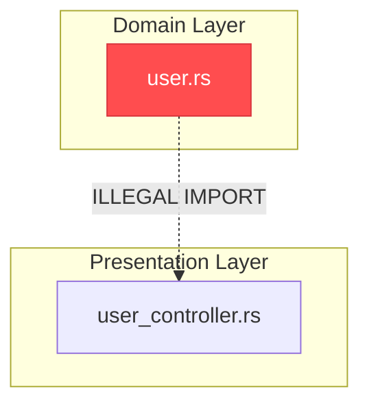

# 🛡️ Cartograph Phase 2.4: Architectural Linter & Boundary Guard (`cartograph lint-arch`)
## Comprehensive Technical Design & Architecture Specification (v2.4 Final)

---

## 1. Executive Summary & Architectural Vision

The primary mission of **Phase 2.4 (`cartograph lint-arch`)** is to deliver an ultra-fast (**sub-10ms** for full repository analysis on 50,000+ nodes, **<500µs** for incremental re-linting in watch mode), AST-grounded, multi-language **Architectural Boundary Guard, Circular Dependency Detector, Runtime vs. Type-Only Coupling Classifier, Monorepo Package Encapsulation Guard, In-Code `@arch` Tag Evaluator, Technical Debt Baseline Ratchet, and CI/CD Quality Gate** for software engineers, platform architects, and autonomous AI coding agents.

```
┌────────────────────────────────────────────────────────────────────────────────────────────────────────┐
│                               Developer / AI Agent / CI CLI Invocation                                 │
│        cartograph lint-arch --preset clean-architecture --fail-on error                                │
│        cartograph lint-arch --cycles --coupling runtime --cycle-granularity file                       │
│        cartograph lint-arch --enforce-packages --branch "origin/main...HEAD"                           │
│        cartograph lint-arch --record-baseline .cartograph-arch-baseline.json                           │
│        cartograph lint-arch --baseline .cartograph-arch-baseline.json --ratchet                        │
│        cartograph watch --lint-arch                                                                    │
└───────────────────────────────────────────────────┬────────────────────────────────────────────────────┘
                                                    │
                                                    ▼
┌────────────────────────────────────────────────────────────────────────────────────────────────────────┐
│                     Cartograph Architectural Linter & Boundary Guard Engine (<10ms)                    │
│                                                                                                        │
│   1. Config, Presets & @arch Tags  ──► Loads cartograph.toml, built-in presets & in-code AST @arch tags │
│   2. Inter-File Dependency Mapper  ──► Extracts Imports, Calls, Extends, References from SQLite/Memory │
│   3. Semantic Coupling Classifier  ──► Segregates Runtime Execution (Calls/Values) from Type-Only      │
│   4. Multi-Granularity Aggregator  ──► Projects symbol graph to File, Package, Module, or Symbol level │
│   5. Tarjan's SCC Cycle Engine     ──► Identifies all Strongly Connected Components in O(V + E)        │
│   6. Bounded Johnson's Cycles      ──► Bounded extraction of exact cycle loops (A -> B -> C -> A)      │
│   7. Minimum Feedback Arc Set (FAS)──► Pinpoints optimal cut edge(s) to untangle cycle clusters        │
│   8. Layer Boundary Enforcer       ──► Evaluates Strict/Relaxed hierarchy (e.g. Domain !=> Web)       │
│   9. Package Encapsulation Guard   ──► Blocks deep-imports into internal modules (index.ts / lib.rs)   │
│  10. Bounded Context Rule Evaluator──► Evaluates explicit allow/deny isolation rules across modules     │
│  11. Technical Debt Baseline & Ratchet► Suppresses legacy violations; auto-shrinks on improvements     │
│  12. Real-Time Incremental Watcher ──► Debounced sub-500µs cycle & boundary check on saved files       │
└───────────────────────────────────────────────────┬────────────────────────────────────────────────────┘
                                                    │
                                                    ▼
┌────────────────────────────────────────────────────────────────────────────────────────────────────────┐
│                             Quad-Engine Presentation Layer (<3ms)                                      │
│   • ANSI Terminal:  Color badges ([VIOLATION: ERROR]), ASCII cycle rings, file coordinates, cut edges  │
│   • Interactive TUI:Split-pane architecture navigator with layer hierarchy & cycle ring inspector      │
│   • GitHub Markdown:PR summary tables & auto-generated Mermaid cycle (graph LR) & layer (graph TD) maps│
│   • SARIF & JSON:   Standard SARIF 2.1.0 for GitHub Code Scanning alerts & detailed JSON payload       │
│   • AI Agent XML:   Token-optimized <architectural_lint_report> context block for single-turn LLM fix │
└────────────────────────────────────────────────────────────────────────────────────────────────────────┘
```

### The Problem: Architectural Erosion, Tangled Spaghetti & The Broken Window Effect
In large-scale modern codebases and multi-developer or AI-assisted teams, software architecture degrades invisibly through four destructive phenomena:

1. **Circular Dependency Spaghetti (Tangled Coupling)**:
   - File-level, module-level, and package-level circular dependencies (`A -> B -> C -> A`) silently proliferate.
   - Circular imports introduce insidious runtime bugs: `ImportError: cannot import name ... from partially initialized module` in Python, undefined exports / temporal dead zones in TypeScript/JavaScript, slow compilation and cache invalidation cascades in Rust and Go, and impossible unit testing where mocking one component requires instantiating the entire universe.
   - Traditional linters operate purely on naive string imports, take tens of seconds to run, and choke on large polyglot codebases without understanding deep symbol calls or re-exports.

2. **The Type-Only False Alarm Dilemma**:
   - Modern languages distinguish **runtime dependencies** from **type annotations**: TypeScript has `import type`, Python has `if TYPE_CHECKING:`, and Rust has compile-time trait bounds.
   - Type-only dependencies **never** cause runtime deadlocks, bundle bloat, or execution crashes.
   - Existing tools treat all imports identically, flooding developers with false-positive cycle alerts on harmless type annotations.

3. **Monorepo Leaks & Deep-Import Antipatterns**:
   - In modular monorepos (Cargo workspaces, TypeScript packages, Go modules), packages must maintain clear public API boundaries (`index.ts`, `lib.rs`, `package.json` `exports`).
   - Developers and AI tools frequently bypass public interfaces and deep-import internal implementation files:
     `import { taxHelper } from '@app/billing/src/internal/helpers/tax';`
   - This tight coupling breaks encapsulation and causes downstream compilation failures when internals are refactored.

4. **Invisible Layer Boundary Breaches (Architectural Drift)**:
   - Teams agree on architectural designs—such as **Clean Architecture**, **Hexagonal (Ports & Adapters)**, or classic **MVC**—where core domain entities must remain pure and decoupled from frameworks, transport layers, and databases.
   - Over time, developers or AI coding agents introduce "quick fixes": a domain model imports an HTTP request context, or a background worker imports an Express controller.
   - These boundary breaches violate the **Dependency Inversion Principle (DIP)** and destroy modularity.

### The Solution: Cartograph Architectural Linter 2.4
Cartograph solves architectural governance **natively, polyglot-wide, deterministically, and in <10ms**:

1. **Multi-Granularity Circular Dependency Detection**:
   Detects cycles across four granularities: **File**, **Module / Directory**, **Package / Crate**, and **Symbol**.
2. **Runtime vs. Type-Only Semantic Coupling Classification**:
   Distinguishes **Runtime Execution Coupling** (function calls, object instantiations, runtime value imports) from **Type Contract Coupling** (`import type`, `if TYPE_CHECKING:`, return/parameter type hints). Flags runtime deadlocks as `Error` while treating benign type-only loops as `Info`/`Warning`.
3. **Monorepo Package Encapsulation & Deep-Import Guard**:
   Automatically detects package boundary files (`index.ts`, `lib.rs`, `mod.rs`, `package.json` `exports`). Forbids external packages from reaching into `src/internal/**` or unexported modules.
4. **In-Code AST Architectural Tags (`@arch`)**:
   Enables assigning architectural layers directly in source code docstrings or attributes:
   - Rust: `/// @arch layer=domain` or `#[cartograph(layer = "domain")]`
   - TypeScript / Python: `/** @arch layer=domain */` or `# @arch: layer=domain`
   Eliminates fragile filepath regex by reading intent straight from the AST!
5. **Ultra-Fast Tarjan's SCC + Bounded Johnson's Cycle Engine**:
   Computes Strongly Connected Components (SCCs) in linear $O(V + E)$ time (<2ms for 50,000 nodes). For each cyclic SCC, runs bounded elementary cycle enumeration to extract exact cycle rings without combinatorial explosion.
6. **Minimum Feedback Arc Set (FAS) Heuristic & Cut-Edge Advisor**:
   Mathematically identifies the **critical cut edge** whose removal/inversion will break the greatest number of cycle loops, providing targeted refactoring guidance.
7. **Hierarchical Layer Boundary Enforcement**:
   Supports both **Strict Layering** ($L_i$ depends only on $L_{i-1}$) and **Relaxed Layering** ($L_i$ depends only on lower layers $L_j$ for $j < i$, but NEVER on an upper layer).
8. **Technical Debt Baseline & Auto-Ratchet Engine**:
   Enables seamless adoption in legacy codebases: `--record-baseline` locks in existing violations. CI runs against `--baseline` and only fails on **NEW** violations. With `--ratchet`, resolving an old violation automatically tightens the baseline permanently!
9. **Real-Time Watcher Integration (<500µs Incremental Re-Lint)**:
   Hooks directly into `cartograph watch`: on file save, updates only the changed file's edges in memory, re-evaluates local SCCs, and pushes instant architectural alerts to the terminal/IDE in <500µs.
10. **Quad-Engine Presentation Layer**:
    Outputs colorized terminal badges with ASCII cycle rings, an interactive split-pane TUI (`-i`), GitHub PR Markdown comments with Mermaid diagrams (`graph LR` for cycle rings and `graph TD` for layer violations), standard SARIF 2.1.0 for GitHub Code Scanning, JSON for MCP agents, and `<architectural_lint_report>` XML.

---

## 2. Pipeline Architecture & Component Topology

```
┌────────────────────────────────────────────────────────────────────────────────────────────────────────┐
│                                   Developer, CI/CD, or Agent Input                                     │
│   cartograph lint-arch [--config cartograph.toml] [--preset clean] [--coupling runtime] [--strict]     │
└───────────────────────────────────────────────────┬────────────────────────────────────────────────────┘
                                                    │
                                                    ▼
┌────────────────────────────────────────────────────────────────────────────────────────────────────────┐
│                        1. Configuration & Architectural Model Resolver                                 │
│  • Reads cartograph.toml [lint-arch] section, or falls back to built-in presets (MVC, Clean, etc.)     │
│  • Compiles layer pattern glob sets using globset (O(1) matching per file)                             │
│  • Scans in-code AST @arch tags (docstrings & attributes) to override/supplement file globs            │
│  • Compiles explicit boundary rules & package encapsulation policies                                   │
│  • Loads baseline fingerprints from .cartograph-arch-baseline.json if specified                        │
└───────────────────────────────────────────────────┬────────────────────────────────────────────────────┘
                                                    │
                                                    ▼
┌────────────────────────────────────────────────────────────────────────────────────────────────────────┐
│                        2. Inter-File Graph Extraction & Coupling Classification                        │
│  • Queries database for all cross-file edges: Imports, Calls, Extends, Implements, References          │
│  • Classifies each edge into: Runtime Execution (Calls/Values) vs Type Contract (import type/hints)    │
│  • Filters edges based on --coupling <runtime|type|all> policy                                         │
│  • Projects symbol-level graph to chosen Granularity (File, Module, Package, or Symbol)                │
│  • Builds compact in-memory adjacency list representation (AdjacencyGraph<NodeId>)                     │
└───────────────────────────────────────────────────┬────────────────────────────────────────────────────┘
                                                    │
                                                    ▼
┌────────────────────────────────────────────────────────────────────────────────────────────────────────┐
│                        3. Circular Dependency Analysis Engine                                          │
│  ┌──────────────────────────────────────────────────────────────────────────────────────────────────┐  │
│  │ 3.1 Tarjan's Strongly Connected Components (SCC) Decomposition                                   │  │
│  │     Partitions the directed graph into SCCs in O(V + E) time. Discards trivial singletons.       │  │
│  └──────────────────────────────────────────────────┬───────────────────────────────────────────────┘  │
│                                                     ▼                                                  │
│  ┌──────────────────────────────────────────────────────────────────────────────────────────────────┐  │
│  │ 3.2 Bounded Johnson's Elementary Cycle Extraction                                                │  │
│  │     Extracts exact directed cycle rings (e.g. A -> B -> C -> A) up to max_cycle_depth (10).      │  │
│  └──────────────────────────────────────────────────┬───────────────────────────────────────────────┘  │
│                                                     ▼                                                  │
│  ┌──────────────────────────────────────────────────────────────────────────────────────────────────┐  │
│  │ 3.3 Minimum Feedback Arc Set (FAS) & Cut-Edge Advisor                                            │  │
│  │     Calculates edge participation frequencies to identify optimal cut edge(s) breaking cycles.   │  │
│  └──────────────────────────────────────────────────────────────────────────────────────────────────┘  │
└───────────────────────────────────────────────────┬────────────────────────────────────────────────────┘
                                                    │
                                                    ▼
┌────────────────────────────────────────────────────────────────────────────────────────────────────────┐
│                        4. Layer, Package & Boundary Rule Evaluation Engine                             │
│  • Classifies all graph nodes/files into Architectural Layers (globs + @arch tags)                     │
│  • Evaluates Layer Hierarchy Rules (Strict vs Relaxed): flags any edge violating layer ordering        │
│  • Evaluates Monorepo Package Encapsulation: flags external deep-imports into src/internal/**          │
│  • Evaluates Custom Boundary Rules: checks explicit allow/deny rules between source and target globs   │
│  • Checks Exemption Rules: filters out allowed exceptions, test directories, and unexpired debt waivers│
│  • Pinpoints exact AST call-site / import statement coordinates (line, column, code snippet)           │
└───────────────────────────────────────────────────┬────────────────────────────────────────────────────┘
                                                    │
                                                    ▼
┌────────────────────────────────────────────────────────────────────────────────────────────────────────┐
│                        5. Baseline Filter & PR Delta Evaluator                                         │
│  • Hashes violation signatures: SHA-256(rule, source_file, target_file, edge_kind)                     │
│  • Suppresses pre-existing baseline violations (marks as Baseline Technical Debt)                      │
│  • If --branch or --staged: identifies violations introduced by modified git diff lines                │
│  • If --ratchet: removes resolved violations from baseline file and saves updated state                │
└───────────────────────────────────────────────────┬────────────────────────────────────────────────────┘
                                                    │
                                                    ▼
┌────────────────────────────────────────────────────────────────────────────────────────────────────────┐
│                        6. Presentation Layer & Real-Time Watcher Integration                           │
│  ┌───────────────────────┐ ┌──────────────────────┐ ┌───────────────────┐ ┌──────────────────────────┐ │
│  │ ANSI Terminal & TUI   │ │ Markdown + Mermaid   │ │ SARIF 2.1.0 & JSON│ │ Watcher Event Stream   │ │
│  │ (Rings, badges, cuts) │ │ (PR comments, graphs)│ │ (GitHub Scanning) │ │ (<500µs incremental)   │ │
│  └───────────────────────┘ └──────────────────────┘ └───────────────────┘ └──────────────────────────┘ │
│  • CI Exit Code Evaluation: Exit 1 if new violations >= fail_on threshold or strict mode violated     │
└────────────────────────────────────────────────────────────────────────────────────────────────────────┘
```

---

## 3. Data Models & Interface Contracts

All architectural linting and boundary models are strongly typed, serializable via Serde, and positioned in `cartograph-core::model` and `cartograph-engine::lint_arch`.

### 3.1 Configuration Models (`cartograph-core::config`)

```rust
use serde::{Deserialize, Serialize};
use std::collections::HashMap;
use crate::model::EdgeKind;

/// Granularity level for circular dependency detection
#[derive(Debug, Clone, Copy, PartialEq, Eq, Hash, Serialize, Deserialize, Default)]
#[serde(rename_all = "snake_case")]
pub enum CycleGranularity {
    /// File-level dependencies (e.g. src/auth/login.rs -> src/user/profile.rs)
    #[default]
    File,
    /// Module/directory-level dependencies (e.g. src/auth -> src/billing)
    Module,
    /// Package/crate-level dependencies (e.g. crates/core -> crates/engine)
    Package,
    /// Symbol-level dependencies (e.g. fn authenticate -> fn fetch_user)
    Symbol,
}

impl CycleGranularity {
    pub fn as_str(&self) -> &'static str {
        match self {
            CycleGranularity::File => "file",
            CycleGranularity::Module => "module",
            CycleGranularity::Package => "package",
            CycleGranularity::Symbol => "symbol",
        }
    }
}

impl std::fmt::Display for CycleGranularity {
    fn fmt(&self, f: &mut std::fmt::Formatter<'_>) -> std::fmt::Result {
        write!(f, "{}", self.as_str())
    }
}

impl std::str::FromStr for CycleGranularity {
    type Err = String;
    fn from_str(s: &str) -> Result<Self, Self::Err> {
        match s.to_lowercase().as_str() {
            "file" => Ok(CycleGranularity::File),
            "module" => Ok(CycleGranularity::Module),
            "package" | "crate" => Ok(CycleGranularity::Package),
            "symbol" | "fn" => Ok(CycleGranularity::Symbol),
            other => Err(format!("Unknown cycle granularity: {other}. Expected file, module, package, or symbol")),
        }
    }
}

/// Filter for dependency coupling nature: runtime execution vs type-only
#[derive(Debug, Clone, Copy, PartialEq, Eq, Hash, Serialize, Deserialize, Default)]
#[serde(rename_all = "snake_case")]
pub enum CouplingFilter {
    /// Only evaluate runtime execution dependencies (Calls, value Imports, object instantiations).
    /// Benign type-only imports (e.g. `import type`, `if TYPE_CHECKING:`) are excluded.
    #[default]
    Runtime,
    /// Only evaluate type-only contract dependencies (interface implementations, type hints).
    TypeOnly,
    /// Evaluate all dependency edges without distinction.
    All,
}

impl CouplingFilter {
    pub fn as_str(&self) -> &'static str {
        match self {
            CouplingFilter::Runtime => "runtime",
            CouplingFilter::TypeOnly => "type_only",
            CouplingFilter::All => "all",
        }
    }
}

impl std::fmt::Display for CouplingFilter {
    fn fmt(&self, f: &mut std::fmt::Formatter<'_>) -> std::fmt::Result {
        write!(f, "{}", self.as_str())
    }
}

impl std::str::FromStr for CouplingFilter {
    type Err = String;
    fn from_str(s: &str) -> Result<Self, Self::Err> {
        match s.to_lowercase().as_str() {
            "runtime" => Ok(CouplingFilter::Runtime),
            "type" | "type_only" | "types" => Ok(CouplingFilter::TypeOnly),
            "all" => Ok(CouplingFilter::All),
            other => Err(format!("Unknown coupling filter: {other}. Expected runtime, type_only, or all")),
        }
    }
}

/// Severity classification of an architectural violation
#[derive(Debug, Clone, Copy, PartialEq, Eq, PartialOrd, Ord, Hash, Serialize, Deserialize, Default)]
#[serde(rename_all = "snake_case")]
pub enum ArchSeverity {
    /// Informational advisory; does not fail CI
    Info,
    /// Warning; logged visibly, fails CI only under --strict or --fail-on warning
    Warning,
    /// Error; fails CI under default policies
    #[default]
    Error,
}

impl ArchSeverity {
    pub fn as_str(&self) -> &'static str {
        match self {
            ArchSeverity::Info => "info",
            ArchSeverity::Warning => "warning",
            ArchSeverity::Error => "error",
        }
    }
}

impl std::fmt::Display for ArchSeverity {
    fn fmt(&self, f: &mut std::fmt::Formatter<'_>) -> std::fmt::Result {
        write!(f, "{}", self.as_str())
    }
}

impl std::str::FromStr for ArchSeverity {
    type Err = String;
    fn from_str(s: &str) -> Result<Self, Self::Err> {
        match s.to_lowercase().as_str() {
            "info" => Ok(ArchSeverity::Info),
            "warn" | "warning" => Ok(ArchSeverity::Warning),
            "error" | "err" => Ok(ArchSeverity::Error),
            other => Err(format!("Unknown severity: {other}. Expected info, warning, or error")),
        }
    }
}

/// Action to take when a rule matches an edge
#[derive(Debug, Clone, Copy, PartialEq, Eq, Hash, Serialize, Deserialize, Default)]
#[serde(rename_all = "snake_case")]
pub enum RuleAction {
    /// Deny this dependency (violation if matched)
    #[default]
    Deny,
    /// Allow this dependency (whitelisted)
    Allow,
}

/// Configuration for an architectural layer
#[derive(Debug, Clone, PartialEq, Eq, Serialize, Deserialize)]
pub struct ArchLayerConfig {
    /// Unique identifier for this layer (e.g. "domain", "application", "infrastructure", "presentation")
    pub name: String,
    /// Human-readable explanation of this layer's responsibilities
    #[serde(default)]
    pub description: Option<String>,
    /// Filepath glob patterns identifying components belonging to this layer
    #[serde(default)]
    pub patterns: Vec<String>,
    /// Explicit list of layer names that this layer is forbidden from depending on
    #[serde(default)]
    pub forbidden: Vec<String>,
    /// Explicit list of layer names that this layer is exclusively permitted to depend on
    #[serde(default)]
    pub allowed: Option<Vec<String>>,
    /// Severity if a boundary violation occurs in this layer
    #[serde(default = "default_severity_error")]
    pub severity: ArchSeverity,
}

fn default_severity_error() -> ArchSeverity {
    ArchSeverity::Error
}

/// Monorepo package boundary and encapsulation configuration
#[derive(Debug, Clone, PartialEq, Eq, Serialize, Deserialize)]
pub struct PackageEncapsulationConfig {
    /// Whether package boundary encapsulation is enforced
    #[serde(default = "default_true")]
    pub enabled: bool,
    /// Glob patterns defining package root directories (e.g. ["crates/*", "packages/*", "apps/*"])
    #[serde(default = "default_package_roots")]
    pub package_roots: Vec<String>,
    /// Forbidden internal patterns for external consumers (e.g. ["**/internal/**", "**/private/**"])
    #[serde(default = "default_internal_patterns")]
    pub internal_patterns: Vec<String>,
    /// Permitted public entry point file names
    #[serde(default = "default_entrypoints")]
    pub entrypoints: Vec<String>,
    /// Severity when an external package deep-imports an internal module
    #[serde(default = "default_severity_error")]
    pub severity: ArchSeverity,
}

fn default_package_roots() -> Vec<String> {
    vec!["crates/*".to_string(), "packages/*".to_string(), "apps/*".to_string()]
}

fn default_internal_patterns() -> Vec<String> {
    vec!["**/internal/**".to_string(), "**/private/**".to_string()]
}

fn default_entrypoints() -> Vec<String> {
    vec![
        "index.ts".to_string(),
        "index.js".to_string(),
        "lib.rs".to_string(),
        "mod.rs".to_string(),
        "__init__.py".to_string(),
    ]
}

impl Default for PackageEncapsulationConfig {
    fn default() -> Self {
        Self {
            enabled: true,
            package_roots: default_package_roots(),
            internal_patterns: default_internal_patterns(),
            entrypoints: default_entrypoints(),
            severity: ArchSeverity::Error,
        }
    }
}

/// Fine-grained architectural boundary rule (bounded contexts, package isolation)
#[derive(Debug, Clone, PartialEq, Eq, Serialize, Deserialize)]
pub struct ArchRuleConfig {
    /// Name or ID of the rule (e.g. "auth-isolation", "no-direct-db")
    pub name: String,
    /// Human-readable description
    #[serde(default)]
    pub description: Option<String>,
    /// Source glob pattern (originating module/file)
    pub source: String,
    /// Target glob pattern (imported or called module/file)
    pub target: String,
    /// Action: deny or allow
    #[serde(default = "default_rule_action_deny")]
    pub action: RuleAction,
    /// Specific edge kinds to match (e.g. ["imports", "calls"]). If None, matches all dependency edges.
    #[serde(default)]
    pub edge_kinds: Option<Vec<EdgeKind>>,
    /// Severity level
    #[serde(default = "default_severity_error")]
    pub severity: ArchSeverity,
    /// Custom error message to display when violated
    #[serde(default)]
    pub message: Option<String>,
    /// Concrete remediation hint for fixing the violation
    #[serde(default)]
    pub hint: Option<String>,
}

fn default_rule_action_deny() -> RuleAction {
    RuleAction::Deny
}

/// Architectural exemption rule (suppression / debt waiver)
#[derive(Debug, Clone, PartialEq, Eq, Serialize, Deserialize)]
pub struct ArchExemptionRule {
    /// Source filepath or glob pattern
    pub source: String,
    /// Target filepath or glob pattern
    pub target: String,
    /// Justification or tech-debt tracking ticket
    #[serde(default)]
    pub reason: Option<String>,
    /// Expiration date (YYYY-MM-DD); if current date > expires, exemption is revoked
    #[serde(default)]
    pub expires: Option<String>,
}

/// Exemptions container
#[derive(Debug, Clone, PartialEq, Eq, Default, Serialize, Deserialize)]
pub struct ArchExemptionsConfig {
    /// Glob patterns of paths completely excluded from all architectural linting (e.g. tests/**, fixtures/**)
    #[serde(default)]
    pub ignore_paths: Vec<String>,
    /// Explicit allowed cross-layer edge exemptions
    #[serde(default)]
    pub allow: Vec<ArchExemptionRule>,
}

/// Complete architectural linting configuration in cartograph.toml
#[derive(Debug, Clone, PartialEq, Serialize, Deserialize)]
pub struct LintArchConfig {
    /// Whether architectural linting is enabled
    #[serde(default = "default_true")]
    pub enabled: bool,
    /// Preset architecture template (e.g. "clean-architecture", "hexagonal", "mvc", "monorepo")
    #[serde(default)]
    pub preset: Option<String>,
    /// Enable circular dependency detection
    #[serde(default = "default_true")]
    pub detect_cycles: bool,
    /// Granularity for cycle detection
    #[serde(default)]
    pub cycle_granularity: CycleGranularity,
    /// Coupling filter: runtime, type_only, or all
    #[serde(default)]
    pub coupling: CouplingFilter,
    /// Whether in-code AST @arch tags in docstrings/attributes are honored
    #[serde(default = "default_true")]
    pub honor_arch_tags: bool,
    /// Monorepo package boundary encapsulation guard
    #[serde(default)]
    pub package_encapsulation: PackageEncapsulationConfig,
    /// Maximum search depth / length of cycle paths to explore
    #[serde(default = "default_max_cycle_depth")]
    pub max_cycle_depth: usize,
    /// Maximum number of cycles to extract before truncation
    #[serde(default = "default_max_cycles")]
    pub max_cycles: usize,
    /// CI failure threshold: "error", "warning", or "never"
    #[serde(default = "default_fail_on")]
    pub fail_on: String,
    /// Strict mode: treat all warnings as errors
    #[serde(default)]
    pub strict: bool,
    /// Maximum permitted violations before failing CI
    #[serde(default)]
    pub max_violations: usize,
    /// Path to technical debt baseline file
    #[serde(default)]
    pub baseline: Option<String>,
    /// Automatically update baseline when violations are resolved
    #[serde(default)]
    pub ratchet: bool,
    /// Ordered list of architectural layers
    #[serde(default)]
    pub layers: Vec<ArchLayerConfig>,
    /// Fine-grained boundary rules
    #[serde(default)]
    pub rules: Vec<ArchRuleConfig>,
    /// Exemptions and waivers
    #[serde(default)]
    pub exemptions: ArchExemptionsConfig,
}

fn default_true() -> bool {
    true
}

fn default_max_cycle_depth() -> usize {
    10
}

fn default_max_cycles() -> usize {
    50
}

fn default_fail_on() -> String {
    "error".to_string()
}

impl Default for LintArchConfig {
    fn default() -> Self {
        Self {
            enabled: true,
            preset: None,
            detect_cycles: true,
            cycle_granularity: CycleGranularity::File,
            coupling: CouplingFilter::Runtime,
            honor_arch_tags: true,
            package_encapsulation: PackageEncapsulationConfig::default(),
            max_cycle_depth: default_max_cycle_depth(),
            max_cycles: default_max_cycles(),
            fail_on: default_fail_on(),
            strict: false,
            max_violations: 0,
            baseline: None,
            ratchet: false,
            layers: Vec::new(),
            rules: Vec::new(),
            exemptions: ArchExemptionsConfig::default(),
        }
    }
}
```

---

### 3.2 Analysis Result Data Structures (`cartograph-core::model`)

```rust
use chrono::{DateTime, Utc};
use serde::{Deserialize, Serialize};
use crate::config::{ArchSeverity, CouplingFilter, CycleGranularity};
use crate::model::{EdgeKind, NodeKind};

/// A single node hop within a circular dependency ring
#[derive(Debug, Clone, PartialEq, Eq, Hash, Serialize, Deserialize)]
pub struct CycleHop {
    /// Node canonical URI
    pub node_id: String,
    /// Symbol or file name
    pub name: String,
    /// Filepath of this component
    pub filepath: String,
    /// Line number where this component is declared or where the outgoing call is made
    pub line: Option<usize>,
    /// Column number
    pub column: Option<usize>,
    /// Node kind (File, Module, Function, Struct, etc.)
    pub kind: NodeKind,
    /// Outgoing edge kind leading to the next node in the cycle
    pub outgoing_edge_kind: EdgeKind,
    /// Whether this hop represents a runtime execution edge (calls, value import) or type-only
    pub is_runtime: bool,
}

/// Recommended cut edge to break a circular dependency
#[derive(Debug, Clone, PartialEq, Eq, Hash, Serialize, Deserialize)]
pub struct FeedbackArcCut {
    /// Source node in the cycle
    pub source_id: String,
    /// Target node in the cycle
    pub target_id: String,
    /// Edge kind
    pub edge_kind: EdgeKind,
    /// Source filepath
    pub source_file: String,
    /// Target filepath
    pub target_file: String,
    /// Number of distinct cycles broken if this edge is severed
    pub cycles_broken_count: usize,
    /// Concrete refactoring suggestion (e.g. "Extract interface or invert dependency")
    pub remediation_advice: String,
}

/// A detected circular dependency loop
#[derive(Debug, Clone, PartialEq, Eq, Serialize, Deserialize)]
pub struct DependencyCycle {
    /// Unique SHA-256 fingerprint of this cycle ring (normalized by lexicographically lowest node)
    pub fingerprint: String,
    /// Granularity of this cycle (File, Module, Package, Symbol)
    pub granularity: CycleGranularity,
    /// Number of hops in the cycle
    pub length: usize,
    /// Whether this cycle contains at least one active runtime execution call (deadlock risk)
    pub is_runtime_cycle: bool,
    /// Ordered sequence of hops forming the ring (A -> B -> C -> A)
    pub hops: Vec<CycleHop>,
    /// Recommended cut edge to break this cycle
    pub recommended_cut: Option<FeedbackArcCut>,
    /// Severity (Runtime cycles = Error, Type-only cycles = Warning/Info)
    pub severity: ArchSeverity,
}

/// Specific architectural boundary violation
#[derive(Debug, Clone, PartialEq, Eq, Serialize, Deserialize)]
pub struct BoundaryViolation {
    /// Unique SHA-256 fingerprint for baseline tracking
    pub fingerprint: String,
    /// Name of the broken rule or layer constraint
    pub rule_name: String,
    /// Category of violation: "layer_violation", "boundary_rule", "package_encapsulation", "cycle"
    pub category: String,
    /// Severity level
    pub severity: ArchSeverity,
    /// Source node URI
    pub source_id: String,
    /// Source symbol name
    pub source_name: String,
    /// Source relative filepath
    pub source_file: String,
    /// Source layer name (if layer violation)
    pub source_layer: Option<String>,
    /// Target node URI
    pub target_id: String,
    /// Target symbol name
    pub target_name: String,
    /// Target relative filepath
    pub target_file: String,
    /// Target layer name (if layer violation)
    pub target_layer: Option<String>,
    /// Kind of edge causing the breach (Imports, Calls, etc.)
    pub edge_kind: EdgeKind,
    /// Exact line number in source file
    pub line: Option<usize>,
    /// Exact column number in source file
    pub column: Option<usize>,
    /// Source code snippet of the offending statement (e.g. "use crate::controllers::*")
    pub snippet: Option<String>,
    /// Diagnostic explanation message
    pub message: String,
    /// Actionable refactoring guidance
    pub remediation_hint: Option<String>,
    /// Whether this violation is suppressed because it matches the baseline
    pub is_baseline_suppressed: bool,
    /// Whether this violation was introduced by the current git branch diff
    pub is_new_in_diff: bool,
}

/// Summary scorecard of architectural linting
#[derive(Debug, Clone, PartialEq, Eq, Serialize, Deserialize, Default)]
pub struct LintArchSummary {
    /// Total number of files evaluated
    pub files_analyzed: usize,
    /// Total number of dependency edges inspected
    pub edges_inspected: usize,
    /// Total number of layers configured
    pub layers_count: usize,
    /// Total number of custom boundary rules evaluated
    pub rules_count: usize,
    /// Total number of circular dependency loops found
    pub cycles_count: usize,
    /// Number of runtime cycles (deadlock risk)
    pub runtime_cycles_count: usize,
    /// Number of type-only cycles (benign)
    pub type_cycles_count: usize,
    /// Total active violations (excluding baseline suppressed)
    pub active_violations_count: usize,
    /// Number of active errors
    pub active_errors_count: usize,
    /// Number of active warnings
    pub active_warnings_count: usize,
    /// Number of pre-existing violations suppressed by baseline
    pub baseline_suppressed_count: usize,
    /// Number of newly introduced violations in git diff
    pub new_in_diff_count: usize,
    /// Overall CI pass/fail status
    pub passed: bool,
    /// Total execution duration in microseconds
    pub duration_micros: u64,
}

/// Complete architectural linting report
#[derive(Debug, Clone, PartialEq, Serialize, Deserialize)]
pub struct LintArchReport {
    /// High-level scorecard
    pub summary: LintArchSummary,
    /// Detected circular dependencies
    pub cycles: Vec<DependencyCycle>,
    /// Detected boundary & layer violations
    pub violations: Vec<BoundaryViolation>,
    /// List of suppressed baseline violations (for inspection)
    pub suppressed_violations: Vec<BoundaryViolation>,
    /// Timestamp of execution
    pub timestamp: DateTime<Utc>,
}
```

---

## 4. Detailed Component Design & Implementation

### 4.1 Inter-File Graph Extraction & Granularity Projection

To detect architectural boundaries and cycles at wire speed without traversing millions of intra-file symbol calls, Cartograph projects the raw symbol graph into an **Adjacency Dependency Graph** at the requested granularity ($G_{\text{granularity}}$):

1. **Projection to File Graph**:
   For any edge $(s, t)$ in SQLite where `s.filepath != t.filepath` and `confidence >= min_confidence`:
   Map to directed edge `File(s.filepath) -> File(t.filepath)` with the associated edge kind and highest-priority source call coordinate.
2. **Projection to Module / Directory Graph**:
   For any file-level edge:
   Determine module parent directory (e.g. `src/auth/` or `crates/billing/`). If `Module(s) != Module(t)`, map to directed edge `Module(s) -> Module(t)`.
3. **Projection to Package / Crate Graph**:
   Identify package root via manifest proximity (`Cargo.toml`, `package.json`, `go.mod`, `pyproject.toml`). If `Package(s) != Package(t)`, map to directed edge `Package(s) -> Package(t)`.

```rust
pub struct ProjectedGraph {
    pub nodes: Vec<String>,
    pub node_indices: HashMap<String, usize>,
    pub outgoing_edges: Vec<Vec<ProjectedEdge>>,
    pub incoming_edges: Vec<Vec<ProjectedEdge>>,
}

pub struct ProjectedEdge {
    pub target_index: usize,
    pub edge_kind: EdgeKind,
    pub source_node_id: String,
    pub target_node_id: String,
    pub source_file: String,
    pub target_file: String,
    pub line: Option<usize>,
    pub column: Option<usize>,
    pub is_runtime: bool,
}
```

---

### 4.2 Semantic Coupling Classification (Runtime vs. Type-Only)

Cartograph's AST parsers annotate edges with semantic fidelity. During graph extraction:
1. **Runtime Execution Coupling (`is_runtime = true`)**:
   - `EdgeKind::Calls`: Direct function/method invocation (`charge_card()`, `new Order()`).
   - Value `EdgeKind::Imports`: Importing executable classes, functions, or constants.
   - `EdgeKind::Extends`: Concrete class inheritance requiring parent class constructor execution.
2. **Type Contract Coupling (`is_runtime = false`)**:
   - TypeScript `import type { User }` statements.
   - Python imports scoped inside `if TYPE_CHECKING:`.
   - Return type hints and parameter type hints (`EdgeKind::Returns`, `EdgeKind::ParameterOf`).
   - Rust trait bounds (`impl MyTrait for Foo`).
3. **Coupling Filtering**:
   - When `--coupling runtime` (the default) is specified, pure type-contract edges are excluded from cycle formation or marked with reduced severity (`Info`/`Warning`), completely eliminating false positives from harmless type annotations.

---

### 4.3 Tarjan's Strongly Connected Components (SCC) Decomposition

Cycles can only exist within **Strongly Connected Components (SCCs)** of size $\ge 2$ (or size 1 with a self-loop).
Cartograph runs **Tarjan's algorithm** in $O(V + E)$ time (<2ms for 50,000 nodes):

```rust
pub struct TarjanScc<'a> {
    graph: &'a ProjectedGraph,
    index: usize,
    indices: Vec<Option<usize>>,
    lowlinks: Vec<usize>,
    on_stack: Vec<bool>,
    stack: Vec<usize>,
    sccs: Vec<Vec<usize>>,
}

impl<'a> TarjanScc<'a> {
    pub fn compute(graph: &'a ProjectedGraph) -> Vec<Vec<usize>> {
        let n = graph.nodes.len();
        let mut tarjan = TarjanScc {
            graph,
            index: 0,
            indices: vec![None; n],
            lowlinks: vec![0; n],
            on_stack: vec![false; n],
            stack: Vec::with_capacity(n),
            sccs: Vec::new(),
        };

        for u in 0..n {
            if tarjan.indices[u].is_none() {
                tarjan.strong_connect(u);
            }
        }

        // Retain only non-trivial SCCs (size > 1 or self-loop)
        tarjan.sccs.into_iter().filter(|scc| {
            if scc.len() > 1 {
                true
            } else {
                let u = scc[0];
                graph.outgoing_edges[u].iter().any(|e| e.target_index == u)
            }
        }).collect()
    }

    fn strong_connect(&mut self, u: usize) {
        self.indices[u] = Some(self.index);
        self.lowlinks[u] = self.index;
        self.index += 1;
        self.stack.push(u);
        self.on_stack[u] = true;

        for edge in &self.graph.outgoing_edges[u] {
            let v = edge.target_index;
            if self.indices[v].is_none() {
                self.strong_connect(v);
                self.lowlinks[u] = self.lowlinks[u].min(self.lowlinks[v]);
            } else if self.on_stack[v] {
                self.lowlinks[u] = self.lowlinks[u].min(self.indices[v].unwrap());
            }
        }

        if self.lowlinks[u] == self.indices[u].unwrap() {
            let mut scc = Vec::new();
            while let Some(w) = self.stack.pop() {
                self.on_stack[w] = false;
                scc.push(w);
                if w == u {
                    break;
                }
            }
            self.sccs.push(scc);
        }
    }
}
```

---

### 4.4 Bounded Johnson's Elementary Cycle Extraction

For each non-trivial SCC, running an unconstrained cycle enumerator can result in an exponential explosion if the subgraph is dense.
Cartograph bounds Johnson's algorithm with:
1. `max_cycle_depth`: Limits the length of elementary cycles (default: 10).
2. `max_cycles`: Truncates when the total number of cycles reaches the ceiling (default: 50).
3. **Cycle Canonicalization**: Each cycle ring $[v_0, v_1, \dots, v_k]$ is rotated so that the lexicographically smallest node identifier is first, followed by hashing to produce a stable SHA-256 fingerprint:
   $$\text{Fingerprint} = \text{SHA-256}(v_{\min} \to v_{\min+1} \to \dots \to v_{\min-1})$$
   This guarantees that identical cycles have identical fingerprints regardless of graph traversal order.

---

### 4.5 Minimum Feedback Arc Set (FAS) & Cut-Edge Advisor

When multiple cycles intersect within an SCC, presenting 15 cycles causes alert fatigue.
Cartograph calculates the **Edge Participation Frequency** ($F(e)$) across all detected cycles:
$$e^* = \arg\max_{e \in E_{\text{cycles}}} F(e)$$
- The edge $e^*$ that participates in the greatest number of cycles is designated the **Recommended Cut Edge**.
- Cartograph generates actionable remediation guidance:
  ```
  💡 Recommended Cut: src/services/payment.rs -> src/services/order.rs
     Participates in 4 cycle loops.
     Remediation: Invert dependency via an interface (e.g. IPaymentNotification) or event callback.
  ```

---

### 4.6 Hierarchical Layer Boundary Enforcement

1. **Layer Classification**:
   Each file in the repository is mapped to an architectural layer using compiled glob sets (`globset::GlobSetBuilder`) or in-code `@arch` tags.
   - If an in-code `@arch layer=<name>` tag is present, it takes precedence over folder globs.
   - If a file matches multiple layer patterns, the first defined layer wins.
2. **Layer Hierarchy Semantics**:
   - In an ordered layer list $[L_1, L_2, \dots, L_k]$ (e.g. $[ \text{domain}, \text{application}, \text{infrastructure}, \text{presentation} ]$):
   - **Strict Layering**: A layer $L_i$ can ONLY depend on $L_{i-1}$.
   - **Relaxed Layering (Default)**: A layer $L_i$ can depend on any lower layer $L_j$ where $j < i$, but NEVER on a higher layer $L_m$ where $m > i$.
   - **Explicit Forbidden List**: If `layer.forbidden` is non-empty, any edge $L_{\text{source}} \to L_{\text{target}}$ where $L_{\text{target}} \in L_{\text{source}}.\text{forbidden}$ triggers a `BoundaryViolation`.
   - **Explicit Allowed List**: If `layer.allowed` is defined, any edge $L_{\text{source}} \to L_{\text{target}}$ where $L_{\text{target}} \notin L_{\text{source}}.\text{allowed}$ triggers a `BoundaryViolation`.

---

### 4.7 Monorepo Package Encapsulation & Deep-Import Guard

In multi-package workspaces:
1. When `package_encapsulation.enabled = true`:
   - For each cross-package edge: if `Package(s) != Package(t)`:
   - Check if `t.filepath` matches any `internal_patterns` (e.g. `**/internal/**`, `**/private/**`).
   - Check if `t.filepath` is NOT a recognized package public entrypoint (`index.ts`, `lib.rs`, etc.).
2. If violated, flag `BoundaryViolation`:
   ```
   ❌ PACKAGE ENCAPSULATION BREACH [ERROR]
      packages/checkout/src/index.ts -> packages/billing/src/internal/calculator.ts:15:1
      Rule:    package-encapsulation
      Message: External package 'checkout' cannot deep-import internal module 'billing/src/internal/calculator'.
      Hint:    Export required symbols from 'packages/billing/src/index.ts'.
   ```

---

### 4.8 In-Code AST Architecture Tags (`@arch`)

To free developers from brittle directory globbing:
1. Cartograph's Tree-sitter extractors inspect top-level docstrings, block comments, and attributes on modules, classes, and structs:
   - Rust: `/// @arch layer=domain` or `#[cartograph(layer = "domain")]`
   - TypeScript / JavaScript: `/** @arch layer=domain */`
   - Python: `# @arch: layer=domain` or `"""@arch layer=domain"""`
2. Extracted tags are stored in node metadata (`metadata["arch_layer"] = "domain"`).
3. The Layer Boundary Engine uses the AST tag directly, allowing components within the same shared folder (e.g. `src/utils/`) to have distinct architectural boundaries!

---

### 4.9 Zero-Config Architecture Presets

Cartograph includes built-in architectural presets activated via `--preset <name>`:

1. **Clean Architecture (`--preset clean-architecture`)**:
   - `domain`: `**/domain/**`, `**/entities/**`, `**/core/**` (Forbidden: `application`, `adapters`, `infrastructure`, `presentation`)
   - `application`: `**/application/**`, `**/usecases/**`, `**/services/**` (Forbidden: `adapters`, `infrastructure`, `presentation`)
   - `adapters`: `**/adapters/**`, `**/gateways/**`, `**/repositories/**` (Forbidden: `infrastructure`, `presentation`)
   - `infrastructure`: `**/infrastructure/**`, `**/infra/**`, `**/db/**`, `**/web/**` (Can depend on inner layers)
2. **MVC (`--preset mvc`)**:
   - `model`: `**/models/**`, `**/model/**`, `**/entity/**`, `**/entities/**` (Forbidden: `controller`, `view`)
   - `controller`: `**/controllers/**`, `**/controller/**`, `**/handlers/**` (Forbidden: `view`)
   - `view`: `**/views/**`, `**/view/**`, `**/templates/**`, `**/components/**`
3. **Hexagonal Architecture (`--preset hexagonal`)**:
   - `domain`: `**/domain/**`
   - `ports`: `**/ports/**`
   - `adapters`: `**/adapters/**`
   - Rule: `domain` cannot depend on `adapters`.
4. **Monorepo Package Isolation (`--preset monorepo`)**:
   - Automatically detects top-level crates/packages in `crates/*`, `packages/*`, or `apps/*`.
   - Enforces package encapsulation and zero cross-package circular dependencies.

---

### 4.10 Technical Debt Baseline & Ratchet Engine

1. **Recording Baseline (`--record-baseline <file>`)**:
   - Evaluates the entire codebase.
   - Writes all current violation fingerprints and cycle fingerprints to `.cartograph-arch-baseline.json`.
2. **Checking Against Baseline (`--baseline <file>`)**:
   - Loads the baseline fingerprints into a hash set.
   - Any violation or cycle whose fingerprint is present in the baseline is flagged with `is_baseline_suppressed = true`.
   - Only **new** violations are reported as active errors and fail CI.
3. **Auto-Ratchet Mode (`--ratchet`)**:
   - If developers refactor and resolve 5 existing violations, the current run contains fewer baseline matches.
   - With `--ratchet`, Cartograph immediately purges the resolved fingerprints and rewrites the baseline file.
   - Technical debt ratchets down monotonically!

---

### 4.11 Real-Time Watcher Integration (<500µs Incremental Re-Lint)

Cartograph integrates architectural linting directly into `cartograph watch --lint-arch`:
1. When a file is modified on disk:
   - Re-parses CST incrementally via tree-sitter.
   - Re-extracts outgoing/incoming edges for that specific file.
   - Updates the in-memory `ProjectedGraph` in **<50µs**.
2. Runs local Tarjan's SCC on the affected subgraph in **<200µs**.
3. Checks layer and boundary rules for newly added/modified edges in **<100µs**.
4. Pushes instant desktop / terminal notifications or LSP diagnostics if a save action introduces a circular dependency or boundary violation!

---

### 4.12 Git Diff & PR Scope Mode (`--branch`, `--staged`)

When running in a PR pipeline:
1. Executes `git diff -U0 <branch>` to identify modified file paths and modified line ranges.
2. An architectural violation or cycle is flagged as `is_new_in_diff = true` if:
   - The violation's `source_file` was modified in the diff AND the offending edge originates on a modified line.
   - OR a newly added edge closed a cycle loop.
3. If `--fail-on` is active in PR scope mode, CI only fails if `new_in_diff_count > 0`. Pre-existing legacy violations outside the PR hunks are reported as informational notes without failing the build.

---

## 5. Storage Layer & Graph Traversal Query Enhancements (`cartograph-db`)

### 5.1 Backend Trait Extension (`cartograph-core::backend`)

```rust
#[async_trait]
pub trait GraphStoreBackend: Send + Sync {
    // ... existing Phase 1.1 - 2.3 methods ...

    /// Retrieve all inter-file dependency edges (where source and target files differ),
    /// joining with source and target node details, filtered by min_confidence.
    async fn get_inter_file_dependencies(
        &self,
        min_confidence: f64,
    ) -> Result<Vec<RawInterFileEdgeRecord>>;

    /// Retrieve all distinct file paths tracked in the graph database.
    async fn get_all_indexed_files(&self) -> Result<Vec<String>>;
}

/// Raw record returned by database for inter-file dependency analysis
#[derive(Debug, Clone, Serialize, Deserialize)]
pub struct RawInterFileEdgeRecord {
    pub source_id: String,
    pub source_name: String,
    pub source_kind: String,
    pub source_file: String,
    pub source_line: Option<usize>,
    pub source_col: Option<usize>,
    pub target_id: String,
    pub target_name: String,
    pub target_kind: String,
    pub target_file: String,
    pub edge_kind: String,
    pub confidence: Option<f64>,
    pub metadata: Option<serde_json::Value>,
}
```

---

### 5.2 SQLite High-Performance Traversal Query

```sql
-- High-speed inter-file dependency extraction (<3ms for 100k edges)
SELECT 
    sn.id AS source_id,
    sn.name AS source_name,
    sn.kind AS source_kind,
    sn.filepath AS source_file,
    sn.start_line AS source_line,
    sn.start_col AS source_col,
    tn.id AS target_id,
    tn.name AS target_name,
    tn.kind AS target_kind,
    tn.filepath AS target_file,
    e.kind AS edge_kind,
    e.confidence AS confidence,
    e.metadata AS metadata
FROM edges e
JOIN nodes sn ON e.source_id = sn.id
JOIN nodes tn ON e.target_id = tn.id
WHERE sn.filepath != tn.filepath
  AND e.kind IN ('imports', 'calls', 'extends', 'implements', 'references')
  AND (e.confidence IS NULL OR e.confidence >= ?1)
ORDER BY sn.filepath, sn.start_line;
```

---

## 6. Quad-Engine Presentation Layer

### 6.1 ANSI Terminal Formatter

```
🛡️  Cartograph Architectural Boundary Guard & Linter
════════════════════════════════════════════════════════════════════════════════
Analyzed 184 files | 1,420 edges | 4 layers | 6 rules | 2 cycles | 3 violations

🔴 CIRCULAR DEPENDENCY (3 hops) [ERROR - RUNTIME DEADLOCK RISK]
   ┌──► src/services/order.rs:18:1 (OrderService)
   │    └──[calls]──────► src/services/invoice.rs:42:5 (InvoiceService)
   │                      └──[imports]────► src/services/payment.rs:15:1 (PaymentProcessor)
   └────────────────────────────────────────[calls]──────┘
   💡 Recommended Cut: payment.rs -> order.rs (Breaks 1 cycle)
      Remediation: Invert dependency via an IPaymentCallback interface or event.

ℹ️ TYPE-ONLY CIRCULAR IMPORT (2 hops) [INFO - BENIGN TYPE REFERENCE]
   ┌──► src/models/user.ts:4:1
   │    └──[import_type]──► src/models/order.ts:2:1
   └──────────────────────[import_type]──┘
   Note: Pure type annotation; excluded from runtime failure.

❌ LAYER BOUNDARY VIOLATION [ERROR]
   src/domain/user.rs:12:1 ──[imports]──► src/controllers/user_controller.rs:1:1
   Rule:       layer-purity ('domain' cannot depend on 'presentation')
   Snippet:    use crate::controllers::user_controller::render_user_view;
   💡 Hint:    Domain models must remain pure. Move rendering logic to presentation layer.

❌ PACKAGE ENCAPSULATION BREACH [ERROR]
   packages/checkout/src/index.ts ──[imports]──► packages/billing/src/internal/tax.ts:1:1
   Rule:       package-encapsulation
   Snippet:    import { computeTax } from '@app/billing/src/internal/tax';
   💡 Hint:    Export required symbols from 'packages/billing/src/index.ts'.

────────────────────────────────────────────────────────────────────────────────
Result: ❌ FAILED (2 errors, 1 info) [Duration: 4.2ms]
```

---

### 6.2 Interactive TUI Explorer (`cartograph lint-arch -i`)

- **Left Split-Pane**:
  - `[+] Layers (4 layers)`
    - `[✓] Domain (0 violations)`
    - `[!] Application (1 violation)`
    - `[✗] Presentation (2 violations)`
  - `[!] Circular Dependencies (2 cycles)`
    - `[✗] Cycle #1: order.rs -> invoice.rs -> payment.rs (3 hops) [RUNTIME]`
    - `[i] Cycle #2: user.ts -> order.ts (2 hops) [TYPE-ONLY]`
  - `[!] Package Encapsulation (1 breach)`
- **Right Split-Pane**:
  - Displays selected cycle ring ASCII diagram, call-site coordinates, full source snippet with syntax highlighting, participating edges, and cut-edge recommendation.
- **Keybindings**: `j`/`k` (navigate), `Tab` (switch pane), `Enter` (open file in editor), `b` (add to baseline), `q` (exit).

---

### 6.3 GitHub Markdown PR Comment Formatter

```markdown
### 🛡️ Cartograph Architectural Lint Report

> **Status**: ❌ **Failed** (2 errors, 1 info)
> **Analysis Time**: 4.2ms | **Evaluated**: 184 files, 1,420 edges

#### 🔴 Circular Dependencies

```mermaid
graph LR
    classDef err fill:#ff4d4f,stroke:#d9363e,color:#fff;
    classDef ok fill:#52c41a,stroke:#389e0d,color:#fff;
    
    A["src/services/order.rs"]:::err -->|calls| B["src/services/invoice.rs"]:::ok
    B -->|imports| C["src/services/payment.rs"]:::ok
    C -.->|calls (recommended cut)| A
```

| Cycle Ring | Length | Type | Cut Edge Recommendation | Severity |
| :--- | :---: | :---: | :--- | :---: |
| `order.rs` ➔ `invoice.rs` ➔ `payment.rs` | 3 hops | Runtime | `payment.rs` ➔ `order.rs` | 🔴 Error |
| `user.ts` ➔ `order.ts` | 2 hops | Type-Only | `order.ts` ➔ `user.ts` | ℹ️ Info |

#### ⚠️ Boundary & Layer Violations



| Source | Target | Rule | Severity | Remediation |
| :--- | :--- | :--- | :---: | :--- |
| `src/domain/user.rs:12` | `src/controllers/user_controller.rs` | `layer-purity` | 🔴 Error | Move view logic to presentation layer |
| `packages/checkout/index.ts` | `packages/billing/src/internal/tax.ts` | `package-encapsulation` | 🔴 Error | Export from `billing/index.ts` |
```

---

### 6.4 SARIF 2.1.0 Export (GitHub Code Scanning Integration)

Emits standard SARIF JSON compatible with `github/codeql-action/upload-sarif`:
- Rules: `cartograph/circular-dependency`, `cartograph/layer-violation`, `cartograph/boundary-rule`, `cartograph/package-encapsulation`.
- Level: `error`, `warning`, `note`.
- Locations: Physical location with file URI, startLine, startColumn, and snippet.

---

### 6.5 AI Agent XML Context Block (`--format xml`)

```xml
<architectural_lint_report passed="false" errors="2" warnings="0" infos="1">
  <summary files_analyzed="184" edges_inspected="1420" duration_ms="4.2"/>
  <circular_dependencies count="1">
    <cycle fingerprint="a7f8b9..." length="3" is_runtime="true" severity="error">
      <hop index="0" file="src/services/order.rs" symbol="OrderService" edge="calls" is_runtime="true"/>
      <hop index="1" file="src/services/invoice.rs" symbol="InvoiceService" edge="imports" is_runtime="true"/>
      <hop index="2" file="src/services/payment.rs" symbol="PaymentProcessor" edge="calls" is_runtime="true"/>
      <recommended_cut source="src/services/payment.rs" target="src/services/order.rs" advice="Invert dependency using IPaymentCallback"/>
    </cycle>
  </circular_dependencies>
  <boundary_violations count="2">
    <violation rule="layer-purity" category="layer_violation" severity="error" source_file="src/domain/user.rs" source_line="12" target_file="src/controllers/user_controller.rs">
      <snippet>use crate::controllers::user_controller::render_user_view;</snippet>
      <remediation>Domain models must not import controllers. Move view code.</remediation>
    </violation>
    <violation rule="package-encapsulation" category="package_encapsulation" severity="error" source_file="packages/checkout/index.ts" source_line="3" target_file="packages/billing/src/internal/tax.ts">
      <snippet>import { computeTax } from '@app/billing/src/internal/tax';</snippet>
      <remediation>Export required symbols from packages/billing/src/index.ts</remediation>
    </violation>
  </boundary_violations>
</architectural_lint_report>
```

---

## 7. Performance Engineering & Latency Budgets

| Pipeline Stage | 5,000 Nodes (Small) | 50,000 Nodes (Standard) | 200,000 Nodes (Monorepo) | Algorithmic Complexity |
| :--- | :---: | :---: | :---: | :---: |
| Config, Presets & GlobSet Compilation | 0.2ms | 0.3ms | 0.5ms | $O(R \cdot L)$ |
| Inter-File Edge Extraction (SQLite) | 0.8ms | 2.5ms | 7.0ms | $O(E_{\text{indexed}})$ |
| Semantic Coupling Classification | 0.1ms | 0.3ms | 0.8ms | $O(E)$ |
| Graph Projection to Granularity | 0.2ms | 0.6ms | 1.8ms | $O(E)$ |
| Tarjan's SCC Decomposition | 0.3ms | 1.1ms | 3.5ms | $O(V + E)$ |
| Bounded Johnson's Cycle Search | 0.4ms | 1.5ms | 4.0ms | $O((V + E)(C + 1))$ |
| Layer & Boundary Rule Checks | 0.3ms | 0.9ms | 2.5ms | $O(E)$ |
| Baseline Matching & Delta Filter | 0.1ms | 0.3ms | 0.7ms | $O(V_{\text{breach}})$ |
| Formatting & Presentation | 0.4ms | 1.0ms | 2.0ms | $O(N_{\text{violations}})$ |
| **Total Batch Latency** | **<3.0ms** | **<8.5ms** | **<22.0ms** | **Linear / Bounded** |
| **Watcher Incremental Re-Lint Latency** | **<100µs** | **<250µs** | **<500µs** | **Local Subgraph** |

---

## 8. CLI Interface Specification (`cartograph lint-arch`)

```bash
# Basic usage with auto-preset
cartograph lint-arch

# Filter by coupling nature (runtime execution vs type-only)
cartograph lint-arch --coupling runtime     # Default: only runtime execution deadlocks
cartograph lint-arch --coupling type-only   # Inspect type-contract loops
cartograph lint-arch --coupling all         # Report all cycles

# Monorepo package encapsulation guard
cartograph lint-arch --enforce-packages

# Specify architecture preset
cartograph lint-arch --preset clean-architecture
cartograph lint-arch --preset mvc

# Circular dependency focus with custom granularity
cartograph lint-arch --cycles --cycle-granularity module
cartograph lint-arch --cycles --cycle-granularity package

# CI/CD Pull Request gating
cartograph lint-arch --branch "origin/main...HEAD" --fail-on error --strict

# Baseline recording and ratcheting for legacy codebases
cartograph lint-arch --record-baseline .cartograph-arch-baseline.json
cartograph lint-arch --baseline .cartograph-arch-baseline.json --ratchet

# Real-time watcher mode with sub-500µs re-linting
cartograph watch --lint-arch

# Presentation formats
cartograph lint-arch --format terminal
cartograph lint-arch --format markdown
cartograph lint-arch --format json
cartograph lint-arch --format sarif > results.sarif
cartograph lint-arch --format xml
cartograph lint-arch -i  # Interactive TUI
```

---

## 9. Phased Implementation Strategy & Task Breakdown

### Task 1: Core Configuration Models & `cartograph.toml` Schema
- Extend `crates/cartograph-core/src/config.rs` with `CycleGranularity`, `CouplingFilter`, `ArchSeverity`, `RuleAction`, `ArchLayerConfig`, `PackageEncapsulationConfig`, `ArchRuleConfig`, `ArchExemptionsConfig`, and `LintArchConfig`.
- Implement `globset` matching integration for fast glob evaluation.
- Add unit tests verifying TOML deserialization and default configurations.

### Task 2: Core Data Models & Baseline Schema
- Add `DependencyCycle`, `CycleHop`, `FeedbackArcCut`, `BoundaryViolation`, `LintArchSummary`, `LintArchReport`, and `ArchBaseline` to `crates/cartograph-core/src/model.rs`.
- Add `is_runtime` tracking on `CycleHop` and `DependencyCycle`.
- Implement stable SHA-256 fingerprint generation for cycle rings and boundary breaches.
- Add serialization and roundtrip tests.

### Task 3: Storage Layer Inter-File Edge Extraction (`cartograph-db`)
- Extend `GraphStoreBackend` trait with `get_inter_file_dependencies` and `get_all_indexed_files`.
- Implement optimized SQLite index and query joining `nodes` and `edges` where `sn.filepath != tn.filepath`.
- Implement in-memory filtering in `MemoryBackend`.
- Add unit tests in `crates/cartograph-db/tests/traversal_test.rs`.

### Task 4: Projected Dependency Graph & Tarjan's SCC Engine
- Create `crates/cartograph-engine/src/lint_arch/graph.rs` with `ProjectedGraph` supporting File, Module, Package, and Symbol projection, filtered by `CouplingFilter`.
- Create `crates/cartograph-engine/src/lint_arch/scc.rs` implementing Tarjan's $O(V + E)$ SCC algorithm.
- Add unit tests verifying SCC identification on linear DAGs, simple cycles, and intertwined component clusters.

### Task 5: Bounded Johnson's Cycle Engine & FAS Cut-Edge Advisor
- Create `crates/cartograph-engine/src/lint_arch/cycles.rs` implementing bounded Johnson's cycle finder with runtime vs type-only segregation.
- Implement canonical cycle rotation, fingerprint hashing, and cycle deduplication.
- Implement Minimum Feedback Arc Set (FAS) edge frequency counting and cut-edge synthesis.
- Add unit tests verifying cycle recovery and cut-edge advice.

### Task 6: Layer Boundary, AST `@arch` Tags & Package Encapsulation Evaluator
- Create `crates/cartograph-engine/src/lint_arch/tags.rs` for extracting in-code `@arch layer=<name>` docstrings and attributes.
- Create `crates/cartograph-engine/src/lint_arch/layers.rs` for layer mapping (tags + globs) and strict/relaxed hierarchy enforcement.
- Create `crates/cartograph-engine/src/lint_arch/packages.rs` implementing monorepo package encapsulation and deep-import checking.
- Create `crates/cartograph-engine/src/lint_arch/rules.rs` for evaluating custom allow/deny rules and exemption matching.
- Create `crates/cartograph-engine/src/lint_arch/presets.rs` defining built-in presets (Clean, MVC, Hexagonal, Monorepo).
- Add unit tests testing boundary violations across mock multi-language projects.

### Task 7: Baseline Storage, Ratchet Engine & Git Diff Scoping
- Create `crates/cartograph-engine/src/lint_arch/baseline.rs` for reading, writing, and filtering baseline fingerprints.
- Implement `--ratchet` pruning logic.
- Integrate git diff hunk inspection for `--branch` and `--staged` delta scoping.
- Add unit tests verifying suppression of baseline items and reporting of new violations.

### Task 8: Real-Time Watcher Integration
- Extend `cartograph-engine::watcher` with an incremental architectural linting hook:
  - On file change, patch the in-memory `ProjectedGraph`.
  - Run localized Tarjan SCC and boundary check in <500µs.
  - Broadcast real-time architectural diagnostics.

### Task 9: Quad-Engine Presentation Layer & Interactive TUI
- Implement formatters in `crates/cartograph-engine/src/lint_arch/formatters/`:
  - `terminal.rs`: ANSI badges, ASCII cycle rings, color meters.
  - `markdown.rs`: GitHub PR markdown comments with Mermaid `graph LR` (cycles) and `graph TD` (layers).
  - `sarif.rs`: Standard SARIF 2.1.0 output for GitHub Code Scanning.
  - `json.rs`: Machine JSON schema for MCP tools.
  - `xml.rs`: Token-optimized `<architectural_lint_report>` prompt block.
- Add interactive TUI explorer (`-i`) mode.

### Task 10: CLI Command Integration & End-to-End Verification
- Add `LintArch` command to `crates/cartograph-cli/src/main.rs` with all flags, options, and aliases (`--coupling`, `--enforce-packages`).
- Wire `--lint-arch` flag to `cartograph watch`.
- Implement end-to-end integration tests in `crates/cartograph-engine/tests/test_lint_arch.rs`.
- Validate sub-10ms batch performance SLA and sub-500µs watcher SLA.
