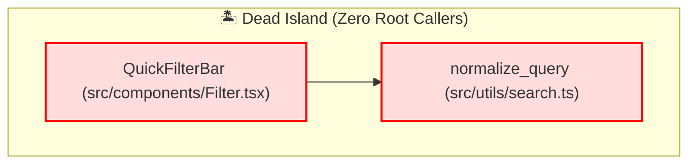

# 🧟 Cartograph Phase 2.6: Dead Code & Abandoned Component Detector (`cartograph deadcode`)
## Comprehensive Technical Design & Architecture Specification (v2.6 Final)

---

## 1. Executive Summary & Architectural Vision

The primary mission of **Phase 2.6 (`cartograph deadcode`)** is to deliver an ultra-fast (**sub-20ms** for full repository analysis on 50,000+ nodes, **<2ms** for incremental PR diffs), polyglot-wide, AST-grounded, graph-based **Dead Code, Zombie Function, Abandoned UI Component (React/Vue/Svelte), Dangling API Route & Dead Parameters, Unused GraphQL/gRPC Operations, Unreferenced Database Model, Dead Island (Mutual-Reference Cycle), Fine-Grained Dead AST Elements (Unread Fields, Unused Enum Variants, Dead Barrel Re-Exports), Cascading Ghost Dependency Detector (Unused npm/Cargo/PyPI Packages), `@deprecated` Lifecycle Automation & Migration Tracker, Test-Only Zombie & Zombie File Detection Engine, Multi-Vector Confidence Scorer (0.0–1.0), Financial & AI Context Token Waste Quantifier, AI Agent Context Exclusion Mask (`.contextignore`), Real-Time Watcher Accidental Orphan Alert Hook (`cartograph watch --deadcode`), Speculative Safe Pruning & Refactoring Advisor, Git Diff PR Delta Quality Gate, and Multi-Engine Presentation Layer** for software engineers, platform architects, and autonomous AI coding agents.

```
┌────────────────────────────────────────────────────────────────────────────────────────────────────────┐
│                               Developer / AI Agent / CI CLI Invocation                                 │
│        cartograph deadcode [--min-lines 20] [--min-confidence 0.85]                                    │
│        cartograph deadcode --components-only               # Abandoned UI components (React/Vue/Svelte)│
│        cartograph deadcode --routes-only                   # Dangling API routes & dead parameters     │
│        cartograph deadcode --models-only                   # Abandoned DB models / SQL tables          │
│        cartograph deadcode --islands-only                  # Mutual-reference dead cycle clusters      │
│        cartograph deadcode --files-only                    # 100% dead zombie files                    │
│        cartograph deadcode --test-orphans                  # Production code only called by tests      │
│        cartograph deadcode --unread-fields                 # Struct/class fields written but never read│
│        cartograph deadcode --unused-variants               # Enum variants never constructed or matched│
│        cartograph deadcode --ghost-deps                    # Unused 3rd-party npm/Cargo/PyPI packages  │
│        cartograph deadcode --deprecated-only               # Ready-for-cremation & migration progress  │
│        cartograph deadcode --export-ai-ignore              # Generate .contextignore for AI agents     │
│        cartograph deadcode --simulate-prune "OldComponent" # Blast-radius verification of deletion     │
│        cartograph deadcode --prompt-prune "OldComponent"   # Generate ready-to-run AI agent prompt     │
│        cartograph deadcode --branch "origin/main...HEAD" --fail-on-new-deadcode                        │
│        cartograph deadcode --record-baseline .cartograph-deadcode-baseline.json                        │
│        cartograph deadcode --baseline .cartograph-deadcode-baseline.json --ratchet                     │
│        cartograph deadcode -i                              # Interactive split-pane TUI explorer       │
│        cartograph deadcode --format html > deadcode_report.html                                        │
│        cartograph watch --deadcode                         # Sub-1ms real-time orphan notifications    │
└───────────────────────────────────────────────────┬────────────────────────────────────────────────────┘
                                                    │
                                                    ▼
┌────────────────────────────────────────────────────────────────────────────────────────────────────────┐
│                      Cartograph Dead Code & Orphan Engine (<20ms)                                      │
│                                                                                                        │
│   1. Config & Living Root Resolver ──► Discovers entrypoints (main, public exports, mounted routes)    │
│   2. Forward Reachability Traversal──► Mark-and-Sweep BFS from roots across AST dependency graph        │
│   3. Dead Island (SCC) Engine      ──► Tarjan's SCC on unreachable subgraph to uncover cyclic zombies │
│   4. Specialized Orphan Detectors  ──► Classifies Components, Routes, Models, Methods, Zombie Files   │
│   5. Fine-Grained AST Analyzers    ──► Extracts Unread Fields, Unused Enum Variants, Barrel Exports    │
│   6. Ghost Dependency Correlator   ──► Correlates dead code with package manifests (Cargo/npm/pip)     │
│   7. @deprecated Lifecycle Tracker ──► Categorizes Ready-for-Cremation vs. Migration Progress %        │
│   8. Multi-Vector Confidence Scorer──► Assigns 0.0-1.0 confidence factoring visibility & conventions  │
│   9. Token Waste & Bloat Quantifier──► Computes Dead LOC, AI Prompt Token Burn & Bundle Bloat (KB)     │
│  10. AI Agent Ignore Mask Exporter ──► Emits .contextignore to shield LLMs from dead code ingestion    │
│  11. Test-Only Zombie Correlator   ──► Identifies production code orphaned except for lingering tests  │
│  12. Real-Time Watcher Hook (<1ms) ──► Alerts developers upon accidental caller severing in watch mode │
│  13. Speculative Prune Simulator   ──► Zero-risk blast-radius verification via Phase 2.1 Impact Engine │
│  14. AI Refactoring Prompt Builder ──► Synthesizes token-optimized prompts for Claude, GPT-4o, AGY    │
│  15. PR Git Diff Delta Evaluator   ──► Detects newly authored dead code and newly orphaned symbols     │
│  16. Technical Debt Baseline Engine──► Suppresses legacy dead code; auto-tightens on cleanups (--ratchet│
└───────────────────────────────────────────────────┬────────────────────────────────────────────────────┘
                                                    │
                                                    ▼
┌────────────────────────────────────────────────────────────────────────────────────────────────────────┐
│                             Multi-Engine Presentation Layer (<2ms)                                     │
│   • ANSI Terminal:  Color badges (🟢 High, 🟡 Medium, 🟠 Low), Dead Island trees, Ghost package meters │
│   • Interactive TUI:Split-pane category browser (All, Components, Routes, Models, Islands, Ghost Deps) │
│   • HTML Dashboard: Self-contained zero-dependency dashboard with Dead Treemap & Category Donut       │
│   • GitHub Markdown:PR comment tables & auto-generated Mermaid dependency diagrams (graph TD)         │
│   • SARIF & JSON:   Standard SARIF 2.1.0 for GitHub Code Scanning alerts & rich machine JSON payload    │
│   • AI Agent XML:   Token-optimized <dead_code_report> context block for single-turn cleanup           │
│   • Prune Prompt:   Ready-to-execute AI agent refactoring prompt for instant, safe symbol deletion    │
└────────────────────────────────────────────────────────────────────────────────────────────────────────┘
```

### The Problem: Zombie Code, Dead Islands, Silent Token Burn & Architectural Rot

As codebases evolve over years of sprints, refactorings, and feature migrations, software architecture deteriorates through seven distinct, high-friction dead code phenomena:

1. **The "Dead Island" Mutual-Reference Trap (The Failure of Naive In-Degree Checks)**:
   - Most lightweight dead code linters look only for symbols with zero incoming references (`in_degree == 0`).
   - In real-world enterprise codebases, dead code almost never exists as isolated single functions. Instead, a feature removal leaves behind **Dead Islands**: a cluster of 5 to 50 functions, classes, and helper utilities that call each other in complex cycles, but whose root entrypoint was disconnected from the application!
   - Because every function in the island has at least one caller (`in_degree >= 1`), naive tools report **zero warnings**, leaving thousands of lines of zombie code lurking indefinitely.
   - **Cartograph's Graph Solution**: Formulates dead code detection as **Compiler-Grade Mark-and-Sweep Garbage Collection** over the entire polyglot AST graph. By computing forward reachability from designated **Living Roots** $\mathcal{R}$, any symbol or island disconnected from $\mathcal{R}$ is immediately identified, and decomposed into cohesive **Dead Island Subgraphs** via Tarjan's Strongly Connected Components (SCC) algorithm.

2. **The Cascading Ghost Dependency Problem (Unused Third-Party Packages)**:
   - When developers remove a feature, they frequently delete or comment out the calling code, but leave behind heavy third-party packages in `package.json`, `Cargo.toml`, `pyproject.toml`, or `go.mod`.
   - Over time, repositories accumulate dozens of **Ghost Dependencies**—third-party crates or npm packages that are never imported anywhere in the living code graph.
   - These ghost dependencies bloat `node_modules` / build caches by hundreds of megabytes, increase cold CI pipeline build times, and introduce unmonitored security vulnerability exposure (CVEs).
   - **Cartograph's Solution**: Cross-references package manifests with AST `Imports` edges to flag unreferenced packages, and computes **Cascading Package Pruning Savings** (e.g. *"Deleting the OldCheckoutModal dead island will allow safely removing 3 npm packages: `stripe-v2-sdk`, `react-old-datepicker`, `accounting-js`"*).

3. **Fine-Grained Dead Elements (Unread Fields, Unused Enum Variants & Barrel Re-Exports)**:
   - Dead code is not limited to whole functions or classes:
     - **Unread Struct / Class Fields**: Fields assigned in constructors or setters (`this.cacheTimeout = 300` or `self.debug_mode = true`) that have **zero read references** anywhere in the codebase.
     - **Unused Enum Variants**: Enums with 10 variants where 3 variants are never constructed or matched in any pattern.
     - **Dead Barrel Re-Exports**: Re-exports in barrel files (`index.ts`, `__init__.py`) where downstream consumers never import the re-exported symbol.
   - Traditional linters fail to track field-level read/write semantics across multiple files.

4. **The Deprecated API Stagnation Dilemma (`@deprecated` Lifecycle Automation)**:
   - Engineers annotate symbols with `#[deprecated]`, `@deprecated`, or JSDoc `@deprecated`, intending to remove them in the next major version.
   - Without automated tooling, deprecated symbols sit in codebases for years because developers do not know if any callers remain.
   - **Cartograph's Solution**: Automatically categorizes deprecated symbols into:
     - **Ready-for-Cremation**: `@deprecated` symbol with **0 remaining callers** anywhere in the codebase (ready for instant deletion).
     - **Migration In Progress**: Deprecated symbol with active caller breakdown and % migration progress tracking.

5. **The "Test-Only Zombie" Paradox**:
   - When developers deprecate a production feature, they frequently delete the calling code in the UI or controller, but forget to remove the unit tests for the underlying service.
   - Traditional linters see that the service has 5 incoming callers (all in `test_service.rs` or `service.spec.ts`) and falsely conclude that the service is alive!
   - Developers continue maintaining, compiling, and running unit tests for code that does nothing in production.
   - **Cartograph's Solution**: Explicitly bifurcates **Production Reachability** from **Test-Only Reachability**. If a symbol is unreachable from application roots but reachable from test roots, Cartograph flags it as a **Test-Only Zombie**.

6. **Silent AI Context Token Burn & Agent Hallucination Risk**:
   - When autonomous AI coding agents (Antigravity, Cursor, Claude Code, GitHub Copilot) index a codebase, dead code wastes millions of tokens and pollutes the agent's context window with obsolete patterns, causing the agent to re-introduce deprecated APIs.
   - **Cartograph's Solution**:
     - Computes the exact **Dead Token Footprint** ($L / 3.6$) and monthly enterprise dollar cost.
     - Provides `--export-ai-ignore`: automatically generates or updates `.contextignore` / `.cursorignore` so AI agents never ingest dead code into their prompts!

7. **The Accidental Orphan Problem in Fast Refactorings**:
   - During code refactorings, developers remove a function call in a central file without realizing that was the *only* call to a private helper elsewhere in the file or module.
   - **Cartograph's Solution**: In watch mode (`cartograph watch --deadcode`), Cartograph hooks into CST updates (<1ms) to emit immediate terminal alerts when an edit accidentally leaves a symbol with 0 callers.

---

## 2. Pipeline Architecture & Component Topology

```
┌────────────────────────────────────────────────────────────────────────────────────────────────────────┐
│                                   Developer, CI/CD, or Agent Input                                     │
│   cartograph deadcode [--ghost-deps] [--deprecated-only] [--unread-fields] [--export-ai-ignore] ...   │
└───────────────────────────────────────────────────┬────────────────────────────────────────────────────┘
                                                    │
                                                    ▼
┌────────────────────────────────────────────────────────────────────────────────────────────────────────┐
│                       1. Configuration & Living Root Resolver (<2ms)                                   │
│  • Reads cartograph.toml [deadcode] configuration, CLI flags, and project profile (app vs library)    │
│  • Resolves Living Roots R:                                                                            │
│    - Executable entrypoints: main(), bin/*, CLI commands, scripts                                     │
│    - Mounted HTTP Routes: Handlers linked to active URLs via Phase 2.3 Route Mapper                    │
│    - Public Package Exports: root index.ts/index.js, lib.rs public symbols, __all__ in Python          │
│    - Background Jobs & Workers: Celery tasks, BullMQ workers, sidekiq jobs, event consumers            │
│    - Framework Conventions: Next.js app/**/page.tsx, Remix routes, Django admin/signals/apps           │
└───────────────────────────────────────────────────┬────────────────────────────────────────────────────┘
                                                    │
                                                    ▼
┌────────────────────────────────────────────────────────────────────────────────────────────────────────┐
│                       2. Forward Graph Reachability Traversal (<5ms)                                   │
│  • Executes Mark-and-Sweep Breadth-First Search (BFS) starting from all Living Roots R                 │
│  • Follows dependency edges: Calls, Imports, References, Extends, Implements, MapsTo, Contains        │
│  • Marks all visited nodes as Reachable (Alive)                                                        │
│  • Computes Unreachable Candidate Set: D = V \ Reachable(R)                                            │
│  • Runs secondary Test Reachability pass: marks symbols reachable ONLY via incoming Tests edges        │
└───────────────────────────────────────────────────┬────────────────────────────────────────────────────┘
                                                    │
                                                    ▼
┌────────────────────────────────────────────────────────────────────────────────────────────────────────┐
│                       3. Dead Island (SCC) & Cycle Decomposition (<3ms)                                │
│  • Builds induced unreachable subgraph G[D] from unreachable nodes and mutual dependency edges         │
│  • Runs Tarjan's Strongly Connected Components (SCC) algorithm to identify cyclic mutual references   │
│  • Groups connected unreachable nodes into cohesive Dead Islands with identified internal roots       │
│  • Computes clean topological deletion order (reverse topological sort) for safe refactoring           │
└───────────────────────────────────────────────────┬────────────────────────────────────────────────────┘
                                                    │
                                                    ▼
┌────────────────────────────────────────────────────────────────────────────────────────────────────────┐
│                       4. Specialized Domain Orphan Classifiers (<2ms)                                  │
│  • Abandoned UI Components: React/Vue/Svelte components with 0 JSX/TSX rendering sites                 │
│  • Dangling API Routes & Dead Params: Unmounted blueprints/routes, and route parameters never supplied │
│  • Unused GraphQL / gRPC Operations: Schema queries/mutations and proto stubs with 0 client callers   │
│  • Abandoned Models: Database models / SQL tables with 0 queries, migrations, or references            │
│  • Dead Class Methods: Unused private/internal methods on otherwise living classes                     │
│  • Zombie Files: Source files where 100% of defined symbols are dead and no top-level side effects     │
└───────────────────────────────────────────────────┬────────────────────────────────────────────────────┘
                                                    │
                                                    ▼
┌────────────────────────────────────────────────────────────────────────────────────────────────────────┐
│                       5. Fine-Grained AST Dead Elements & Manifest Analyzer (<3ms)                     │
│  • Unread Fields: Struct/class properties written in constructor/setter but never read                 │
│  • Unused Enum Variants: Enum members never constructed or matched against                             │
│  • Dead Barrel Re-Exports: Symbols exported in barrel files (index.ts) with 0 downstream imports       │
│  • Ghost Dependencies: Manifest packages (package.json, Cargo.toml) with zero import edges in graph    │
│  • Cascading Package Pruning: Packages that become 100% unused if a dead island is pruned             │
└───────────────────────────────────────────────────┬────────────────────────────────────────────────────┘
                                                    │
                                                    ▼
┌────────────────────────────────────────────────────────────────────────────────────────────────────────┐
│                       6. @deprecated Lifecycle & Migration Tracker (<1ms)                              │
│  • Inspects #[deprecated], @deprecated, JSDoc @deprecated annotations across AST nodes                │
│  • Categorizes into:                                                                                   │
│    - Ready-for-Cremation: @deprecated with exactly 0 callers across entire codebase                    │
│    - Migration In Progress: @deprecated with N > 0 callers, tracking migration % and caller coordinates│
└───────────────────────────────────────────────────┬────────────────────────────────────────────────────┘
                                                    │
                                                    ▼
┌────────────────────────────────────────────────────────────────────────────────────────────────────────┐
│                       7. Multi-Vector Confidence Scoring Engine (<2ms)                                 │
│  • Evaluates symbol visibility: Private (+0.15), pub(crate) (+0.10), Public in App (+0.05)              │
│  • Applies framework convention dampers: React hooks, Django signals, Rust trait impls (-0.30)        │
│  • Checks string literal / FTS references for reflection candidates (-0.25)                            │
│  • Checks in-code suppression directives: /// @deadcode ignore, #[cartograph(allow_dead)] (Conf = 0.0)│
│  • Assigns final confidence score (0.0 to 1.0) and classifies tier: High, Medium, Low, Suppressed     │
└───────────────────────────────────────────────────┬────────────────────────────────────────────────────┘
                                                    │
                                                    ▼
┌────────────────────────────────────────────────────────────────────────────────────────────────────────┐
│                       8. Financial & AI Token Waste Quantifier & Ignore Mask (<1ms)                    │
│  • Computes Dead LOC, Dead SLOC, and AST Token Footprint (chars / 3.6)                                 │
│  • Estimates monthly enterprise AI prompt token waste ($0.010 per 1k tokens * prompt frequency)        │
│  • Computes frontend JS bundle bloat (KB) and node_modules / disk bloat (MB) from ghost dependencies   │
│  • If --export-ai-ignore: generates .contextignore file excluding dead files from LLM agents           │
└───────────────────────────────────────────────────┬────────────────────────────────────────────────────┘
                                                    │
                                                    ▼
┌────────────────────────────────────────────────────────────────────────────────────────────────────────┐
│                       9. Speculative Prune & AI Remediation Engine (<3ms)                              │
│  • --simulate-prune <symbol>: Executes Phase 2.1 Impact Analysis to verify zero downstream breakage    │
│  • --prompt-prune <symbol|island>: Generates copyable, token-optimized AI refactoring prompt           │
└───────────────────────────────────────────────────┬────────────────────────────────────────────────────┘
                                                    │
                                                    ▼
┌────────────────────────────────────────────────────────────────────────────────────────────────────────┐
│                      10. PR Git Diff Delta & Baseline Ratchet Engine (<1ms)                            │
│  • Scopes analysis to git diff (--branch origin/main...HEAD or --staged)                               │
│  • Differentiates Newly Authored Dead Code vs. Newly Created Dead Code (Accidental Orphans)            │
│  • Matches against .cartograph-deadcode-baseline.json SHA-256 fingerprints                             │
│  • If --ratchet: permanently removes pruned dead code from baseline file                               │
└───────────────────────────────────────────────────┬────────────────────────────────────────────────────┘
                                                    │
                                                    ▼
┌────────────────────────────────────────────────────────────────────────────────────────────────────────┐
│                      11. Multi-Engine Presentation Layer (<2ms)                                        │
│  ┌───────────────────────┐ ┌──────────────────────┐ ┌───────────────────┐ ┌──────────────────────────┐ │
│  │ ANSI Terminal & TUI   │ │ HTML Dashboard       │ │ SARIF & JSON      │ │ AI XML & Prune Prompt    │ │
│  │ (Badges, trees, ghost)│ │ (Dead Treemap, Donut)│ │ (GitHub Scanning) │ │ (<dead_code_report>)     │ │
│  └───────────────────────┘ └──────────────────────┘ └───────────────────┘ └──────────────────────────┘ │
│  • CI Exit Code Evaluation: Exit 1 if --fail-on-deadcode or --fail-on-new-deadcode is triggered       │
└────────────────────────────────────────────────────────────────────────────────────────────────────────┘
```

---

## 3. Data Models & Interface Contracts

All data structures are strongly typed, serializable via Serde, and positioned in `cartograph-core::model` and `cartograph-engine::deadcode`.

### 3.1 Configuration Models (`cartograph-core::config`)

```rust
use serde::{Deserialize, Serialize};
use std::path::PathBuf;

/// Project classification profile affecting entrypoint and visibility heuristics
#[derive(Debug, Clone, Copy, PartialEq, Eq, Hash, Serialize, Deserialize, Default)]
#[serde(rename_all = "snake_case")]
pub enum ProjectProfile {
    /// End-user application (CLI, backend server, web app). Public symbols without callers are dead.
    #[default]
    Application,
    /// Reusable library or SDK. Publicly exported symbols are presumed living roots.
    Library,
    /// Monorepo containing both internal applications and shared published libraries.
    Monorepo,
}

/// Category filtering for dead code analysis
#[derive(Debug, Clone, Copy, PartialEq, Eq, Hash, Serialize, Deserialize, Default)]
#[serde(rename_all = "snake_case")]
pub enum DeadCodeCategoryFilter {
    #[default]
    All,
    Components,
    Routes,
    Models,
    Islands,
    Files,
    Functions,
    Methods,
    UnreadFields,
    UnusedVariants,
    BarrelExports,
    GhostDependencies,
    Deprecated,
    TestOrphans,
}

/// Project-level configuration for cartograph deadcode in cartograph.toml
#[derive(Debug, Clone, Serialize, Deserialize)]
pub struct DeadCodeConfig {
    /// Project profile (application, library, or monorepo)
    #[serde(default)]
    pub profile: ProjectProfile,

    /// Minimum physical lines of code for a symbol to be reported (filters tiny stubs)
    #[serde(default = "default_min_lines")]
    pub min_lines: usize,

    /// Minimum confidence threshold (0.0 to 1.0) to report dead code
    #[serde(default = "default_min_confidence")]
    pub min_confidence: f64,

    /// Whether to treat test suites as consumers (false = production-only reachability)
    #[serde(default)]
    pub include_tests: bool,

    /// Custom living root path globs (e.g., ["src/bin/**", "cmd/**", "app/api/**"])
    #[serde(default)]
    pub custom_roots: Vec<String>,

    /// Ignore glob patterns for dead code scanning (e.g., ["**/generated/**", "**/mocks/**"])
    #[serde(default = "default_ignore_patterns")]
    pub ignore_patterns: Vec<String>,

    /// Frameworks to enable automated convention exemptions for
    #[serde(default = "default_frameworks")]
    pub frameworks: Vec<String>,

    /// AI context ignore export settings
    #[serde(default)]
    pub ai_ignore_file: Option<PathBuf>,

    /// CI Gating thresholds
    #[serde(default)]
    pub max_dead_loc: Option<usize>,
    #[serde(default)]
    pub max_wasted_tokens: Option<usize>,
    #[serde(default)]
    pub fail_on_new_deadcode: bool,
}

fn default_min_lines() -> usize { 5 }
fn default_min_confidence() -> f64 { 0.75 }
fn default_ignore_patterns() -> Vec<String> {
    vec![
        "**/node_modules/**".to_string(),
        "**/target/**".to_string(),
        "**/vendor/**".to_string(),
        "**/.git/**".to_string(),
        "**/dist/**".to_string(),
        "**/build/**".to_string(),
    ]
}
fn default_frameworks() -> Vec<String> {
    vec![
        "react".to_string(),
        "nextjs".to_string(),
        "vue".to_string(),
        "fastapi".to_string(),
        "django".to_string(),
        "rails".to_string(),
        "axum".to_string(),
        "actix".to_string(),
        "graphql".to_string(),
        "grpc".to_string(),
    ]
}

impl Default for DeadCodeConfig {
    fn default() -> Self {
        Self {
            profile: ProjectProfile::default(),
            min_lines: default_min_lines(),
            min_confidence: default_min_confidence(),
            include_tests: false,
            custom_roots: Vec::new(),
            ignore_patterns: default_ignore_patterns(),
            frameworks: default_frameworks(),
            ai_ignore_file: None,
            max_dead_loc: None,
            max_wasted_tokens: None,
            fail_on_new_deadcode: false,
        }
    }
}
```

### 3.2 Core Dead Code Data Models (`cartograph-core::model`)

```rust
use serde::{Deserialize, Serialize};
use std::collections::HashMap;
use crate::model::NodeKind;

/// Classification category of detected dead code
#[derive(Debug, Clone, Copy, PartialEq, Eq, Hash, Serialize, Deserialize)]
#[serde(rename_all = "snake_case")]
pub enum DeadCodeCategory {
    /// Standalone function with zero incoming references
    DeadFunction,
    /// Method on an active class/struct with zero callers
    DeadMethod,
    /// Entire class/struct never instantiated or referenced
    DeadClass,
    /// React/Vue/Svelte UI component never rendered or imported
    AbandonedComponent,
    /// Unmounted HTTP route or endpoint with zero callers
    DanglingRoute,
    /// Route parameter declared in endpoint but never supplied by any client
    DeadRouteParameter,
    /// Unused GraphQL query/mutation or gRPC procedure stub
    UnusedRpcOperation,
    /// ORM model or SQL table never queried or referenced
    AbandonedModel,
    /// Mutual-reference dependency cycle unreachable from living roots
    DeadIsland,
    /// Entire file where 100% of symbols are dead and has no side effects
    ZombieFile,
    /// Production symbol only referenced in unit or integration tests
    TestOnlyZombie,
    /// Struct or class field written in constructor/setter but never read
    UnreadField,
    /// Enum variant never constructed or matched against
    UnusedEnumVariant,
    /// Re-export in barrel file (index.ts, __init__.py) never imported downstream
    DeadBarrelExport,
    /// Third-party manifest dependency with zero import edges in graph
    GhostDependency,
    /// Symbol marked with @deprecated or #[deprecated]
    DeprecatedSymbol,
}

impl DeadCodeCategory {
    pub fn as_str(&self) -> &'static str {
        match self {
            DeadCodeCategory::DeadFunction => "dead_function",
            DeadCodeCategory::DeadMethod => "dead_method",
            DeadCodeCategory::DeadClass => "dead_class",
            DeadCodeCategory::AbandonedComponent => "abandoned_component",
            DeadCodeCategory::DanglingRoute => "dangling_route",
            DeadCodeCategory::DeadRouteParameter => "dead_route_parameter",
            DeadCodeCategory::UnusedRpcOperation => "unused_rpc_operation",
            DeadCodeCategory::AbandonedModel => "abandoned_model",
            DeadCodeCategory::DeadIsland => "dead_island",
            DeadCodeCategory::ZombieFile => "zombie_file",
            DeadCodeCategory::TestOnlyZombie => "test_only_zombie",
            DeadCodeCategory::UnreadField => "unread_field",
            DeadCodeCategory::UnusedEnumVariant => "unused_enum_variant",
            DeadCodeCategory::DeadBarrelExport => "dead_barrel_export",
            DeadCodeCategory::GhostDependency => "ghost_dependency",
            DeadCodeCategory::DeprecatedSymbol => "deprecated_symbol",
        }
    }

    pub fn display_name(&self) -> &'static str {
        match self {
            DeadCodeCategory::DeadFunction => "Dead Function",
            DeadCodeCategory::DeadMethod => "Dead Method",
            DeadCodeCategory::DeadClass => "Dead Class",
            DeadCodeCategory::AbandonedComponent => "Abandoned UI Component",
            DeadCodeCategory::DanglingRoute => "Dangling API Route",
            DeadCodeCategory::DeadRouteParameter => "Dead Route Parameter",
            DeadCodeCategory::UnusedRpcOperation => "Unused GraphQL/gRPC Operation",
            DeadCodeCategory::AbandonedModel => "Abandoned Database Model",
            DeadCodeCategory::DeadIsland => "Dead Island (Mutual Cycle)",
            DeadCodeCategory::ZombieFile => "Zombie File",
            DeadCodeCategory::TestOnlyZombie => "Test-Only Zombie",
            DeadCodeCategory::UnreadField => "Unread Field",
            DeadCodeCategory::UnusedEnumVariant => "Unused Enum Variant",
            DeadCodeCategory::DeadBarrelExport => "Dead Barrel Re-Export",
            DeadCodeCategory::GhostDependency => "Ghost Manifest Dependency",
            DeadCodeCategory::DeprecatedSymbol => "Deprecated Symbol",
        }
    }
}

/// Confidence tier indicating certainty that code is truly dead
#[derive(Debug, Clone, Copy, PartialEq, Eq, PartialOrd, Ord, Hash, Serialize, Deserialize)]
#[serde(rename_all = "snake_case")]
pub enum ConfidenceTier {
    /// Suppressed by directive or below minimum threshold (<0.50)
    Suppressed,
    /// Low confidence (0.50–0.74): potential dynamic reflection or convention hook
    Low,
    /// Medium confidence (0.75–0.89): unreferenced exported symbol in application
    Medium,
    /// High confidence (0.90–1.00): private/internal symbol with zero references
    High,
}

impl ConfidenceTier {
    pub fn badge(&self) -> &'static str {
        match self {
            ConfidenceTier::High => "🟢 High",
            ConfidenceTier::Medium => "🟡 Medium",
            ConfidenceTier::Low => "🟠 Low",
            ConfidenceTier::Suppressed => "⚪ Suppressed",
        }
    }
}

/// Specific factor influencing the confidence score calculation
#[derive(Debug, Clone, PartialEq, Serialize, Deserialize)]
pub struct ConfidenceFactor {
    /// Description of the factor (e.g. "Private visibility", "Next.js page segment")
    pub description: String,
    /// Score delta applied (-1.0 to +1.0)
    pub delta: f64,
}

/// Individual detected dead code symbol record
#[derive(Debug, Clone, PartialEq, Serialize, Deserialize)]
pub struct DeadSymbolItem {
    /// Canonical node ID in cartograph.db
    pub id: String,
    /// Symbol identifier name (e.g. "OldCheckoutButton", "calculate_discount")
    pub name: String,
    /// AST Node kind
    pub kind: NodeKind,
    /// Relative filepath
    pub filepath: String,
    /// Scope qualifier (e.g. "global", "BillingService")
    pub scope: String,
    /// Source start and end lines (1-indexed)
    pub start_line: u32,
    pub end_line: u32,
    /// Physical lines of code (end_line - start_line + 1)
    pub loc: usize,
    /// Source lines of code excluding blank lines and comment-only lines
    pub sloc: usize,
    /// Estimated LLM token footprint (approx. characters / 3.6)
    pub estimated_tokens: usize,
    /// Dead code classification category
    pub category: DeadCodeCategory,
    /// Computed confidence score (0.0 to 1.0)
    pub confidence: f64,
    /// Qualitative confidence tier
    pub tier: ConfidenceTier,
    /// Factors contributing to the confidence score
    pub confidence_factors: Vec<ConfidenceFactor>,
    /// If member of a Dead Island, the Island ID
    pub island_id: Option<String>,
    /// If member of a class/struct, the parent node ID
    pub parent_id: Option<String>,
    /// Associated unit/integration tests (non-empty only if TestOnlyZombie)
    pub associated_tests: Vec<String>,
    /// SHA-256 fingerprint for technical debt baselining
    pub fingerprint: String,
}

/// Dead Island: A cluster of mutually dependent dead nodes forming an unreachable subgraph
#[derive(Debug, Clone, PartialEq, Serialize, Deserialize)]
pub struct DeadIsland {
    /// Unique island identifier (e.g. "island-a1b2c3d4")
    pub id: String,
    /// Root candidate(s) within the island (nodes with no incoming edges from within the island)
    pub island_roots: Vec<String>,
    /// All member symbol IDs in this island
    pub member_symbol_ids: Vec<String>,
    /// Primary files spanned by this island
    pub filepaths: Vec<String>,
    /// Aggregated physical LOC
    pub total_loc: usize,
    /// Aggregated SLOC
    pub total_sloc: usize,
    /// Aggregated LLM token footprint
    pub total_tokens: usize,
    /// Recommended clean topological deletion order (callees before callers)
    pub deletion_order: Vec<String>,
    /// Third-party manifest packages that become completely unused if this island is pruned
    pub cascading_package_savings: Vec<String>,
}

/// Ghost Dependency: Installed manifest package with zero imports across the entire graph
#[derive(Debug, Clone, PartialEq, Serialize, Deserialize)]
pub struct GhostDependencyReport {
    /// Package name (e.g. "accounting-js", "uuid", "boto3")
    pub package_name: String,
    /// Manifest file where package is declared (e.g. "package.json", "Cargo.toml")
    pub manifest_file: String,
    /// Package version string
    pub version: String,
    /// Estimated disk size saved if uninstalled (MB)
    pub estimated_disk_saved_mb: f64,
    /// Estimated bundle size saved if frontend asset (KB)
    pub estimated_bundle_saved_kb: f64,
    /// Shell command to safely remove package (e.g. "npm uninstall accounting-js", "cargo remove uuid")
    pub removal_command: String,
}

/// Status of a deprecated symbol
#[derive(Debug, Clone, PartialEq, Serialize, Deserialize)]
pub struct DeprecatedSymbolStatus {
    /// Symbol ID
    pub id: String,
    pub name: String,
    pub filepath: String,
    pub start_line: u32,
    /// Deprecation note or version string from annotation
    pub deprecation_note: Option<String>,
    /// Total remaining living callers across the codebase
    pub remaining_callers_count: usize,
    /// Exact caller locations (filepath, line, caller name)
    pub caller_locations: Vec<String>,
    /// Whether symbol has 0 callers and is ready for immediate cremation
    pub is_ready_for_cremation: bool,
    /// Migration completion progress percentage (0.0 to 100.0%)
    pub migration_progress_pct: f64,
}

/// Zombie File: A source file where 100% of defined symbols are dead
#[derive(Debug, Clone, PartialEq, Serialize, Deserialize)]
pub struct ZombieFileReport {
    /// Relative filepath
    pub filepath: String,
    /// Total physical LOC in file
    pub total_loc: usize,
    /// Total SLOC in file
    pub total_sloc: usize,
    /// Number of dead symbols in file
    pub symbol_count: usize,
    /// Total LLM token footprint of file
    pub total_tokens: usize,
    /// Clean shell deletion command (e.g. "git rm src/legacy_service.ts")
    pub prune_command: String,
}

/// Financial, operational, and code health impact metrics
#[derive(Debug, Clone, PartialEq, Serialize, Deserialize, Default)]
pub struct DeadCodeImpactMetrics {
    /// Total count of dead symbols detected
    pub total_dead_symbols: usize,
    /// Total dead physical LOC
    pub total_dead_loc: usize,
    /// Total dead SLOC (executable code lines)
    pub total_dead_sloc: usize,
    /// Total LLM context tokens wasted if ingested into prompts
    pub total_wasted_tokens: usize,
    /// Estimated monthly token cost wasted in enterprise AI workflows ($)
    pub estimated_monthly_token_cost: f64,
    /// Estimated frontend bundle bloat in Kilobytes (for dead JS/TSX chunks)
    pub estimated_bundle_bloat_kb: f64,
    /// Count of distinct 100% dead zombie files
    pub zombie_file_count: usize,
    /// Count of dead islands (cyclic clusters)
    pub dead_island_count: usize,
    /// Count of ghost dependencies in manifests
    pub ghost_dependency_count: usize,
    /// Count of @deprecated symbols ready for immediate cremation
    pub ready_for_cremation_count: usize,
    /// Count of test-only zombies (production code only called by tests)
    pub test_only_zombie_count: usize,
}

/// Git Diff Delta for PR evaluation
#[derive(Debug, Clone, PartialEq, Serialize, Deserialize, Default)]
pub struct DeadCodePRDelta {
    /// Dead symbols newly introduced in the PR branch
    pub newly_introduced: Vec<DeadSymbolItem>,
    /// Existing symbols whose callers were removed in the PR, leaving them orphaned
    pub newly_orphaned: Vec<DeadSymbolItem>,
    /// Dead symbols that were successfully deleted/pruned in this PR
    pub resolved_symbols: Vec<String>,
    /// Net change in dead LOC (negative is improvement)
    pub net_dead_loc_delta: i64,
}

/// Technical debt baseline storage structure (`.cartograph-deadcode-baseline.json`)
#[derive(Debug, Clone, Serialize, Deserialize)]
pub struct DeadCodeBaseline {
    /// Schema version
    pub version: u32,
    /// Generation timestamp (ISO 8601)
    pub recorded_at: String,
    /// Git commit SHA when baseline was generated
    pub commit_sha: Option<String>,
    /// Map of symbol fingerprint -> metadata
    pub baseline_items: HashMap<String, BaselineItemRecord>,
}

#[derive(Debug, Clone, Serialize, Deserialize)]
pub struct BaselineItemRecord {
    pub symbol_name: String,
    pub filepath: String,
    pub category: DeadCodeCategory,
    pub loc: usize,
    pub confidence: f64,
}

/// Complete top-level report payload for `cartograph deadcode`
#[derive(Debug, Clone, Serialize, Deserialize)]
pub struct DeadCodeReport {
    /// Repository root path
    pub repo_path: String,
    /// Database profile used
    pub db_profile: String,
    /// Total symbols scanned across the graph
    pub total_scanned_symbols: usize,
    /// Detected dead symbols meeting threshold and confidence filters
    pub dead_symbols: Vec<DeadSymbolItem>,
    /// Detected dead islands (cyclic clusters)
    pub dead_islands: Vec<DeadIsland>,
    /// Detected 100% dead zombie files
    pub zombie_files: Vec<ZombieFileReport>,
    /// Detected ghost dependencies in manifests
    pub ghost_dependencies: Vec<GhostDependencyReport>,
    /// Deprecated symbol migration statuses
    pub deprecated_statuses: Vec<DeprecatedSymbolStatus>,
    /// Aggregated impact and financial waste metrics
    pub impact: DeadCodeImpactMetrics,
    /// PR delta if run with --branch or --staged
    pub pr_delta: Option<DeadCodePRDelta>,
    /// Active baseline comparison stats
    pub baseline_suppressed_count: usize,
    /// Total execution duration in milliseconds
    pub duration_ms: f64,
}
```

---

## 4. Detailed Component Design & Implementation

### 4.1 Living Root Detection & Mark-and-Sweep Reachability Engine

The core algorithm adapts compiler-grade **Mark-and-Sweep Garbage Collection** to the polyglot code graph $G = (V, E)$:

```
┌─────────────────────────────────────────────────────────────────────────────────────────────────┐
│                                 Step 1: Identify Living Roots (R)                               │
│                                                                                                 │
│   • Executable Entrypoints: main(), bin/*, scripts, if __name__ == "__main__"                   │
│   • Web Routes: HTTP routes mounted via router/blueprint (Phase 2.3 Route Mapper)               │
│   • Public Exports: root index.ts/index.js, lib.rs public items, __all__ in Python              │
│   • Workers & Tasks: Celery @shared_task, BullMQ workers, sidekiq jobs, Kafka consumers        │
│   • Framework Conventions: Next.js page.tsx/layout.tsx, Remix routes, Django admin.py           │
│   • Custom Roots: User-configured globs in cartograph.toml [deadcode.custom_roots]              │
└────────────────────────────────────────────────┬────────────────────────────────────────────────┘
                                                 │
                                                 ▼
┌─────────────────────────────────────────────────────────────────────────────────────────────────┐
│                           Step 2: Forward Multi-Source BFS Reachability                         │
│                                                                                                 │
│   Initialize Queue Q = R, Visited Set V_alive = R                                               │
│   While Q is not empty:                                                                         │
│       Pop u from Q                                                                              │
│       For each outgoing edge (u -> v) in E:                                                     │
│           If edge.confidence >= min_confidence AND v not in V_alive:                            │
│               Insert v into V_alive                                                             │
│               Push v into Q                                                                     │
└────────────────────────────────────────────────┬────────────────────────────────────────────────┘
                                                 │
                                                 ▼
┌─────────────────────────────────────────────────────────────────────────────────────────────────┐
│                          Step 3: Unreachable Candidate Extraction                               │
│                                                                                                 │
│   Candidate Dead Set: D = { v ∈ V | v ∉ V_alive }                                               │
│   (Filters out test-only symbols unless --include-tests is specified)                           │
└─────────────────────────────────────────────────────────────────────────────────────────────────┘
```

#### Living Root Heuristics by Language & Framework

| Ecosystem | Detected Living Roots ($\mathcal{R}$) | Criteria & AST Signatures |
|---|---|---|
| **Rust** | `fn main()`, `pub` symbols in `src/lib.rs` (if library), binaries in `src/bin/*.rs`, `#[no_mangle]`, `extern "C"` | `NodeKind::Function` named `main` or public symbols rooted at package entry |
| **TypeScript / JS** | Exports in `package.json` entry points (`main`, `module`, `exports`), Next.js `app/**/page.tsx`, `layout.tsx`, `route.ts`, Express routes | AST nodes with `export` modifier in root files or matched route patterns |
| **Python** | `if __name__ == "__main__":`, CLI entrypoints in `pyproject.toml` (`[project.scripts]`), Celery `@shared_task`, Django `urls.py`, `admin.py` | Top-level script runners, decorated Celery tasks, or registered handlers |
| **Go** | `func main()` in `package main`, `init()` functions, exported symbols in non-`internal` packages (if library) | Main entrypoints or public identifiers in root packages |
| **Ruby on Rails** | Rails routes declared in `config/routes.rb`, controller actions mapped to routes, ActiveJob classes, Rake tasks | Endpoints linked via Phase 2.3 Route Mapper |

---

### 4.2 Cascading Ghost Dependency Detector (`cartograph-engine::deadcode::manifest`)

1. **Manifest Parsing**:
   - `package.json`: reads `dependencies` and `devDependencies`.
   - `Cargo.toml`: reads `[dependencies]`.
   - `pyproject.toml` / `requirements.txt`: parses declared PyPI packages.
   - `go.mod`: parses required Go modules.
2. **AST Import Cross-Referencing**:
   - Compares manifest package identifiers against all AST `Imports` edges in `cartograph.db`:
     - In TS: `import { ... } from 'pkg'` or `require('pkg')`.
     - In Rust: `use pkg::...;` or `extern crate pkg;`.
     - In Python: `import pkg` or `from pkg import ...`.
3. **Ghost Dependency Classification**:
   - Any package declared in dependencies with **zero incoming import edges** across the entire code graph is flagged as a **Ghost Dependency**.
4. **Cascading Pruning Correlation**:
   - When a dead island $\mathcal{I}$ is identified, Cartograph checks which packages are imported **only** within $\mathcal{I}$.
   - If $\mathcal{I}$ is deleted, those packages have 0 remaining callers and can be purged from the manifest!
   - Calculates disk savings and frontend bundle reduction.

---

### 4.3 Fine-Grained AST Dead Elements Extractor

#### 1. Unread Struct / Class Fields
- During CST traversal, records for each class/struct:
  - **Written Fields**: Field targets in assignment expressions (`this.foo = ...`, `self.foo = ...`, struct literal initializers).
  - **Read Fields**: Field targets in property read access (`this.foo`, `self.foo`).
- A field written in a constructor or setter that has **zero read accesses** throughout the entire codebase is flagged as `DeadCodeCategory::UnreadField`.

#### 2. Unused Enum Variants & Match Arms
- Identifies all declared variants of an `enum` (e.g. `enum Status { Active, Inactive, Archived }`).
- Scans the graph for:
  - Constructor expressions: `Status::Archived`, `Status.Archived`.
  - Match/switch arms: `match s { Status::Archived => ... }`, `case Status.Archived:`.
- Variants with zero construction and zero pattern match references are flagged as `DeadCodeCategory::UnusedEnumVariant`.

#### 3. Dead Barrel Re-Exports
- In barrel files (`index.ts`, `mod.rs`, `__init__.py`), statements like `export * from './legacy_service'` or `export { LegacyHelper } from './legacy'`.
- If no external file ever imports `LegacyHelper` from the barrel file or directly:
  - Flagged as `DeadCodeCategory::DeadBarrelExport`.

---

### 4.4 `@deprecated` Lifecycle Automation & Migration Tracker

Cartograph turns `@deprecated` comments into actionable, automated progress metrics:

1. **AST Deprecation Extraction**:
   - Rust: `#[deprecated(since = "...", note = "...")]`.
   - TypeScript/JS: JSDoc `/** @deprecated ... */`.
   - Python: `@deprecated` decorator or `warnings.warn(..., DeprecationWarning)`.
2. **Status Bifurcation**:
   - **Ready-for-Cremation**: Deprecated symbol with **0 remaining living callers**. Can be permanently deleted immediately without breaking any code!
   - **Migration In Progress**: Deprecated symbol with $N > 0$ remaining callers.
3. **Migration Progress Calculation**:
   $$\text{Progress} = \left(1.0 - \frac{\text{Current Callers}}{\text{Baseline Callers}}\right) \times 100\%$$
   Emits the exact file and line coordinates of all remaining callers to streamline migration.

---

### 4.5 AI Agent Context Exclusion Mask (`--export-ai-ignore`)

When autonomous AI coding agents (Antigravity, Cursor, Claude Code, Copilot) inspect a codebase:
- Ingesting dead code wastes LLM context tokens ($0.010 per 1k tokens) and increases hallucination rates by exposing deprecated APIs.
- Running:
  ```bash
  cartograph deadcode --export-ai-ignore .contextignore
  ```
  Generates or updates `.contextignore` / `.cursorignore` containing:
  - Relative filepaths of all `ZombieFile`s.
  - Line-range exclusion directives for dead islands and abandoned components.
  - Directly reduces AI token burn and prevents agents from reusing dead code patterns.

---

### 4.6 Real-Time Watcher Accidental Orphan Hook (`cartograph watch --deadcode`)

Integrated directly into `cartograph watch`:
1. When a developer edits and saves a file, the watcher updates the CST in `<50µs`.
2. If the update severed one or more outgoing `Calls` edges, Cartograph checks the callee's remaining afferent in-degree ($C_a$).
3. If $C_a$ drops to 0, Cartograph immediately displays an instant notification in the terminal in **<1ms**:
   ```
   ℹ️ Accidental Orphan: Editing src/app.tsx severed the last caller to:
      └── calculate_discount (src/billing/discount.ts:42) [Conf: 0.95]
      Tip: Run 'cartograph deadcode --prompt-prune calculate_discount' to safely clean it up.
   ```

---

### 4.7 Dead Route Parameters & Unused GraphQL / RPC Operations

Connects directly with Phase 2.3 Route Mapper:
1. **Dead Route Parameters**:
   - HTTP route declared with parameters: `GET /api/users/{id}?include_orders=bool`.
   - Frontend caller analysis (`RawFrontendCallerRecord`) scans `fetch`, `axios`, and React Query invocations.
   - If `include_orders` is never passed or queried by any client, flagged as `DeadRouteParameter`.
2. **Unused GraphQL Operations**:
   - Schema defines 40 queries/mutations in `.graphql` or resolver files.
   - Frontend AST scan reveals 6 mutations have 0 query sites across TSX/JSX/TS files.
   - Flagged as `UnusedRpcOperation`.
3. **Unused gRPC / Protobuf Stubs**:
   - `.proto` service methods with zero client invocations across the codebase.

---

### 4.8 Multi-Vector Confidence Scoring Engine

$$C(s) = \text{clamp}\left( C_{\text{base}} + \sum \Delta C_{\text{factors}}, 0.0, 1.0 \right)$$

where $C_{\text{base}} = 0.80$.

#### Confidence Scoring Matrix

| Factor | Condition | Score Delta ($\Delta C$) | Rationale |
|---|---|---|---|
| **Private Visibility** | Function/method/class is private, local, or unexported | $+0.15$ | Cannot be accessed outside its module; zero callers guarantees dead code. |
| **`pub(crate)` / Package-Private** | Accessible only within current crate/package | $+0.10$ | All possible call-sites are fully indexed; zero callers means dead. |
| **Application Repo Profile** | Repository is an application (not a published library) | $+0.05$ | Public symbols are internal to the app unless they are entrypoints. |
| **Published Library Profile** | Repository is a library and symbol is `pub` | $-0.45$ | Public symbols may be consumed by external downstream packages. |
| **Framework Convention Match** | Name matches framework lifecycle (e.g., `componentDidCatch`, `getStaticProps`, `Django.ready`) | $-0.30$ | Invoked via framework reflection or runtime inversion of control. |
| **Reflection / String Match** | Symbol name appears in string literal or dynamic lookup (`getattr`, `eval`, `querySelector`) | $-0.25$ | High risk of dynamic invocation not captured in static AST edges. |
| **Trait / Interface Implementation** | Method implements a required trait/interface signature | $-0.20$ | May be required by type system even if never invoked directly. |
| **Serialization / Schema Tag** | Struct/field annotated with `#[derive(Serialize)]` or `@dataclass` | $-0.15$ | Used during external JSON serialization/deserialization. |
| **In-Code Ignore Directive** | Annotated with `/// @deadcode ignore` or `#[cartograph(allow_dead)]` | $-1.00$ | Explicitly suppressed by developer (Score $\to 0.0$). |

---

## 5. Storage Layer & Graph Traversal Query Enhancements (`cartograph-db`)

### 5.1 Unreachable Subgraph Query

```sql
-- Single-pass recursive CTE to mark reachable nodes from roots, returning unreachable candidate nodes
WITH RECURSIVE reachable(id) AS (
    -- Initial base query: all designated living root IDs
    SELECT id FROM nodes WHERE id IN (/* living_root_ids */)
    UNION
    -- Recursive step: follow outgoing dependency edges with sufficient confidence
    SELECT e.target_id
    FROM edges e
    JOIN reachable r ON e.source_id = r.id
    WHERE e.confidence >= ?1 
      AND e.kind IN ('calls', 'imports', 'references', 'extends', 'implements', 'maps_to', 'contains')
)
SELECT 
    n.id, n.name, n.kind, n.filepath, n.scope, n.start_line, n.end_line, n.signature, n.checksum, n.metadata,
    COALESCE(incoming.in_degree, 0) AS in_degree,
    COALESCE(outgoing.out_degree, 0) AS out_degree
FROM nodes n
LEFT JOIN (
    SELECT target_id, COUNT(*) AS in_degree
    FROM edges
    WHERE kind IN ('calls', 'imports', 'references', 'extends', 'implements', 'maps_to')
    GROUP BY target_id
) incoming ON n.id = incoming.target_id
LEFT JOIN (
    SELECT source_id, COUNT(*) AS out_degree
    FROM edges
    WHERE kind IN ('calls', 'imports', 'references', 'extends', 'implements', 'maps_to')
    GROUP BY source_id
) outgoing ON n.id = outgoing.source_id
WHERE n.id NOT IN (SELECT id FROM reachable);
```

### 5.2 Ghost Dependencies Query

```sql
-- Identifies external packages with zero import edges from workspace source files
SELECT target_id AS package_name
FROM edges
WHERE kind = 'imports' AND target_id LIKE 'pkg:%'
GROUP BY target_id
HAVING COUNT(*) = 0;
```

---

## 6. Multi-Engine Presentation Layer

### 6.1 ANSI Terminal Presentation
Outputs color confidence badges (🟢 High, 🟡 Medium, 🟠 Low), Dead Island ASCII trees, Ghost Dependencies, Deprecated progress, and financial waste meters:

```
🧟 Cartograph Dead Code & Abandoned Component Report (Found 24 items, 1,120 LOC, ~4,800 tokens)
──────────────────────────────────────────────────────────────────────────────────────────────────
TIER       CATEGORY             SYMBOL                          FILE:LINE                 LOC  CONF
──────────────────────────────────────────────────────────────────────────────────────────────────
🟢 High    AbandonedComponent   OldCheckoutModal                src/ui/OldCheckout.tsx:14  114  0.98
🟢 High    DeadFunction         calculate_legacy_tax            src/billing/tax.py:88       42  0.96
🟢 High    UnreadField          BillingService::debug_cache     src/billing.rs:24            1  0.95
🟢 High    UnusedEnumVariant    PaymentStatus::Archived         src/types.ts:56              1  0.95
🟢 High    ZombieFile           src/legacy/v1_converter.ts      (Entire file, 5 symbols)   215  0.95
🟡 Medium  GhostDependency      accounting-js (package.json)    v1.2.0 (Unused 3rd-party)    -  0.90
🟡 Medium  DanglingRoute        POST /api/v1/user/export-csv    src/routes/export.ts:32     78  0.88
🟡 Medium  DeadRouteParameter   GET /api/users [include_orders] src/routes/users.ts:15       -  0.85
🟡 Medium  AbandonedModel       LegacyAuditLog                  src/models/audit.py:10      65  0.85
🟠 Low     DeadMethod           BillingService::dump_debug      src/billing.rs:142          28  0.72

⚰️ @deprecated Symbols (1 Ready for Cremation):
  • [Ready for Cremation] OldAuthTokenHelper (src/auth.ts:89) ──► 0 remaining callers!
  • [Migration: 80%] LegacyApiClient (src/api.ts:12) ──► 2 / 10 callers remaining (src/cron.py:45, src/worker.py:12)

📦 Ghost Dependencies (Unused Manifest Packages):
  • accounting-js (package.json) ──► Safe to remove: npm uninstall accounting-js (Saves 185 KB bundle)
  • uuid-v4 (Cargo.toml)         ──► Safe to remove: cargo remove uuid-v4 (Saves 1.2 MB target cache)

🏝️ Dead Islands (Mutual-Reference Cycles):
  • Island [island-c4a1] (3 symbols, 185 LOC, ~740 tokens):
    └── order_sync_helper (src/sync.rs:10)
        ├──► push_to_legacy_bus (src/bus.rs:45)
        └──► format_legacy_payload (src/payload.rs:12)
    Clean Deletion Order: 1. format_legacy_payload ──► 2. push_to_legacy_bus ──► 3. order_sync_helper
    Cascading Package Pruning: Deleting this island unlocks removing `bus-sdk` (package.json)!

📊 Financial & AI Token Waste:
  • Dead Physical LOC: 1,120  |  Dead SLOC: 840  |  Zombie Files: 1  |  Ghost Packages: 2
  • Wasted LLM Context Tokens: ~4,800 tokens / prompt
  • Estimated Enterprise AI Waste: ~$63.30 / month (based on 30 devs, 40 turns/day)
  • Estimated Frontend JS Bundle Bloat: ~48.2 KB
  • AI Context Shield: Run 'cartograph deadcode --export-ai-ignore' to protect AI agents.
```

### 6.2 Interactive Split-Pane TUI Explorer (`-i`)
- **Left Pane**: Filterable list with tabs `[All] [Components] [Routes] [Models] [Islands] [Ghost-Deps] [Deprecated] [Files]`.
- **Right Pane**: Detailed symbol inspection, syntax-highlighted code preview, confidence factor breakdown, and action triggers:
  - `[p]`: Simulate prune (blast radius check).
  - `[c]`: Copy ready-to-run AI agent prune prompt.
  - `[b]`: Add to technical debt baseline file.
  - `[e]`: Export AI ignore mask (`.contextignore`).

### 6.3 Self-Contained Standalone HTML/SVG Dashboard (`--format html`)
Generates a zero-dependency, rich interactive HTML report:
- **Dead Code Treemap**: Hierarchical layout sized by dead LOC and color-coded by category.
- **Category Donut Chart**: Breakdown of Components vs Routes vs Models vs Ghost Deps vs Deprecated.
- **Interactive Data Table**: Filter by confidence tier, search by symbol name or file, with expandable code viewer.

### 6.4 GitHub PR Markdown with Auto-Generated Mermaid Flowchart
Embeds `graph TD` Mermaid visualizations of dead islands and PR summary tables directly into GitHub Actions comments:

````markdown
### 🧟 Cartograph Dead Code Guard: 2 Newly Introduced Dead Symbols & 1 Ghost Package

| Status | Category | Symbol | File:Line | LOC | Confidence |
|---|---|---|---|---|---|
| 🚨 New Dead | AbandonedComponent | `QuickFilterBar` | `src/components/Filter.tsx:45` | 68 | 🟢 0.95 |
| ⚠️ Orphaned | DeadFunction | `normalize_query` | `src/utils/search.ts:112` | 24 | 🟢 0.92 |
| 📦 Ghost Dep | GhostDependency | `fast-levenshtein` | `package.json` | - | 🟢 0.95 |


> [!WARNING]
> This PR introduces 92 lines of unreachable code and 1 unused npm package. Clean up before merging!
````

---

## 7. Performance Engineering & Latency Budgets

| Pipeline Phase | Latency Budget / SLA | Algorithmic Complexity | Optimization Strategy |
|---|---|---|---|
| **Root Identification** | **<2ms** | $O(R)$ | Index-backed point lookups for entrypoint names and route nodes |
| **Forward Reachability Traversal** | **<5ms** | $O(V + E)$ | Multi-source BFS using bitsets / fast integer IDs on in-memory CSR graph |
| **Dead Island (SCC) Decomposition** | **<3ms** | $O(V_{\mathcal{D}} + E_{\mathcal{D}})$ | Tarjan's linear SCC on small induced unreachable subgraph ($\mathcal{D} \ll V$) |
| **Ghost Dependency & Manifest Scan**| **<2ms** | $O(M + I)$ | Set difference between manifest dependencies and AST import targets |
| **Fine-Grained AST Field/Variant Scan**| **<3ms** | $O(F)$ | Cached AST attribute lookup during CST parsing pass |
| **Confidence Scoring & Domain Filtering** | **<2ms** | $O(|\mathcal{D}|)$ | Parallel Rayon workers applying heuristic rules and cache checks |
| **Token & Financial Quantifier** | **<1ms** | $O(|\mathcal{D}|)$ | Fast character length division ($L / 3.6$) and summation |
| **PR Branch Diff Check** | **<2ms** | $O(D_{\text{hunks}})$ | Filters reachability to nodes intersecting `git diff -U0` hunks |
| **Real-Time Watcher Accidental Orphan Check**| **<1ms** | $O(E_{\text{severed}})$ | Checks afferent in-degree of callees of severed edges |
| **Total Full Run (50,000 nodes)** | **<20ms** | — | Single-pass traversal, parallelized scoring, WAL-mode SQLite queries |

---

## 8. CLI Interface Specification (`cartograph deadcode`)

```bash
# 1. Basic usage: Discover all dead code exceeding 5 lines with confidence >= 0.75
cartograph deadcode

# 2. Inspect only abandoned UI components (React, Vue, Svelte)
cartograph deadcode --components-only

# 3. Inspect only dangling or unmounted API routes and dead parameters
cartograph deadcode --routes-only

# 4. Inspect only abandoned database models & SQL tables
cartograph deadcode --models-only

# 5. Inspect dead islands (mutual-reference cyclic clusters) with clean deletion orders
cartograph deadcode --islands-only

# 6. Inspect 100% dead zombie files ready for 'git rm'
cartograph deadcode --files-only

# 7. Inspect unread struct/class fields and unused enum variants
cartograph deadcode --unread-fields --unused-variants

# 8. Inspect unused third-party manifest dependencies (npm, Cargo, PyPI)
cartograph deadcode --ghost-deps

# 9. Inspect @deprecated symbols ready for cremation or track migration progress
cartograph deadcode --deprecated-only

# 10. Generate .contextignore to shield AI coding agents from dead code ingestion
cartograph deadcode --export-ai-ignore .contextignore

# 11. Highlight production code kept alive solely by unit tests (Test-Only Zombies)
cartograph deadcode --test-orphans

# 12. Zero-risk blast-radius simulation of pruning a symbol
cartograph deadcode --simulate-prune "OldComponent"

# 13. Generate self-contained AI refactoring prompt to safely prune a symbol or island
cartograph deadcode --prompt-prune "OldComponent"

# 14. CI/CD Quality Gate: fail if any new dead code or accidental orphans are introduced
cartograph deadcode --branch "origin/main...HEAD" --fail-on-new-deadcode

# 15. Technical debt baseline: record legacy dead code and auto-ratchet improvements
cartograph deadcode --record-baseline .cartograph-deadcode-baseline.json
cartograph deadcode --baseline .cartograph-deadcode-baseline.json --ratchet

# 16. Launch real-time watcher with instant accidental orphan alerts (<1ms)
cartograph watch --deadcode

# 17. Interactive split-pane TUI explorer
cartograph deadcode -i

# 18. Output standalone interactive HTML dashboard
cartograph deadcode --format html > deadcode_report.html

# 19. Output SARIF 2.1.0 for GitHub Code Scanning
cartograph deadcode --format sarif > deadcode.sarif
```

---

## 9. Phased Implementation Strategy & Task Breakdown

### Phase 2.6A: Core Models, Configuration & Database Traversal Queries
- [ ] **Task 2.6.1**: Define dead code categories, confidence tiers, dead symbol items, dead islands, ghost dependencies, deprecated status, and PR delta models in `cartograph-core::model`.
- [ ] **Task 2.6.2**: Implement `DeadCodeConfig` and `ProjectProfile` in `cartograph-core::config` with default thresholds and framework options.
- [ ] **Task 2.6.3**: Implement recursive SQLite reachability and unreachable candidate query (`get_unreachable_subgraph`) in `cartograph-db::sqlite::traversal`.
- [ ] **Task 2.6.4**: Implement ghost dependency query (`get_ghost_dependencies`) and test-only reachability query in `cartograph-db`.
- [ ] **Task 2.6.5**: Add unit tests in `cartograph-db` verifying reachability traversals on mock graphs with living roots and unreachable nodes.

### Phase 2.6B: Living Root Resolver, Reachability Engine & Dead Island SCC
- [ ] **Task 2.6.6**: Implement Living Root detection in `cartograph-engine::deadcode::roots` for Rust, TS/JS, Python, Go, and Ruby entrypoints.
- [ ] **Task 2.6.7**: Implement Mark-and-Sweep forward BFS reachability engine in `cartograph-engine::deadcode::reachability`.
- [ ] **Task 2.6.8**: Implement Dead Island extraction and Tarjan's SCC decomposition in `cartograph-engine::deadcode::island`.
- [ ] **Task 2.6.9**: Implement topological sort algorithm to calculate optimal clean deletion sequences for dead islands.

### Phase 2.6C: Specialized Domain Orphan Classifiers & Manifest Analyzer
- [ ] **Task 2.6.10**: Implement Abandoned UI Component classifier in `cartograph-engine::deadcode::components` (React/Vue/Svelte rendering site validation).
- [ ] **Task 2.6.11**: Implement Dangling API Route & Dead Parameter classifier in `cartograph-engine::deadcode::routes`.
- [ ] **Task 2.6.12**: Implement Abandoned Database Model classifier in `cartograph-engine::deadcode::models` (unreferenced ORM models and tables).
- [ ] **Task 2.6.13**: Implement Ghost Dependency manifest parser and cascading package prune calculator in `cartograph-engine::deadcode::manifest` (`package.json`, `Cargo.toml`, `pyproject.toml`).
- [ ] **Task 2.6.14**: Implement Fine-Grained AST analyzers for Unread Fields, Unused Enum Variants, and Barrel Re-Exports in `cartograph-engine::deadcode::ast`.
- [ ] **Task 2.6.15**: Implement `@deprecated` lifecycle tracker categorizing Ready-for-Cremation vs Migration Progress in `cartograph-engine::deadcode::deprecated`.
- [ ] **Task 2.6.16**: Implement Test-Only Zombie correlator distinguishing production from test reachability.

### Phase 2.6D: Confidence Scorer, Financial Quantifier & AI Mask Exporter
- [ ] **Task 2.6.17**: Implement multi-vector confidence scoring engine in `cartograph-engine::deadcode::confidence` with visibility weights and framework damping.
- [ ] **Task 2.6.18**: Implement financial waste, AI context token burn, and frontend bundle bloat quantifier in `cartograph-engine::deadcode::metrics`.
- [ ] **Task 2.6.19**: Implement AI Context Exclusion Mask exporter (`--export-ai-ignore`) emitting `.contextignore` / `.cursorignore`.
- [ ] **Task 2.6.20**: Implement speculative pruning verification (`--simulate-prune`) leveraging Phase 2.1 Impact Engine.
- [ ] **Task 2.6.21**: Implement AI refactoring prompt synthesizer (`--prompt-prune`) for Claude, GPT-4o, and Antigravity agents.

### Phase 2.6E: Git Diff PR Delta, Watcher Hook & Presentation Layer
- [ ] **Task 2.6.22**: Implement PR git diff delta evaluator (`cartograph-engine::deadcode::diff`) identifying newly authored dead code vs accidental orphans.
- [ ] **Task 2.6.23**: Implement real-time accidental orphan notification hook in `cartograph watch --deadcode` (<1ms latency).
- [ ] **Task 2.6.24**: Implement technical debt baseline manager with SHA-256 fingerprinting and `--ratchet` auto-tightening.
- [ ] **Task 2.6.25**: Implement ANSI color terminal formatter with dead island trees, ghost dependency tables, and deprecation progress meters.
- [ ] **Task 2.6.26**: Implement interactive split-pane TUI explorer (`-i`).
- [ ] **Task 2.6.27**: Implement self-contained standalone HTML dashboard generator (`--format html`) with interactive Dead Treemap and donut charts.
- [ ] **Task 2.6.28**: Implement GitHub PR Markdown generator with auto-generated Mermaid `graph TD` island diagrams.
- [ ] **Task 2.6.29**: Implement SARIF 2.1.0, machine JSON, and AI Agent XML (`<dead_code_report>`) formatters.

### Phase 2.6F: CLI Integration, End-to-End Testing & Documentation
- [ ] **Task 2.6.30**: Register `DeadCode` subcommand in `cartograph-cli::main.rs` with all CLI flags, options, and formats.
- [ ] **Task 2.6.31**: Write comprehensive integration tests in `crates/cartograph-engine/tests/test_deadcode.rs` covering ghost dependencies, unread fields, deprecation, dead islands, and PR diff gating.
- [ ] **Task 2.6.32**: Update `ROADMAP.md` and `README.md` with Phase 2.6 documentation and command examples.
