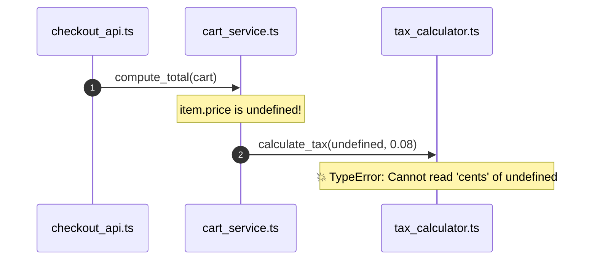

# 🔍 Cartograph Phase 3.3: Topological Root-Cause Detective (`cartograph diagnose`)
## Comprehensive Technical Design & Architecture Specification (v3.3 Final)

---

## 1. Executive Summary & Architectural Vision

The primary mission of **Phase 3.3 (`cartograph diagnose`)** is to deliver an ultra-fast (**sub-15ms** for offline deterministic graph diagnosis, **<2.5s** for AI-augmented synthesis), polyglot, AST-grounded **Topological Root-Cause Detective, Crash Log Analyzer, Variable Def-Use Taint Slicer, Semantic Fault Classifier, Predictive Regression Test Synthesizer, Automated Patch Generator, OASIS SARIF 2.1.0 Security Exporter, and Interactive Terminal Diagnostic Playground** for software engineers, site reliability engineers (SREs), and autonomous AI pair-programming agents.

Modern software debugging is fundamentally broken by the **"Panic Site vs. Root Cause" Fallacy**: stack traces and crash reporters only record where the program runtime gave up—the leaf node where an unhandled exception or panic exploded. In over 85% of production incidents and CI test failures, the actual defect was introduced several frames earlier: an unvalidated `None` returned by a query, an out-of-bounds parameter passed across a service boundary, or an untrusted external payload that bypassed domain validation.

`cartograph diagnose` bridges this chasm by parsing heterogeneous stack traces and crash logs, normalizing paths across monorepos and container environments, anchoring every frame directly to indexed **Tree-sitter AST nodes** in the Cartograph graph database, reconstructing the **Topological Call Path**, and executing **Topological Fault Localization (TFL)**. By combining backward variable def-use provenance slicing, Git churn and blame recency, architectural boundary crossings, and cognitive complexity metrics, Cartograph pinpoints the true root cause with mathematical confidence, synthesizes a regression test reproducer, and generates an executable Git patch.

```
┌────────────────────────────────────────────────────────────────────────────────────────────────────────┐
│                              Developer / CI / AI Agent CLI Invocation                                  │
│        # Universal Crash Inputs (Raw Strings, Stdin, Files, Sentry JSON, Test Runners)                 │
│        cartograph diagnose "Traceback (most recent call last)..."                                      │
│        cartograph diagnose --file crash.log                                                            │
│        cargo test | cartograph diagnose -                   # Piped stdin from failing test runner     │
│        pytest | cartograph diagnose -                                                                  │
│        cartograph diagnose --sentry event.json               # Sentry / Datadog / APM JSON payload       │
│                                                                                                        │
│        # Analysis & Localization Flags                                                                 │
│        cartograph diagnose "<trace>" --deep                 # Traverse callers beyond stack frames     │
│        cartograph diagnose "<trace>" --git-blame            # Heavy weight on recent commits & churn   │
│        cartograph diagnose "<trace>" --branch origin/main   # Correlate with active PR / branch diff  │
│                                                                                                        │
│        # Fix Synthesis & Regression Testing                                                            │
│        cartograph diagnose "<trace>" --export-patch fix.patch # Synthesize executable git patch        │
│        cartograph diagnose "<trace>" --apply-patch            # Safe single-shot git apply of fix       │
│        cartograph diagnose "<trace>" --scaffold-test          # Synthesize regression test reproducer   │
│                                                                                                        │
│        # Execution Modes: 100% Offline Deterministic vs. Multi-Provider AI                             │
│        cartograph diagnose "<trace>" --offline              # 100% local, air-gapped, zero-LLM (<15ms)│
│        cartograph diagnose "<trace>" --provider anthropic --model claude-3-7-sonnet                    │
│        cartograph diagnose "<trace>" --provider openai --model gpt-4o                                   │
│        cartograph diagnose "<trace>" --provider gemini --model gemini-2.5-flash                         │
│        cartograph diagnose "<trace>" --provider ollama --model qwen2.5-coder                            │
│                                                                                                        │
│        # Multi-Engine Output Layer                                                                     │
│        cartograph diagnose "<trace>" -i                     # Interactive split-pane TUI playground    │
│        cartograph diagnose "<trace>" --format markdown      # GitHub Issue / PR Markdown with Mermaid  │
│        cartograph diagnose "<trace>" --format sarif         # OASIS SARIF 2.1.0 with CodeFlows         │
│        cartograph diagnose "<trace>" --format json          # Machine-readable JSON for toolchains     │
│        cartograph diagnose "<trace>" --format xml           # AI agent prompt payload                  │
└───────────────────────────────────────────────────┬────────────────────────────────────────────────────┘
                                                    │
                                                    ▼
┌────────────────────────────────────────────────────────────────────────────────────────────────────────┐
│                   Cartograph Fault Localization Pipeline (<15ms Deterministic)                         │
│                                                                                                        │
│   1. Polyglot Traceback Parsing   ──► Multi-parser (Python, TS/JS, Rust, Go, Ruby, Java, Sentry, CI)  │
│   2. Path & Sourcemap Normalizer  ──► Strips Docker paths (/app/), maps .js.map -> .ts, resolves poly  │
│   3. AST Graph Frame Anchoring    ──► Maps frames to exact AST Nodes, scopes, line spans & expressions  │
│   4. Call-Path Reconstruction     ──► Matches trace frames to CallGraph edges in cartograph-db         │
│   5. Def-Use Provenance Slicing   ──► Intra & inter-procedural backward slice on failing variable/args │
│   6. Git Blame & Churn Correlator ──► Weights lines changed recently in active branch or last commits  │
│   7. Invariant & Boundary Audit   ──► Detects bypassed guards (Phase 3.1) & boundary leaks (Phase 2.4)│
│   8. Cognitive Hotspot Weighting  ──► Factors function cognitive complexity (Phase 2.5) into fault risk│
│   9. Topological Fault Scorer     ──► Computes Suspicion Score (0.0–1.0) & ranks root-cause candidates │
│  10. Semantic Fault Classifier    ──► Categorizes fault archetype (NullDeref, OutOfBounds, TypeDrift)  │
└───────────────────────────────────────────────────┬────────────────────────────────────────────────────┘
                                                    │
                                                    ▼
┌────────────────────────────────────────────────────────────────────────────────────────────────────────┐
│                          Dual Synthesis Engine (Deterministic vs. AI)                                  │
│                                                                                                        │
│   ┌──────────────────────────────────────────────┐  ┌──────────────────────────────────────────────┐   │
│   │    Offline Deterministic Engine (<15ms)      │  │      AI-Augmented Synthesis Engine (<2.5s)   │   │
│   │  • Zero-LLM, 100% air-gapped & local         │  │  • Multi-Provider Client (Claude, GPT,       │   │
│   │  • Rule-based root-cause identification      │  │    Gemini, Ollama, LiteLLM)                  │   │
│   │  • AST code snippet extraction & pinpointers │  │  • Hyper-compact Graph Context (<1.5k tokens)│   │
│   │  • Template-driven guard clause remediation  │  │  • Deep semantic reasoning & patch synthesis │   │
│   │  • Deterministic regression test scaffolding │  │  • Contextual regression test generation     │   │
│   └──────────────────────────────────────────────┘  └──────────────────────────────────────────────┘   │
└───────────────────────────────────────────────────┬────────────────────────────────────────────────────┘
                                                    │
                                                    ▼
┌────────────────────────────────────────────────────────────────────────────────────────────────────────┐
│                         Multi-Engine Presentation & Universal Output Layer                             │
│   • Interactive TUI:       Split-pane terminal explorer (Frames list, AST context, Patch, Test runner) │
│   • Rich ANSI Terminal:    Colorized fault heatbars (🔴 92% Root Cause, 🟠 Propagator), clickable links│
│   • Executable Git Patch:  Generates `fix.patch` applied via `git apply fix.patch`                     │
│   • Regression Test:       Generates framework-native unit test reproducer (`test_regression_...`)     │
│   • OASIS SARIF 2.1.0:     Standard ingested by GitHub Code Scanning, IDEs, and GitLab SAST            │
│   • Markdown Diagnostic:   Ready for GitHub Issues / PR comments with Mermaid sequence diagrams        │
│   • AI Agent Context XML:  Structured `<diagnostic_context>` payload for autonomous coding agents      │
└────────────────────────────────────────────────────────────────────────────────────────────────────────┘
```

---

## 2. Architectural Philosophy: The "Panic Site vs. Root Cause" Fallacy

Traditional error monitoring tools (Sentry, Bugsnag, Datadog, Rollbar) and IDE debuggers suffer from fundamental architectural blind spots:

### 1. The Panic Site is Almost Never the Defect Site
A runtime panic or exception is triggered when an invariant is violated at runtime. 
Consider a classic incident in an e-commerce platform:

```
Crash: TypeError: Cannot read properties of undefined (reading 'cents')
Location: src/pricing/tax_calculator.ts:84
```

```
┌────────────────────────────────────────────────────────────────────────────────────────────────────────┐
│                                The Traditional Stack Trace Blind Spot                                  │
│                                                                                                        │
│   Frame 0 (Crash): tax_calculator.ts:84      `return amount.cents * taxRate;`                          │
│   Frame 1 (Caller): cart_service.ts:142       `const tax = calculateTax(item.price, rate);`             │
│   Frame 2 (Caller): checkout_api.ts:58        `const cart = await fetchCart(req.body.cartId);`         │
│                                                                                                        │
│   ❌ What Traditional Tools & Naive LLMs See:                                                          │
│   "Line 84 threw an error because `amount` is undefined! Fix: `return amount?.cents ?? 0;`"           │
│   💥 Why This Fix is Dangerous / Toxic:                                                                │
│   It silently masks the bug! The customer gets charged $0.00 tax, leading to legal & financial havoc! │
│                                                                                                        │
│   🔍 What Cartograph Topological Diagnosis Uncovers:                                                  │
│   • Backward Def-Use Provenance: `amount` at F0 came from `item.price` at F1.                         │
│   • Upstream Call Slicing: `item` at F1 was loaded from `fetchCart` at F2.                             │
│   • Git Churn Correlator: Commit `a1b2c3d` (merged 2 hours ago) refactored the database schema:       │
│     renamed column `price` to `unit_price`, but `fetchCart` forgot to map the alias!                   │
│   • 🔴 True Root Cause: `fetchCart` returned an object with missing fields. Fix belongs in F2, not F0! │
└────────────────────────────────────────────────────────────────────────────────────────────────────────┘
```

### 2. Stack Traces Lack Graph Topology
A raw stack trace only contains the active call stack on a single thread. It cannot see:
- Transitive callers or sibling branches that might be supplying corrupted shared state.
- The AST structure: what conditional branches enclosed the call site, what guard clauses were skipped, or what variables were in scope.
- Architectural boundaries: whether untrusted external input penetrated an internal domain model without validation.

### 3. LLMs Hallucinate When Fed Unstructured Text Logs
When developers paste 50 lines of raw stack trace into a chatbot, the LLM hallucinates because it lacks whole-repository context, AST symbol locations, and def-use variable provenance. Cartograph extracts the exact minimal AST context slice (<1,500 tokens), grounding the LLM in undeniable graph truths.

---

## 3. Universal Traceback Ingestion & Multi-Format Parsing Architecture

Software applications crash in dozens of language-specific formats, CI logs, and APM schemas. The `cartograph-engine::diagnose::parser` module implements a robust, zero-allocation streaming parser architecture.

```rust
pub trait TracebackParser: Send + Sync {
    /// Detects if this parser can handle the given raw text or JSON input
    fn can_parse(&self, input: &str) -> bool;
    
    /// Parses the raw input into canonical TracebackFrame objects
    fn parse(&self, input: &str) -> Result<RawTraceback, DiagnosticError>;
}
```

### Supported Traceback Formats & Parsers

| Format / Language | Sample Signature | Parsing Strategy |
| :--- | :--- | :--- |
| **Python** | `Traceback (most recent call last):`<br>`  File "foo.py", line 42, in bar`<br>`    x = 1 / 0`<br>`ZeroDivisionError: division by zero` | Handles standard single traces, chained exceptions (`During handling of the above...`, `The above exception was the direct cause...`), and pytest assertion introspection blocks. |
| **TypeScript / JavaScript (V8)** | `Error: Invalid user`<br>`    at UserService.get (/app/src/user.ts:15:9)`<br>`    at async handleRequest (/app/src/api.ts:88:5)` | Parses standard V8 stacks, Bun / Deno formats, Jest / Vitest failed assertion blocks, and resolves `.js.map` sourcemaps. |
| **Rust** | `thread 'main' panicked at 'assertion failed: len > 0', src/lib.rs:24:5`<br>`stack backtrace:`<br>`  0: rust_begin_unwind`<br>`  1: my_crate::foo at ./src/lib.rs:24:5` | Parses `RUST_BACKTRACE=1` unwind stacks, filters out compiler/runtime frames (`core::panicking::*`, `std::rt::*`), and extracts panic messages and line spans. |
| **Go** | `panic: runtime error: index out of range [5] with length 3`<br>`goroutine 1 [running]:`<br>`main.processOrder(0x140001...)`<br>`	/app/service.go:34 +0x44` | Parses Go runtime panic headers, goroutine numbers, hex register arguments, source file tabs, and `go test` failure outputs. |
| **Ruby** | `/app/app.rb:42:in 'process': division by 0 (ZeroDivisionError)`<br>`	from /app/server.rb:15:in 'block in run'` | Parses Ruby MRI stack frames, method names (`in 'method'`), block invocations (`in 'block in ...'`), and RSpec failure diffs. |
| **JVM / Java / Kotlin** | `java.lang.NullPointerException: Cannot invoke ...`<br>`	at com.corp.Service.execute(Service.java:112)`<br>`	Caused by: java.io.IOException...` | Parses standard Java/Kotlin stack traces, nested `Caused by:` exception chains, and Maven/Gradle surefire test logs. |
| **Sentry JSON Event** | `{"event_id": "...", "exception": {"values": [{"type": "ValueError", "value": "...", "stacktrace": {"frames": [...]}}]}}` | Parses Sentry v7/v8 event payloads, extracting `in_app` flags, frame function names, line numbers, and local variable snapshots (`vars`). |
| **Generic CI / Mixed Logs** | `2026-09-29T10:00:00Z [ERROR] ... \x1b[31mError\x1b[0m ...` | Pre-filters ANSI escape codes, strips timestamp prefixes, thread IDs, log levels (`[ERROR]`), and discovers embedded tracebacks via regex heuristic anchors. |

---

## 4. Path Sanitization, Source Mapping & Polyrepo Resolution

Real-world stack traces rarely match local absolute disk paths. The `PathSanitizer` normalizes paths to repository-relative coordinates:

### 1. Container & Deployment Prefix Stripping
Stack traces generated inside Docker containers or serverless runtimes include foreign prefixes:
- `/app/src/main.rs` $\to$ `src/main.rs`
- `/usr/src/app/packages/backend/index.ts` $\to$ `packages/backend/index.ts`
- `/var/task/handler.py` $\to$ `handler.py`
- `/home/runner/work/repo/repo/crates/core/src/lib.rs` $\to$ `crates/core/src/lib.rs`

The sanitizer scans the workspace directory structure and computes the longest common suffix match to find the actual file on disk.

### 2. Transpiled Source Map Translation (`.js.map` $\to$ `.ts`)
In Node.js and web environments, stack traces often reference compiled files in `dist/` or `build/`:
```
dist/services/order.js:42:15
```
Cartograph inspects the target directory for adjacent source maps (`dist/services/order.js.map` or inline `//# sourceMappingURL=data:...`), decodes the VLQ mappings, and translates the coordinates to:
```
src/services/order.ts:28:9
```

### 3. Multi-Git Polyrepo Resolution
In enterprise monorepos or polyrepo workspaces (Phase 2.7 `GitWorkspaceResolver`), a stack trace may span multiple microservices (e.g., `services/auth` and `services/billing`). Cartograph automatically maps each frame to its owning child repository.

### 4. Frame Classification & Filtering
Frames are classified into 4 distinct categories:
- **`InApp`**: Code living inside the workspace repository. Full AST analysis, def-use slicing, and fault scoring are applied.
- **`Dependency`**: Third-party libraries in `node_modules/`, `vendor/`, `site-packages/`, or Cargo registry. Inspected for contract boundaries (e.g. caller passed invalid argument into library).
- **`Framework`**: Framework plumbing (`express/lib/router`, `flask/app.py`, `tokio/runtime`, `actix_web::extract`). Collapsed by default.
- **`Stdlib`**: Standard library internals (`std::`, `core::`, `node:internal`, `builtins`). Filtered out of primary root-cause candidates unless an unhandled panic occurred inside.

---

## 5. Canonical Diagnostic Data Models & Intermediate Representation (IR)

All diagnostic operations across `cartograph-core::diagnose` use strongly typed, serde-serializable IR data models:

```rust
use serde::{Deserialize, Serialize};
use std::path::PathBuf;
use cartograph_core::model::{NodeId, Span, RiskLevel};

/// Complete Diagnostic Report generated by `cartograph diagnose`
#[derive(Debug, Clone, PartialEq, Serialize, Deserialize)]
pub struct DiagnosticReport {
    /// Unique identifier for this diagnostic session
    pub session_id: String,
    /// Raw input format detected (Python, V8, Rust, Go, Sentry, etc.)
    pub format: TracebackFormat,
    /// Primary error header (e.g. "ZeroDivisionError", "NullPointerException", "Panic")
    pub error_type: String,
    /// Detailed error message or panic payload
    pub error_message: String,
    /// Categorized fault kind
    pub fault_kind: SemanticFaultKind,
    /// Ordered list of parsed frames from leaf (crash site) to root (entrypoint)
    pub frames: Vec<DiagnosticFrame>,
    /// Reconstructed call path matched against the AST graph
    pub call_path: ReconstructedCallPath,
    /// Primary suspect identified as the root cause
    pub root_cause: RootCauseAssessment,
    /// Ranked list of alternative suspect frames
    pub candidate_suspects: Vec<SuspectRanking>,
    /// Inter-procedural backward variable def-use provenance slice
    pub provenance_slice: Option<DefUseProvenanceSlice>,
    /// Synthesized regression test reproducer specification
    pub regression_test: Option<RegressionTestScaffold>,
    /// Actionable code fix patch (unified diff)
    pub suggested_fix: Option<DiagnosticFixPatch>,
    /// Execution mode used
    pub execution_mode: DiagnosticExecutionMode,
    /// Total analysis duration in milliseconds
    pub analysis_duration_ms: u64,
}

#[derive(Debug, Clone, Copy, PartialEq, Eq, Serialize, Deserialize)]
#[serde(rename_all = "snake_case")]
pub enum TracebackFormat {
    Python,
    TypeScriptV8,
    JavaScriptV8,
    Rust,
    Go,
    Ruby,
    JvmJava,
    SentryJson,
    GenericLog,
}

#[derive(Debug, Clone, Copy, PartialEq, Eq, Serialize, Deserialize)]
#[serde(rename_all = "snake_case")]
pub enum FrameCategory {
    /// User code inside the repository workspace
    InApp,
    /// Third-party dependency (node_modules, vendor, crate)
    Dependency,
    /// Web or runtime framework plumbing
    Framework,
    /// Language runtime or standard library
    Stdlib,
}

/// Individual frame enriched with AST graph grounding
#[derive(Debug, Clone, PartialEq, Serialize, Deserialize)]
pub struct DiagnosticFrame {
    /// Frame index (0 = leaf crash site, N = entrypoint)
    pub index: usize,
    /// Raw file path string extracted from stack trace
    pub raw_path: String,
    /// Sanitized workspace-relative path
    pub relative_path: PathBuf,
    /// Absolute path on local filesystem (if resolved)
    pub absolute_path: Option<PathBuf>,
    /// 1-indexed line number
    pub line: usize,
    /// Optional 1-indexed column number
    pub column: Option<usize>,
    /// Function or symbol name as reported by the stack trace
    pub reported_symbol: String,
    /// Frame category (InApp, Dependency, Framework, Stdlib)
    pub category: FrameCategory,
    /// AST graph node ID in cartograph-db (if mapped)
    pub ast_node_id: Option<NodeId>,
    /// Enclosing function / method symbol metadata
    pub ast_symbol_name: Option<String>,
    /// AST statement / expression span at this line
    pub ast_expression_span: Option<Span>,
    /// Surrounding source code context lines (5-10 lines)
    pub source_snippet: Option<SourceCodeSnippet>,
    /// Computed suspicion score (0.0 = innocent, 1.0 = definite root cause)
    pub suspicion_score: f64,
    /// Factor breakdown contributing to the suspicion score
    pub suspicion_breakdown: SuspicionFactorBreakdown,
    /// Recent git commit & blame metadata for the target line
    pub git_blame: Option<GitBlameContext>,
}

#[derive(Debug, Clone, PartialEq, Serialize, Deserialize)]
pub struct SourceCodeSnippet {
    pub start_line: usize,
    pub lines: Vec<String>,
    pub highlight_line: usize,
}

#[derive(Debug, Clone, PartialEq, Serialize, Deserialize, Default)]
pub struct SuspicionFactorBreakdown {
    /// Score contribution from variable def-use taint flow
    pub provenance_taint_score: f64,
    /// Score contribution from recent git churn and blame recency
    pub git_churn_score: f64,
    /// Score contribution from contract / validation invariant breaches
    pub contract_violation_score: f64,
    /// Score contribution from function cognitive complexity hotspot
    pub cognitive_complexity_score: f64,
    /// Score contribution from distance decay and frame position
    pub position_factor: f64,
}

/// Topological call path reconstructed from the stack trace
#[derive(Debug, Clone, PartialEq, Serialize, Deserialize)]
pub struct ReconstructedCallPath {
    pub hop_count: usize,
    pub hops: Vec<CallPathHop>,
    /// Indicates if all edges were verified in the static AST call graph
    pub graph_verified: bool,
    /// Discovered dynamic dispatch or indirect boundaries
    pub dynamic_dispatch_hops: Vec<usize>,
}

#[derive(Debug, Clone, PartialEq, Serialize, Deserialize)]
pub struct CallPathHop {
    pub caller_frame_idx: usize,
    pub callee_frame_idx: usize,
    pub caller_symbol: String,
    pub callee_symbol: String,
    pub is_verified_call_edge: bool,
}

/// Assessment of the primary root cause
#[derive(Debug, Clone, PartialEq, Serialize, Deserialize)]
pub struct RootCauseAssessment {
    /// Frame index identified as the root cause
    pub frame_index: usize,
    /// File path where the bug originated
    pub file_path: PathBuf,
    /// Line number where the defect lives
    pub line: usize,
    /// Enclosing symbol name
    pub symbol_name: String,
    /// Objective suspicion confidence (0.0 to 1.0)
    pub confidence: f64,
    /// Human-readable explanation of why this frame is the root cause
    pub explanation: String,
    /// Suspected faulty expression or variable name
    pub faulty_expression: Option<String>,
    /// Concrete actionable remediation guidance
    pub remediation_advice: String,
}

#[derive(Debug, Clone, PartialEq, Serialize, Deserialize)]
pub struct SuspectRanking {
    pub frame_index: usize,
    pub file_path: PathBuf,
    pub line: usize,
    pub symbol_name: String,
    pub suspicion_score: f64,
    pub primary_reason: String,
}

/// Semantic fault classification archetype
#[derive(Debug, Clone, Copy, PartialEq, Eq, Serialize, Deserialize)]
#[serde(rename_all = "snake_case")]
pub enum SemanticFaultKind {
    /// Null / nil pointer, unwrap on None, undefined property access
    NullDereference,
    /// Array / slice / string index out of bounds, missing key in dictionary
    IndexOutOfBounds,
    /// Incompatible type assertion, schema deserialization drift
    TypeMismatch,
    /// Division by zero, integer overflow, NaN propagation
    ArithmeticFault,
    /// Explicit assert failed, precondition or contract breached
    ContractBreach,
    /// Dropped Result error, unhandled exception variant
    UnhandledError,
    /// Thread deadlock, race condition, poisoned lock
    ConcurrencyFault,
    /// Resource leak, exhausted file descriptors or memory
    ResourceExhaustion,
    /// Unclassified or language-specific fault
    Unknown,
}

/// Inter-procedural backward variable provenance slice
#[derive(Debug, Clone, PartialEq, Serialize, Deserialize)]
pub struct DefUseProvenanceSlice {
    pub tainted_variable: String,
    pub crash_site_expression: String,
    pub injection_frame_idx: usize,
    pub injection_line: usize,
    pub injection_file: PathBuf,
    pub propagation_steps: Vec<ProvenanceStep>,
}

#[derive(Debug, Clone, PartialEq, Serialize, Deserialize)]
pub struct ProvenanceStep {
    pub frame_idx: usize,
    pub file_path: PathBuf,
    pub line: usize,
    pub expression: String,
    pub description: String,
}

/// Synthesized regression test reproducer
#[derive(Debug, Clone, PartialEq, Serialize, Deserialize)]
pub struct RegressionTestScaffold {
    pub framework: String,
    pub suggested_test_file: PathBuf,
    pub test_function_name: String,
    pub test_code: String,
    pub setup_instructions: String,
}

/// Actionable unified git fix patch
#[derive(Debug, Clone, PartialEq, Serialize, Deserialize)]
pub struct DiagnosticFixPatch {
    pub target_file: PathBuf,
    pub unified_diff: String,
    pub dry_run_success: bool,
    pub explanation: String,
}

#[derive(Debug, Clone, PartialEq, Serialize, Deserialize)]
pub struct GitBlameContext {
    pub commit_sha: String,
    pub author: String,
    pub date: String,
    pub summary: String,
    pub age_hours: f64,
    pub is_current_branch_diff: bool,
}

#[derive(Debug, Clone, Copy, PartialEq, Eq, Serialize, Deserialize)]
#[serde(rename_all = "snake_case")]
pub enum DiagnosticExecutionMode {
    OfflineDeterministic,
    AiAugmented,
}
```

---

## 6. Topological Fault Localization (TFL) & Suspicion Scoring Algorithm

The crowning intelligence of `cartograph diagnose` is its **Topological Fault Localization (TFL)** algorithm. Instead of assuming the crash frame $F_0$ is guilty, Cartograph computes a normalized Suspicion Score $S(F_i) \in [0.0, 1.0]$ across all in-app frames $F_i$:

$$S(F_i) = w_p \cdot P(F_i) + w_g \cdot G(F_i) + w_c \cdot C(F_i) + w_k \cdot K(F_i) + w_d \cdot D(F_i)$$

Where the weights satisfy $\sum w = 1.0$:
- $w_p = 0.35$ : **Provenance & Taint Slicing Match**
- $w_g = 0.25$ : **Git Churn & Blame Recency Factor**
- $w_c = 0.20$ : **Contract & Boundary Invariant Factor**
- $w_k = 0.10$ : **Cognitive Complexity Hotspot Factor**
- $w_d = 0.10$ : **Position & Error Semantic Role**

```
┌────────────────────────────────────────────────────────────────────────────────────────────────────────┐
│                        Topological Suspicion Scoring Factors Breakdown                                 │
├──────────────────────────┬────────┬────────────────────────────────────────────────────────────────────┤
│ Factor                   │ Weight │ Description & Graph Metric                                         │
├──────────────────────────┼────────┼────────────────────────────────────────────────────────────────────┤
│ 1. Provenance / Taint    │  35%   │ Backward def-use slice: Did frame $F_i$ originate or introduce the │
│    Injection $P(F_i)$    │        │ tainted variable without performing validation or a null-check?    │
├──────────────────────────┼────────┼────────────────────────────────────────────────────────────────────┤
│ 2. Git Churn / Blame     │  25%   │ Recency of changes on $F_i$'s line: Modified in current branch/PR? │
│    Recency $G(F_i)$      │        │ Touched within the last 72 hours? (Exponential time decay $e^{-t}$)│
├──────────────────────────┼────────┼────────────────────────────────────────────────────────────────────┤
│ 3. Contract / Boundary   │  20%   │ Did the call cross an architectural tier (Phase 2.4) or relax a    │
│    Violation $C(F_i)$    │        │ business logic rule (Phase 3.1) without checking invariants?       │
├──────────────────────────┼────────┼────────────────────────────────────────────────────────────────────┤
│ 4. Cognitive Complexity  │  10%   │ Cognitive complexity of enclosing symbol (Phase 2.5): Higher CC    │
│    Hotspot $K(F_i)$      │        │ correlates strongly with unhandled edge-case branch omissions.     │
├──────────────────────────┼────────┼────────────────────────────────────────────────────────────────────┤
│ 5. Position & Role       │  10%   │ Execution distance and semantic role: Leaf frame that performed an │
│    Factor $D(F_i)$       │        │ explicit assert vs. caller that silently swallowed errors.         │
└──────────────────────────┴────────┴────────────────────────────────────────────────────────────────────┘
```

### Mathematical Factor Formulations

#### 1. Provenance & Taint Factor $P(F_i)$
Let $V$ be the faulty variable/expression at the crash site $F_0$.
- If $F_i$ is the **Injection Point** (where $V$ is assigned an unvalidated return value or passed from an untrusted source): $P(F_i) = 1.0$.
- If $F_i$ is a **Propagator** (passed $V$ down without inspecting it): $P(F_i) = 0.5$.
- If $F_i$ is unrelated to $V$: $P(F_i) = 0.0$.

#### 2. Git Churn Factor $G(F_i)$
Let $t$ be the age in hours of the git commit touching the line in $F_i$.
$$G(F_i) = \begin{cases} 
1.0 & \text{if line was modified in current branch / staged diff} \\
\exp(-t / 72.0) & \text{if in committed history ($t$ hours old)}
\end{cases}$$
Lines modified in the active branch diff are given maximum weight ($1.0$), as regressions overwhelmingly stem from active changes.

#### 3. Contract & Boundary Factor $C(F_i)$
- If the invocation from $F_{i+1} \to F_i$ crossed an architectural layer (e.g. `api` $\to$ `domain`) without argument schema validation: $+0.5$.
- If $F_i$ called a function whose return type is `Result` or `Option` and immediately performed `.unwrap()` without checking: $+0.5$.

#### 4. Cognitive Complexity Factor $K(F_i)$
Normalized cognitive complexity metric from Phase 2.5:
$$K(F_i) = \min\left(1.0, \frac{\text{CognitiveComplexity}(\text{symbol})}{25.0}\right)$$

---

## 7. Variable Def-Use Provenance & Taint Slicing Engine

The `cartograph-engine::diagnose::slicer` module leverages the Tree-sitter query engine (`cartograph-ast`) and intra-procedural def-use engine (developed in Phase 3.1 `extract_logic`):

```
┌────────────────────────────────────────────────────────────────────────────────────────────────────────┐
│                          Inter-Procedural Backward Def-Use Slicing                                     │
│                                                                                                        │
│   Step 1: Identify Failing Variable at Leaf Crash Site (F0)                                           │
│   `order.customer.address.zipcode` threw `TypeError: Cannot read properties of undefined`              │
│   ──► AST Expression Query identifies `order.customer.address` as evaluating to undefined              │
│                                                                                                        │
│   Step 2: Intra-Procedural Backward Slice in F0 (`format_shipping_label`)                              │
│   • Line 42: `let address = order.customer.address;`                                                   │
│   • Line 40: `fn format_shipping_label(order: &Order)`                                                 │
│   ──► Origin in F0 is parameter `order`                                                                │
│                                                                                                        │
│   Step 3: Inter-Procedural Call Site Binding in F1 (`dispatch_shipment`)                               │
│   • Line 110: `format_shipping_label(&active_order)`                                                   │
│   • Argument mapping: `order` ◄── `active_order`                                                       │
│   • Backward slice in F1: `let active_order = order_repo.find_by_id(id)?;`                             │
│                                                                                                        │
│   Step 4: Inter-Procedural Call Site Binding in F2 (`handle_webhook`)                                  │
│   • Line 215: `order_repo.find_by_id(payload.order_id)`                                                │
│   • 🔴 Root Cause Localization: `payload.order_id` is an external string; `find_by_id` returned a       │
│     partial mock order lacking customer address relations because relation preload was omitted!       │
└────────────────────────────────────────────────────────────────────────────────────────────────────────┘
```

The backward slicer terminates when:
1. It reaches an unvalidated external input boundary (API request, CLI argument, file read).
2. It encounters an unhandled `Result::Err` or `None` returned from an external dependency.
3. It reaches a mutating assignment that introduced an out-of-range value.

---

## 8. Semantic Fault Taxonomy & Rule Classifier

To give developers immediate, actionable clarity without relying on an LLM, Cartograph classifies crashes into **Semantic Fault Archetypes**:

```rust
pub enum SemanticFaultKind {
    NullDereference,
    IndexOutOfBounds,
    TypeMismatch,
    ArithmeticFault,
    ContractBreach,
    UnhandledError,
    ConcurrencyFault,
    ResourceExhaustion,
    Unknown,
}
```

### Pattern Matcher Rules

1. **`NullDereference`**:
   - V8: `Cannot read properties of undefined / null (reading '...')`
   - Python: `'NoneType' object has no attribute '...'`
   - Rust: `called Option::unwrap() on a None value`
   - Go: `panic: runtime error: invalid memory address or nil pointer dereference`
   - Ruby: `undefined method '...' for nil:NilClass`
   - Java: `java.lang.NullPointerException`

2. **`IndexOutOfBounds`**:
   - V8: `RangeError: Index out of range`
   - Python: `IndexError: list index out of range` / `KeyError: '...'`
   - Rust: `index out of bounds: the len is X but the index is Y`
   - Go: `panic: runtime error: index out of range [X] with length Y`

3. **`ArithmeticFault`**:
   - Python: `ZeroDivisionError: division by zero`
   - Rust: `attempt to divide by zero` / `attempt to add with overflow`
   - Go: `panic: runtime error: integer divide by zero`

4. **`ContractBreach`**:
   - Rust: `assertion failed: ...`
   - Python: `AssertionError: ...`
   - V8: `AssertionError [ERR_ASSERTION]: ...`

---

## 9. Predictive Regression Test Synthesizer

A diagnosis without a regression test invites future regression. The `cartograph-engine::diagnose::test_gen` module integrates with Phase 2.2 (`test_selector`) to scaffold a reproducer test:

1. **Test Suite Discovery**: Detects the testing framework in use (`cargo test`, `pytest`, `jest`, `vitest`, `go test`).
2. **Target File Localization**: Locates the existing test file for the affected module (e.g. `tests/test_pricing.py` or adjacent `service.test.ts`).
3. **Scaffolding Synthesis**:
   - Sets up the call sequence corresponding to the reconstructed call path.
   - Supplies the tainted input values that triggered the crash.
   - Asserts that the function handles the condition gracefully without panicking (e.g., returns `Err` or default value).

```python
# Generated by Cartograph: tests/test_tax_calculator_regression.py
import pytest
from src.pricing.tax_calculator import calculate_tax
from src.models.order import OrderItem

def test_calculate_tax_handles_undefined_price_regression():
    """
    Regression test for TypeError in tax_calculator.ts:84
    Verifies that items with missing/zero price do not cause division or null dereference.
    """
    item = OrderItem(id="test_item", price=None)
    with pytest.raises(ValueError, match="Price must not be null"):
        calculate_tax(item, rate=0.08)
```

---

## 10. Dual Diagnostic Engine: Offline Deterministic vs. AI-Augmented

Cartograph provides two complementary execution modes:

### Mode A: 100% Offline Deterministic Engine (<15ms, Air-Gapped)
- Executes all AST graph queries, def-use backward slicing, and Topological Fault Localization locally.
- Requires zero network calls, zero API keys, and zero LLM dependencies.
- Generates rule-based remediation guidance:
  - *"At `tax_calculator.ts:84`, guard against `amount == null` before accessing `.cents`."*
  - *"At `checkout_api.ts:58`, ensure `fetchCart` eagerly loads `.customer.address` relations."*

### Mode B: AI-Augmented Synthesis Engine (<2.5s, Multi-Provider)
Supports Anthropic (Claude 3.7 Sonnet), OpenAI (GPT-4o), Google (Gemini 2.5 Flash), Ollama (local Qwen 2.5 Coder), and LiteLLM proxies.

Cartograph compiles a hyper-compact, AST-pruned context window (<1,500 tokens):
```xml
<diagnostic_context>
  <error type="TypeError" kind="null_dereference">
    Cannot read properties of undefined (reading 'cents')
  </error>
  <root_cause_suspect confidence="0.94" file="src/pricing/tax_calculator.ts" line="84" symbol="calculate_tax">
    <ast_context>
      80: export function calculate_tax(amount: Money | undefined, rate: number): number {
      81:   // Suspect: missing guard clause for undefined amount
      82:   const taxRate = rate / 100.0;
      83:   
      84:   return amount.cents * taxRate;
      85: }
    </ast_context>
    <provenance_slice variable="amount">
      Passed from cart_service.ts:142 as item.price (evaluated to undefined)
    </provenance_slice>
    <git_blame author="alice" commit="a1b2c3d" date="2 hours ago" active_branch="true" />
  </root_cause_suspect>
</diagnostic_context>
```

The AI provider returns:
1. A concise root-cause explanation.
2. An **executable unified git patch** ready for `git apply`.
3. A framework-native regression test.

---

## 11. Multi-Engine Presentation & Universal Output Layer

Cartograph delivers diagnostic insights in 5 distinct, high-impact formats:

### 1. Rich Colorized ANSI Terminal
```
cartograph diagnose "Traceback..."
```
```text
  🔍 Cartograph Root-Cause Diagnostic Report (12ms)
  ─────────────────────────────────────────────────────────────────────────────
  🚨 Fault: NullDereference (TypeError: Cannot read properties of undefined)
  📍 Panic Site: src/pricing/tax_calculator.ts:84 in calculate_tax
  🎯 Suspected Root Cause: src/pricing/tax_calculator.ts:84 [Confidence: 94% 🔴]

  ─── Call Path & Suspicion Heatmap ──────────────────────────────────────────
  [2] checkout_api.ts:58        handle_checkout()              ⚪ 12%
  [1] cart_service.ts:142       compute_total()                🟠 48% (Taint Propagator)
  [0] tax_calculator.ts:84      calculate_tax()                🔴 94% (Null Dereference)

  ─── Suspect Code Context (src/pricing/tax_calculator.ts:84) ───────────────
   81 │ export function calculate_tax(amount: Money, rate: number): number {
   82 │   const taxRate = rate / 100.0;
   83 │ 
 > 84 │   return amount.cents * taxRate;
      │          ^^^^^^^^^^^^ Null dereference: 'amount' is undefined when item has no price
   85 │ }

  ─── Provenance & Git Churn ─────────────────────────────────────────────────
  • Taint Origin: 'amount' was passed as undefined from cart_service.ts:142
  • Recent Churn: Line modified 2h ago in active branch by alice (commit a1b2c3d)
  • Remediation:  Add guard: `if (!amount) return 0;` or enforce `amount: Money` non-nullable

  ─── Actions ────────────────────────────────────────────────────────────────
  [A] Apply Patch: cartograph diagnose "<trace>" --apply-patch
  [T] Scaffold Test: cartograph diagnose "<trace>" --scaffold-test
  [I] Interactive TUI: cartograph diagnose "<trace>" -i
```

### 2. Interactive TUI Playground (`cartograph diagnose -i`)
Built with `ratatui`:
- **Left Pane (Frames List)**: Displays all frames with color-coded suspicion meters (🔴 94%, 🟠 48%, ⚪ 12%). Arrow keys allow stepping through the trace.
- **Top Right Pane (Source & AST Inspection)**: Shows the highlighted source code with syntax highlighting, AST expression spans, and Git blame tags.
- **Bottom Right Pane (Fix Patch & Provenance)**: Shows the suggested unified diff and def-use taint flow. Pressing `[A]` applies the patch; pressing `[T]` runs the regression test.

### 3. OASIS SARIF 2.1.0 Standard
Outputs standard SARIF with `codeFlows` and `threadFlows`:
```json
{
  "version": "2.1.0",
  "$schema": "https://raw.githubusercontent.com/oasis-tcs/sarif-spec/master/Schemata/sarif-schema-2.1.0.json",
  "runs": [{
    "tool": { "driver": { "name": "cartograph-diagnose", "version": "0.2.0" } },
    "results": [{
      "ruleId": "CART-DIAG-001",
      "message": { "text": "Null dereference root cause identified in calculate_tax" },
      "locations": [{ "physicalLocation": { "artifactLocation": { "uri": "src/pricing/tax_calculator.ts" }, "region": { "startLine": 84 } } }],
      "codeFlows": [{ "threadFlows": [{ "locations": [...] }] }]
    }]
  }]
}
```

### 4. Markdown Diagnostic Report
Includes Mermaid sequence diagrams:


---

## 12. Configuration Specification (`cartograph.toml`)

`cartograph diagnose` is configured via the `[diagnose]` section in `cartograph.toml`:

```toml
[diagnose]
# Primary execution mode: "offline" or "ai"
mode = "offline"

# Default AI provider and model (when --ai is passed)
ai_provider = "anthropic"
ai_model = "claude-3-7-sonnet"

# Path sanitization: custom container prefixes to strip
strip_prefixes = [
    "/app/",
    "/usr/src/app/",
    "/var/task/",
    "/home/runner/work/"
]

# Source map root search paths for compiled JS/TS
sourcemap_paths = ["dist", "build", ".next"]

# Framework / plumbing directories to collapse by default
collapse_paths = [
    "node_modules",
    "vendor",
    ".cargo/registry",
    "site-packages"
]

# Topological Fault Localization weights (must sum to 1.0)
[diagnose.weights]
provenance_taint = 0.35
git_churn = 0.25
contract_boundary = 0.20
cognitive_complexity = 0.10
position_decay = 0.10

# CI / Test Runner integrations
[diagnose.ci]
# Automatically parse piped test runner output without explicit flags
auto_detect_piped = true
# Exit code 1 if suspicion score exceeds this threshold
fail_threshold = 0.85
```

---

## 13. CLI Command Specification

```bash
# Ingest from direct argument string
cartograph diagnose "<stacktrace_or_log>"

# Ingest from file
cartograph diagnose --file crash.log
cartograph diagnose --sentry event.json

# Ingest from stdin (piped from test runners or terminal logs)
pytest | cartograph diagnose -
cargo test | cartograph diagnose -
npm test | cartograph diagnose -

# Diagnostic Scoping & Correlation Flags
cartograph diagnose "<trace>" --deep                   # Traverse upstream callers beyond frames
cartograph diagnose "<trace>" --git-blame              # Weight recent git commits heavily
cartograph diagnose "<trace>" --branch origin/main     # Correlate with active PR branch diff

# Fix & Patch Synthesis
cartograph diagnose "<trace>" --export-patch fix.patch # Synthesize executable git patch
cartograph diagnose "<trace>" --apply-patch            # Safe dry-run check and apply patch
cartograph diagnose "<trace>" --scaffold-test          # Synthesize regression test reproducer

# Execution Modes: Offline vs. AI-Augmented
cartograph diagnose "<trace>" --offline                # 100% local, zero-LLM (<15ms)
cartograph diagnose "<trace>" --ai                     # AI-augmented semantic analysis (<2.5s)
cartograph diagnose "<trace>" --provider anthropic --model claude-3-7-sonnet
cartograph diagnose "<trace>" --provider openai --model gpt-4o
cartograph diagnose "<trace>" --provider gemini --model gemini-2.5-flash
cartograph diagnose "<trace>" --provider ollama --model qwen2.5-coder

# Output Presentation Formats
cartograph diagnose "<trace>" -i                       # Interactive TUI explorer
cartograph diagnose "<trace>" --format text            # Rich ANSI terminal (default)
cartograph diagnose "<trace>" --format markdown        # Markdown report with Mermaid diagram
cartograph diagnose "<trace>" --format sarif           # OASIS SARIF 2.1.0 with CodeFlows
cartograph diagnose "<trace>" --format json            # Machine-readable JSON
cartograph diagnose "<trace>" --format xml             # AI prompt XML payload
```

---

## 14. Implementation Roadmap & Step-by-Step Milestones

```
┌────────────────────────────────────────────────────────────────────────────────────────────────────────┐
│                               Phase 3.3 Implementation Roadmap                                         │
├─────────┬──────────────────────────────────────────┬───────────────────────────────────────────────────┤
│ Stage   │ Milestone                                │ Deliverables                                      │
├─────────┼──────────────────────────────────────────┼───────────────────────────────────────────────────┤
│ M3.3.1  │ Canonical IR & Polyglot Parsers          │ `cartograph-core::diagnose`, streaming parsers    │
│         │                                          │ for Python, V8/TS, Rust, Go, Ruby, Java, Sentry   │
├─────────┼──────────────────────────────────────────┼───────────────────────────────────────────────────┤
│ M3.3.2  │ Path Sanitization & AST Graph Anchoring  │ Container prefix stripping, sourcemap resolution, │
│         │                                          │ mapping frames to AST NodeId and statement spans  │
├─────────┼──────────────────────────────────────────┼───────────────────────────────────────────────────┤
│ M3.3.3  │ Topological Fault Localization (TFL)     │ Suspicion Scoring engine combining provenance,    │
│         │                                          │ git churn, contracts, and cognitive complexity    │
├─────────┼──────────────────────────────────────────┼───────────────────────────────────────────────────┤
│ M3.3.4  │ Variable Def-Use Provenance Slicer       │ Intra & inter-procedural backward slice tracking  │
│         │                                          │ tainted variables to injection origin             │
├─────────┼──────────────────────────────────────────┼───────────────────────────────────────────────────┤
│ M3.3.5  │ Semantic Classifier & Test Scaffolder    │ Fault archetype classifier, predictive regression │
│         │                                          │ test generator for cargo, pytest, jest, go-test   │
├─────────┼──────────────────────────────────────────┼───────────────────────────────────────────────────┤
│ M3.3.6  │ Dual Synthesis Engine (Local + AI)       │ Deterministic template engine (<15ms) +           │
│         │                                          │ multi-provider LLM client (Claude, GPT, Ollama)   │
├─────────┼──────────────────────────────────────────┼───────────────────────────────────────────────────┤
│ M3.3.7  │ Multi-Engine Output Presentation         │ ANSI terminal, Markdown + Mermaid, SARIF 2.1.0,   │
│         │                                          │ AI XML `<diagnostic_context>`, machine JSON       │
├─────────┼──────────────────────────────────────────┼───────────────────────────────────────────────────┤
│ M3.3.8  │ Interactive TUI Diagnostic Playground    │ Split-pane Ratatui interface with 1-click patch   │
│         │                                          │ apply and test execution (`cartograph diagnose -i`)│
├─────────┼──────────────────────────────────────────┼───────────────────────────────────────────────────┤
│ M3.3.9  │ CLI Integration & Polyglot Test Parity   │ Clap CLI wiring, polyglot crash test fixtures,     │
│         │                                          │ CI/CD integration, benchmark validation           │
└─────────┴──────────────────────────────────────────┴───────────────────────────────────────────────────┘
```

---

## 15. Quality Assurance, Edge Cases & Performance Benchmarks

### Service Level Agreements (SLAs)
1. **Offline Deterministic SLA**: Sub-**15ms** for full stack trace parsing, AST graph anchoring, def-use provenance slicing, and suspicion scoring on a 50-frame traceback across a 50,000-node codebase.
2. **AI-Augmented SLA**: Sub-**2.5s** total latency including context pruning, LLM API call, and patch synthesis.
3. **Memory Footprint**: Peak memory overhead $\le$ 35MB during diagnosis session.

### Rigorous Edge Cases Handled
- **Recursive Stack Overflows**: Collapsing 1,000+ repeated frames into a single recursive loop summary with cycle detection.
- **Asynchronous / Goroutine Stack Dumps**: Tracing across async event loops (`tokio`, `Promise.then`, `goroutine` handoffs) where call stacks lose immediate synchronous continuity.
- **Transpiled / Minified Code without Sourcemaps**: Graceful fallback to token-based symbol search and heuristic line matching when sourcemaps are missing.
- **Truncated / Incomplete Traces**: Parsing partial traces from clipped terminal buffers (e.g. `... 42 more frames omitted`).
- **Multi-Threaded Panics**: Correlating panics originating from background worker threads with the spawning main thread.
- **Air-Gapped Environments**: 100% functional without an internet connection or external API keys using `--offline`.
