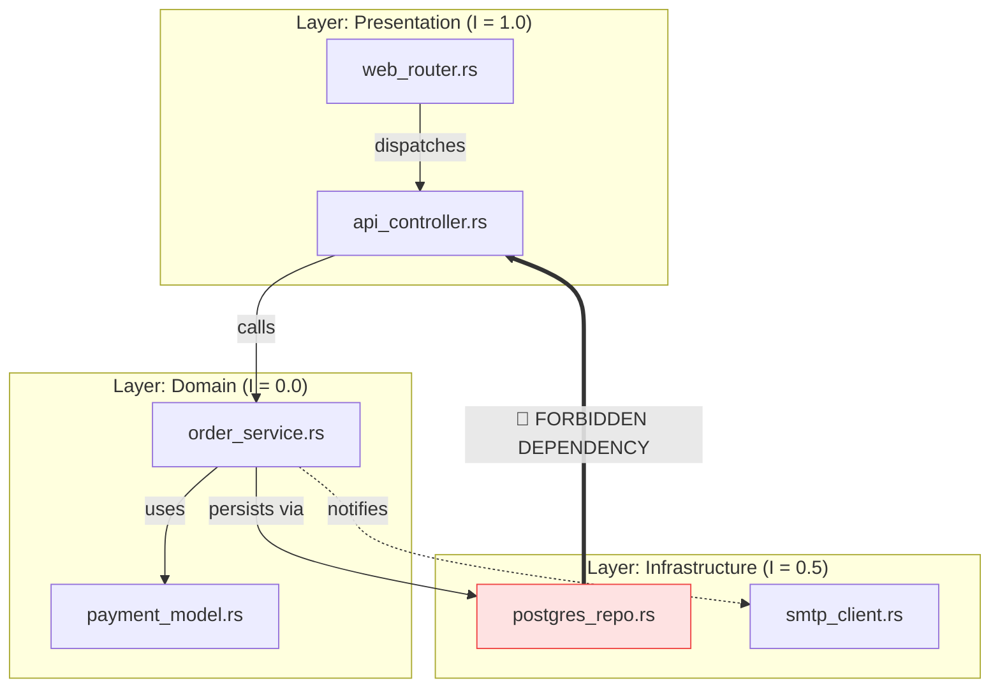
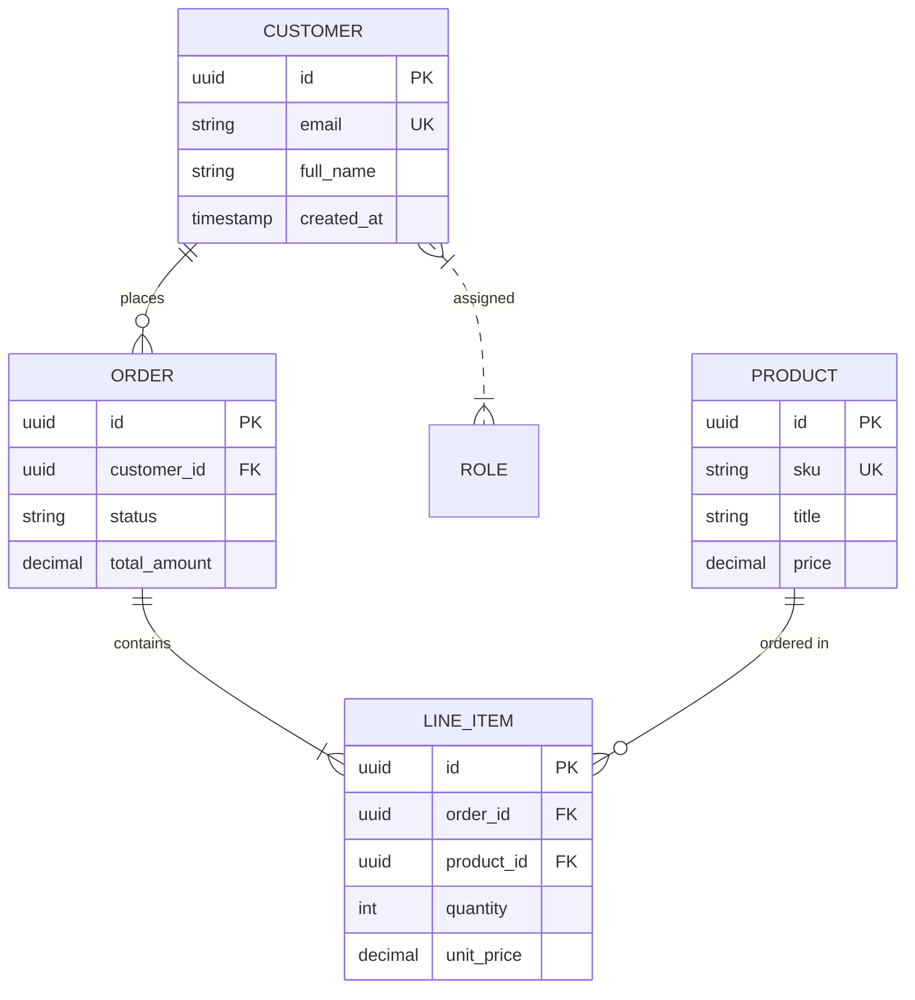
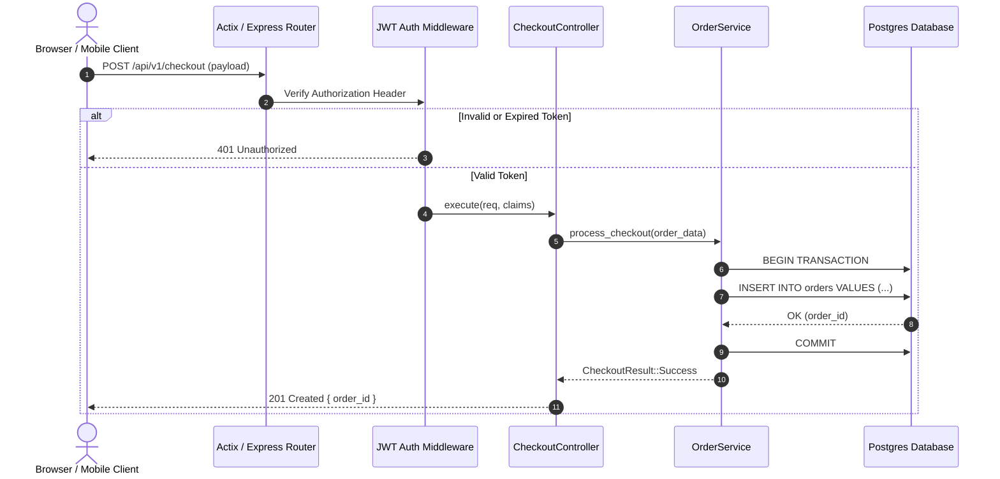
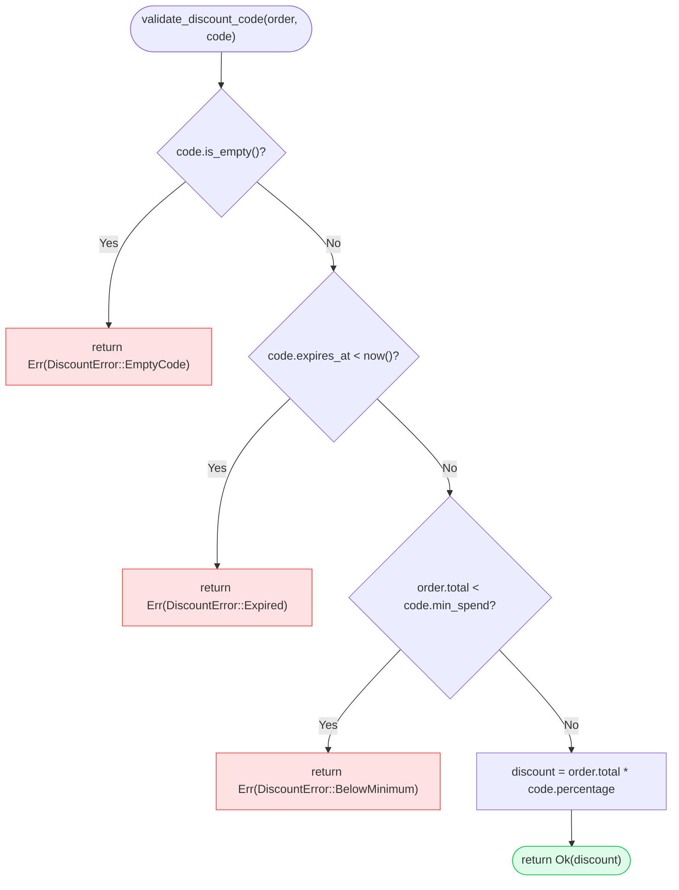
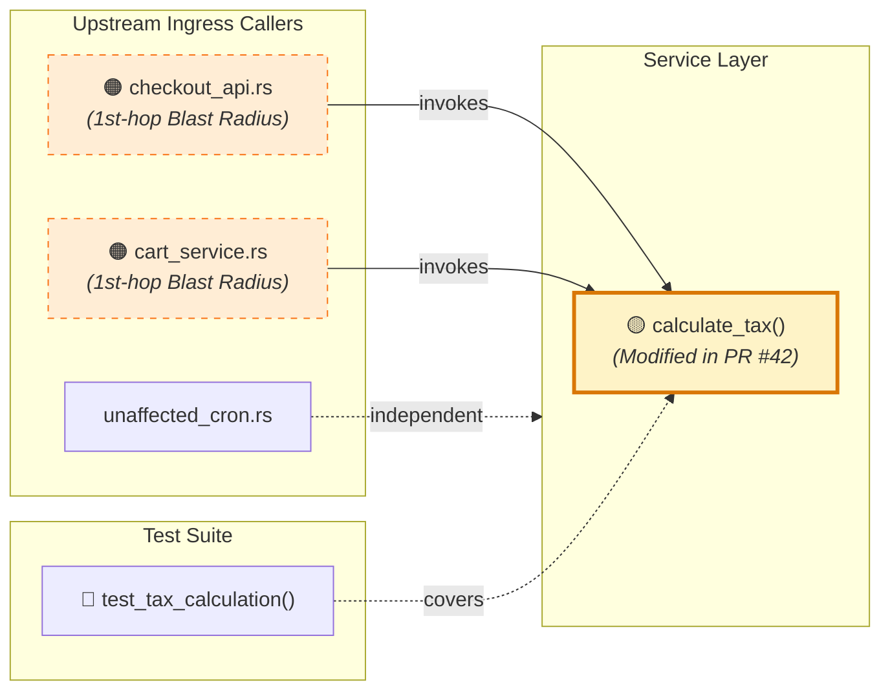
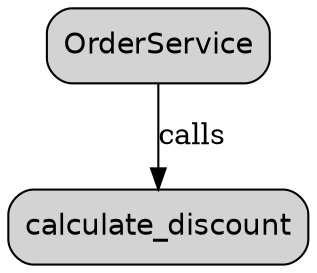

# 📊 Cartograph Phase 3.4: Visual Diagram Exporter (`cartograph diagram`)
## Comprehensive Technical Design & Architecture Specification (v3.4 Final)

---

## 1. Executive Summary & Architectural Vision

The primary mission of **Phase 3.4 (`cartograph diagram`)** is to deliver an ultra-fast (**sub-15ms** for graph extraction, layout, and rendering on codebases up to 50,000 nodes), polyglot, AST-grounded **Visual Diagram Exporter, Architectural Topology Visualizer, Interactive Terminal Canvas, Entity-Relationship (ER) Schema Synthesizer, Dynamic Call-Graph Navigator, Git PR Blast-Radius Diff Mapper, and Multi-Format Presentation Engine** for software engineers, systems architects, technical writers, and autonomous AI pair-programming agents.

Software systems are fundamentally non-linear networks of interacting abstractions: modules, classes, functions, routes, state stores, and database schemas. Yet developers and AI agents are forced to perceive codebases through linear, 1-dimensional streams of text files. While visual diagrams are essential for understanding architecture, onboarding developers, and reviewing pull requests, existing diagramming tools suffer from four crippling failures:
1. **Manual Drift**: Architecture diagrams hand-drawn in tools like Lucidchart, Miro, or Visio drift out of date within days of code merges.
2. **Spaghetti Ball Overload**: Naive automated tools dump thousands of raw AST nodes into a single unreadable visual ball of wool that crashes browser renderers.
3. **Heavy External Toolchain Dependencies**: Many CLI diagram tools require Node.js, Puppeteer, Chromium, Java (PlantUML), or Graphviz binaries to be pre-installed, making them unsuitable for lightweight CI runners, Docker containers, and terminal workflows.
4. **Lack of Semantic Code Graph Grounding**: Generic diagram generators lack semantic awareness—they cannot distinguish an architectural boundary crossing from an internal utility import, an API route from an internal helper, or a database foreign-key relation from a variable assignment.

`cartograph diagram` solves these challenges by combining Cartograph's indexed multi-language ASTs (`cartograph-ast`) and topological graph database (`cartograph-db`) with an intelligent **Topological Subgraph Extractor**, a pure-Rust **Hierarchical Layout Engine** (implementing the Sugiyama framework with zero external binaries), and a **Universal Multi-Format Presentation Layer** (Mermaid.js, pure vector SVG, interactive Ratatui TUI canvas, standalone HTML viewer, D2, PlantUML, Graphviz DOT, ANSI terminal trees, and AI Agent XML).

```
┌────────────────────────────────────────────────────────────────────────────────────────────────────────┐
│                              Developer / CI / AI Agent CLI Invocation                                  │
│        # Targeted Diagram Export (Auto-detects symbol kind or concept)                                 │
│        cartograph diagram "OrderService"                                                               │
│        cartograph diagram "calculate_discount" --type callgraph --depth 3                             │
│        cartograph diagram --type er                                     # Whole-system ER diagram      │
│        cartograph diagram "POST /api/v1/checkout" --type sequence       # Fullstack route trace        │
│        cartograph diagram "validate_payment" --type logic               # Decision flowchart           │
│        cartograph diagram --type architecture --collapse-modules        # Package/layer architecture   │
│                                                                                                        │
│        # Git PR Architecture Blast-Radius Visualizer                                                   │
│        cartograph diagram --type diff --branch origin/main              # PR architectural diff        │
│        cartograph diagram --type diff --staged                          # Pre-commit staged diff       │
│                                                                                                        │
│        # Scoping, Filtering & Topological Pruning Flags                                                │
│        cartograph diagram "Payment" --depth 2                           # Traversal depth radius       │
│        cartograph diagram "Order" --direction upstream                  # Callers only (or downstream) │
│        cartograph diagram "User" --max-nodes 35                         # Centrality-ranked node prune │
│        cartograph diagram "Auth" --focus "validate_token"               # Pinpoint focus center        │
│        cartograph diagram --concept "Billing"                           # DDD aggregate boundary       │
│                                                                                                        │
│        # Multi-Format Export Engines                                                                   │
│        cartograph diagram "OrderService" --format mermaid               # Mermaid.js (default)         │
│        cartograph diagram "OrderService" --format svg --out arch.svg    # Pure-Rust standalone SVG     │
│        cartograph diagram "OrderService" --format html --open           # Interactive browser viewer   │
│        cartograph diagram "OrderService" -i                             # Interactive Terminal Canvas  │
│        cartograph diagram "OrderService" --format text                  # Rich ANSI/Unicode ASCII tree │
│        cartograph diagram "OrderService" --format d2                    # D2 modern declarative syntax │
│        cartograph diagram "OrderService" --format plantuml              # PlantUML enterprise syntax   │
│        cartograph diagram "OrderService" --format dot                   # Graphviz DOT syntax          │
│        cartograph diagram "OrderService" --format xml                   # AI Agent spatial prompt XML  │
│        cartograph diagram "OrderService" --format json                  # Machine-readable graph IR    │
└───────────────────────────────────────────────────┬────────────────────────────────────────────────────┘
                                                    │
                                                    ▼
┌────────────────────────────────────────────────────────────────────────────────────────────────────────┐
│                  Cartograph Topological Subgraph Extraction Pipeline (<10ms)                           │
│                                                                                                        │
│   1. Symbol / Concept Resolver   ──► Fuzzy symbol match, endpoint route anchor, or DDD concept search  │
│   2. Directional BFS Traverser   ──► Upstream callers, downstream callees, or bidirectional expansion  │
│   3. Polyglot ER Schema Extractor──► Discovers ORM models, structs, fields, PK/FK, 1:1, 1:N, N:M links │
│   4. Module Hierarchy Clusterer  ──► Aggregates nodes into packages, crates, folders & boundary layers │
│   5. Arch & Cycle Annotator      ──► Annotates boundary violations (Phase 2.4) & circular cycle rings  │
│   6. Git Diff Impact Overlay     ──► Correlates with git diff (Phase 3.2); marks modified & hazards    │
│   7. Centrality-Based Pruner     ──► PageRank & degree pruning; eliminates low-relevance leaf clutter  │
│   8. Transitive Edge Reducer     ──► Prunes redundant transitives (A->B->C and A->C) for visual clarity│
└───────────────────────────────────────────────────┬────────────────────────────────────────────────────┘
                                                    │
                                                    ▼
┌────────────────────────────────────────────────────────────────────────────────────────────────────────┐
│                   Pure-Rust Hierarchical Layout Engine (Sugiyama Framework, <5ms)                      │
│                                                                                                        │
│   ┌──────────────────────────────────────────────┐  ┌──────────────────────────────────────────────┐   │
│   │ 1. Cycle Removal (Greedy FAS)                │  │ 2. Layer Assignment (Rank Assignment)        │   │
│   │    Reverses minimal back-edges to form a DAG │  │    Longest-path & network-simplex layering   │   │
│   ├──────────────────────────────────────────────┤  ├──────────────────────────────────────────────┤   │
│   │ 3. Crossing Reduction (Barycenter Sweep)     │  │ 4. Coordinate Assignment (Brandes-Köpf)      │   │
│   │    Layer-by-layer sweep minimizing crossings │  │    Aesthetic compact node placement & balance│   │
│   ├──────────────────────────────────────────────┴──┴──────────────────────────────────────────────┤   │
│   │ 5. Spline & Bézier Curve Routing: Calculates smooth cubic bezier curves avoiding node boxes     │   │
│   └────────────────────────────────────────────────────────────────────────────────────────────────┘   │
└───────────────────────────────────────────────────┬────────────────────────────────────────────────────┘
                                                    │
                                                    ▼
┌────────────────────────────────────────────────────────────────────────────────────────────────────────┐
│                        Universal Multi-Format Presentation & Export Layer                              │
│   • Mermaid.js:        Flowcharts (`TD`/`LR`), Sequence (`autonumber`), Class, ER (`erDiagram`)        │
│   • Pure-Rust SVG:     Zero-dependency standalone vector SVG with dark/light themes, tooltips, links   │
│   • Interactive TUI:   Ratatui 2D canvas with pan, zoom, node selection, inspector sidebar, jump-to-src│
│   • Standalone HTML:   Single-file zero-network HTML dashboard with pan-zoom and search (`--open`)     │
│   • ANSI / ASCII Tree: Terminal Unicode box-drawing visual flow with clickable OSC-8 file hyperlinks   │
│   • Ecosystem Formats: D2 language, PlantUML (`@startuml`), Graphviz DOT (`digraph`), JSON IR          │
│   • AI Agent Context:  Structured `<architecture_diagram>` XML payload with spatial coordinates        │
└────────────────────────────────────────────────────────────────────────────────────────────────────────┘
```

---

## 2. Architectural Philosophy: Visualizing Topology Without "Spaghetti" Overload

Codebases of non-trivial size suffer from extreme visual clutter when graphed naively. A graph with 500 nodes and 1,200 edges quickly turns into an unintelligible "hairball" or "spaghetti ball."

Cartograph enforces five foundational design principles for diagram generation:

### Principle 1: Cognitive Budgeting & The $7 \pm 2$ Rule
Human short-term working memory can track only $7 \pm 2$ distinct conceptual entities at once. A diagram containing 150 raw functions is cognitively useless. Cartograph enforces semantic **Hierarchical Clustering**:
- Nodes belonging to the same directory or package are enclosed within visual **Clusters / Subgraphs**.
- With `--collapse-modules`, internal helper nodes are collapsed into a single module summary box displaying internal symbol counts and external ingress/egress edges.

### Principle 2: Dynamic Centrality-Ranked Pruning
When a developer queries a symbol with a large blast radius (e.g., `cartograph diagram "User"`), Cartograph does not naively render all 2,000 transitively connected nodes. It computes the local subgraph's **Degree Centrality** and **Betweenness Centrality**:
$$C_D(v) = \text{deg}^+(v) + \text{deg}^-(v)$$
Nodes are ranked, and when the node count exceeds `--max-nodes` (default: 30), peripheral leaf nodes with $C_D(v) = 1$ and zero structural risk are aggregated into collapsible summary pills (e.g. `+ 14 leaf callers...`).

### Principle 3: Transitive Edge Reduction (Hasse Simplification)
In module and inheritance graphs, if module $A$ depends on module $B$ ($A \to B$), module $B$ depends on module $C$ ($B \to C$), and a developer also wrote an explicit import from $A$ to $C$ ($A \to C$), drawing both paths produces crossing lines and visual noise. Cartograph applies transitive reduction to architectural dependencies:
$$\text{If } \exists \text{ path } u \rightsquigarrow v \text{ of length } \ge 2, \text{ edge } (u, v) \text{ is visually de-emphasized or hidden in high-level views.}$$

### Principle 4: Zero External Dependencies
Developers and CI environments should **never** be blocked because Graphviz, Node.js, Chromium, Java, or Cairo is not installed. Cartograph ships with an entirely native, self-contained Rust layout engine and vector renderer. `cartograph diagram "Foo" --format svg` generates high-resolution, pixel-perfect, interactive vector graphics in **<10ms** with zero external binaries.

### Principle 5: Semantic Edge Encoding
Arrows in diagrams should carry rich semantic meaning rather than uniform black lines:
- **Synchronous Calls**: Solid lines (`──►`).
- **Asynchronous / Future / Coroutine Calls**: Dashed lines (`- - ►`).
- **Inheritance / Extends**: Solid lines with open triangle arrowheads (`──▷`).
- **Interface Realization / Implements**: Dashed lines with open triangle arrowheads (`- - ▷`).
- **Foreign Key / 1:N Relationship**: Cardinality crow's foot indicators (`||──|{`).
- **Architectural Boundary Violations**: Bold crimson lines with warning indicators (`══🚨══►`).
- **PR Modified / Impacted Flow**: Glowing amber / cyan lines representing diff blast paths.

---

## 3. The Seven Canonical Diagram Archetypes

`cartograph diagram` supports seven specialized diagram archetypes, each optimized for a specific engineering, documentation, or review scenario:

```
┌────────────────────────────────────────────────────────────────────────────────────────────────────────┐
│                                 The Seven Diagram Archetypes                                           │
├──────────────────────┬────────────────────────────────────────────┬────────────────────────────────────┤
│ Archetype            │ Invocation / Detection                     │ Primary Use Case                   │
├──────────────────────┼────────────────────────────────────────────┼────────────────────────────────────┤
│ 1. Architecture      │ `cartograph diagram --type architecture`   │ High-level module dependencies,    │
│    & Modules         │ `cartograph diagram <module_path>`         │ boundary layers, cycles, coupling  │
├──────────────────────┼────────────────────────────────────────────┼────────────────────────────────────┤
│ 2. Call Graph        │ `cartograph diagram <symbol> --type call`  │ Function call hierarchies,         │
│    & Control Flow    │ `cartograph diagram <function_name>`       │ upstream callers & downstream flow │
├──────────────────────┼────────────────────────────────────────────┼────────────────────────────────────┤
│ 3. Entity-           │ `cartograph diagram --type er`             │ Database schemas, ORM models,      │
│    Relationship (ER) │ `cartograph diagram <model> --type er`     │ PK/FK, 1:1, 1:N, N:M associations  │
├──────────────────────┼────────────────────────────────────────────┼────────────────────────────────────┤
│ 4. Fullstack Route   │ `cartograph diagram "<method> <path>"`     │ End-to-end request sequence: UI -> │
│    Sequence Trace    │ `cartograph diagram <route> --type seq`    │ Client -> Middleware -> DB Model   │
├──────────────────────┼────────────────────────────────────────────┼────────────────────────────────────┤
│ 5. Business Logic    │ `cartograph diagram <symbol> --type logic` │ Conditional decision diamonds,     │
│    & Decision Flow   │ `cartograph diagram <fn> --flowchart`      │ validation trees, rejection paths  │
├──────────────────────┼────────────────────────────────────────────┼────────────────────────────────────┤
│ 6. PR Architecture   │ `cartograph diagram --type diff --branch`  │ Pull request blast radius overlay, │
│    Impact Diff       │ `cartograph diagram --type diff --staged`  │ changed nodes & hazard call paths  │
├──────────────────────┼────────────────────────────────────────────┼────────────────────────────────────┤
│ 7. DDD Concept       │ `cartograph diagram --concept <entity>`    │ Domain aggregates, bounded         │
│    Aggregate Cluster │ `cartograph diagram --concept "Payment"`   │ contexts, domain entity clustering │
└──────────────────────┴────────────────────────────────────────────┴────────────────────────────────────┘
```

### Archetype 1: Module & Package Architecture Diagrams
Visualizes how packages, crates, directories, and architectural layers interact.
- **Subgraphs**: Files grouped into their parent directories or modules.
- **Coupling Metrics Overlay**: Afferent Coupling ($C_a$), Efferent Coupling ($C_e$), and Instability metric:
  $$I = \frac{C_e}{C_a + C_e}$$
- **Architectural Boundary Linter Integration (Phase 2.4)**: Detects forbidden cross-layer imports (e.g. `domain` importing `infrastructure`), rendering boundary-crossing edges in bold crimson (`fill:#fee2e2,stroke:#ef4444`).
- **Circular Cycle Rings**: Highlights recursive dependency cycles detected by Tarjan's SCC algorithm with circular dashed arrows and cycle cut recommendations.



### Archetype 2: Targeted Call Graphs & Execution Flow
Explores the execution topology surrounding a specific function or method.
- **Directional Exploration**:
  - `--direction upstream`: Shows callers leading into the function (inbound call hierarchy).
  - `--direction downstream`: Shows functions invoked by the function (outbound call hierarchy).
  - `--direction both` (default): Bidirectional radial expansion centered on target.
- **Async Execution Distinction**: Edges representing asynchronous invocations (`async fn`, `.await`, `tokio::spawn`, `Promise.then`, `go func()`) are rendered as dashed lines with an `async` badge.
- **Error Propagation**: Edges that propagate errors (`?` operator in Rust, `try/catch` re-throws, `if err != nil`) are colored in amber with error return tags.

### Archetype 3: Polyglot Entity-Relationship (ER) & Schema Diagrams
Extracts domain models, database schemas, and data structures across languages:
- **Rust**: `struct` with Serde attributes, Diesel / SeaORM entities.
- **TypeScript / JavaScript**: Prisma schemas, TypeORM `@Entity()`, Mongoose schemas, interfaces.
- **Python**: SQLAlchemy `Base`, Django `models.Model`, Pydantic `BaseModel`.
- **Go**: Structs with `gorm:`, `db:`, `json:` tags.
- **Ruby**: ActiveRecord `ApplicationRecord` classes.

Discovers relationships:
- **Primary Keys** (`PK`) and **Foreign Keys** (`FK`).
- **One-to-One (`1:1`)**: e.g., `User` has one `UserProfile`.
- **One-to-Many (`1:N`)**: e.g., `Customer` has many `Orders`.
- **Many-to-Many (`N:M`)**: e.g., `Student` has many `Courses` via `Enrollment`.



### Archetype 4: Fullstack End-to-End Route Sequence Diagrams
Traces the execution path of an API endpoint from user interface components down to database models, leveraging the **Fullstack Route Mapper (Phase 2.3)**.
- **Participants**: `Browser/Client` $\to$ `Router` $\to$ `Middlewares` $\to$ `Controller` $\to$ `Service` $\to$ `Database`.
- **Autonumbering**: Chronological numbering of requests and responses.
- **Failure Branches**: `alt / else` blocks showing validation errors, authentication failures, and successful completion.



### Archetype 5: Business Logic Decision Trees & Flowcharts
Translates complex procedural validation logic (extracted via **Phase 3.1 `extract_logic`**) into intuitive visual decision flowcharts.
- **Decision Diamonds**: Conditional statements (`if`, `match`, `switch`, ternary).
- **Green Pill / Box**: Valid business path.
- **Red Octagon / Pill**: Rejection, assertion panic, or validation error return.



### Archetype 6: Git PR Architectural Blast-Radius Impact Diagrams
Integrates directly with Git pull requests and branch diffs (`--branch origin/main` or `--staged`), overlaying architectural impact onto visual diagrams.
- **Node Coloring**:
  - 🟢 **Added Nodes**: Pure green background (`fill:#dcfce7,stroke:#16a34a`).
  - 🟡 **Modified Nodes**: Glowing amber background (`fill:#fef3c7,stroke:#d97706`).
  - 🔴 **Deleted Nodes**: Strikethrough text with light red background (`fill:#fee2e2,stroke:#dc2626`).
  - 🟠 **Blast-Radius Hazard (1st- & 2nd-Hop Callers)**: Dashed border with hazard alert badges.
- **PR Test Deficit Marker**: Nodes whose implementation changed without corresponding unit test updates (Phase 2.2) are marked with `🧪 Missing Test`.



### Archetype 7: DDD Concept & Aggregate Cluster Diagrams
Groups all components across the repository belonging to a unified business domain concept (`--concept "Billing"` or `--concept "Authentication"`).
- Uses semantic taxonomy and synonym expansion to discover relevant entities.
- Displays the **Aggregate Root**, enclosed entities, value objects, domain events, repository interfaces, and external service adapters.

---

## 4. Pure-Rust Hierarchical Layout Engine (Sugiyama Framework)

To generate standalone vector graphics (SVG, HTML, Terminal Canvas) with zero external binaries (no Graphviz `dot`), Cartograph implements a native, high-performance graph layout engine based on the **Sugiyama Framework** (Hierarchical Graph Drawing).

The engine runs in five distinct, mathematically rigorous phases:

```
┌────────────────────────────────────────────────────────────────────────────────────────────────────────┐
│                              Sugiyama Layout Pipeline (<5ms for 200 nodes)                             │
│                                                                                                        │
│   Input: Directed Graph G = (V, E)                                                                     │
│                                                                                                        │
│   Phase 1: Cycle Removal (Greedy Feedback Arc Set)                                                     │
│   ──► Finds minimal set of back-edges E_back whose reversal renders G a Directed Acyclic Graph (DAG)   │
│                                                                                                        │
│   Phase 2: Layer Assignment (Rank Assignment)                                                          │
│   ──► Assigns each node v in V to an integer layer L(v) such that for all (u, v) in E, L(u) < L(v)      │
│   ──► Inserts virtual dummy nodes for long-span edges crossing multiple layers (span > 1)              │
│                                                                                                        │
│   Phase 3: Crossing Reduction (Barycenter & Median Sweep)                                              │
│   ──► Permutes node orderings within each layer to minimize edge-crossing pairs                        │
│   ──► Alternates top-down and bottom-up passes until crossings stabilize                              │
│                                                                                                        │
│   Phase 4: Coordinate Assignment (Brandes-Köpf Algorithm)                                              │
│   ──► Assigns exact continuous (X, Y) coordinates to nodes and dummy vertices                          │
│   ──► Balances edge alignment, prevents edge overlap, respects node bounding dimensions               │
│                                                                                                        │
│   Phase 5: Spline & Bézier Curve Routing                                                               │
│   ──► Chains dummy nodes into smooth cubic Bézier splines (P0, P1, P2, P3)                             │
│   ──► Inverts reversed back-edges, drawing return loops with directional arrowheads                    │
└────────────────────────────────────────────────────────────────────────────────────────────────────────┘
```

### Phase 1: Cycle Removal (Greedy Feedback Arc Set)
Given a directed graph $G = (V, E)$ containing cycles (common in software recursion or circular dependencies), we find a minimal subset of edges $E_{\text{back}} \subset E$ such that reversing them produces a DAG:
$$G_{\text{dag}} = (V, (E \setminus E_{\text{back}}) \cup \{ (v, u) \mid (u, v) \in E_{\text{back}} \})$$

Cartograph uses Eades' greedy linear-time heuristic:
1. Maintain left and right sequences $S_1, S_2$.
2. Repeatedly remove source nodes (in-degree = 0) and append to $S_1$.
3. Repeatedly remove sink nodes (out-degree = 0) and prepend to $S_2$.
4. For remaining nodes, pick node $v$ maximizing $(\text{out-degree}(v) - \text{in-degree}(v))$ and append to $S_1$.
5. Final topological ordering is $S_1 \mathbin{\Vert} S_2$. Any edge $(u, v)$ where $\text{order}(u) > \text{order}(v)$ is marked as a back-edge and reversed for layout computation.

### Phase 2: Layer Assignment (Rank Assignment)
Assigns layer ranks $L(v) \in \mathbb{N}$ such that:
$$\forall (u, v) \in E_{\text{dag}}, \quad L(v) - L(u) \ge \delta_{\text{min}} \quad (\delta_{\text{min}} = 1)$$
Cartograph implements the **Network Simplex** algorithm to minimize total edge length:
$$\min \sum_{(u, v) \in E} w(u, v) \cdot (L(v) - L(u))$$
Subject to $L(v) - L(u) \ge 1$.
For any edge spanning multiple layers ($L(v) - L(u) > 1$), virtual dummy nodes are inserted at each intermediate layer to ensure every edge connects adjacent layers only.

### Phase 3: Crossing Reduction (Barycenter Sweep)
The number of edge crossings between adjacent layers $L_i$ and $L_{i+1}$ depends entirely on the relative ordering of nodes.
For each node $v \in L_{i+1}$, its barycenter $B(v)$ is the average position of its neighbors in $L_i$:
$$B(v) = \frac{1}{\text{deg}^-(v)} \sum_{u \in N^-(v)} \text{pos}(u)$$
Nodes in $L_{i+1}$ are sorted by $B(v)$. Ties are broken deterministically using symbol names.
The algorithm alternates between downward passes ($L_0 \to L_k$) and upward passes ($L_k \to L_0$) for 4 to 8 iterations until the crossing count stabilizes.

### Phase 4: Coordinate Assignment (Brandes-Köpf Algorithm)
To achieve visually appealing, balanced layouts where vertical edges remain straight, Cartograph implements Brandes and Köpf's fast horizontal coordinate assignment:
- Computes four extremal layouts: Upper-Left, Upper-Right, Lower-Left, Lower-Right.
- Aligns connected components with their root nodes.
- Combines the four layouts by taking the median $X$-coordinate for each node, ensuring symmetry and compactness.

### Phase 5: Bézier Curve Edge Routing
Edges routed through dummy nodes are converted into continuous cubic Bézier curves:
$$B(t) = (1-t)^3 P_0 + 3(1-t)^2 t P_1 + 3(1-t) t^2 P_2 + t^3 P_3, \quad t \in [0, 1]$$
- $P_0$: Origin node boundary connection point.
- $P_1, P_2$: Tangential control points offset perpendicular to the layer boundary.
- $P_3$: Target node boundary connection point with directional arrowhead.

---

## 5. Pure-Rust Native Standalone Vector SVG Renderer

The `cartograph-engine::diagram::renderers::svg` module generates standalone, standards-compliant SVG files.

### Design Features of Cartograph SVG
1. **Resolution Independence**: Infinite zoom clarity for print, presentations, and documentation.
2. **Modern Visual Aesthetics**:
   - Curated developer palette: Dark slate (`#0f172a`), deep indigo (`#1e1b4b`), soft zinc borders (`#3f3f46`), crisp text (`#f8fafc`).
   - Clean drop shadows (`filter="url(#drop-shadow)"`).
   - Distinctive iconography: ⚡ method, 📦 class, 🗄️ model, 🌐 route, 🧪 test.
   - Elegant rounded corners (`rx="8" ry="8"`).
3. **Interactive Features Embedded in SVG**:
   - **Clickable Hyperlinks**: Nodes are wrapped in `<a xlink:href="file:///path/to/file#L42">`, allowing developers to click a node in Chrome/Safari/Firefox to open the exact file and line in their IDE (VS Code, Cursor, JetBrains).
   - **Rich Hover Tooltips**: Embedded `<title>` elements display symbol signatures, docstrings, line counts, and cognitive complexity.
   - **Interactive CSS Hover States**: Embedded `<style>` with CSS hover animations:
     ```css
     .cartograph-node:hover {
       filter: drop-shadow(0 0 10px rgba(99, 102, 241, 0.6));
       cursor: pointer;
       transform: translateY(-2px);
       transition: all 0.15s ease-in-out;
     }
     ```
4. **Theme Switcher**: Standalone SVG includes embedded JavaScript allowing users to toggle between **Dark Mode** and **Light Mode** by clicking the sun/moon icon in the upper-right corner!

---

## 6. Multi-Model Mermaid.js Synthesizer

Mermaid.js is the de facto standard for markdown diagrams rendered natively by GitHub, GitLab, Notion, and Obsidian. Cartograph implements a robust, multi-model Mermaid generator.

### Robust Syntax Handling & Escaping Rules
Mermaid syntax is notorious for breaking when presented with standard programming symbols:
- **Generics**: `Result<T, E>` breaks Mermaid. Cartograph translates generics into tilde notation: `Result~T, E~`.
- **Special Characters**: Quotes, parentheses, semicolons, and brackets are escaped using HTML character entities or enclosed in standard quotes: `["execute(payload: &[u8])"]`.
- **Reserved Keywords**: Identifiers matching Mermaid keywords (`end`, `subgraph`, `graph`, `style`, `class`) are safely prefixed or aliased.

### Supported Mermaid Directives
1. `flowchart TD` / `flowchart LR` (with nested `subgraph` blocks and `classDef` styling).
2. `sequenceDiagram` (with `autonumber`, `participant` aliases, `box` groupings, and `alt`/`opt` decision blocks).
3. `erDiagram` (with entity attribute blocks and cardinality connectors: `||--o{`, `||--||`, `}|..|{`).
4. `classDiagram` (with member visibility markers `+`, `-`, `#`, parameter types, and inheritance arrows).

---

## 7. Interactive Terminal UI Canvas (`cartograph diagram -i`)

For rapid local exploration without leaving the terminal or opening a browser, Cartograph provides an interactive terminal UI built on **Ratatui Canvas**.

```
┌────────────────────────────────────────────────────────────────────────────────────────────────────────┐
│ Cartograph Diagram Explorer: OrderService (Call Graph - Depth 2)                     [?] Help  [q] Quit│
├─────────────────────────────────────────────────────────┬──────────────────────────────────────────────┤
│ ┌─────────────────────────────────────────────────────┐ │ 📋 Selected Node: calculate_discount        │
│ │                 [ CheckoutController ]              │ │ ───────────────────────────────────────────  │
│ │                           │                         │ │ Kind:        Method (pub fn)                 │
│ │                           ▼                         │ │ Location:    src/pricing/discount.rs:42-88   │
│ │                 [ OrderService::create ]            │ │ Signature:   fn(&Order) -> Result<f64, Err>  │
│ │                 ╱                   ╲               │ │ Complexity:  7 (Cognitive)                   │
│ │                ▼                     ▼              │ │ Blast Risk:  🟠 42 / 100                     │
│ │      ►[*calculate_discount*]     [ validate_items ] │ │ Invariants:  3 rules enforced                │
│ │          │            │                             │ │                                              │
│ │          ▼            ▼                             │ │ 🔗 Connections:                             │
│ │    [ PromoRepo ]  [ TaxTable ]                      │ │ • Upstream:   OrderService::create (calls)   │
│ │                                                     │ │ • Downstream: PromoRepo::find (calls)        │
│ │                                                     │ │               TaxTable::lookup (calls)       │
│ └─────────────────────────────────────────────────────┘ │                                              │
│ Zoom: 100%  Pan: (0, 0)  Nodes: 6  Edges: 5           │ │ ⚡ Actions:                                 │
│ [c] Calls [i] Imports [e] Extends [m] Models [t] Theme│ │ [Enter] Open in Editor    [M] Export Mermaid │
│ [/] Filter: "discount"                                │ │ [Space] Expand Children   [S] Export SVG     │
└─────────────────────────────────────────────────────────┴──────────────────────────────────────────────┘
```

### Interactive Keybindings
- **Pan**: Arrow keys or `h`, `j`, `k`, `l` (smooth 2D navigation across large diagrams).
- **Zoom**: `+` / `-` or `]` / `[` (scales canvas coordinates; detail toggles between symbol names $\to$ signatures $\to$ full attribute lists).
- **Node Selection**: `Tab` / `Shift-Tab` or mouse click to select and focus nodes.
- **Search & Filter**: `/` activates instantaneous fuzzy node search; matched nodes are highlighted.
- **Toggle Edge Kinds**:
  - `c`: Toggle call edges.
  - `i`: Toggle import/dependency edges.
  - `e`: Toggle extends/implements edges.
- **Code Jump**: Pressing `Enter` opens the selected symbol's source file at the exact line in your editor (`$EDITOR` or configured IDE).
- **Instant Export**:
  - `M`: Copies Mermaid markdown syntax to system clipboard.
  - `S`: Exports current view to `diagram.svg`.
  - `H`: Generates and opens interactive HTML in browser.

---

## 8. Data Model & Entity Relationship Discovery Engine

The `cartograph-engine::diagram::er` module extracts rich entity schemas across five programming languages without requiring a live database connection:

```rust
pub struct EntitySchema {
    pub name: String,
    pub filepath: String,
    pub fields: Vec<EntityField>,
    pub relations: Vec<EntityRelation>,
    pub metadata: HashMap<String, String>,
}

pub struct EntityField {
    pub name: String,
    pub raw_type: String,
    pub is_primary_key: bool,
    pub is_foreign_key: bool,
    pub is_nullable: bool,
    pub is_unique: bool,
    pub foreign_target: Option<String>,
}

pub enum RelationCardinality {
    OneToOne,      // 1:1 (||--||)
    OneToMany,     // 1:N (||--|{)
    ManyToOne,     // N:1 (}|--||)
    ManyToMany,    // N:M (}|--|{)
}
```

### Heuristic Polyglot Relation Mining
1. **Foreign Key Naming Conventions**: Recognizes `*_id`, `*Id`, `*_fk` fields and matches them to candidate entity models (e.g. `customer_id: Uuid` $\to$ `Customer.id`).
2. **Collection Type Recognition**: Detects 1:N relationships when field types are collections: `Vec<T>`, `List[T]`, `Array<T>`, `Set<T>`, `Relationship("Item")`.
3. **ORM Decorators & Attributes**:
   - Rust: `#[diesel(foreign_key = ...)]`, `#[sea_orm(belongs_to = ...)]`.
   - TypeScript: `@OneToMany(() => Order, o => o.user)`, `@ManyToOne()`.
   - Python: `relationship("Order", back_populates="customer")`, `models.ForeignKey("Customer")`.
   - Go: Struct tags `gorm:"foreignKey:CustomerID"`, `db:"customer_id"`.
   - Ruby: `has_many :orders`, `belongs_to :customer`.

---

## 9. Full Ecosystem Format Adapters

`cartograph diagram` provides native formatting adapters for the broader developer ecosystem:

### 1. D2 Declarative Diagramming (`--format d2`)
Modern, human-readable diagram syntax with built-in auto-layout:
```d2
direction: right

Presentation: {
  api_controller: "api_controller.rs"
}
Domain: {
  order_service: "order_service.rs"
}

Presentation.api_controller -> Domain.order_service: "calls"
```

### 2. Standalone HTML Interactive Viewer (`--format html` / `--open`)
Generates a self-contained, single-file HTML bundle (`diagram.html`):
- Embedded SVG with `svg-pan-zoom` touch and mousewheel support.
- Left-side collapsible search and node inspection tray.
- Minimap thumbnail in the bottom-right corner.
- Zero network requests: completely functional offline in air-gapped environments.

### 3. Graphviz DOT (`--format dot`)
For traditional Unix pipelines and rendering with `dot -Tpng -o arch.png`:


### 4. PlantUML (`--format plantuml`)
Standard `@startuml` and `@enduml` output for Confluence wikis and enterprise architecture teams.

### 5. AI Agent Structured XML (`--format xml`)
Designed specifically for LLMs and autonomous coding agents needing spatial and architectural topology context:
```xml
<architecture_diagram target="OrderService" depth="2" total_nodes="6">
  <node id="OrderService" kind="struct" file="src/order.rs" lines="45-120" role="focus">
    <callees>
      <call target="calculate_discount" edge="sync"/>
      <call target="PromoRepo::find" edge="async"/>
    </callees>
  </node>
  <node id="calculate_discount" kind="function" file="src/pricing.rs" lines="12-50"/>
</architecture_diagram>
```

---

## 10. Canonical Rust Data Structures & Traits

### `cartograph-core::diagram`

```rust
use serde::{Deserialize, Serialize};
use std::collections::HashMap;
use crate::model::{NodeKind, EdgeKind};

#[derive(Debug, Clone, Copy, PartialEq, Eq, Hash, Serialize, Deserialize)]
#[serde(rename_all = "snake_case")]
pub enum DiagramType {
    Architecture,
    CallGraph,
    EntityRelationship,
    Sequence,
    LogicFlow,
    DiffImpact,
    ConceptCluster,
}

#[derive(Debug, Clone, Copy, PartialEq, Eq, Hash, Serialize, Deserialize)]
#[serde(rename_all = "snake_case")]
pub enum DiagramFormat {
    Mermaid,
    Svg,
    Html,
    Text,
    D2,
    Dot,
    PlantUml,
    Json,
    Xml,
}

#[derive(Debug, Clone, Copy, PartialEq, Eq, Hash, Serialize, Deserialize)]
#[serde(rename_all = "snake_case")]
pub enum DiagramTheme {
    Dark,
    Light,
    HighContrast,
}

#[derive(Debug, Clone, Copy, PartialEq, Eq, Serialize, Deserialize)]
#[serde(rename_all = "snake_case")]
pub enum TraversalDirection {
    Upstream,
    Downstream,
    Both,
}

#[derive(Debug, Clone, PartialEq, Serialize, Deserialize)]
pub struct DiagramOptions {
    pub diagram_type: Option<DiagramType>,
    pub format: DiagramFormat,
    pub theme: DiagramTheme,
    pub depth: usize,
    pub direction: TraversalDirection,
    pub max_nodes: usize,
    pub collapse_modules: bool,
    pub include_tests: bool,
    pub focus_symbol: Option<String>,
    pub concept: Option<String>,
    pub branch: Option<String>,
    pub staged: bool,
    pub out_path: Option<String>,
}

#[derive(Debug, Clone, PartialEq, Serialize, Deserialize)]
pub struct DiagramNode {
    pub id: String,
    pub label: String,
    pub subtitle: Option<String>,
    pub kind: NodeKind,
    pub filepath: String,
    pub line_span: (u32, u32),
    pub cluster_id: Option<String>,
    pub attributes: Vec<DiagramAttribute>,
    pub metrics: DiagramNodeMetrics,
    pub diff_status: Option<DiagramDiffStatus>,
    pub layout: LayoutBox,
}

#[derive(Debug, Clone, PartialEq, Serialize, Deserialize)]
pub struct DiagramAttribute {
    pub name: String,
    pub data_type: String,
    pub is_pk: bool,
    pub is_fk: bool,
    pub is_nullable: bool,
}

#[derive(Debug, Clone, PartialEq, Default, Serialize, Deserialize)]
pub struct DiagramNodeMetrics {
    pub cognitive_complexity: u32,
    pub blast_risk_score: u32,
    pub afferent_coupling: usize,
    pub efferent_coupling: usize,
}

#[derive(Debug, Clone, Copy, PartialEq, Eq, Serialize, Deserialize)]
#[serde(rename_all = "snake_case")]
pub enum DiagramDiffStatus {
    Added,
    Modified,
    Deleted,
    BlastRadiusHazard,
}

#[derive(Debug, Clone, PartialEq, Serialize, Deserialize)]
pub struct DiagramEdge {
    pub source_id: String,
    pub target_id: String,
    pub kind: EdgeKind,
    pub label: Option<String>,
    pub style: DiagramEdgeStyle,
    pub is_cycle_cut: bool,
    pub waypoints: Vec<Point2D>,
}

#[derive(Debug, Clone, Copy, PartialEq, Eq, Serialize, Deserialize)]
#[serde(rename_all = "snake_case")]
pub enum DiagramEdgeStyle {
    Solid,
    Dashed,
    Dotted,
    BoldWarning,
}

#[derive(Debug, Clone, PartialEq, Serialize, Deserialize)]
pub struct DiagramCluster {
    pub id: String,
    pub label: String,
    pub parent_cluster_id: Option<String>,
    pub bounds: LayoutBox,
}

#[derive(Debug, Clone, PartialEq, Default, Serialize, Deserialize)]
pub struct LayoutBox {
    pub x: f64,
    pub y: f64,
    pub width: f64,
    pub height: f64,
}

#[derive(Debug, Clone, Copy, PartialEq, Default, Serialize, Deserialize)]
pub struct Point2D {
    pub x: f64,
    pub y: f64,
}

#[derive(Debug, Clone, PartialEq, Serialize, Deserialize)]
pub struct DiagramGraph {
    pub title: String,
    pub diagram_type: DiagramType,
    pub nodes: Vec<DiagramNode>,
    pub edges: Vec<DiagramEdge>,
    pub clusters: Vec<DiagramCluster>,
    pub total_unpruned_nodes: usize,
    pub metadata: HashMap<String, serde_json::Value>,
}
```

---

## 11. Configuration Schema (`cartograph.toml`)

```toml
[diagram]
# Default export format when --format is omitted: mermaid | svg | html | text | d2 | dot | plantuml
default_format = "mermaid"

# Default visual theme: dark | light | high_contrast
default_theme = "dark"

# Default BFS traversal depth
default_depth = 2

# Maximum number of nodes before centrality-ranked pruning engages
max_nodes = 35

# Automatically collapse internal module nodes into package summary boxes
collapse_modules = true

# Include unit and integration test files in diagrams
include_tests = false

# Exclude standard library and vendor dependencies
include_stdlib = false

# SVG specific visual options
[diagram.svg]
font_family = "Inter, ui-sans-serif, system-ui, -apple-system, BlinkMacSystemFont, 'Segoe UI', Roboto, sans-serif"
dark_bg = "#0f172a"
dark_node_bg = "#1e293b"
dark_border = "#334155"
dark_text = "#f8fafc"
light_bg = "#ffffff"
light_node_bg = "#f8fafc"
light_border = "#e2e8f0"
light_text = "#0f172a"
```

---

## 12. CLI Command Specification

```bash
# 1. Targeted Diagram Generation (Auto-detects symbol kind)
cartograph diagram "OrderService"
cartograph diagram "OrderService" --format svg --out architecture.svg
cartograph diagram "OrderService" --format html --open

# 2. Explicit Diagram Types
cartograph diagram --type architecture               # Whole-project module architecture
cartograph diagram --type callgraph "process_order"  # Call hierarchy & execution flow
cartograph diagram --type er                         # Polyglot Entity-Relationship diagram
cartograph diagram "POST /api/v1/orders" --type seq  # Fullstack route trace sequence
cartograph diagram "validate_discount" --type logic  # Business logic decision flowchart
cartograph diagram --type diff --branch origin/main  # PR architectural impact diff
cartograph diagram --concept "Payment"               # DDD concept aggregate cluster

# 3. Scoping, Direction & Pruning
cartograph diagram "calculate_tax" --depth 3         # 3-hop traversal radius
cartograph diagram "calculate_tax" --direction upstream # Callers leading into symbol
cartograph diagram "calculate_tax" --direction downstream # Callees invoked by symbol
cartograph diagram "User" --max-nodes 25             # Restrict visual complexity
cartograph diagram "Order" --collapse-modules        # Group into package boundary boxes
cartograph diagram "Order" --include-tests           # Include test suites in graph

# 4. Interactive Terminal Explorer
cartograph diagram "OrderService" -i                 # Fullscreen 2D Ratatui canvas

# 5. Multi-Engine Presentation Formats
cartograph diagram "OrderService" --format mermaid   # Mermaid.js (default)
cartograph diagram "OrderService" --format svg       # Standalone pure-Rust vector SVG
cartograph diagram "OrderService" --format html      # Interactive web dashboard
cartograph diagram "OrderService" --format text      # Terminal ANSI/Unicode ASCII tree
cartograph diagram "OrderService" --format d2        # D2 modern declarative syntax
cartograph diagram "OrderService" --format dot       # Graphviz DOT
cartograph diagram "OrderService" --format plantuml  # PlantUML enterprise syntax
cartograph diagram "OrderService" --format xml       # AI agent spatial prompt context
cartograph diagram "OrderService" --format json      # Machine-readable graph coordinates IR
```

---

## 13. Implementation Roadmap & Step-by-Step Milestones

```
┌────────────────────────────────────────────────────────────────────────────────────────────────────────┐
│                               Phase 3.4 Implementation Roadmap                                         │
├─────────┬──────────────────────────────────────────┬───────────────────────────────────────────────────┤
│ Stage   │ Milestone                                │ Deliverables                                      │
├─────────┼──────────────────────────────────────────┼───────────────────────────────────────────────────┤
│ M3.4.1  │ Canonical IR & Core Domain Models        │ `cartograph-core::diagram`, `DiagramGraph`,        │
│         │                                          │ `DiagramNode`, `DiagramEdge`, `DiagramOptions`    │
├─────────┼──────────────────────────────────────────┼───────────────────────────────────────────────────┤
│ M3.4.2  │ Topological Graph Extractors             │ `CallGraphExtractor`, `ArchitectureExtractor`,    │
│         │                                          │ BFS traversers, Centrality Pruner, Transitive Red │
├─────────┼──────────────────────────────────────────┼───────────────────────────────────────────────────┤
│ M3.4.3  │ Polyglot Entity-Relationship Extractor   │ `EntityRelationshipExtractor` across Rust, TS,     │
│         │                                          │ Python, Go, Ruby; PK/FK & Cardinality Miner       │
├─────────┼──────────────────────────────────────────┼───────────────────────────────────────────────────┤
│ M3.4.4  │ Pure-Rust Sugiyama Layout Engine         │ Cycle removal, layer assignment, crossing         │
│         │                                          │ reduction (barycenter sweep), Brandes-Köpf layout │
├─────────┼──────────────────────────────────────────┼───────────────────────────────────────────────────┤
│ M3.4.5  │ Standalone Pure-Rust SVG Vector Renderer │ High-res vector generator, dark/light themes,     │
│         │                                          │ clickable hyperlinks, interactive CSS tooltips    │
├─────────┼──────────────────────────────────────────┼───────────────────────────────────────────────────┤
│ M3.4.6  │ Multi-Model Mermaid.js Synthesizer       │ Flowchart TD/LR, Sequence, ER, Class generators,  │
│         │                                          │ safe symbol escaping, subgraphs & styling classes │
├─────────┼──────────────────────────────────────────┼───────────────────────────────────────────────────┤
│ M3.4.7  │ Ecosystem Exporters                      │ Standalone HTML with pan-zoom (`--open`), D2,     │
│         │                                          │ PlantUML, Graphviz DOT, ANSI tree, AI Agent XML   │
├─────────┼──────────────────────────────────────────┼───────────────────────────────────────────────────┤
│ M3.4.8  │ Interactive Terminal UI Canvas           │ Ratatui 2D canvas (`cartograph diagram -i`),      │
│         │                                          │ pan/zoom, node inspector, search, jump-to-editor  │
├─────────┼──────────────────────────────────────────┼───────────────────────────────────────────────────┤
│ M3.4.9  │ CLI Integration & Polyglot Test Parity   │ Clap command wiring, unit & snapshot tests,       │
│         │                                          │ polyglot test fixtures, benchmarks & docs update  │
└─────────┴──────────────────────────────────────────┴───────────────────────────────────────────────────┘
```

---

## 14. Quality Assurance, Edge Cases & Performance Benchmarks

### Service Level Agreements (SLAs)
1. **Extraction & Pruning Latency**: Sub-**10ms** to extract and prune a 100-node subgraph from an indexed repository of 50,000 nodes.
2. **Layout & SVG Rendering Latency**: Sub-**5ms** for Sugiyama layout coordinate assignment and SVG string generation on graphs up to 100 nodes.
3. **Total CLI Execution Time**: Sub-**20ms** end-to-end command execution (`cartograph diagram "Symbol" --format svg`).
4. **Memory Overhead**: Peak heap allocation under **30MB** during full graph extraction and rendering.

### Rigorous Edge Cases Handled
- **Recursive & Mutually Recursive Cycles**: Detected and resolved via Greedy Feedback Arc Set; rendered cleanly as return loops without infinite recursion.
- **Disconnected Subgraphs & Isolated Islands**: Handled gracefully by partitioning disconnected components into distinct visual columns.
- **Extreme Fan-In / Fan-Out Hubs**: Utility functions (e.g. `logger.info`, `unwrap`, `clone`) with hundreds of call edges are intelligently pruned or marked as ubiquitous dependencies to prevent graph explosion.
- **Special Characters in Symbol Names**: Operator overloads (`operator+=`), generic brackets (`<T, U>`), lambdas (`closure#1`), and path separators (`::`, `/`) are sanitized across all export formats.
- **Air-Gapped / Headless Environments**: 100% operational with zero internet connection, zero graphical displays, and zero external packages installed.
